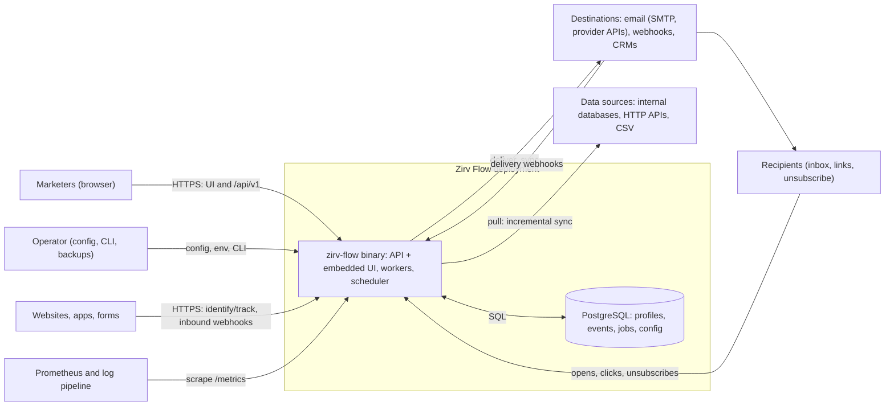
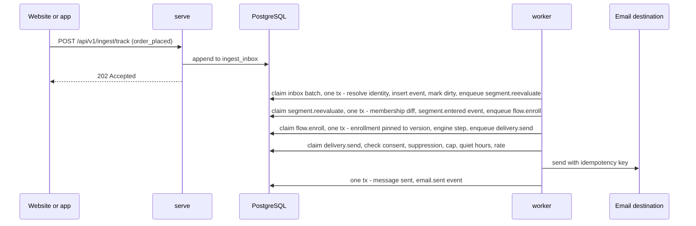
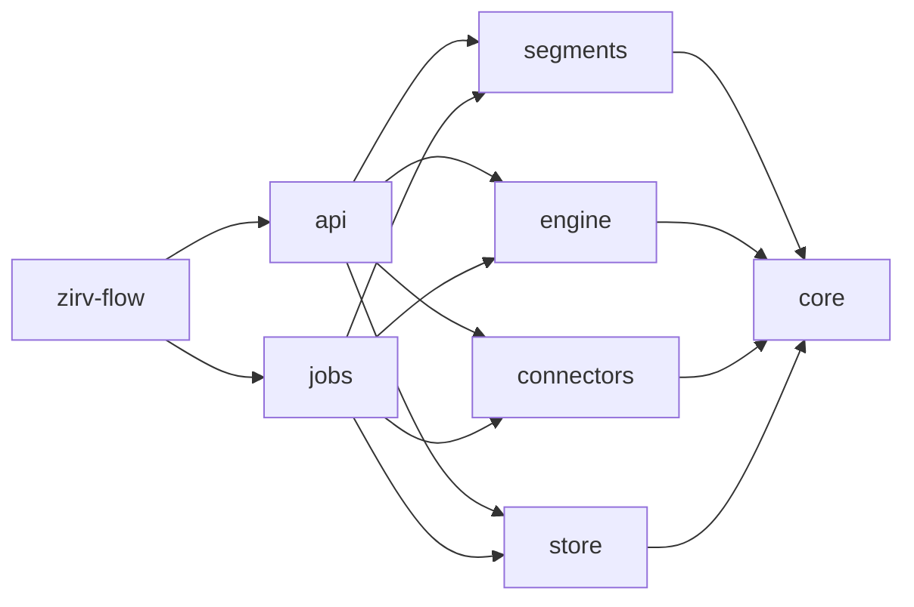
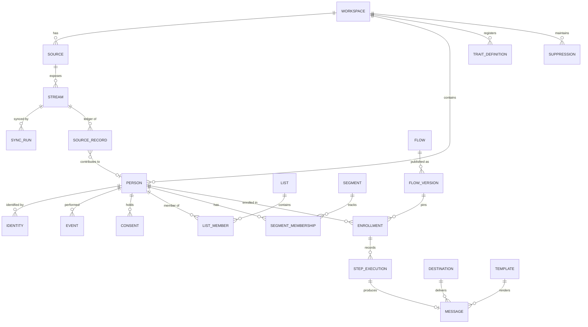
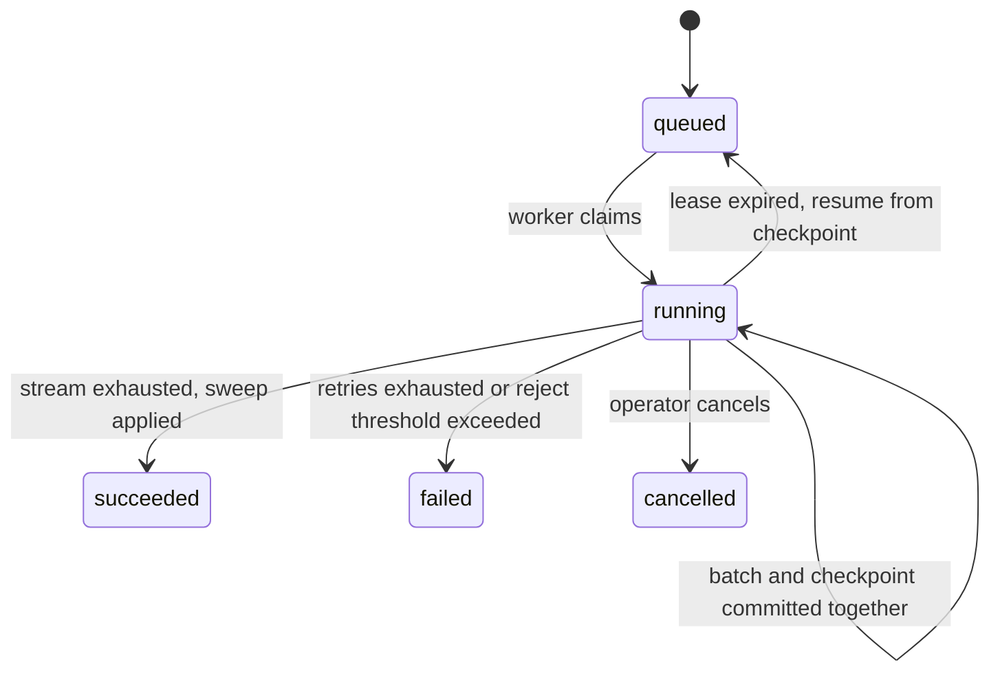

# Zirv Flow architecture

Living document: the intended system and the decisions behind it. Change it
through pull requests. Decisions (section 17) are never rewritten in place; a
changed decision gets a new superseding entry, linked both ways. Anything not
yet decided is an open question (section 18). Delivery order: [roadmap.md](roadmap.md).

## 1. Purpose and scope

Zirv Flow (`Glubiz/zirv-flow`, MIT) is a self-hosted marketing automation tool:
one Rust binary, `zirv-flow`, plus PostgreSQL. Marketers connect internal and
external data sources, segment the people in their business from that data,
and run automation flows for everyone or for a segment. It targets the problems
marketers hit before any message is sent: data about one person spread across
systems that disagree; segments nobody can explain or date; integrations that
drop, duplicate or never delete records; consent and erasure handled elsewhere.

### 1.1 Goals for v1.0

| ID | Goal |
|----|------|
| G1 | Connect data: built-in database sources, declarative HTTP sources, CSV import, identify/track API, inbound webhooks. Syncs are incremental, idempotent and deletion-aware, with per-source freshness visible. |
| G2 | One profile per person: deterministic identity resolution, typed traits with per-trait source precedence, events, lists, consent, suppression. |
| G3 | Segments marketers can trust: visual builder, live counts, per-person explanation, visible data age, entry/exit events. |
| G4 | Durable, versioned, testable flows triggered by segment changes, events, schedules, manual starts or the API. |
| G5 | Compliant delivery: email and webhooks first; consent, suppression, frequency caps, quiet hours and rate limits enforced in core; delivery and engagement fed back as events. |
| G6 | Operable by a small team: binary + Postgres, compose quickstart, metrics, health checks, documented backup/restore/upgrade. |

### 1.2 Non-goals for v1

- More than one organization per deployment; active-active multi-region.
- Querying sources live without copying them (federated mode is a later milestone, ADR-001).
- Running a mail transfer agent or managing IP reputation (mail goes to SMTP relays and provider APIs).
- SMS, push and ad-audience channels; probabilistic identity matching; predictive scoring.
- Analytics, attribution and campaign reporting beyond delivery and per-node flow counters.
- A drag-and-drop email designer (templates are HTML/text with MiniJinja and live preview); hosted landing pages or forms.
- Third-party code plugins (ADR-004); sub-second membership for time-window segment conditions (scheduled recompute, section 8.4).

## 2. Principles

1. **The binary and Postgres are the whole product.** More infrastructure needs measured evidence (ADR-003).
2. **Every number is explainable.** Counts, memberships and skipped sends link to the data and rule behind them.
3. **Freshness is a value.** Every segment result and send decision carries the age of its inputs.
4. **Compliance is data, enforced at one boundary.** Consent, suppression and erasure live in the profile store and are checked in the send pipeline, not left to flow design.
5. **Deterministic core, effects at the edge.** Segment compiler and flow interpreter are pure functions of input and an injected clock; I/O lives in job handlers.
6. **At-least-once execution with idempotency keys.** Exactly-once is never claimed for a system that cannot honour a key.
7. **The workspace is the isolation unit.** Every row carries `workspace_id`; every query and job is scoped by it.
8. **API first.** The UI uses the public `/api/v1`; every milestone ships API and UI for its feature together.
9. **Fail visibly.** Rejected records, failed steps and skipped sends are stored with a reason and shown in the UI.

## 3. System context



## 4. Runtime and process view

### 4.1 Roles

One binary, several roles, each a long-running loop. `all` runs every role in
one process and is the default (bare `zirv-flow` and the container image).

| Command | Instances | Responsibilities |
|---------|-----------|------------------|
| `serve` | any, stateless | `/api/v1`, ingestion, tracking/unsubscribe, inbound webhooks, embedded UI, `/healthz`, `/readyz`, `/metrics` |
| `worker` | any, stateless | Claim and execute jobs; `--kinds` dedicates a pool (e.g. `delivery`) |
| `scheduler` | any, one active leader | Due schedules to jobs, lease reaping, partition maintenance, retention, stale-source detection |
| `all` | one per host | All three roles in one process (default) |
| `migrate`, `admin ...`, `config check` | one-off | Apply migrations; create owner, rotate master key, replay erasures; validate config (secrets redacted) |

### 4.2 Cooperation through Postgres

- Roles never call each other; all coordination is rows in Postgres.
- **Transactional enqueue:** a state change and the jobs it causes commit in one transaction, so a committed change always has its follow-up job and a rolled-back one never does. No dual write, no outbox relay.
- Jobs are claimed in a short transaction and executed outside it (section 11).
- `LISTEN/NOTIFY` wakes workers as a latency hint; fixed-interval polling is the correctness path.
- The scheduler leader holds a session-level `pg_try_advisory_lock`; if its connection drops another scheduler takes over. Schedule slots carry unique keys, so a brief two-leader overlap cannot fire a slot twice.
- Due-time comparisons use the database's `now()`, so host clock skew cannot fire timers early.

### 4.3 From event to email



### 4.4 Shutdown and failure

On `SIGTERM`, `serve` drains requests, workers stop claiming and finish
in-flight jobs within a grace period, and the scheduler releases its lock. Jobs
left unfinished, by shutdown or crash, are retried when their lease expires;
idempotency keys make that safe (section 11). If Postgres is down, `/readyz`
fails, loops back off and ingestion returns `503`; v1 does not buffer locally.

## 5. Module and crate layout

M0 is a single crate. The Cargo workspace arrives in M1: `crates/<name>` for
each crate below, plus `web/` (TypeScript + React SPA, Vite, React Flow canvas).

| Crate | Contents | Independent reason to exist |
|-------|----------|-----------------------------|
| `zirv-flow` (bin) | CLI, config, role startup, embedded web assets | The single deliverable; thin composition root |
| `zirv-flow-core` | Domain types, ids, validation, segment AST, flow graph, `Clock` | Shared vocabulary; dependency set kept pure (no sqlx, HTTP client or tokio networking) |
| `zirv-flow-store` | sqlx pool, migrations, repositories, Postgres job queue primitives | Sole owner of the profile store: one migration stream, one sqlx offline cache. Queue SQL lives here because enqueue must join the caller's transaction. |
| `zirv-flow-segments` | AST to parameterized SQL compiler, dependency analysis, reference evaluator | Most correctness-critical code, own golden corpus. Pure: emits SQL + params that `store` executes. Used by `api` (preview, explain) and `jobs` (recompute). |
| `zirv-flow-engine` | Deterministic flow interpreter, simulation harness | Pure, so simulation needs no I/O. Used by `api` (test mode) and `jobs`. |
| `zirv-flow-connectors` | `Source`/`Destination` traits, connector runtime, built-ins, HTTP manifests, email, templates | Heavy, fast-moving external dependencies (HTTP, SMTP, source DB drivers). Depends on `core` only: yields records and checkpoints, never writes the profile store. |
| `zirv-flow-api` | axum router, auth, OpenAPI, ingestion, tracking, static UI serving | HTTP surface; neither `api` nor `jobs` depends on the other |
| `zirv-flow-jobs` | Worker and scheduler loops, job registry, job handlers | Composition point for background work: handlers combine `store`, `segments`, `engine`, `connectors`, which no other crate needs together |



Rules: a CI check on `cargo tree` keeps sqlx, HTTP clients and tokio networking
out of `core`, `segments` and `engine`. The engine evaluates branch conditions
through an injected `ConditionEvaluator` (production: `segments` + `store`;
simulation: the reference evaluator). CI builds `web/` before the release
build; a placeholder `web/dist` keeps `cargo build` working without Node. The
OpenAPI document (utoipa) is committed, drift-checked and feeds the SPA client.

## 6. Domain model

One organization per deployment (implicit). **Workspaces** (brands,
environments) are the isolation unit. **Users** are deployment-wide and join
workspaces through **memberships** with a role; **API keys** belong to one
workspace and carry scopes. Every domain table leads its key with
`workspace_id`; ids are UUIDv7 (time-ordered, index-friendly).



| Entity | Purpose and key rules |
|--------|-----------------------|
| Person | Resolved individual. `traits jsonb` is materialized from contributions; `merged_into` is set on the losing side of a merge. |
| Identity | `(kind, normalized value)` per person: email, phone, anonymous_id, external id namespaced per source. Unique on `(workspace_id, kind, value)`. |
| Trait definition | Field registry: key, type (string, number, boolean, timestamp, date, string list), precedence policy, PII flag, channel-address flag. Values are validated on write, so compiled reads cast safely. |
| Source record | Ledger row per `(source, stream, record key)`: mapped payload, content hash, person, last seen run, deletion mark. These are the per-source contributions traits are computed from. |
| Event | Append-only `(name, occurred_at, properties, source)`. Range-partitioned by month on `occurred_at`. Dedupe on `(workspace_id, source_id, dedupe_key, occurred_at)`, since Postgres requires the partition key in unique constraints. |
| Consent | State per `(person, channel, topic)`: `subscribed`, `unsubscribed`, `pending_confirmation`, `unknown`; plus append-only history with source and evidence. |
| Suppression | Identifier-level block (hard bounce, complaint, manual, erased), stored as an HMAC of the normalized identifier so it outlives erasure. |
| List; segment, version, membership | Static set of people (manual, CSV, API, flow action). Segment definition AST; membership rows with `entered_at`/`exited_at`, current members `exited_at IS NULL` (partial unique index). |
| Flow, version, enrollment; message | Versions are immutable once published and enrollments are pinned to one. One message row per send attempt; `messages.idempotency_key` is unique. |

## 7. Data sources and ingestion

### 7.1 Paths and the common write path

| Path | Mechanism | Idempotency | Freshness signal |
|------|-----------|-------------|------------------|
| Sync (pull) | `sync.run` job per stream, resuming from a checkpoint | Ledger content hash; checkpoint committed with the data | Last successful run, cursor high-water mark |
| Identify / track (push) | `serve` appends to `ingest_inbox`; workers drain it in batches | Client `messageId`, else server-assigned | Oldest unprocessed inbox row |
| CSV import | Upload, map, dry run, then run like a sync | Key column, else file hash + row number | Import completion |
| Inbound webhook | `/hooks/{id}`, signature check, mapping | Configured dedupe field | Last received |

Every path ends in **apply-batch**, one transaction per batch (default 500
records): normalize identifiers; resolve or create the person (merging if
needed); upsert ledger contributions and recompute affected traits; insert
events with dedupe; write coalesced dirty marks (`person_changes`); enqueue
follow-ups (segment re-evaluation, event triggers, event-wait wakeups); commit
the stream checkpoint.

### 7.2 Sources, streams and sync runs

A **source** is a connector instance (type, config, encrypted credentials,
schedule) exposing **streams** (table, query, API resource). Each stream maps to
`people` (identifiers, traits), `events` (name, timestamp, person identifier,
properties) or `list_membership`.

| Sync mode | Use | Deletion detection |
|-----------|-----|--------------------|
| Incremental (cursor field) | Default where an `updated_at`-like field exists | Delete signal in the mapping (soft-delete field, deleted-records endpoint), or a periodic key-only reconciliation run |
| Full refresh | Small data, no cursor | Mark and sweep: not seen in a successful complete run means tombstoned |
| Push | API, webhooks | Explicit delete calls |



A checkpoint is opaque connector state (cursor, page token, LSN) written in the
same transaction as the batch it covers, so a resumed run neither skips nor
re-applies data. Long runs heartbeat their lease. One run per stream at a time
(job unique key). The sweep runs only after a run **succeeded**: a failed or
cancelled run never deletes. A run also fails, without sweeping, when its reject
rate exceeds the stream threshold (default 5%), so a broken mapping cannot
cascade into deletions. Rejects (type mismatch, missing identifier, bad
timestamp) are kept in `sync_rejects` with reason and raw values.

**Mapping** is declarative: field path to identifier kind, trait, event field or
list, with a bounded transform set (trim, case, cast, timestamp parse,
concatenate, constant, value map, split). No scripting in v1 (OQ-5). The UI
previews a mapping on sample records before saving.

### 7.3 Identity resolution and precedence

Deterministic matching only, with rules per identifier kind:

| Rule | Meaning | Default |
|------|---------|---------|
| Normalization | email: trim + lowercase; phone: E.164; external ids exact, namespaced per source | as stated |
| `unique_per_person` | At most one value of this kind per person | on for external ids |
| `max_per_person` | Cap per kind, preventing chain merges through shared addresses | email 10, phone 10 |
| Merge policy | Whether a match may merge two existing people | allowed unless a uniqueness rule would break |

- **Blocked merge:** the record attaches to the person matched by the strongest identifier, and an **identity conflict** is recorded for review in the UI (shared family or role addresses are the common case).
- **Merge:** the older person survives. One transaction moves identities, contributions, list memberships and consent, recomputes traits and sets `merged_into`. Consent takes the most recent explicit decision per channel/topic (`unsubscribed` wins ties). A `person.merge.rewrite` job then re-points events, memberships, enrollments and messages in batches; meanwhile reads follow `merged_into` (one hop, chains compressed). Duplicate active enrollments in one flow keep the older and exit the other with reason `merged`. Unmerge is OQ-3.
- **Races:** concurrent creation of the same person is serialized by the unique identity index; the loser retries resolution.
- **Precedence:** each trait value is computed from all sources' contributions under the registry policy `latest` (by source observation time, default), `source_priority` (ordered sources) or `first`. Flow actions and the API write as sources (`flow:<id>`, `api`). The profile shows which source supplied each value.

### 7.4 Deletion propagation

Deletion is in the pipeline from M2. A source-side delete tombstones the ledger
record, removes that record's identities, contributions and event rows, and
recomputes traits from what remains. If nothing remains (no contributions,
first-party events or consent), the workspace orphan policy applies (`keep`
default, or `delete`). The person is marked dirty, so memberships exit, flows
react as configured and destination syncs remove the person downstream (10.2).
Deletion removes one source's contribution; **erasure** (13.3) removes the
person and every derived row.

### 7.5 Freshness and connector concerns

| Object | Freshness | Shown as |
|--------|-----------|----------|
| Pull stream | Time since last successful run; cursor high-water mark | fresh / stale (past threshold, default 2x schedule interval) / failing |
| Push source | Time since last record; inbox backlog age | same |
| Segment | `computed_at` plus the oldest input freshness of sources feeding its dependencies | "Data as of ..." on counts and membership |
| Send decision | Segment and trait freshness at decision time | recorded on the message |

Stale and failing sources are metrics and Sources-page badges (auto-pausing
sends on stale inputs is OQ-14). The connector runtime, not each connector,
owns (ADR-004): auth (API key, basic, bearer, OAuth2 client credentials and
authorization code with refresh), retries honouring `Retry-After`, rate limits,
pagination (cursor, offset, page, link header), checkpoints, the egress policy
(13.1) and delivery capabilities (idempotency keys, batching, erase).

## 8. Segmentation engine

### 8.1 Definition AST

JSON with a schema version. "Nordic customers with two or more orders of at
least 50 in 90 days, not VIP, subscribed to the newsletter":

```json
{ "v": 1, "all": [
  { "trait": "country", "op": "in", "value": ["DK", "SE", "NO"] },
  { "event": "order_placed", "where": [{ "prop": "total", "op": "gte", "value": 50 }],
    "agg": { "fn": "count", "op": "gte", "value": 2 }, "window": { "last": "P90D" } },
  { "not": { "segment": "seg_0192f3c0" } },
  { "consent": { "channel": "email", "topic": "newsletter", "status": "subscribed" } } ] }
```

| Node | Semantics |
|------|-----------|
| `all`, `any`, `not` | Boolean composition |
| `trait` | Operators by registry type: equality, comparison, `in`, contains, exists, relative dates ("more than 7 days ago") |
| `event` | Property filters, then `count`/`sum`/`min`/`max`/`avg`/first or last time over a window (`last` duration, `between`, since a timestamp trait); "did not" and "never" |
| `list`, `segment` | Membership; segment references must stay acyclic |
| `consent`, `identifier` | Channel/topic state; presence of an identifier kind |

### 8.2 Compilation

`parse -> validate -> normalize -> lower`. Validation checks types, operators,
references and window limits against the field registry and event catalog.
Normalization flattens, pushes `not` inward and folds constants. Lowering emits
SQL with an `EXISTS` subquery per event condition; every value is a bind
parameter, column and JSON keys come only from the registry, and relative
windows bind `$now` from the injected clock, so output is deterministic. Result:
`CompiledSegment { sql, params, deps, time_sensitive }`, where `deps` lists the
traits, events, lists, segments and consent channels read.

Verification: golden tests (AST fixture to expected SQL, reviewed on change);
an in-memory **reference evaluator** of the same AST; property tests running
random ASTs and data through both and comparing. v1 evaluates event aggregates
on raw events with partition pruning and `(workspace_id, name, occurred_at)`
indexes; a per-person daily rollup is the first optimization if benchmarks miss
targets (OQ-2).

### 8.3 Preview, explain, membership

- **Preview:** count and sample under a `statement_timeout` (default 10 s), optionally on a read replica (`database.read_url`), always with data age.
- **Explain:** evaluates each AST node for one person and returns a pass/fail tree with observed values ("2 orders in window, needs 2 or more"); it answers "why is this person in or out" on the profile.
- **Membership refresh:** compute the new set, diff against current members, insert entries, close exits, write `segment.entered`/`segment.exited` events (properties: version, cause `data_change`, `time`, `definition_change` or `initial`), and enqueue batched flow triggers, all in one transaction.

### 8.4 Recompute and versioning

| Mode | When | Scope |
|------|------|-------|
| Incremental | `segment.reevaluate` drains coalesced dirty marks | Segments whose `deps` intersect the change, with `person_id = ANY($batch)` |
| Scheduled full | Per-segment cadence, default hourly, minimum 5 min | Whole segment; **required** for `time_sensitive` segments, which change as time passes with no new data ("no order in 30 days") |
| Manual | "Refresh now" | Whole segment |

Segment-of-segment dependencies are evaluated in topological order; one refresh
per segment at a time (job unique key); the UI states the cadence ("re-evaluated
every hour"). Editing a definition creates a new version and applies the diff
with cause `definition_change`; whether that triggers flows is OQ-6 (proposed:
no). A flow with a segment-entry trigger chooses at publish whether current
members enroll or only new entries.

## 9. Flow engine

### 9.1 Model

A **flow** has drafts and immutable published **versions**: directed acyclic
graphs of typed nodes with stable node ids. Publish validation rejects cycles,
unreachable nodes and untyped edges. Lifecycle: `draft -> published -> paused ->
archived`; enrollments stay on the version they entered, new ones use the latest
(migrating in-flight enrollments is OQ-7). Triggers: segment entered or exited
(optionally enrolling current members at publish); named event with property
filters; schedule (cron + time zone, audience = segment or everyone); manual
start for an audience; API (`POST .../flows/{id}/enrollments`).

| Node | Behaviour |
|------|-----------|
| `wait.duration`, `wait.until_time` | Resume after a duration, or at a local time/date (person `timezone` trait, else workspace zone) |
| `wait.until_event` | Resume on a matching event, or take the timeout edge |
| `branch` | Ordered segment-AST conditions evaluated for this person now, plus else |
| `split.random` | Percentage split by stable hash of `(enrollment_id, node_id)` (reproducible in simulation) |
| `action.send` | Message via destination + template, through the send pipeline (10.1) |
| `action.webhook`, `action.sync` | Signed HTTP call; upsert/remove the person in a destination |
| `action.update_trait`, `action.list` | Set/increment/unset a trait (as source `flow:<id>`); add/remove list membership |
| `goal`, `exit` | Record conversion (optionally exit); end the enrollment |

### 9.2 Execution model

```rust
pub fn step(
    graph: &FlowGraph,
    state: &EnrollmentState,
    input: StepInput,      // Start | TimerDue | EventArrived(..) | Resume
    ctx: &dyn StepContext, // injected Clock + ConditionEvaluator
) -> Result<Transition, EngineError>; // Transition { state, effects, wake, outcome }
```

One call advances through consecutive non-blocking nodes and stops at a wait,
an exit or the end of the graph. **Internal effects** (trait update, list,
goal) are applied in the same transaction as the state change, so later
branches see them. **External effects** (send, webhook, sync) are enqueued as
jobs in that transaction and the enrollment moves on; their outcomes return as
events (`message.sent`, `message.skipped`, ...) that later nodes can wait for.

### 9.3 Durability, idempotency, timers

- Enrollment state (node, context, `wake_at`, `state_version`) lives in Postgres. Each `flow.step` job carries the `state_version` it expects; stale jobs are no-ops. So when an awaited event races its timeout, the first commit wins.
- Step idempotency key: `(enrollment_id, node_id)`, sufficient because graphs are acyclic and re-entry creates a new enrollment. It is stored on `step_executions` and passed to effect jobs and destinations.
- A wait sets `wake_at` and enqueues `flow.step` with `run_at = wake_at`, unique key `wake:{enrollment_id}:{state_version}`. `wait.until_event` also writes `enrollment_waits(person_id, event_name, enrollment_id, timeout_at)`, which apply-batch checks on event insert.
- Failed steps retry with backoff; then the enrollment is `failed` with the error visible, and an operator can retry or skip.
- Enrollment states: `active`, `waiting` (timer or event), `completed` (exit node or end of graph), `exited` (goal exit, exit criteria, merge, flow archived), `failed` (back to `active` on operator retry or skip).

### 9.4 Enrollment rules and test mode

| Rule | Behaviour |
|------|-----------|
| Fan-out | `flow.enroll` jobs of up to 1,000 people; idempotent on `(flow_id, person_id, trigger_occurrence)` (event id or schedule slot) |
| Re-entry | `once`, `once_at_a_time` (after the previous ends), or `always` with a minimum interval; partial unique index on active enrollments + history check |
| Exit criteria | Leaves trigger segment, event occurs, or goal reached; checked from dirty marks and events for people with active enrollments |
| Pause | No new enrollments (skips are counted); due timers held and re-enqueued on resume |

The injected clock and evaluator let one engine run three ways. **Test mode**
(UI and API) walks a real or synthetic person through a version on a virtual
clock: conditions read the profile store, effects are captured not executed,
events can be injected to satisfy waits, and the UI shows the path.
**Simulation tests** run thousands of enrollments over virtual months with the
reference evaluator and injected crashes (section 15). **Production** uses wall
time, with due-time comparisons in SQL.

## 10. Channels, destinations and delivery tracking

### 10.1 Destinations and the send pipeline

A destination implements `Destination` and declares capabilities: channels
(email, webhook, profile sync), idempotency-key support, batching, rate limits,
erase. v1: SMTP email, email-provider HTTP APIs (built in or manifest), generic
webhook, profile sync via manifests. Every `action.send` passes these gates **at
send time** (consent can change while a person waits):

| # | Gate | On failure |
|---|------|------------|
| 1 | Enrollment active, flow not paused | dropped |
| 2 | Channel address present and valid (registry channel-address trait) | `skipped: no_address` |
| 3 | Consent for channel and topic under the topic's policy (explicit opt-in, or allowed unless opted out) | `skipped: no_consent` |
| 4 | Suppression check on the address hash | `skipped: suppressed` |
| 5 | Frequency cap per person, channel, window; check-and-record under a per-person transaction advisory lock | `skipped: frequency_cap` or deferred (configurable) |
| 6 | Quiet hours in the recipient's time zone | deferred to the next allowed time |
| 7 | Template render (strict undefined, sandboxed) | `failed: render_error` |
| 8 | Destination rate limit | deferred until a token is available |
| 9 | Deliver with idempotency key | `sent`, retried, or `failed` |

Each outcome updates `messages` (template version, destination, data
freshness, gate results) and appends a person event, so the profile answers
"why did this person not get the email". Zirv Flow enforces the consent policy
the operator configures; it does not decide which legal regime applies.

### 10.2 Email, tracking and feedback

- **Templates:** MiniJinja in a sandbox (no filesystem or network; fuel, recursion and output limits), HTML + text parts, versions, preview with a real or sample person, test sends. Marketing templates must contain an unsubscribe link (publish fails otherwise); messages carry `List-Unsubscribe` and `List-Unsubscribe-Post` (RFC 8058 one-click).
- **Categories:** `marketing` or `transactional`. Transactional skips the marketing-consent gate, never suppression; a dedicated transactional API is OQ-11. DKIM and signing domains are the relay's or provider's job (documented).
- **Tracking:** open pixel `/t/o/{token}`, click redirect `/t/c/{token}`, unsubscribe page and one-click endpoint `/u/{token}` on `server.public_url`. Tokens are HMAC-signed (message id, link index, no personal data); redirects only go to links recorded for that message.
- **Feedback:** provider webhooks map to `email.delivered`, `email.bounced` (`hard`/`soft`), `email.complained`; hard bounce and complaint add a suppression. SMTP-only bounce handling is OQ-12. Engagement events (`email.opened`, `email.clicked`, `email.unsubscribed`) are ordinary person events usable in segments and waits; opens are low-confidence because some clients prefetch images (OQ-10).
- **Webhooks and sync:** outbound webhooks are HMAC-signed with a timestamp and send `Idempotency-Key`, with timeout and retries. Keeping a segment in an external system is a flow (entry: `action.sync` upsert; exit: remove), not a second mechanism. Deletion and erasure call the destination's remove/erase capability where declared.

## 11. Queue and scheduler

`jobs(id, workspace_id, kind, payload, priority, run_at, state, attempts,
max_attempts, lease_token, lease_expires_at, locked_by, unique_key, last_error)`
has a partial index `(priority, run_at) WHERE state = 'ready'` and a partial
unique index on `unique_key WHERE state IN ('ready','running')`. `schedules(kind,
cron, timezone, next_run_at, payload)` holds recurring work. Kinds: `sync.run`,
`ingest.drain`, `person.merge.rewrite`, `segment.reevaluate`, `segment.refresh`,
`flow.enroll`, `flow.step`, `delivery.send`, `delivery.sync`, `webhook.call`,
`privacy.export`, `privacy.erase`, `maintenance.*`.

```sql
-- Claim: short transaction, committed before the handler runs.
UPDATE jobs SET state = 'running', attempts = attempts + 1, locked_by = $worker,
       lease_token = gen_random_uuid(), lease_expires_at = now() + $lease
WHERE id IN (SELECT id FROM jobs
             WHERE state = 'ready' AND run_at <= now() AND kind = ANY($kinds)
             ORDER BY priority, run_at LIMIT $batch
             FOR UPDATE SKIP LOCKED)
RETURNING id, kind, payload, attempts, lease_token;
-- Complete: fenced by the lease token; a worker whose lease expired cannot complete.
DELETE FROM jobs WHERE id = $id AND lease_token = $token;
```

| Concern | Design |
|---------|--------|
| Execution | Outside any claim transaction. The handler's writes and the jobs it enqueues commit in its own transaction, which also checks the lease token. Long handlers heartbeat. |
| Retries | `run_at = now() + min(base * 2^attempts, cap) * jitter`; after `max_attempts` the job is `dead`, visible and retryable on the Jobs admin page. |
| Idempotency | Database effects are idempotent by construction (upserts, unique keys, `state_version`). External effects carry stable keys: effectively-once where the destination honours them; where it cannot (SMTP), a crash between provider acceptance and recording can duplicate a send. Documented, not hidden. |
| Scheduler | Leader enqueues due schedules with unique key `(schedule_id, slot)`, reaps expired leases, pre-creates event partitions and watches the default partition, enforces retention, marks stale sources, triggers scheduled segment refreshes. |
| Hygiene | Completed jobs are deleted at once (history only for failures/dead); aggressive autovacuum on `jobs`; applied inbox rows deleted; dead-tuple counts exported as metrics. |
| Rate limits | Per-destination token bucket in a row; workers take tokens in blocks with one `UPDATE ... RETURNING`; `429` shrinks the rate and honours `Retry-After`. Cross-workspace fairness is OQ-8. |

## 12. API and UI

REST under `/api/v1`, JSON, OpenAPI 3.1 (utoipa, committed). Workspace resources
live under `/api/v1/workspaces/{ws}/...`. Cursor pagination,
`application/problem+json` errors (RFC 9457), `Idempotency-Key` on creating
POSTs. After 1.0, `/api/v1` changes only additively.

**Authentication:** local accounts (argon2id), server-side sessions in
HttpOnly SameSite cookies with CSRF tokens on mutations; API keys random, stored
as SHA-256 hashes, workspace-scoped, with scopes `ingest` (write-only), `read`,
`write`, `admin`. OIDC SSO later (OQ-16). **Public endpoints:**
`/api/v1/ingest/{identify,track,batch}` (ingestion key implies workspace; size
and per-key rate limits; schema validation; `202` after durable append),
`/hooks/{id}` (HMAC signature), `/t/*` and `/u/*` (signed tokens).

The SPA (TypeScript, React, Vite, React Flow) is served from `/` (history
fallback, hashed assets, strict CSP). Every destructive or bulk action previews
its impact first, such as how many people would enter a flow now.

| Area | API resources | UI |
|------|---------------|----|
| Sources | sources, streams, sync-runs, rejects, imports | Freshness badges, setup wizard (test connection, discover, mapping preview), run history, rejects |
| People | people, timeline, identity-conflicts, traits (registry), event catalog, lists, consent, topics, suppressions | Search; profile with identities by source, traits with provenance, event timeline, consent, lists, segments with explain, messages with gate outcomes; conflict review |
| Segments | segments, versions, preview, members, people/{id}/explain | Builder over registry and event catalog, live count with data age, sample, membership history |
| Flows | flows, versions, publish, enrollments, simulate, stats | Canvas editor with inline validation, publish with impact preview, test mode, enrollment inspector, per-node stats |
| Delivery | destinations, templates, messages | Destinations, templates with preview, topic consent policy, frequency caps, quiet hours |
| Settings | workspaces, members, users, api-keys, audit, privacy/exports, privacy/erasures, jobs, health | Workspaces, members and roles, API keys, audit log, retention, privacy requests, jobs admin |

## 13. Security, privacy and compliance

### 13.1 Trust boundaries

| Boundary | Threat | Control |
|----------|--------|---------|
| Browser to `serve` | Session theft, CSRF, XSS | HttpOnly SameSite cookies, CSRF tokens, CSP without inline scripts |
| Ingestion, webhooks | Floods, forged data | Write-only keys or signatures, size and rate limits, schema validation |
| Tracking, unsubscribe | Enumeration, forged unsubscribes, open redirect | HMAC tokens, no personal data in URLs, recorded-link allowlist |
| Outbound HTTP | SSRF into internal networks or cloud metadata | Egress policy checked after DNS resolution: deny loopback, private, link-local, metadata ranges unless allowlisted |
| Templates | Injection, resource exhaustion | MiniJinja sandbox, fuel and output limits |
| Segment builder | SQL injection | AST only, bind parameters, registry-only identifiers, no raw SQL in v1 |
| Stored credentials | Database dump exposes secrets | Envelope encryption (13.2) |
| Database sources | Over-privileged credentials | Documented read-only roles; connectors open read-only transactions |
| Logs | Personal data leakage | Log person ids, not identifier values; secrets redacted |

### 13.2 Secrets, RBAC, audit

Connector credentials and OAuth tokens use **envelope encryption**: a random
data key per secret (XChaCha20-Poly1305), wrapped by an operator-held master
key (`secrets.master_key_file` or env, identified by key id).
`zirv-flow admin rotate-master-key` re-wraps data keys without touching
ciphertexts. The API never returns plaintext. A lost master key means
credentials must be re-entered (documented).

| Role (proposed, confirmed in M7) | Scope | Can |
|------|-------|-----|
| Owner | Organization | Everything: workspaces, users, instance settings, key rotation |
| Admin | Workspace | Sources, destinations, credentials, API keys, members, retention |
| Publisher | Workspace | Editor rights plus publish/pause flows and run imports |
| Editor | Workspace | Draft segments, flows, templates, lists; previews and test mode |
| Viewer | Workspace | Read only; personal data masked unless granted `view_pii` |

M1 ships owner, admin and member; the full matrix lands in M7. The **audit
log** is append-only (actor, action, object, time, request id, change summary
without personal data values) and covers sign-ins, membership and key changes,
credential access, publishes, imports, exports, erasures and configuration.

### 13.3 Export, erasure and retention

**Export** (`privacy.export`) produces JSON of everything held on a person
(profile, identities, traits with sources, events, consent history, membership
history, enrollments, messages) behind an expiring link. **Erasure**
(`privacy.erase`): (1) record the request in the erasure ledger (person id,
identifier HMACs); (2) add suppression hashes; (3) delete identities, ledger
contributions, events in all partitions, list members, consent, segment
memberships, enrollments, step executions, messages, rejects and pending
exports; (4) call `erase` on destinations that declare it and record results;
(5) delete the person; (6) write an audit entry without personal data. Each
milestone that adds a table extends erasure, and a test asserts no row for an
erased person survives anywhere. Backups keep erased data until they age out;
after a restore, `zirv-flow admin replay-erasures` re-applies the ledger
(keeping a ledger copy outside the database is OQ-13). **Retention** (proposed
defaults, enforced by scheduler jobs): events 25 months deployment-wide (drop
monthly partitions; batched deletes where a workspace sets less), messages 13
months, sync rejects 30 days, job failure history 14 days, audit log 2 years.

## 14. Observability and operations

| Area | Design |
|------|--------|
| Logs and traces | `tracing`, JSON logs, spans per request and job (request id, job id, kind, workspace, attempt); optional OTLP export later |
| Metrics | Prometheus, `zirv_flow_` prefix: HTTP latency/status; queue depth by kind/state, claim lag (`now - run_at`), handler duration, retries, dead jobs; ingestion rate, inbox age, rejects; sync duration, records, stream freshness; segment refresh duration/size, dirty backlog; active/waiting enrollments, timer lateness; sends by outcome and skip reason, rate-limit waits; DB pool, jobs-table dead tuples |
| Health | `/healthz` liveness; `/readyz` readiness (DB reachable, schema version matches, role loops running) |
| Config | TOML file + env overrides `ZIRV_FLOW_<SECTION>__<KEY>` (e.g. `ZIRV_FLOW_DATABASE__URL`). Sections: `server` (bind, `public_url` for tracking links), `database` (url, `read_url`, pool, `migrate_on_start`), `worker` (concurrency, kinds), `secrets` (`master_key_file`). `config check` prints the result with secrets redacted. |
| Migrations | sqlx, embedded, forward-only. `zirv-flow migrate` explicitly, or guarded `database.migrate_on_start` / `--migrate` under an advisory lock (one migrator). Startup refuses an unknown (newer) schema, and pending migrations when migrating is not enabled. |
| Packaging | GHCR image (multi-stage, non-root, linux amd64/arm64); release binaries from CD; `docker-compose.yml` quickstart (`zirv-flow all` + Postgres, health checks, volume). Larger setups: `serve` behind a load balancer, N workers, two schedulers. Minimum PostgreSQL version is OQ-15. |
| Backup and restore | Postgres is the only stateful component: `pg_dump` when small, WAL archiving + point-in-time recovery in production. Back up the master key and config separately. Restore = database, matching binary, erasure replay; rehearsed in M7. |
| Upgrades (v1) | Back up, stop all roles, `zirv-flow migrate` with the new binary, start. Mixed-version rolling upgrades are OQ-17. |

## 15. Testing strategy

| Layer | Tests |
|-------|-------|
| `core`, `segments` | Inline unit and property tests; golden SQL snapshots for the compiler; property tests comparing compiled SQL on Postgres with the reference evaluator |
| `engine` | Inline unit tests; deterministic simulation: virtual clock, crash after every effect, randomized event arrival. Invariants: no internal effect applied twice, every external effect enqueued with a stable key, no timer fires early, every enrollment ends or waits on a due wake. |
| Store and queue | Postgres-backed integration tests in CI: claim concurrency, lease expiry, fencing, unique keys, scheduler failover |
| Ingestion | Idempotent replay, identity scenario suite, deletion propagation, erasure table scan |
| Connectors | Database sources against service containers; HTTP manifests against recorded fixtures and a mock server (pagination, OAuth refresh, `429`) |
| API and web | Handler tests on real Postgres, RBAC matrix, OpenAPI drift check; SPA type check and unit tests, browser end-to-end tests from M5 |
| Performance | Load generator and benchmarks per milestone slice; full validation in M7 |
| Gates | The M0 CI gates (fmt, clippy, nextest, test-presence, advisory security scan) apply to every PR |

## 16. Scalability envelope

Every figure is a **TARGET to validate, not a measurement**; nothing has been
measured yet. Each milestone measures its slice and M7 validates all of them on
reference hardware (assumed: PostgreSQL 8 vCPU / 32 GB RAM / NVMe; two
`zirv-flow` hosts of 4 vCPU). A missed target is fixed or revised in a recorded
decision, never dropped silently. Beyond the envelope: more workers, a read
replica for preview and explain, event rollups (OQ-2), then the ADR-003 add-ons
(external broker, analytical event store), only on measured need.

| Dimension | v1 TARGET |
|-----------|-----------|
| People per workspace / per deployment | 10 million / 25 million |
| Retained events per deployment | 500 million rows |
| Sustained / burst ingestion | 2,000 events/s / 10,000 events/s for 10 min, backlog drained within 15 min |
| Ingestion API latency | p99 < 100 ms at sustained rate |
| Inbox to applied profile | p95 < 5 s at sustained rate |
| Segment preview, 10 M people | p95 < 3 s trait-only; < 15 s with a 90-day event aggregate |
| Full segment refresh, 10 M people | < 2 min trait-only; < 10 min with event aggregates |
| Event to segment entry to enrollment | p95 < 60 s |
| Waiting enrollments; timer lateness | 10 million; p99 < 60 s at that volume |
| Job throughput | 1,000 jobs/s claimed and completed |
| Send throughput | 300 messages/s per deployment, provider limits permitting |

## 17. Key decisions

All five are **Accepted (M0)**.

### ADR-001: Sync-first data model

- **Context.** Segments must combine many sources, resolve identity across them, show freshness, and run fast and repeatably. Many sources are SaaS APIs that cannot answer analytical queries; live cross-source joins are neither consistent nor fast.
- **Options.** (1) Federated live queries only: no copies, but impossible for most APIs, no cross-source identity, availability tied to every source. (2) Sync-first into an own profile store. (3) Warehouse-native: requires every operator to run a warehouse, breaking the binary + Postgres baseline.
- **Decision.** (2). Connectors incrementally import records and events into the Postgres profile store (identity-resolved people, typed traits, events); segments are evaluated there. Per-source freshness is visible, ingestion is idempotent and incremental, deletions propagate from the start. A federated live-query source mode follows in a later milestone for data that cannot or must not be copied.
- **Consequences.** Fast, explainable, source-independent segments with event history. Personal data is copied, so erasure and retention must reach the copies. Data is as fresh as the last sync, which the UI must show. Storage grows with sources. The AST must not assume all data is local (OQ-18).
- **Reverse if.** Many deployments cannot copy their people data (policy or volume); measured sync lag cannot meet freshness needs live queries would; or copied volume exceeds the Postgres envelope and the analytical add-on does not fix it.

### ADR-002: Embedded TypeScript + React SPA

- **Context.** The core UI is highly interactive (flow canvas with drag, zoom, edge routing; nested segment builder with live counts), and the product must stay a single binary.
- **Options.** (1) Server-rendered HTML with progressive enhancement: one toolchain, but a graph editor is impractical. (2) A Rust-to-WASM UI framework: one language, but a less mature graph-editor ecosystem and a narrower contributor pool. (3) TypeScript + React SPA with React Flow, embedded.
- **Decision.** (3). Built in CI, embedded with rust-embed, served by axum.
- **Consequences.** Mature canvas library; typed client generated from OpenAPI. Two toolchains (Node in CI and for UI work); frontend dependencies become a supply-chain concern; binary grows by the asset size.
- **Reverse if.** A Rust-native UI stack reaches comparable graph-editing maturity and the dual toolchain measurably slows contributions; or embedding blocks a needed deployment pattern (e.g. separately hosted UI).

### ADR-003: Baseline deployment = binary + PostgreSQL

- **Context.** Small teams self-host. Each extra stateful service adds backup, upgrade, monitoring and HA work. Domain writes and job enqueues must be atomic or work is lost or duplicated.
- **Options.** (1) Postgres + external message broker: more queue throughput, but a second system and dual writes or an outbox relay. (2) Postgres + in-memory store for queues and rate limits: durability gaps, one more service. (3) Postgres only.
- **Decision.** (3). Postgres is system of record, profile/event store, durable job queue (`FOR UPDATE SKIP LOCKED`, short claim transactions, leases, retries, idempotent handlers, indexed due times) and scheduler; jobs execute outside the claim transaction. External broker only when measured throughput or fan-out justifies it; an analytical event store (e.g. ClickHouse) is an optional later add-on.
- **Consequences.** One component to operate; transactional enqueue. Queue throughput shares Postgres write capacity; vacuum and bloat need active management; Postgres is the single point of failure (HA = operator's replication).
- **Reverse if.** At the section 16 targets, queue tables become the dominant write load or claim lag p99 exceeds the timer-lateness target on an otherwise healthy database; campaign fan-out cannot reach the send target because of claim contention; event queries miss preview targets (analytical add-on).

### ADR-004: Extension model

- **Context.** The long tail of sources and destinations is mostly paginated HTTP with standard auth. Auth refresh, retries, rate limits, checkpoints and delivery semantics are where integrations fail, so they must be implemented once, in core. No third party ships connectors yet.
- **Options.** (1) Built-in Rust connectors only: every API needs a release. (2) Built-ins + bounded declarative HTTP manifest + generic webhooks. (3) Sandboxed WASM component plugins now: ABI, host interface and sandbox to maintain before anyone needs them. (4) External connector processes over stdio: any language, but process management, weaker contracts, runtime concerns leave core. (5) Embedded scripting: unbounded, hard to secure and test.
- **Decision.** (2). Built-in Rust connectors behind `Source`/`Destination` traits; a bounded manifest for auth, pagination and field mapping; generic inbound/outbound webhooks. Auth, retries, rate limits, checkpoints and delivery semantics are core connector concerns. WASM plugins deferred until third-party isolation or independent plugin distribution is a demonstrated need.
- **Consequences.** Uniform reliability; manifests are reviewable data testable with fixtures. Non-HTTP or logic-heavy integrations need a Rust PR and release. The manifest language must resist becoming a programming language.
- **Reverse if.** Requests manifests cannot express regularly outpace what maintainers merge; third parties want to distribute connectors independently; operators need to run untrusted connector code.

### ADR-005: Release cadence

- **Context.** Before M1 nothing is functional; per-merge releases would publish binaries that do nothing. After M1, frequent releases keep `main` releasable and feedback short.
- **Options.** (1) Release on every merge from the start: noise, non-functional releases. (2) Tag-driven only: batches changes, depends on someone tagging. (3) Manual dispatch until M1, then every merge to `main`.
- **Decision.** (3). CD publishes only by manual dispatch until M1 (first functional milestone), then on every merge to `main`.
- **Consequences.** From M1 every merge is a release: migrations, config and API changes must be release-safe in every PR, and versioning must be automated. Before M1 a maintainer must remember to dispatch.
- **Reverse if.** Per-merge releases cause measurable user harm (a broken release reaches users, or operators report upgrade churn); then batched or tagged releases.

## 18. Open questions

| ID | Question | Decide by |
|----|----------|-----------|
| OQ-1 | Trait storage: `jsonb` + expression indexes for hot traits, or promoted typed columns? | M2, by benchmark |
| OQ-2 | Do event aggregates need a per-person daily rollup; how are property-filtered aggregates served at 10 M people? | M4, by benchmark |
| OQ-3 | Is unmerge needed, and a review-and-split workflow for shared-identifier conflicts? | M2 |
| OQ-4 | Custom object types (accounts, orders, subscriptions as entities, not events): v1 or post-1.0? | M3 |
| OQ-5 | Is the bounded transform set enough, or is a small expression language needed for mapping? | M3 |
| OQ-6 | Do membership changes from a definition edit trigger flows? (Proposed: no.) | M4 |
| OQ-7 | Can in-flight enrollments migrate to a new flow version? | M5 |
| OQ-8 | Cross-workspace fairness in the shared queue: per-workspace concurrency limits or weighted claiming? | M1 design, M7 validation |
| OQ-9 | Rate-limit token block size and behaviour under worker churn | M6 |
| OQ-10 | How to flag machine-generated opens, and whether segments exclude them by default | M6 |
| OQ-11 | Scope and timing of a dedicated transactional messaging API | M6 |
| OQ-12 | Bounce handling for SMTP-only setups without provider webhooks (VERP, DSN mailbox polling)? | M6 |
| OQ-13 | Where the erasure ledger is kept outside the database so it survives a restore | M7 |
| OQ-14 | Should flows pause sends automatically when an input source is stale? | M5 |
| OQ-15 | Minimum supported PostgreSQL version | M1 |
| OQ-16 | Is OIDC SSO required for v1.0, or post-1.0? | M7 |
| OQ-17 | Rolling, mixed-version upgrades with expand/contract migrations | Post-1.0 |
| OQ-18 | Federated mode shape: which AST nodes run against a live source; freshness and identity there | M8 |
| OQ-19 | Suppression scope: per workspace only, or also organization-wide across brands? | M6 |
| OQ-20 | Browser and mobile SDKs for identify/track, or HTTP API only in v1? | M2 |
