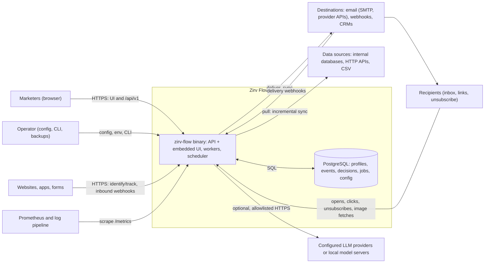
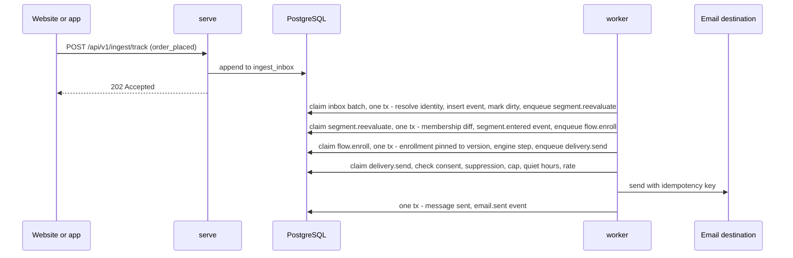
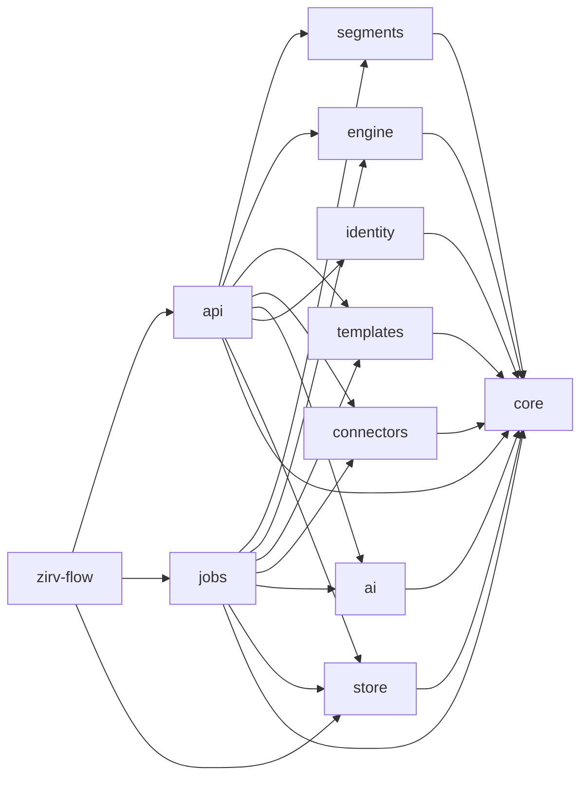
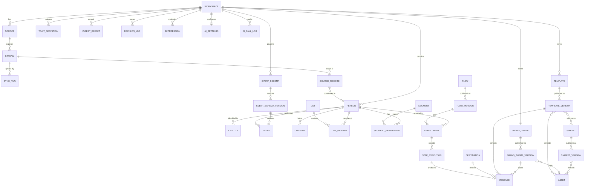
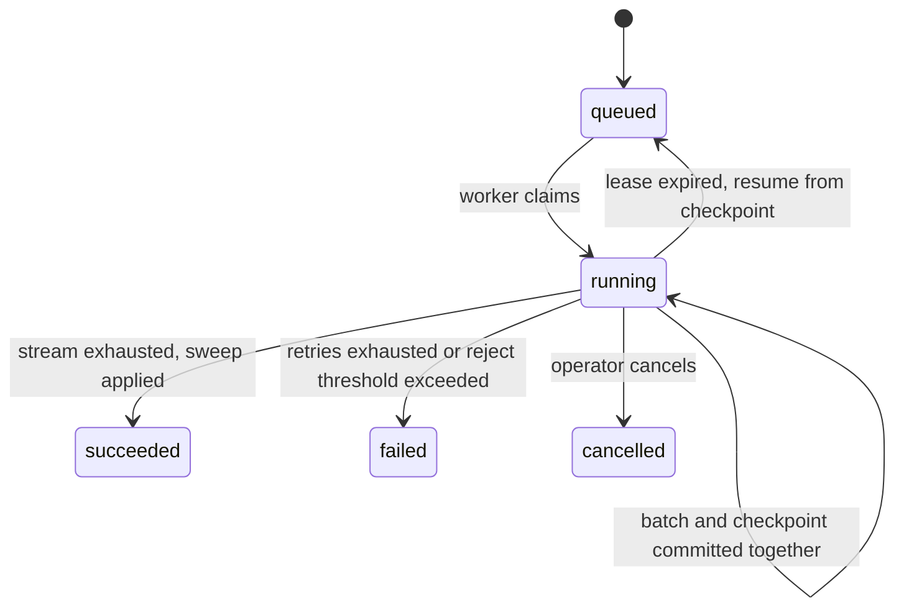
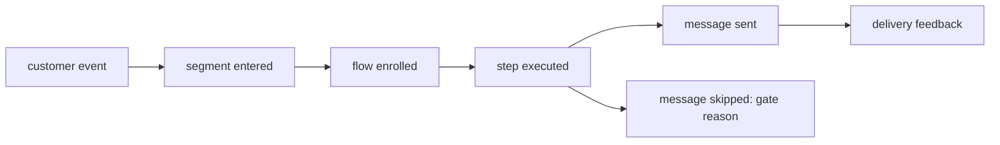

# Zirv Flow architecture

Living document: the intended system and the decisions behind it. Change it
through pull requests. Decisions (section 20) are never rewritten in place; a
changed decision gets a new superseding entry, linked both ways. Anything not
yet decided is an open question (section 21). Delivery order: [roadmap.md](roadmap.md).

## 1. Purpose and scope

Zirv Flow (`Glubiz/zirv-flow`, MIT) is a self-hosted marketing automation tool:
one Rust binary, `zirv-flow`, plus PostgreSQL. Marketers connect internal and
external data sources, segment the people in their business from that data,
and run automation flows for everyone or for a segment. It targets the problems
marketers hit before any message is sent: data about one person spread across
systems that disagree; segments nobody can explain or date; integrations that
drop, duplicate or never delete records; consent and erasure handled elsewhere.

### 1.1 Goals for v1.0

| ID | Goal |
|----|------|
| G1 | Connect data: built-in database sources, declarative HTTP sources, CSV import, identify/track API, inbound webhooks. Syncs are incremental, idempotent and deletion-aware, with per-source freshness visible. |
| G2 | One profile per person: deterministic identity resolution, typed traits with per-trait source precedence, events, lists, consent, suppression. |
| G3 | Segments marketers can trust: visual builder, live counts, per-person explanation, visible data age, entry/exit events. |
| G4 | Durable, versioned, testable flows triggered by segment changes, events, schedules, manual starts or the API. |
| G5 | Compliant delivery: email and webhooks first; consent, suppression, frequency caps, quiet hours and rate limits enforced in core; delivery and engagement fed back as events. |
| G6 | Operable by a small team: binary + Postgres, compose quickstart, metrics, health checks, documented backup/restore/upgrade. |
| G7 | Message content without code: a channel-aware template builder (email blocks rendered to responsive HTML and text, a webhook payload editor) with brand theme, snippets, merge tags from the field registry and per-block conditions; previews come from the same renderer as sends. |
| G8 | Govern and investigate events: versioned schemas, visible validation and rejects, redaction, live debugging, exploration and a unified person timeline. Every derived action is traceable to its typed cause, including skips and failures. |
| G9 | Optional, safe authoring assistance: configured LLMs draft and explain Zirv Flow's typed artifacts through the same validators and RBAC as the API; a person always reviews and accepts a draft. |

### 1.2 Non-goals for v1

- More than one organization per deployment; active-active multi-region.
- Querying sources live without copying them (federated mode is a later milestone, ADR-001).
- Running a mail transfer agent or managing IP reputation (mail goes to SMTP relays and provider APIs).
- SMS, push, in-app and ad-audience channels and their builders (their content types are reserved in the template model, section 11.1); probabilistic identity matching; predictive scoring.
- Analytics, attribution and campaign reporting beyond delivery and per-node flow counters.
- AMP email; hosted landing pages or forms.
- Autonomous assistant actions; model hosting, training or fine-tuning by Zirv Flow.
- Third-party code plugins (ADR-004); sub-second membership for time-window segment conditions (scheduled recompute, section 8.4).

## 2. Principles

1. **The binary and Postgres are the whole product.** More infrastructure needs measured evidence (ADR-003).
2. **Every number is explainable.** Counts, memberships and skipped sends link to the data and rule behind them.
3. **Freshness is a value.** Every segment result and send decision carries the age of its inputs.
4. **Compliance is data, enforced at one boundary.** Consent, suppression and erasure live in the profile store and are checked in the send pipeline, not left to flow design.
5. **Deterministic core, effects at the edge.** Segment compiler, flow interpreter and template renderer are pure functions of input and an injected clock; I/O lives in job handlers.
6. **At-least-once execution with idempotency keys.** Exactly-once is never claimed for a system that cannot honour a key.
7. **The workspace is the isolation unit.** Every row carries `workspace_id`; every query and job is scoped by it.
8. **API first.** The UI uses the public `/api/v1`; every milestone ships API and UI for its feature together.
9. **Fail visibly.** Rejected records, failed steps and skipped sends are stored with a reason and shown in the UI.
10. **Causality is data.** Every derived action carries a trace and typed cause across queues and external effects; operational logs are not the system of record for product decisions.
11. **Assistance proposes, people decide.** LLM output is untrusted, workspace-scoped and draft-only; deterministic validators and explicit acceptance remain authoritative.
12. **Module boundaries are executable rules.** Crate dependencies, feature-module APIs and frontend imports follow the allowlists in section 5, and CI rejects violations.

## 3. System context



## 4. Runtime and process view

### 4.1 Roles

One binary, several roles, each a long-running loop. `all` runs every role in
one process and is the default (bare `zirv-flow` and the container image).

| Command | Instances | Responsibilities |
|---------|-----------|------------------|
| `serve` | any, stateless | `/api/v1`, ingestion, tracking/unsubscribe, inbound webhooks, template preview, image assets, embedded UI, `/healthz`, `/readyz`, `/metrics` |
| `worker` | any, stateless | Claim and execute jobs; `--kinds` dedicates a pool (e.g. `delivery`) |
| `scheduler` | any, one active leader | Due schedules to jobs, lease reaping, partition maintenance, retention, stale-source detection |
| `all` | one per host | All three roles in one process (default) |
| `migrate`, `admin ...`, `config check` | one-off | Apply migrations; create owner, rotate master key, replay erasures; validate config (secrets redacted) |

### 4.2 Cooperation through Postgres

- Roles never call each other; all coordination is rows in Postgres.
- **Transactional enqueue:** a state change and the jobs it causes commit in one transaction, so a committed change always has its follow-up job and a rolled-back one never does. No dual write, no outbox relay.
- Jobs are claimed in a short transaction and executed outside it (section 14).
- `LISTEN/NOTIFY` wakes workers as a latency hint; fixed-interval polling is the correctness path.
- The scheduler leader holds a session-level `pg_try_advisory_lock`; if its connection drops another scheduler takes over. Schedule slots carry unique keys, so a brief two-leader overlap cannot fire a slot twice.
- Due-time comparisons use the database's `now()`, so host clock skew cannot fire timers early.

### 4.3 From event to email



### 4.4 Shutdown and failure

On `SIGTERM`, `serve` drains requests, workers stop claiming and finish
in-flight jobs within a grace period, and the scheduler releases its lock. Jobs
left unfinished, by shutdown or crash, are retried when their lease expires;
idempotency keys make that safe (section 14). If Postgres is down, `/readyz`
fails, loops back off and ingestion returns `503`; v1 does not buffer locally.

## 5. Module and crate layout

M0 is a single crate. The Cargo workspace arrives in M1: `crates/<name>` for
each crate below (`zirv-flow-ai` joins in M3, `zirv-flow-identity` in M1 with OIDC sign-in and `zirv-flow-templates` in M6), plus `web/` (TypeScript +
React SPA, Vite, React Flow canvas).

| Crate | Contents | Independent reason to exist |
|-------|----------|-----------------------------|
| `zirv-flow` (bin) | CLI, config, role startup, embedded web assets | The single deliverable; thin composition root |
| `zirv-flow-core` | Domain types, ids, validation, segment AST, flow graph, `Clock` | Shared vocabulary; dependency set kept pure (no sqlx, HTTP client or tokio networking) |
| `zirv-flow-store` | sqlx pool, migrations, repositories, Postgres job queue primitives | Sole owner of the profile store: one migration stream, one sqlx offline cache. Queue SQL lives here because enqueue must join the caller's transaction. |
| `zirv-flow-segments` | AST to parameterized SQL compiler, dependency analysis, reference evaluator | Most correctness-critical code, own golden corpus. Pure: emits SQL + params that `store` executes. Used by `api` (preview, explain) and `jobs` (recompute). |
| `zirv-flow-engine` | Deterministic flow interpreter, simulation harness | Pure, so simulation needs no I/O. Used by `api` (test mode) and `jobs`. |
| `zirv-flow-connectors` | `Source`/`Destination` traits, connector runtime, built-ins, HTTP manifests, email transport | Heavy, fast-moving external dependencies (HTTP, SMTP, source DB drivers). Depends on `core` only: yields records and checkpoints, never writes the profile store. |
| `zirv-flow-identity` | OIDC discovery, JWKS and the authorization-code exchange with ID-token verification (`openidconnect`, rustls) | Every outbound call to the operator-configured identity provider lives here, so `api` stays inbound-only. Depends on `core` only. The issuer is operator-configured, so the M3 egress policy does not apply to it. |
| `zirv-flow-ai` | Provider trait and OpenAI-compatible and Anthropic adapters; structured tool-call orchestration, bounded repair, budgets, audit inputs and deterministic fake provider | Optional outbound protocols and HTTP dependencies change independently from the deterministic domain crates. The crate coordinates existing typed tools and validators but neither defines nor bypasses them. |
| `zirv-flow-templates` | Template document types and schema migrations, MiniJinja sandbox, rich-text sanitizer, MJML generation and rendering via `mrml`, text-part generation, webhook payload rendering, publish validation | Pure renderer used by `api` (preview) and `jobs` (send), so preview and send share one code path. Own golden corpus (per-block renders, migrations). Its dependencies (`mrml`, MiniJinja, sanitizer) are pure but too heavy for `core`, and `connectors` cannot be held pure by the `cargo tree` check. Starts in M6 with code templates; M7 adds block documents. |
| `zirv-flow-api` | axum router, auth, OpenAPI, ingestion, tracking, static UI serving, assistant tools (`AiTool` implementations and their registry) | HTTP surface; neither `api` nor `jobs` depends on the other |
| `zirv-flow-jobs` | Worker and scheduler loops, job registry, job handlers | Composition point for background work: handlers combine `store`, `segments`, `engine`, `templates`, `connectors`, which no other crate needs together |



### 5.1 Allowed crate dependencies

The table is an allowlist of direct workspace-crate dependencies. A crate may
depend on fewer crates than listed; any workspace edge not listed fails CI.

| Crate | May depend directly on |
|-------|-------------------------|
| `zirv-flow` (bin) | `zirv-flow-api`, `zirv-flow-jobs`, `zirv-flow-store` |
| `zirv-flow-core` | none |
| `zirv-flow-store` | `zirv-flow-core` |
| `zirv-flow-segments` | `zirv-flow-core` |
| `zirv-flow-engine` | `zirv-flow-core` |
| `zirv-flow-connectors` | `zirv-flow-core` |
| `zirv-flow-ai` | `zirv-flow-core` |
| `zirv-flow-identity` | `zirv-flow-core` |
| `zirv-flow-templates` | `zirv-flow-core` |
| `zirv-flow-api` | `zirv-flow-core`, `zirv-flow-store`, `zirv-flow-segments`, `zirv-flow-engine`, `zirv-flow-connectors`, `zirv-flow-ai`, `zirv-flow-identity`, `zirv-flow-templates` |
| `zirv-flow-jobs` | `zirv-flow-core`, `zirv-flow-store`, `zirv-flow-segments`, `zirv-flow-engine`, `zirv-flow-connectors`, `zirv-flow-ai`, `zirv-flow-templates` |

`api` and `jobs` never depend on each other, and no crate depends on the binary.
The pure crates (`core`, `segments`, `engine`, `templates`) never depend on an
I/O crate, sqlx, an HTTP client or tokio networking. `store` owns sqlx;
`connectors`, `ai` and `identity` are the outbound-I/O crates.

### 5.2 Feature modules inside crates

Each crate is split into vertical feature modules for the domain areas it owns:
`sources`, `people`, `events`, `segments`, `flows`, `templates`, `delivery` and
`assistant`. A crate creates only the modules it needs. Shared code stays small
and earns a domain-neutral name; feature code does not move into a generic
`utils` module.

```text
crates/zirv-flow-api/src/
  lib.rs
  sources/mod.rs
  people/mod.rs
  events/mod.rs
  segments/mod.rs
  flows/mod.rs
  templates/mod.rs
  delivery/mod.rs
  assistant/mod.rs
```

Items are `pub(crate)` by default. A feature's supported surface is the set of
functions and types re-exported by its `mod.rs`; a crate's external surface is
re-exported by `lib.rs`. Code never reaches into another feature's internal
submodules. Cross-feature calls use the owning feature's public functions and
types. File and module names use domain terms, not transport or implementation
terms, unless the module owns that transport.

### 5.3 Extension points

These are the only implementation registries. Adding an implementation means
one module that implements the owning trait and one line in its registry; only
the registry enumerates implementations.

| Extension | Trait | Owning crate | A new implementation adds |
|-----------|-------|--------------|---------------------------|
| Connectors | `Source` | `zirv-flow-connectors` | One source module and one source-registry line |
| Destinations and channels | `Destination` | `zirv-flow-connectors` | One destination module and one destination-registry line |
| Template content types | `TemplateContent` | `zirv-flow-templates` | One content-type module and one content-registry line |
| Job kinds | `JobHandler` | `zirv-flow-jobs` | One handler module and one job-registry line |
| AI tools | `AiTool` (defined in `zirv-flow-ai`) | `zirv-flow-api` (`assistant` feature module) | One tool module and one tool-registry line; tools live in `api` because they call validators and store reads that `ai` may not depend on (5.1) |

No other registry is introduced. Domain catalogs such as the field and event
schema registries store workspace data; they are not implementation registries.

### 5.4 Frontend modules

`web/src/features/` contains feature folders named for the same domain areas.
Each feature exposes its supported surface through `index.ts`; another feature
imports only that surface, never an internal file. Shared presentation
components live in `web/src/ui/`, and the generated OpenAPI client has its own
top-level folder. Features may use both, but never import from `web/src/app/`;
the app shell composes features, not the reverse.

### 5.5 Enforcement

- From M1, CI reads `cargo metadata` and fails on every workspace dependency
  edge absent from section 5.1, naming the disallowed edge.
- The existing `cargo tree` purity check rejects sqlx, HTTP clients and tokio
  networking in `core`, `segments`, `engine` and `templates`; sqlx remains a
  direct dependency of `store` only.
- Frontend lint rejects deep imports across features and imports by a feature
  from the app shell.
- Rust review treats `pub(crate)` as the default and rejects access to another
  feature's internal modules or an implementation listed outside its registry.
- Reviews never loosen an allowlist, purity rule or import boundary merely to
  make a change pass. A boundary change requires an architecture decision.

The engine evaluates branch conditions through an injected
`ConditionEvaluator` (production: `segments` + `store`; simulation: the
reference evaluator). The renderer never evaluates conditions itself: it lists
a template's block conditions, the handler evaluates them in one
`ConditionEvaluator` call, and the results go into the render as plain inputs
(section 11.4). CI builds `web/` before the release build; `build.rs` embeds `web/dist`, or a
placeholder page in the api crate when it is absent, so `cargo build` works without Node. The OpenAPI document
(utoipa) is committed, drift-checked and feeds the SPA client.

## 6. Domain model

One organization per deployment (implicit). **Workspaces** (brands,
environments) are the isolation unit. **Users** are deployment-wide and join
workspaces through **memberships** with a role; **API keys** belong to one
workspace and carry scopes. Every domain table leads its key with
`workspace_id`; ids are UUIDv7 (time-ordered, index-friendly).



| Entity | Purpose and key rules |
|--------|-----------------------|
| Person | Resolved individual. `traits jsonb` is materialized from contributions; `merged_into` is set on the losing side of a merge. |
| Identity | `(kind, normalized value)` per person: email, phone, anonymous_id, external id namespaced per source. Unique on `(workspace_id, kind, value)`. |
| Trait definition | Field registry: key, type (string, number, boolean, timestamp, date, string list), precedence policy, PII flag, channel-address flag. Values are validated on write, so compiled reads cast safely. |
| Source record | Ledger row per `(source, stream, record key)`: mapped payload, content hash, person, last seen run, deletion mark. These are the per-source contributions traits are computed from. |
| Event schema, version | Registry entry per event name with immutable versions: typed properties, required fields, enums, descriptions and a PII flag per property; validation mode `allow`, `warn` or `block`. The workspace policy creates a draft schema for an unplanned name or rejects it. |
| Event | Append-only `(name, schema_version, occurred_at, received_at, properties, source, event_id, message_id, trace_id, validation_state)`. Range-partitioned by month on `occurred_at`; ingest redaction runs before storage. A client `messageId` deduplicates retries for effectively-once storage. |
| Ingest reject | Rejected customer event or sync record with reason, masked sample, source and trace. It is visible, retained separately and replayable after its schema or mapping is fixed. |
| Decision log | Append-only, time-partitioned typed records for derived actions and their causes. It stores durable ids and reasons but no personal-data values; `trace_id` links the tree across jobs, events, messages and forwarding. |
| Consent | State per `(person, channel, topic)`: `subscribed`, `unsubscribed`, `pending_confirmation`, `unknown`; plus append-only history with source and evidence. |
| Suppression | Identifier-level block (hard bounce, complaint, manual, erased), stored as an HMAC of the normalized identifier so it outlives erasure. |
| List; segment, version, membership | Static set of people (manual, CSV, API, flow action). Segment definition AST; membership rows with `entered_at`/`exited_at`, current members `exited_at IS NULL` (partial unique index). |
| Flow, version, enrollment; message | Versions are immutable once published and enrollments are pinned to one. One message row per send attempt; `messages.idempotency_key` is unique. The message records the exact template, snippet and theme versions it was rendered from. |
| Template, template version | Channel (`email`, `webhook`; `sms`, `push`, `in_app` reserved), category, mode (`blocks` or `code`) and a versioned content document (section 11). Versions are immutable once published. |
| Snippet, snippet version | Reusable block fragment (e.g. legal footer). Templates reference the snippet, and rendering uses its current published version. |
| Brand theme, theme version | One per workspace: colours, fonts, logo asset, default footer snippet. Published versions are immutable; rendering uses the current one. |
| Asset | Uploaded raster image (bytes, sniffed type, dimensions, content hash), served publicly from `server.public_url`. Retained while any published template, snippet or theme version references it. |
| AI settings | Per-workspace enablement, provider/model choice, budget, transcript retention and PII opt-in. Deployment configuration declares the permitted providers and models. |
| AI call log | Audit record for each assistant call: workspace, user, feature, provider, model, tokens, estimated cost, latency, outcome and resulting draft id; transcript content follows the workspace retention setting. |

## 7. Data sources and ingestion

### 7.1 Paths and the common write path

| Path | Mechanism | Idempotency | Freshness signal |
|------|-----------|-------------|------------------|
| Sync (pull) | `sync.run` job per stream, resuming from a checkpoint | Ledger content hash; checkpoint committed with the data | Last successful run, cursor high-water mark |
| Identify / track (push) | `serve` durably appends to `ingest_inbox` before returning `202`; workers drain it in batches | Client `messageId`, else server-assigned | Oldest unprocessed inbox row |
| CSV import | Upload, map, dry run, then run like a sync | Key column, else file hash + row number | Import completion |
| Inbound webhook | `/hooks/{id}`, signature check, mapping | Configured dedupe field | Last received |
| Contacts API (push) | Create, update and delete contacts by key, singly or in bulk, through the inbox like identify (7.6) | Idempotency key, else contact key plus payload hash | Oldest unprocessed inbox row |
| Kafka stream | A long-running consumer per stream; the partition offsets are the stream checkpoint, committed in the apply-batch transaction (7.6) | Topic, partition and offset | Consumer lag per partition |

Every path ends in **apply-batch**, one transaction per batch (default 500
records): normalize identifiers; resolve or create the person (merging if
needed); upsert ledger contributions and recompute affected traits; insert
events with dedupe; write coalesced dirty marks (`person_changes`); enqueue
follow-ups (segment re-evaluation, event triggers, event-wait wakeups); commit
the stream checkpoint. Customer-event schema validation, redaction, reject
handling, lateness and trace propagation are defined once in section 12 and
used by every ingestion path.

### 7.2 Sources, streams and sync runs

A **source** is a connector instance (type, config, encrypted credentials,
schedule) exposing **streams** (table, query, API resource). Each stream maps to
`people` (identifiers, traits), `events` (name, timestamp, person identifier,
properties) or `list_membership`.

| Sync mode | Use | Deletion detection |
|-----------|-----|--------------------|
| Incremental (cursor field) | Default where an `updated_at`-like field exists | Delete signal in the mapping (soft-delete field, deleted-records endpoint), or a periodic key-only reconciliation run |
| Full refresh | Small data, no cursor | Mark and sweep: not seen in a successful complete run means tombstoned |
| Push | API, webhooks | Explicit delete calls |
| Stream | Kafka topics | A tombstone (null value) for the record key, or a mapped delete field |



A checkpoint is opaque connector state (cursor, page token, LSN) written in the
same transaction as the batch it covers, so a resumed run neither skips nor
re-applies data. Long runs heartbeat their lease. One run per stream at a time
(job unique key). The sweep runs only after a run **succeeded**: a failed or
cancelled run never deletes. A run also fails, without sweeping, when its reject
rate exceeds the stream threshold (default 5%), so a broken mapping cannot
cascade into deletions. Rejects (type mismatch, missing identifier, bad
timestamp) are kept in `sync_rejects` with reason and raw values.

**Mapping** is declarative: field path to identifier kind, trait, event field or
list, with a bounded transform set (trim, case, cast, timestamp parse,
concatenate, constant, value map, split). No scripting in v1 (OQ-5). The UI
previews a mapping on sample records before saving.

### 7.3 Identity resolution and precedence

Deterministic matching only, with rules per identifier kind:

| Rule | Meaning | Default |
|------|---------|---------|
| Normalization | email: trim + lowercase; phone: E.164; external ids exact, namespaced per source | as stated |
| `unique_per_person` | At most one value of this kind per person | on for external ids |
| `max_per_person` | Cap per kind, preventing chain merges through shared addresses | email 10, phone 10 |
| Merge policy | Whether a match may merge two existing people | allowed unless a uniqueness rule would break |

- **Blocked merge:** the record attaches to the person matched by the strongest identifier, and an **identity conflict** is recorded for review in the UI (shared family or role addresses are the common case). A review ends in one of two outcomes: keep the people separate, or move the identifier to one of them.
- **Merge:** the older person survives. One transaction moves identities, contributions, list memberships and consent, recomputes traits and sets `merged_into`. Consent takes the most recent explicit decision per channel/topic (`unsubscribed` wins ties). A `person.merge.rewrite` job then re-points events, memberships, enrollments and messages in batches; meanwhile reads follow `merged_into` (one hop, chains compressed). Duplicate active enrollments in one flow keep the older and exit the other with reason `merged`. Each merge records its provenance (the moved ids in a merge record, plus a decision record). There is no unmerge in v1 (OQ-3).
- **Races:** concurrent creation of the same person is serialized by the unique identity index; the loser retries resolution.
- **Precedence:** each trait value is computed from all sources' contributions under the registry policy `latest` (by source observation time, default), `source_priority` (ordered sources) or `first`. Flow actions and the API write as sources (`flow:<id>`, `api`). The profile shows which source supplied each value.

As built (people, identities and the field registry):

- **Identifier kinds.** `email`, `phone`, `anonymous_id` and `external:<namespace>`
  (namespace `[a-z0-9_.-]{1,64}`). Email reuses the `Email` rules; phone is international
  format only (`+` and 8 to 15 digits after removing spaces, `-`, `.`, `(`, `)`, and a leading
  `00` read as `+`), with no national-format guessing; anonymous and external ids are exact,
  non-empty, at most 256 characters, with no control characters. Strength for an attach:
  external, then email, phone, anonymous id. An invalid identifier rejects the record with a
  typed reason; a record needs at least one valid identifier. Until merges exist, a match
  across several people attaches to the strongest identifier's owner and writes an
  `identity_conflicts` row (`merge_deferred`) per other person.
- **Inference.** An unregistered key is registered on first sight with `inferred = true`,
  `latest` precedence and `pii = false`: a string becomes `string`, a number `number`, a
  boolean `boolean`, an array of strings `string_list`. Timestamp and date are never
  inferred, and an object or a mixed array is dropped with a reason. Concurrent inference is
  `ON CONFLICT DO NOTHING` followed by a re-read. A type is fixed at creation.
- **Changing a rule.** Changing a trait's `precedence`, `source_order` or `archived` flag
  enqueues a `traits.recompute` job (payload `{workspace_id, key}`) in the same transaction
  as the registry change. The job recomputes that key for every person with a live
  contribution, 500 people per run and transaction (each run enqueues the next with an
  `after` person-id cursor), and appends a `trait.change` decision (ids only) and a dirty
  mark where a value changed. An archived key is not materialized: its values leave
  `people.traits` and `trait_sources` while the ledger keeps them, so unarchiving restores
  them. Retry: `StoreError::is_retryable()` is true for deadlocks, serialization failures and
  an identity race that outlasts three attempts; the caller retries the whole batch.

### 7.4 Deletion propagation

Deletion is in the pipeline from M2. A source-side delete tombstones the ledger
record, removes that record's identities, contributions and event rows, and
recomputes traits from what remains. If nothing remains (no contributions,
first-party events or consent), the workspace orphan policy applies (`keep`
default, or `delete`). The person is marked dirty, so memberships exit, flows
react as configured and destination syncs remove the person downstream (10.2).
Deletion removes one source's contribution; **erasure** (16.3) removes the
person and every derived row.

### 7.5 Freshness and connector concerns

| Object | Freshness | Shown as |
|--------|-----------|----------|
| Pull stream | Time since last successful run; cursor high-water mark | fresh / stale (past threshold, default 2x schedule interval) / failing |
| Push source | Time since last record; inbox backlog age | same |
| Segment | `computed_at` plus the oldest input freshness of sources feeding its dependencies | "Data as of ..." on counts and membership |
| Send decision | Segment and trait freshness at decision time | recorded on the message |

Stale and failing sources are metrics and Sources-page badges (auto-pausing
sends on stale inputs is OQ-14). The connector runtime, not each connector,
owns (ADR-004): auth (API key, basic, bearer, OAuth2 client credentials and
authorization code with refresh), retries honouring `Retry-After`, rate limits,
pagination (cursor, offset, page, link header), checkpoints, the egress policy
(16.1) and delivery capabilities (idempotency keys, batching, erase).

### 7.6 Native contacts and streaming updates

Some companies have no external customer store. For them Zirv Flow is the
system of record for its **contacts** (customers), not only a copy of someone
else's data.

- **Contact definition.** Each workspace defines its contact shape on top of
  the field registry: typed fields, which fields are required, and which are
  identifiers (contact key, email, phone, external ids). Validation uses the
  same rules as event schemas (section 12.1). A contact is a person whose
  contributions come from the built-in `native` source, so identity resolution,
  precedence, consent, suppression, segments and erasure work unchanged.
- **Writes over HTTPS.** `/api/v1/workspaces/{ws}/contacts` offers create,
  read, list and search, full replace, partial update and delete by contact
  key, plus a bulk upsert. Writes are idempotent (an idempotency key, else the
  key plus a payload hash) and go through the inbox and apply-batch like
  `identify`. The UI edits contacts through the same API. A delete removes the
  `native` contributions under the orphan policy (7.4); erasure stays separate.
- **Writes over Kafka.** A Kafka source consumes one or more topics with a
  consumer group. Each message is mapped like any other stream to contact
  upserts, events or list membership; a tombstone deletes the contact. Offsets
  are stored as the stream checkpoint in the apply-batch transaction, so a
  crash replays from the last committed batch with no double application. A
  message that fails mapping or validation becomes an ingest reject and the
  partition moves on. Freshness is consumer lag. Broker credentials (SASL, TLS
  client certificates) use secrets encryption (16.1), and connections pass the
  egress policy. JSON values come first; Avro and Protobuf with a schema
  registry follow (OQ-31).

## 8. Segmentation engine

### 8.1 Definition AST

JSON with a schema version. "Nordic customers with two or more orders of at
least 50 in 90 days, not VIP, subscribed to the newsletter":

```json
{ "v": 1, "all": [
  { "trait": "country", "op": "in", "value": ["DK", "SE", "NO"] },
  { "event": "order_placed", "where": [{ "prop": "total", "op": "gte", "value": 50 }],
    "agg": { "fn": "count", "op": "gte", "value": 2 }, "window": { "last": "P90D" } },
  { "not": { "segment": "seg_0192f3c0" } },
  { "consent": { "channel": "email", "topic": "newsletter", "status": "subscribed" } } ] }
```

| Node | Semantics |
|------|-----------|
| `all`, `any`, `not` | Boolean composition |
| `trait` | Operators by registry type: equality, comparison, `in`, contains, exists, relative dates ("more than 7 days ago") |
| `event` | Property filters, then `count`/`sum`/`min`/`max`/`avg`/first or last time over a window (`last` duration, `between`, since a timestamp trait); "did not" and "never" |
| `list`, `segment` | Membership; segment references must stay acyclic |
| `consent`, `identifier` | Channel/topic state; presence of an identifier kind |

### 8.2 Compilation

`parse -> validate -> normalize -> lower`. Validation checks types, operators,
references and window limits against the field registry and event catalog.
Normalization flattens, pushes `not` inward and folds constants. Lowering emits
SQL with an `EXISTS` subquery per event condition; every value is a bind
parameter, column and JSON keys come only from the registry, and relative
windows bind `$now` from the injected clock, so output is deterministic. Result:
`CompiledSegment { sql, params, deps, time_sensitive }`, where `deps` lists the
traits, events, lists, segments and consent channels read.

Verification: golden tests (AST fixture to expected SQL, reviewed on change);
an in-memory **reference evaluator** of the same AST; property tests running
random ASTs and data through both and comparing. v1 evaluates event aggregates
on raw events with partition pruning and `(workspace_id, name, occurred_at)`
indexes; a per-person daily rollup is the first optimization if benchmarks miss
targets (OQ-2).

### 8.3 Preview, explain, membership

- **Preview:** count and sample under a `statement_timeout` (default 10 s), optionally on a read replica (`database.read_url`), always with data age.
- **Explain:** evaluates each AST node for one person and returns a pass/fail tree with observed values ("2 orders in window, needs 2 or more"); it answers "why is this person in or out" on the profile.
- **Membership refresh:** compute the new set, diff against current members, insert entries, close exits, write `segment.entered`/`segment.exited` events (properties: version, cause `data_change`, `time`, `definition_change` or `initial`), and enqueue batched flow triggers, all in one transaction.

### 8.4 Recompute and versioning

| Mode | When | Scope |
|------|------|-------|
| Incremental | `segment.reevaluate` drains coalesced dirty marks | Segments whose `deps` intersect the change, with `person_id = ANY($batch)` |
| Scheduled full | Per-segment cadence, default hourly, minimum 5 min | Whole segment; **required** for `time_sensitive` segments, which change as time passes with no new data ("no order in 30 days") |
| Manual | "Refresh now" | Whole segment |

Segment-of-segment dependencies are evaluated in topological order; one refresh
per segment at a time (job unique key); the UI states the cadence ("re-evaluated
every hour"). Editing a definition creates a new version and applies the diff
with cause `definition_change`; whether that triggers flows is OQ-6 (proposed:
no). A flow with a segment-entry trigger chooses at publish whether current
members enroll or only new entries.

## 9. Flow engine

### 9.1 Model

A **flow** has drafts and immutable published **versions**: directed acyclic
graphs of typed nodes with stable node ids. Publish validation rejects cycles,
unreachable nodes and untyped edges. Lifecycle: `draft -> published -> paused ->
archived`; enrollments stay on the version they entered, new ones use the latest
(migrating in-flight enrollments is OQ-7). Triggers: segment entered or exited
(optionally enrolling current members at publish); named event with property
filters; schedule (cron + time zone, audience = segment or everyone); manual
start for an audience; API (`POST .../flows/{id}/enrollments`).

| Node | Behaviour |
|------|-----------|
| `wait.duration`, `wait.until_time` | Resume after a duration, or at a local time/date (person `timezone` trait, else workspace zone) |
| `wait.until_event` | Resume on a matching event, or take the timeout edge |
| `branch` | Ordered segment-AST conditions evaluated for this person now, plus else |
| `split.random` | Percentage split by stable hash of `(enrollment_id, node_id)` (reproducible in simulation) |
| `action.send` | Message via destination + template, through the send pipeline (10.1) |
| `action.webhook`, `action.sync` | Signed HTTP call; upsert/remove the person in a destination |
| `action.update_trait`, `action.list` | Set/increment/unset a trait (as source `flow:<id>`); add/remove list membership |
| `goal`, `exit` | Record conversion (optionally exit); end the enrollment |

### 9.2 Execution model

```rust
pub fn step(
    graph: &FlowGraph,
    state: &EnrollmentState,
    input: StepInput,      // Start | TimerDue | EventArrived(..) | Resume
    ctx: &dyn StepContext, // injected Clock + ConditionEvaluator
) -> Result<Transition, EngineError>; // Transition { state, effects, wake, outcome }
```

One call advances through consecutive non-blocking nodes and stops at a wait,
an exit or the end of the graph. **Internal effects** (trait update, list,
goal) are applied in the same transaction as the state change, so later
branches see them. **External effects** (send, webhook, sync) are enqueued as
jobs in that transaction and the enrollment moves on; their outcomes return as
events (`message.sent`, `message.skipped`, ...) that later nodes can wait for.

### 9.3 Durability, idempotency, timers

- Enrollment state (node, context, `wake_at`, `state_version`) lives in Postgres. Each `flow.step` job carries the `state_version` it expects; stale jobs are no-ops. So when an awaited event races its timeout, the first commit wins.
- Step idempotency key: `(enrollment_id, node_id)`, sufficient because graphs are acyclic and re-entry creates a new enrollment. It is stored on `step_executions` and passed to effect jobs and destinations.
- A wait sets `wake_at` and enqueues `flow.step` with `run_at = wake_at`, unique key `wake:{enrollment_id}:{state_version}`. `wait.until_event` also writes `enrollment_waits(person_id, event_name, enrollment_id, timeout_at)`, which apply-batch checks on event insert.
- Failed steps retry with backoff; then the enrollment is `failed` with the error visible, and an operator can retry or skip.
- Enrollment states: `active`, `waiting` (timer or event), `completed` (exit node or end of graph), `exited` (goal exit, exit criteria, merge, flow archived), `failed` (back to `active` on operator retry or skip).

### 9.4 Enrollment rules and test mode

| Rule | Behaviour |
|------|-----------|
| Fan-out | `flow.enroll` jobs of up to 1,000 people; idempotent on `(flow_id, person_id, trigger_occurrence)` (event id or schedule slot) |
| Re-entry | `once`, `once_at_a_time` (after the previous ends), or `always` with a minimum interval; partial unique index on active enrollments + history check |
| Exit criteria | Leaves trigger segment, event occurs, or goal reached; checked from dirty marks and events for people with active enrollments |
| Pause | No new enrollments (skips are counted); due timers held and re-enqueued on resume |

The injected clock and evaluator let one engine run three ways. **Test mode**
(UI and API) walks a real or synthetic person through a version on a virtual
clock: conditions read the profile store, effects are captured not executed,
events can be injected to satisfy waits, and the UI shows the path.
**Simulation tests** run thousands of enrollments over virtual months with the
reference evaluator and injected crashes (section 18). **Production** uses wall
time, with due-time comparisons in SQL.

## 10. Channels, destinations and delivery tracking

### 10.1 Destinations and the send pipeline

A destination implements `Destination` and declares capabilities: channels
(email, webhook, profile sync), idempotency-key support, batching, rate limits,
erase. v1: SMTP email, email-provider HTTP APIs (built in or manifest), generic
webhook, profile sync via manifests. Every `action.send` passes these gates **at
send time** (consent can change while a person waits):

| # | Gate | On failure |
|---|------|------------|
| 1 | Enrollment active, flow not paused | dropped |
| 2 | Channel address present and valid (registry channel-address trait) | `skipped: no_address` |
| 3 | Consent for channel and topic under the topic's policy (explicit opt-in, or allowed unless opted out) | `skipped: no_consent` |
| 4 | Suppression check on the address hash | `skipped: suppressed` |
| 5 | Frequency cap per person, channel, window; check-and-record under a per-person transaction advisory lock | `skipped: frequency_cap` or deferred (configurable) |
| 6 | Quiet hours in the recipient's time zone | deferred to the next allowed time |
| 7 | Template render (section 11; sandboxed, strict undefined) | `failed: render_error` |
| 8 | Destination rate limit | deferred until a token is available |
| 9 | Deliver with idempotency key | `sent`, retried, or `failed` |

Each outcome updates `messages` (template version, destination, data
freshness, gate results) and appends a person event, so the profile answers
"why did this person not get the email". Zirv Flow enforces the consent policy
the operator configures; it does not decide which legal regime applies.

### 10.2 Email, tracking and feedback

- **Templates:** content model, builder, rendering, validation and preview are in section 11. Marketing email must contain an unsubscribe link (publish fails otherwise); messages carry `List-Unsubscribe` and `List-Unsubscribe-Post` (RFC 8058 one-click).
- **Categories:** `marketing` or `transactional`. Transactional skips the marketing-consent gate, never suppression; a dedicated transactional API is OQ-11. DKIM and signing domains are the relay's or provider's job (documented).
- **Tracking:** open pixel `/t/o/{token}`, click redirect `/t/c/{token}`, unsubscribe page and one-click endpoint `/u/{token}` on `server.public_url`. Tokens are HMAC-signed (message id, link index, no personal data); redirects only go to links recorded for that message.
- **Feedback:** provider webhooks map to `email.delivered`, `email.bounced` (`hard`/`soft`), `email.complained`; hard bounce and complaint add a suppression. SMTP-only bounce handling is OQ-12. Engagement events (`email.opened`, `email.clicked`, `email.unsubscribed`) are ordinary person events usable in segments and waits; opens are low-confidence because some clients prefetch images (OQ-10).
- **Webhooks and sync:** outbound webhooks are HMAC-signed with a timestamp and send `Idempotency-Key`, with timeout and retries. Keeping a segment in an external system is a flow (entry: `action.sync` upsert; exit: remove), not a second mechanism. Deletion and erasure call the destination's remove/erase capability where declared.

## 11. Templates and the builder

A template is Zirv Flow's own channel-aware content document, stored as
versioned JSON, edited in the React builder and rendered server-side in Rust per
channel (ADR-006). Preview and send call the same renderer
(`zirv-flow-templates`). v1.0 builds email and webhook content. SMS, push and
in-app content types are defined in the schema from day one, and their builders
ship with those channels after 1.0. M6 ships code templates (MiniJinja HTML and
text); M7 adds the block builder on the same renderer.

### 11.1 Content model

```json
{ "schema": 1, "channel": "email", "mode": "blocks",
  "email": { "subject": "{{ person.first_name | default('Hi') }}, your order shipped",
             "preheader": "Tracking inside", "sender": "snd_0192f4a1", "lang": "en",
             "body": [ { "type": "section", "columns": [[ { "type": "heading", "level": 1, "text": "On its way" } ]] },
                       { "type": "snippet", "ref": "snp_0192f4b7" } ] } }
```

| Channel | Content type | v1.0 editor |
|---------|--------------|-------------|
| `email` | Subject, preheader, sender identity, reply-to, `lang`, body as blocks or as code (HTML + text) | Block builder, code mode |
| `webhook` | Headers and a JSON body template; the destination supplies URL and signing | Payload editor (11.7) |
| `sms` | Text and sender id, with encoding and segment-length rules | Reserved: validated, not publishable |
| `push` | Title, body, image, deep link, data | Reserved |
| `in_app` | Title, body, image, call to action | Reserved |

- Every document carries an integer `schema`. The server reads older schemas through migrations (11.8) and refuses newer ones.
- `mode` is `blocks` or `code`. Code mode (raw HTML + text with MiniJinja) is the escape hatch. Conversion is one-way: blocks to code produces HTML and text with merge tags kept; code to blocks is never offered.
- Reserved channel types define typed fields and length rules now, so content and validation keep their shape when those builders ship.

### 11.2 Email block set v1

| Block | Content | Notes |
|-------|---------|-------|
| `section` | Row of 1 to 3 columns, each a list of blocks; background, padding | Columns stack on narrow screens; sections do not nest |
| `heading` | Level 1 to 3, text | Theme font and colour |
| `text` | Rich text: paragraphs, bold, italic, underline, links, lists, line breaks | Sanitized against an allowlist on save and on render |
| `image` | Asset, alt text, optional link, width | From the asset library (11.3) |
| `button` | Label, URL, alignment | Theme colours |
| `divider`, `spacer` | Style; height | |
| `raw_html` | The marketer's own HTML | Passed through as `mj-raw`; never rendered unsandboxed in the app (16.1) |
| `snippet` | Reference to a snippet | Resolved at render time to the snippet's current published version |

Any block may carry a visibility condition (11.4). Styling is limited to theme
tokens and a small set of spacing and alignment values. The set grows only
under the block-set growth policy (OQ-23).

### 11.3 Brand theme, snippets, assets

- **Brand theme:** one per workspace, versioned: colours (primary, text, background, link), font stacks (web-safe, optional web font URL), logo asset, default footer snippet (postal address, unsubscribe link). Blocks reference theme tokens, so a theme change restyles templates at their next render without republishing.
- **Snippets:** versioned block lists (legal footer, signature). Snippets cannot contain snippet references, so there are no cycles. Templates render a snippet's current published version; publishing a snippet lists the templates and active flows that use it.
- **Assets:** raster images only (PNG, JPEG, GIF, WebP; no SVG), with the type sniffed from the bytes rather than taken from the client, and per-file and per-workspace limits (OQ-21). The baseline (ADR-003) stores them in Postgres and serves them content-addressed from `server.public_url` under `/a/` with immutable cache headers and `nosniff`. An asset referenced by any published version cannot be deleted, because sent emails keep pointing at it. S3-compatible object storage is an optional later add-on; large sends should put a CDN or caching proxy in front of `/a/`.

### 11.4 Personalization and conditions

- **Merge tags:** a picker fed by the field registry (traits by type), the event catalog (trigger event properties), the brand theme and system values (unsubscribe and preference URLs) inserts MiniJinja expressions such as `{{ person.first_name | default("there") }}`. The sandbox is unchanged: no filesystem or network, fuel, recursion and output limits, strict undefined, HTML autoescape in HTML fields.
- **Visibility conditions:** a block may carry a segment-AST condition ("in segment VIP", "country is DK"). The renderer lists a template's conditions; the send or preview handler evaluates them for the person in one call through the existing `ConditionEvaluator` and passes the results in. Preview shows which blocks are hidden and why, using explain (8.3).

### 11.5 Rendering pipeline

1. Load the template version and the current published theme and snippet versions.
2. Migrate the document to the current schema in memory (11.8).
3. Resolve snippets, apply theme tokens, drop blocks whose condition is false.
4. Render every text field (subject, preheader, text, labels, URLs, alt text) through MiniJinja with the person and trigger context.
5. Emit MJML and render it to responsive HTML with the `mrml` crate.
6. Generate the text part from the block tree (headings, paragraphs, links as `label: url`), not by scraping the HTML.
7. Post-render: rewrite links for click tracking, bind the required `marketing` unsubscribe footer to the message's signed URLs, add the `List-Unsubscribe` headers. Preview runs this step with inert tokens.

Code mode runs steps 4 (on the whole HTML and text) and 7; webhook content
renders as in 11.7. Output is deterministic: no clock reads, random ids or
map-order dependence, so equal inputs give equal bytes. Golden tests and the
preview-equals-send test rely on this.

### 11.6 Validation

- **Blocks publish:** a merge field unknown to the registry or event catalog; MiniJinja syntax errors; a `marketing` email without an unsubscribe link (own or from the theme footer); a missing sender identity; a broken reference (snippet, asset, theme, segment in a condition); a document failing its schema or the sanitizer; raw HTML that `mrml` cannot parse; a webhook body that is not valid JSON after a sample render.
- **Warns:** images without alt text; HTML size near the clipping threshold of common mail clients (about 100 KB); missing `lang`; subject or preheader beyond typical display length; links not using `https`.

### 11.7 Versions, preview, test sends, webhook payloads

- **Versions:** drafts are editable; publishing creates an immutable version. `action.send` references the template, not a version, and sends its current published version at send time, so a typo fix needs no flow republish. Publishing shows the active flows that use the template. Version history and where-used are available for templates and snippets.
- **Preview:** rendered server-side through the same pipeline, as a real person (requires `view_pii`; until M8 introduces that grant, owners and admins only) or a sample person built from registry types, at desktop and mobile widths. The SPA shows it in a sandboxed iframe (no `allow-scripts`, no same-origin) with the text part, subject, preheader, hidden blocks and validation results.
- **Test sends:** a `template.test_send` job sends through the real destination, but only to workspace members' verified addresses or a workspace allowlist. Test sends are rate-limited, marked `test`, excluded from frequency caps and engagement stats, and kept in a test-send log under message retention.
- **Webhook payloads:** headers and a JSON body template. MiniJinja is allowed only inside string values, so the structure always stays valid JSON; a value that is exactly one merge tag may take the field's registry type (number, boolean). Sample-payload preview with a real or sample person; body size limit.

### 11.8 Document schema migrations

A migration is a pure function from schema `N` to `N + 1`, and reads chain them.
Published versions are stored as saved and never rewritten; drafts are upgraded
when saved. Each migration ships with golden tests: a schema-`N` fixture
migrates to the expected document and renders byte-identically. The builder
refuses a document whose schema is newer than the server's.

## 12. Event logging and traceability

Customer events describe what people did; the decision log describes what
Zirv Flow derived and why. Neither replaces security audit records or
operational logs. The four layers stay separate because they have different
writers, readers, retention and privacy constraints:

| Layer | Records | Authority and links |
|-------|---------|---------------------|
| Customer events | Typed business facts used by segments and flows | Event store; `event_id`, `message_id`, `trace_id`, source id |
| Audit records | Who changed configuration or accessed sensitive operations | Audit log; actor id, object id, `request_id`, `trace_id` where applicable |
| Decision log | What the system derived, attempted, skipped or rejected, and why | Append-only decision store; `trace_id`, typed cause and domain ids, never personal-data values |
| Operational logs and spans | Runtime diagnosis for requests, jobs, dependencies and failures | Structured `tracing` output; `request_id`, `trace_id`, job and domain ids; exportable through OTLP |

Durable ids, not copied payloads, link the layers. A request receives a
`request_id`; ingestion or a domain operation receives a `trace_id`; a customer
event receives an `event_id`; a client retry may supply `message_id`; a send
receives a message id. These ids cross every job payload and span.

### 12.1 Event schemas, validation and redaction

The event catalog is a versioned schema registry keyed by event name. Each
immutable version defines properties, types, required fields, enums,
descriptions and a PII flag per property. A registry entry selects one mode:

| Mode | Behaviour |
|------|-----------|
| `allow` | Accept and record validation results without flagging the event |
| `warn` | Accept, set `validation_state = flagged`, and expose every reason |
| `block` | Do not create the customer event; write an ingest reject with reason and a masked sample |

A workspace policy handles unplanned event names by creating a draft schema
from the observed shape or rejecting them. Schema inference never publishes a
schema. Before accepted properties are stored, ingest redaction drops or
keyed-hashes configured properties and truncates IP addresses; validation uses
the pre-redaction types but rejects and debugger samples apply the same masking
rules. Property values flagged as PII are masked without `view_pii`; until M8
adds that grant, only owners and admins can view them. Per-event-name retention
may shorten or extend the deployment default within operator-set bounds.

### 12.2 Delivery, time and replay semantics

- The ingestion API returns `202` only after the inbox append is durable. A
  client `messageId` has a unique dedupe record, so retries give
  effectively-once customer-event storage; duplicates are counted and linked
  to the original event rather than applied again.
- `occurred_at` and `received_at` are distinct. Timestamps beyond the configured
  future-skew limit are clamped to `received_at` and flagged. Events older than
  the workspace lateness window are accepted and marked late; affected
  time-window segments are recomputed for that person before downstream
  triggers are evaluated.
- An operator may replay rejects after publishing a schema or fixing a mapping,
  or re-drive a failed forwarding destination. A replay records its original
  id and a typed `manual` or `definition_change` cause. It never re-triggers
  flows unless the operator explicitly selects that separately previewed
  action; forwarding re-drives cannot trigger flows.

### 12.3 Debugger, explorer and person timeline

- **Live debugger:** an authenticated SSE stream scoped to one workspace and
  optionally one source. It shows accepted, flagged, rejected and duplicate
  events with validation results; filters by event name, source and result;
  samples apply PII masking and ingest redaction. Disconnecting a viewer never
  affects ingestion.
- **Event explorer:** filters by event name, typed properties, time and person;
  displays counts over time and property breakdowns; exports the filtered set
  as CSV. Interactive and export queries have separate statement timeouts and
  row limits, always use workspace and partition predicates, and report a
  timeout rather than running without a bound.
- **Person timeline:** interleaves customer events with relevant decision
  records, including merges, consent and trait changes, segment changes,
  enrollments, steps, sends and skips. Each system record links to its trace
  tree; values remain subject to the caller's PII access.

### 12.4 End-to-end causality

Every derived action appends a typed decision record in the same transaction
as its domain state change. Covered actions are sync records applied, rejected
or deleted; identity merges; consent and trait changes; segment entry and exit;
enrollment and flow step outcomes; sends or skips with the gate reason;
delivery feedback; and forwarding attempts. Each record has `trace_id`, time,
action type, outcome, durable domain ids and one typed cause: `event`,
`trait_change`, `schedule`, `manual`, `api` or `definition_change`, with the
cause id. It never stores identifier, trait or event-property values.

The `trace_id` and cause cross transactional job enqueue, retries and external
effects. Retries add attempts under the same logical record rather than hiding
failures. `GET /api/v1/workspaces/{ws}/traces/{trace_id}` and the trace UI return
the resulting tree, including skipped work and exhausted retries:



Decision records are append-only and time-partitioned by record time. Their
retention and volume policy is OQ-28; erasure removes records scoped to the
person while preserving aggregate operational metrics.

As built (M1 skeleton):

- **Trace id and cause.** `TraceId` is a v4 UUID shown as 32 lowercase hex
  characters (the W3C trace-id shape, so OTLP can carry it later). `Cause` is one
  of the six kinds above plus an id, built only through typed constructors. The
  HTTP layer mints a fresh trace per request with cause `api(<request id>)` and
  ignores any incoming trace header, so a client cannot graft its requests onto
  another trace. The scheduler mints one per fired slot with cause
  `schedule(<schedule id>)`.
- **Jobs.** `jobs.trace_id`, `cause_kind` and `cause_id` are required; handlers read
  the trace from `JobContext::trace()` and pass it to follow-up jobs they enqueue.
- **`decision_records`.** Columns: `id`, `workspace_id`, `trace_id`, `recorded_at`,
  `action`, `outcome`, `reason`, `cause_kind`, `cause_id`, `subject_ids` (name to
  uuid, durable ids only), `job_id` and `attempt`. The table is partitioned by
  month on `recorded_at` with primary key `(recorded_at, id)`, an index on
  `(workspace_id, trace_id, recorded_at)` and a DEFAULT partition, so an insert
  never fails for a missing month. The scheduler leader creates this month's and
  next month's partitions on taking leadership and at most hourly; if the DEFAULT
  partition already holds rows for a month, that month's partition cannot be
  created, a warning is logged, and the rows stay readable. The store API takes
  static strings and ids only, and offers no update or delete.
- **`job.attempt` records.** For workspace jobs, a failed attempt appends
  `job.attempt` with outcome `failed` (a retry follows) or `exhausted` (dead) and
  the fixed failure reason, in the same statement as the fenced update. The lease
  reaper appends `lease_expired`, or `exhausted` when the expiry kills the job.
  Successful completion appends nothing; domain handlers record their own
  decisions through `JobContext::record_decision`, in their own transaction.
- **`GET /api/v1/workspaces/{ws}/traces/{trace_id}`** needs a workspace member or an
  API key with `read` scope. It returns `{trace_id, records, truncated}`, oldest
  first and at most 1000 records, each with `id`, `recorded_at`, `action`,
  `outcome`, `reason`, `cause {kind, id}`, `subject_ids`, `job_id` and `attempt`.
  A malformed id is 400 and a trace with no records in the workspace is 404,
  never saying whether it exists elsewhere.

### 12.5 Event forwarding

M6 adds event-forwarding destinations after core tracking and causality are in
place. A destination selects accepted events with typed filters and maps them
to its payload. Delivery is at-least-once with a stable idempotency key derived
from event and destination; retries with backoff, attempts and dead letters
are visible, re-drivable and represented in the decision log. Metrics expose
per-destination queue depth, oldest-item lag, attempts and outcomes. Erasure
removes pending and dead forwarding payloads and calls destination erase where
the destination declares that capability.

## 13. LLM assistance

Assistance is optional and operator-configured. It turns natural language into
reviewable drafts of Zirv Flow's own typed artifacts; it is not a second
authoring model and has no privileged path around validation (ADR-008).

### 13.1 Providers and configuration

`zirv-flow-ai` defines a Rust provider trait with OpenAI-compatible and
Anthropic API adapters. The compatible adapter accepts a base URL, so local
model servers use the same path. Deployment configuration allowlists providers,
models and base URLs. Per-workspace settings choose enablement, provider,
model, monthly budget and whether personal data may be sent. Provider keys use
M3 envelope encryption. Every call uses the M3 egress policy; a local server on
a private network still needs an explicit allowlist entry.

Minimum model capabilities are OQ-27. Provider-specific responses are reduced
to one internal stream of text, usage and structured tool calls, so product
code does not branch on provider.

### 13.2 Typed tools and the draft loop

Tool JSON schemas are generated from the same Rust types that produce the API
schema. The registry contains workspace-scoped reads and draft creation only:

| Artifact | Assistant work | Deterministic authority and review |
|----------|----------------|------------------------------------|
| Segment AST | Draft or explain a segment | Segment parser/compiler; diff plus preview count and sample |
| Flow graph | Draft or explain a flow | Flow publish validation; graph diff plus simulation summary |
| Template document | Draft copy, subject variants, layout or translation | Template validation; rendered diff at desktop/mobile widths |
| Source field mapping | Draft mappings from schema and samples | Mapping schema and sample dry run; field-by-field diff |
| HTTP connector manifest | Draft a manifest from pasted API documentation | Manifest schema and mock/test-connection preview |
| Trace | Explain a trace tree in plain language | Read-only trace API; cited decision-record ids |

Model output is parsed as a tool call and passed to the existing validator.
Validation errors may be returned to the model for a configured bounded number
of repair attempts; exhaustion returns the errors to the user. The UI shows
the validated diff and applicable counts, renders or dry-run results. Accepting
copies it into an ordinary product draft; publishing remains a separate human
action under its existing permission.

### 13.3 Authorization and untrusted input

The server authenticates every tool call as the requesting user, rechecks its
RBAC permission and workspace, and rejects ids from another workspace. No tool
can publish, send, delete, mutate consent or invoke an arbitrary endpoint; the
absence of those tools is enforced by a registry test. Structurally valid model
output remains untrusted and receives semantic validation and normal limits.

System instructions identify event properties, template text, source samples
and pasted API documentation as data, never instructions. Tool arguments may
only select registered fields and typed ids; retrieved content cannot add tools
or loosen policy. Prompt-injection tests cover indirect instructions in each
context source.

### 13.4 Context, audit and limits

Schema-only context is the default: field and event names, types, descriptions
and aggregate counts, without identifier or property values. Sending personal
data requires per-workspace opt-in and may be restricted to configured local
providers. Without opt-in, request construction rejects identifier values even
if a caller attempts to supply them.

Every call records workspace, user, feature, provider, model, input/output
tokens, estimated cost, latency, outcome and resulting draft id. Transcript
retention is configurable; its default is OQ-26. Per-workspace budgets stop
new calls before dispatch with a clear error, and per-user rate limits bound
abuse and accidental loops. Audit records never contain prompt or response
content.

### 13.5 Evaluation and later MCP exposure

A provider-independent evaluation harness holds golden natural-language prompts
and expected artifact properties. Operators run it manually or nightly against
configured providers; scores and model metadata are recorded but do not gate a
release. CI uses a deterministic fake provider that replays recorded tool calls
to test validation, repair, privacy, budget and authorization paths. CI never
calls an LLM.

After 1.0, an MCP server may expose the same read-and-draft tool registry. It
uses the same workspace scoping, RBAC, audit and draft-only constraints; its
authentication model is OQ-30.

## 14. Queue and scheduler

`jobs(id, workspace_id, kind, payload, priority, run_at, state, attempts,
max_attempts, lease_token, lease_expires_at, locked_by, unique_key, last_error)`
has a partial index `(priority, run_at) WHERE state = 'ready'` and a partial
unique index on `unique_key WHERE state IN ('ready','running')`. `schedules(kind,
cron, timezone, next_run_at, payload)` holds recurring work. Kinds: `sync.run`,
`ingest.drain`, `ingest.replay`, `event.forward`, `person.merge.rewrite`, `segment.reevaluate`, `segment.refresh`,
`flow.enroll`, `flow.step`, `delivery.send`, `delivery.sync`, `webhook.call`,
`template.test_send`, `privacy.export`, `privacy.erase`, `maintenance.*`.

```sql
-- Claim: short transaction, committed before the handler runs.
UPDATE jobs SET state = 'running', attempts = attempts + 1, locked_by = $worker,
       lease_token = gen_random_uuid(), lease_expires_at = now() + $lease
WHERE id IN (SELECT id FROM jobs
             WHERE state = 'ready' AND run_at <= now() AND kind = ANY($kinds)
             ORDER BY priority, run_at LIMIT $batch
             FOR UPDATE SKIP LOCKED)
RETURNING id, kind, payload, attempts, lease_token;
-- Complete: fenced by the lease token; a worker whose lease expired cannot complete.
DELETE FROM jobs WHERE id = $id AND lease_token = $token;
```

**Completion.** The runtime opens the handler's transaction and first takes a
key-share lock on the job row, `SELECT 1 FROM jobs WHERE id = $1 AND
lease_token = $2 FOR KEY SHARE`; no row means the lease was lost and the
transaction is abandoned. A key-share lock, not `FOR UPDATE`, because the
heartbeat's `UPDATE` runs on another connection while the handler works and must
not wait for the handler to finish. The handler writes and enqueues through that
transaction. When it returns, the runtime runs the fenced `DELETE FROM jobs
WHERE id = $1 AND lease_token = $2` in the same transaction and commits only if
a row was deleted; otherwise the lease was lost meanwhile and the whole
transaction, handler writes included, rolls back. Of two workers that ran the
same job, exactly one deletes it, so a job never completes twice. Failure, retry,
heartbeat and dead are fenced on the token the same way. `last_error` is cut to
2 KB and never holds payload values; handlers return a typed error with a fixed
message.

**Scheduler slots.** A slot is enqueued only by `UPDATE schedules SET
next_run_at = $next WHERE id = $id AND next_run_at = $slot`, a compare-and-set
in the same transaction as the enqueue, with unique key `schedule:<id>:<slot>`.
Advancing `next_run_at` is the durable record that a slot fired, so a failover
or a two-leader overlap fires no slot twice, even after the first slot's job
completed and was deleted. A schedule far behind enqueues only its latest due
slot and logs how many it skipped. A DST gap runs a fixed wall-clock time at the
first instant after the gap, and an overlap runs it once.

**Fairness (OQ-8, decided).** One shared queue with a per-workspace running cap:
the claim query skips a workspace that already has `worker.max_running_per_workspace`
jobs running (default unlimited; instance-level jobs are never capped). While a
cap is set, claims take a transaction-level advisory lock so concurrent workers
cannot overshoot it. Weighted claiming is rejected for v1: it is more complex
and nothing yet shows the cap is not enough. M8 validates the cap under load.

| Concern | Design |
|---------|--------|
| Execution | Outside any claim transaction. The handler's writes and the jobs it enqueues commit in its own transaction, which also checks the lease token (see Completion below). Long handlers heartbeat every third of the lease (default 30 s, `worker.lease_seconds`); a heartbeat that finds the lease gone cancels the handler and discards its transaction. |
| Retries | `run_at = now() + min(base * 2^attempts, cap) * jitter`; after `max_attempts` the job is `dead`, visible and retryable on the Jobs admin page. |
| Idempotency | Database effects are idempotent by construction (upserts, unique keys, `state_version`). External effects carry stable keys: effectively-once where the destination honours them; where it cannot (SMTP), a crash between provider acceptance and recording can duplicate a send. Documented, not hidden. |
| Scheduler | Leader enqueues due schedules with unique key `(schedule_id, slot)`, reaps expired leases, pre-creates event partitions and watches the default partition, enforces retention, marks stale sources, triggers scheduled segment refreshes. |
| Hygiene | Completed jobs are deleted at once (history only for failures/dead); aggressive autovacuum on `jobs`; applied inbox rows deleted; dead-tuple counts exported as metrics. |
| Rate limits | Per-destination token bucket in a row; workers take tokens in blocks with one `UPDATE ... RETURNING`; `429` shrinks the rate and honours `Retry-After`. Cross-workspace fairness is a per-workspace running cap (OQ-8, below). |

## 15. API and UI

REST under `/api/v1`, JSON, OpenAPI 3.1 (utoipa, committed). Workspace resources
live under `/api/v1/workspaces/{ws}/...`. Cursor pagination,
`application/problem+json` errors (RFC 9457), `Idempotency-Key` on creating
POSTs. After 1.0, `/api/v1` changes only additively.

**Authentication:** local accounts (argon2id), server-side sessions in
HttpOnly SameSite cookies with CSRF tokens on mutations; API keys random, stored
as SHA-256 hashes, workspace-scoped, with scopes `ingest` (write-only), `read`,
`write`, `admin`. OIDC SSO works with any compliant provider, with Keycloak as
the reference: the authorization-code flow with PKCE, a state cookie bound to a
single-use server-side login, and ID-token verification in `zirv-flow-identity`.
An identity links to a user by issuer and subject, or by a verified e-mail
address; provider roles are not mapped, so an admin grants workspace access.
Local sign-in can be turned off. **First-run setup:** while no owner exists,
`serve` mints a one-time setup token (kept as a SHA-256 in memory, logged once)
and `GET /api/v1/setup` reports `{required}`; `POST /api/v1/setup` with
`{token, email, password}` creates the owner through the shared audited admin
operation and signs them in like `POST /api/v1/session` (403 on a wrong token,
409 when an owner exists). Each `serve` process has its own token. **Jobs
administration (instance owner session only; API keys get 403):**
`GET /api/v1/admin/jobs` (ready, running and dead counts per kind and the age of
the oldest runnable job), `GET /api/v1/admin/jobs/dead` (dead letters newest
first, keyset-paginated, with trace ids and no payload) and
`POST /api/v1/admin/jobs/{id}/retry` (requeues a dead job under its original
trace; audited as `job.retried`, plus a `job.retry` decision for workspace
jobs). **Public endpoints:**
`/api/v1/ingest/{identify,track,batch}` (ingestion key implies workspace; size
and per-key rate limits; schema validation; `202` after durable append),
`/hooks/{id}` (HMAC signature), `/t/*` and `/u/*` (signed tokens), `/a/*`
(content-addressed image assets, read-only).

The SPA (TypeScript, React, Vite, React Flow) is served from `/` (history
fallback, hashed assets, strict CSP). Every destructive or bulk action previews
its impact first, such as how many people would enter a flow now.

| Area | API resources | UI |
|------|---------------|----|
| Sources | sources, streams, sync-runs, rejects, imports | Freshness badges, setup wizard (test connection, discover, mapping preview), run history, rejects |
| Events and traces | event-schemas, ingest-rejects, reject-replays, debugger stream, event-explorer, event-exports, traces, forwarding-destinations and attempts | Schema registry and validation modes; live debugger; explorer with charts, breakdowns and CSV; reject replay; trace tree; forwarding lag and dead letters |
| People | people, timeline, identity-conflicts, traits (registry), lists, consent, topics, suppressions | Search; profile with identities by source, traits with provenance, unified event and decision timeline, consent, lists, segments with explain, messages with gate outcomes; conflict review |
| Segments | segments, versions, preview, members, people/{id}/explain | Builder over registry and event catalog, live count with data age, sample, membership history |
| Flows | flows, versions, publish, enrollments, simulate, stats | Canvas editor with inline validation, publish with impact preview, test mode, enrollment inspector, per-node stats |
| Delivery | destinations, messages, sender identities | Destinations, topic consent policy, frequency caps, quiet hours |
| Templates | templates, versions, publish, where-used, snippets, brand theme, assets, preview, test-sends | Email block builder with code mode, merge-tag picker, visibility conditions, desktop/mobile preview, test sends; webhook payload editor; snippets, theme, asset library; version history and where-used |
| Assistant | ai/settings, ai/models, ai/drafts, ai/evaluations, ai/usage | Provider/model and privacy settings; authoring panel with validated diff and previews; usage, budget and call audit |
| Settings | workspaces, members, users, api-keys, audit, privacy/exports, privacy/erasures, jobs, health | Workspaces, members and roles, API keys, audit log, retention, privacy requests, jobs admin |

## 16. Security, privacy and compliance

### 16.1 Trust boundaries

| Boundary | Threat | Control |
|----------|--------|---------|
| Browser to `serve` | Session theft, CSRF, XSS | HttpOnly SameSite cookies, CSRF tokens, CSP without inline scripts |
| Ingestion, webhooks | Floods, forged data | Write-only keys or signatures, size and rate limits, schema validation |
| Tracking, unsubscribe | Enumeration, forged unsubscribes, open redirect | HMAC tokens, no personal data in URLs, recorded-link allowlist |
| Outbound HTTP | SSRF into internal networks or cloud metadata | Egress policy checked after DNS resolution: deny loopback, private, link-local, metadata ranges unless allowlisted |
| Templates | Injection, resource exhaustion | MiniJinja sandbox, fuel and output limits |
| Rich text in blocks | Script or markup injection into emails and the builder | Allowlist sanitizer (tags, attributes, URL schemes) on save and on render |
| Preview of marketer HTML | Raw HTML block or code mode running script in the app | Shown only in a sandboxed iframe without `allow-scripts` or same-origin, with its own CSP; never rendered unsandboxed in the app. It is the marketer's own content, so it is not sanitized for the email itself. |
| Asset uploads | Disguised files, SVG script, storage exhaustion | Type sniffed from the bytes, raster allowlist (no SVG), size and quota limits, `nosniff`, served from `/a/` only |
| Test sends | Use as an open relay | Recipients limited to members' verified addresses or a workspace allowlist; rate-limited |
| Segment builder | SQL injection | AST only, bind parameters, registry-only identifiers, no raw SQL in v1 |
| LLM provider egress | Personal data disclosure, SSRF, unapproved model | Provider/model/base-URL allowlist, common egress policy after DNS resolution, schema-only context by default, workspace PII opt-in |
| Assistant context and output | Prompt injection in stored or pasted data; structurally valid unsafe output | Treat context as data, fixed read/draft tool registry, per-call RBAC and workspace checks, deterministic semantic validators, bounded repair |
| Stored credentials | Database dump exposes secrets | Envelope encryption (16.2) |
| Database sources | Over-privileged credentials | Documented read-only roles; connectors open read-only transactions |
| Logs | Personal data leakage | Log person ids, not identifier values; secrets redacted |

### 16.2 Secrets, RBAC, audit

Connector credentials, OAuth tokens and AI provider keys use **envelope encryption**: a random
data key per secret (XChaCha20-Poly1305), wrapped by an operator-held master
key (`secrets.master_key_file` or env, identified by key id).
`zirv-flow admin rotate-master-key` re-wraps data keys without touching
ciphertexts. The API never returns plaintext. A lost master key means
credentials must be re-entered (documented).

As built (M2): the master key arrives in M2 as `secrets.master_key_file` or `secrets.master_key`, with per-purpose HMAC keys derived by HKDF-SHA256 (identifier and redaction hashes); M3 reuses it for the envelope encryption above.

| Role (proposed, confirmed in M8) | Scope | Can |
|------|-------|-----|
| Owner | Organization | Everything: workspaces, users, instance settings, key rotation |
| Admin | Workspace | Sources, destinations, credentials, API keys, members, retention, assistant provider and privacy settings |
| Publisher | Workspace | Editor rights plus publish/pause flows, publish templates, snippets and the brand theme, run imports |
| Editor | Workspace | Draft segments, flows, templates, snippets, lists; assistant drafts when enabled; previews, test mode and test sends |
| Viewer | Workspace | Read only; personal data masked unless granted `view_pii` |

M1 ships owner, admin and member; the full matrix lands in M8. The **audit
log** is append-only (actor, action, object, time, request id, change summary
without personal data values) and covers sign-ins, membership and key changes,
credential access, publishes, imports, exports, erasures and configuration.
Assistant calls also write the dedicated call log in section 13.4 whether they
succeed, fail validation or are stopped by policy or budget.

### 16.3 Export, erasure and retention

**Export** (`privacy.export`) produces JSON of everything held on a person
(profile, identities, traits with sources, events, consent history, membership
history, enrollments, messages) behind an expiring link. **Erasure**
(`privacy.erase`): (1) record the request in the erasure ledger (person id,
identifier HMACs); (2) add suppression hashes; (3) delete identities, ledger
contributions, events in all partitions, ingest rejects, list members, consent,
segment memberships, enrollments, step executions, messages, test-send log entries,
sync rejects, person-scoped decision records, assistant transcripts, pending
and dead forwarding payloads and pending exports, and clear saved preview-person
references; (4) call `erase` on forwarding and delivery destinations that
declare it and record results; (5) delete the person; (6) write an audit entry
without personal data. Templates,
snippets, themes and assets hold no personal data by design. Each milestone
that adds a table extends erasure, and a test asserts no row for an erased
person survives anywhere. Backups keep erased data until they age out;
after a restore, `zirv-flow admin replay-erasures` re-applies the ledger
(keeping a ledger copy outside the database is OQ-13). **Retention** (proposed
defaults, enforced by scheduler jobs): events 25 months deployment-wide, with
per-name workspace overrides (drop monthly partitions; batched deletes where
an override is shorter), messages 13 months, ingest and sync rejects 30 days,
job failure history 14 days, audit log 2 years. Decision-log retention is OQ-28
and assistant transcript retention is OQ-26.

## 17. Observability and operations

| Area | Design |
|------|--------|
| Logs and traces | Structured JSON through `tracing` on standard error for the long-running commands (`serve`, `worker`, `scheduler`, `all`); one-shot commands print plain text. An `http.request` span carries `request_id`, `trace_id`, `method` and the matched `route`; a `job` span carries `job_id`, `kind`, `workspace_id`, `attempt`, `trace_id`, `cause_kind` and `cause_id`. JSON lines include the current span's fields. The response header `x-trace-id` and the `trace_id` of problem bodies name the trace; with `log.otlp.endpoint` set, spans are exported over OTLP/HTTP (protobuf, batched, dropped on a full queue or a collector error, flushed at shutdown) with the zirv trace id as the OTel trace id and no invented parent span, so `x-trace-id`, the logged `trace_id`, the decision log and the exported trace agree; a valid `traceparent` request header becomes a span link on `http.request` and never a parent or the trace id, `log.filter` applies to exported spans too, and export is off (no provider, layer or task) without the setting. Operational spans link to, but never replace, the customer-event, audit or decision stores in section 12. |
| Metrics | Prometheus, `zirv_flow_` prefix: HTTP latency/status (`zirv_flow_http_requests_total`, `zirv_flow_http_request_duration_seconds`); queue depth `zirv_flow_jobs{kind,state}` for `ready`, `running` and `dead`, claim lag `zirv_flow_job_claim_lag_seconds{kind}` (`now - run_at`), handler duration `zirv_flow_job_duration_seconds{kind}`, attempts `zirv_flow_jobs_total{kind,outcome}`; ingestion rate, inbox age, validation outcomes, duplicates and late events; debugger delivery latency and clients; explorer duration/timeouts/exports; decision-log append duration; sync duration, records, stream freshness; segment refresh duration/size, dirty backlog; active/waiting enrollments, timer lateness; sends by outcome and skip reason, rate-limit waits; forwarding lag/retries/dead letters; template render duration and failures; assistant calls/tokens/estimated cost/latency/outcomes/budget denials; DB pool `zirv_flow_db_pool_connections{pool,state}` and `zirv_flow_db_pool_max_connections{pool}`, jobs-table dead tuples. `/metrics` is served only by processes that run `serve` (so not by a worker-only or scheduler-only process, #21); the leader exports the queue gauges, so they appear where `serve` and the leader run together |
| Health | `/healthz` liveness; `/readyz` readiness (DB reachable, schema version matches, role loops running) |
| Config | TOML file + env overrides `ZIRV_FLOW_<SECTION>__<KEY>` (e.g. `ZIRV_FLOW_DATABASE__URL`). Sections: `server` (bind, `public_url` for tracking links), `database` (url, `read_url`, pool, `migrate_on_start`), `worker` (concurrency, kinds), `ops` (`bind`, off by default: metrics and health listener for worker-only and scheduler-only processes), `log` (`filter`, an EnvFilter directive, default `info`; `format`, `json` or `text`, default `json`), `secrets` (`master_key_file`, `master_key`), `ai` (allowed providers/models/base URLs). `config check` prints the result with secrets redacted. |
| Migrations | sqlx, embedded, forward-only. `zirv-flow migrate` explicitly, or guarded `database.migrate_on_start` / `--migrate` under an advisory lock (one migrator). Startup refuses an unknown (newer) schema, and pending migrations when migrating is not enabled. |
| Packaging | GHCR image (multi-stage, non-root, linux amd64/arm64); a static Linux release binary from CD; `docker-compose.yml` quickstart (`zirv-flow all` + Postgres, health checks, volume). Larger setups: `serve` behind a load balancer, N workers, two schedulers, and a CDN or caching proxy in front of `/a/` image assets. Worker-only and scheduler-only processes serve `/metrics`, `/healthz` and `/readyz` on `ops.bind` (off by default); with `serve` the endpoints stay on `server.bind`. PostgreSQL 16 or newer is required. |
| Backup and restore | Postgres is the only stateful component: `pg_dump` when small, WAL archiving + point-in-time recovery in production. Back up the master key and config separately. Restore = database, matching binary, erasure replay; rehearsed in M8. |
| Upgrades (v1) | Back up, stop all roles, `zirv-flow migrate` with the new binary, start. Mixed-version rolling upgrades are OQ-17. |

## 18. Testing strategy

| Layer | Tests |
|-------|-------|
| `core`, `segments` | Inline unit and property tests; golden SQL snapshots for the compiler; property tests comparing compiled SQL on Postgres with the reference evaluator |
| `engine` | Inline unit tests; deterministic simulation: virtual clock, crash after every effect, randomized event arrival. Invariants: no internal effect applied twice, every external effect enqueued with a stable key, no timer fires early, every enrollment ends or waits on a due wake. |
| Store and queue | Postgres-backed integration tests in CI: claim concurrency, lease expiry, fencing, unique keys, scheduler failover |
| Ingestion and events | Idempotent replay, identity scenario suite, schema-mode and unplanned-event matrix, redaction, duplicate/late/future handling, reject replay, debugger masking and SSE latency, explorer filters/timeouts/CSV, deletion propagation, erasure table scan |
| Connectors | Database sources against service containers; HTTP manifests against recorded fixtures and a mock server (pagination, OAuth refresh, `429`) |
| `templates` | Golden render corpus per block and per channel; representative email layouts validated through `mrml`; preview-equals-send byte test (tracking tokens excluded); golden tests per document schema migration; sanitizer allowlist tests |
| Causality | Trace-completeness integration fixtures for every derived action and cause; job retry and failure trees; assertions that decision records contain ids and reasons but no personal-data values |
| Assistant | Deterministic fake provider and recorded tool calls in CI; tool-registry allowlist, RBAC/workspace isolation, no-PII context, budget/rate-limit, bounded repair, prompt-injection and draft-only tests. Golden-prompt evaluations against real configured providers run manually or nightly, never as a CI gate. |
| API and web | Handler tests on real Postgres, RBAC matrix, OpenAPI drift check; SPA type check and unit tests, browser end-to-end tests from M5 |
| Performance | Load generator and benchmarks per milestone slice; full validation in M8 |
| Gates | The M0 CI gates (fmt, clippy, nextest, test-presence, advisory security scan) apply to every PR; from M1, the crate-dependency allowlist, purity check and frontend import-boundary lint in section 5.5 are also required |

## 19. Scalability envelope

Every figure is a **TARGET to validate, not a measurement**; nothing has been
measured yet. Each milestone measures its slice and M8 validates all of them on
reference hardware (assumed: PostgreSQL 8 vCPU / 32 GB RAM / NVMe; two
`zirv-flow` hosts of 4 vCPU). A missed target is fixed or revised in a recorded
decision, never dropped silently. Beyond the envelope: more workers, a read
replica for preview and explain, event rollups (OQ-2), then the ADR-003 add-ons
(external broker, analytical event store), only on measured need.

| Dimension | v1 TARGET |
|-----------|-----------|
| People per workspace / per deployment | 10 million / 25 million |
| Retained events per deployment | 500 million rows |
| Sustained / burst ingestion | 2,000 events/s / 10,000 events/s for 10 min, backlog drained within 15 min |
| Ingestion API latency | p99 < 100 ms at sustained rate |
| Inbox to applied profile | p95 < 5 s at sustained rate |
| Live debugger delivery from durable inbox append | p95 < 2 s at sustained ingestion rate |
| Event explorer interactive query | p95 < 5 s for a 90-day filtered count or property breakdown; hard timeout 15 s |
| Decision-log append overhead | p95 < 5 ms added transaction time and < 10% ingestion-throughput loss against the same workload with decision writes disabled |
| Segment preview, 10 M people | p95 < 3 s trait-only; < 15 s with a 90-day event aggregate |
| Full segment refresh, 10 M people | < 2 min trait-only; < 10 min with event aggregates |
| Event to segment entry to enrollment | p95 < 60 s |
| Waiting enrollments; timer lateness | 10 million; p99 < 60 s at that volume |
| Job throughput | 1,000 jobs/s claimed and completed |
| Send throughput | 300 messages/s per deployment, provider limits permitting |
| Template render, typical block email (about 20 blocks, conditions pre-evaluated) | p95 < 50 ms per message |

## 20. Key decisions

ADR-001 to ADR-005 are **Accepted (M0)**. ADR-006 to ADR-009 are **Accepted**;
they were ruled as their capabilities were added to the plan.

### ADR-001: Sync-first data model

- **Context.** Segments must combine many sources, resolve identity across them, show freshness, and run fast and repeatably. Many sources are SaaS APIs that cannot answer analytical queries; live cross-source joins are neither consistent nor fast.
- **Options.** (1) Federated live queries only: no copies, but impossible for most APIs, no cross-source identity, availability tied to every source. (2) Sync-first into an own profile store. (3) Warehouse-native: requires every operator to run a warehouse, breaking the binary + Postgres baseline.
- **Decision.** (2). Connectors incrementally import records and events into the Postgres profile store (identity-resolved people, typed traits, events); segments are evaluated there. Per-source freshness is visible, ingestion is idempotent and incremental, deletions propagate from the start. A federated live-query source mode follows in a later milestone for data that cannot or must not be copied.
- **Consequences.** Fast, explainable, source-independent segments with event history. Personal data is copied, so erasure and retention must reach the copies. Data is as fresh as the last sync, which the UI must show. Storage grows with sources. The AST must not assume all data is local (OQ-18).
- **Reverse if.** Many deployments cannot copy their people data (policy or volume); measured sync lag cannot meet freshness needs live queries would; or copied volume exceeds the Postgres envelope and the analytical add-on does not fix it.

### ADR-002: Embedded TypeScript + React SPA

- **Context.** The core UI is highly interactive (flow canvas with drag, zoom, edge routing; nested segment builder with live counts), and the product must stay a single binary.
- **Options.** (1) Server-rendered HTML with progressive enhancement: one toolchain, but a graph editor is impractical. (2) A Rust-to-WASM UI framework: one language, but a less mature graph-editor ecosystem and a narrower contributor pool. (3) TypeScript + React SPA with React Flow, embedded.
- **Decision.** (3). Built in CI, embedded with rust-embed, served by axum.
- **Consequences.** Mature canvas library; typed client generated from OpenAPI. Two toolchains (Node in CI and for UI work); frontend dependencies become a supply-chain concern; binary grows by the asset size.
- **Reverse if.** A Rust-native UI stack reaches comparable graph-editing maturity and the dual toolchain measurably slows contributions; or embedding blocks a needed deployment pattern (e.g. separately hosted UI).

### ADR-003: Baseline deployment = binary + PostgreSQL

- **Context.** Small teams self-host. Each extra stateful service adds backup, upgrade, monitoring and HA work. Domain writes and job enqueues must be atomic or work is lost or duplicated.
- **Options.** (1) Postgres + external message broker: more queue throughput, but a second system and dual writes or an outbox relay. (2) Postgres + in-memory store for queues and rate limits: durability gaps, one more service. (3) Postgres only.
- **Decision.** (3). Postgres is system of record, profile/event store, durable job queue (`FOR UPDATE SKIP LOCKED`, short claim transactions, leases, retries, idempotent handlers, indexed due times) and scheduler; jobs execute outside the claim transaction. External broker only when measured throughput or fan-out justifies it; an analytical event store (e.g. ClickHouse) is an optional later add-on.
- **Consequences.** One component to operate; transactional enqueue. Queue throughput shares Postgres write capacity; vacuum and bloat need active management; Postgres is the single point of failure (HA = operator's replication).
- **Reverse if.** At the section 19 targets, queue tables become the dominant write load or claim lag p99 exceeds the timer-lateness target on an otherwise healthy database; campaign fan-out cannot reach the send target because of claim contention; event queries miss preview targets (analytical add-on).

### ADR-004: Extension model

- **Context.** The long tail of sources and destinations is mostly paginated HTTP with standard auth. Auth refresh, retries, rate limits, checkpoints and delivery semantics are where integrations fail, so they must be implemented once, in core. No third party ships connectors yet.
- **Options.** (1) Built-in Rust connectors only: every API needs a release. (2) Built-ins + bounded declarative HTTP manifest + generic webhooks. (3) Sandboxed WASM component plugins now: ABI, host interface and sandbox to maintain before anyone needs them. (4) External connector processes over stdio: any language, but process management, weaker contracts, runtime concerns leave core. (5) Embedded scripting: unbounded, hard to secure and test.
- **Decision.** (2). Built-in Rust connectors behind `Source`/`Destination` traits; a bounded manifest for auth, pagination and field mapping; generic inbound/outbound webhooks. Auth, retries, rate limits, checkpoints and delivery semantics are core connector concerns. WASM plugins deferred until third-party isolation or independent plugin distribution is a demonstrated need.
- **Consequences.** Uniform reliability; manifests are reviewable data testable with fixtures. Non-HTTP or logic-heavy integrations need a Rust PR and release. The manifest language must resist becoming a programming language.
- **Reverse if.** Requests manifests cannot express regularly outpace what maintainers merge; third parties want to distribute connectors independently; operators need to run untrusted connector code.

### ADR-005: Release cadence

- **Context.** Before M1 nothing is functional; per-merge releases would publish binaries that do nothing. After M1, frequent releases keep `main` releasable and feedback short.
- **Options.** (1) Release on every merge from the start: noise, non-functional releases. (2) Tag-driven only: batches changes, depends on someone tagging. (3) Manual dispatch until M1, then every merge to `main`.
- **Decision.** (3). CD publishes only by manual dispatch until M1 (first functional milestone), then on every merge to `main`.
- **Consequences.** From M1 every merge is a release: migrations, config and API changes must be release-safe in every PR, and versioning must be automated. Before M1 a maintainer must remember to dispatch.
- **Reverse if.** Per-merge releases cause measurable user harm (a broken release reaches users, or operators report upgrade churn); then batched or tagged releases.

### ADR-006: Template builder

- **Context.** Marketers must build content for every channel without writing HTML. Email HTML has to render across clients with very uneven CSS support. Merge fields, unsubscribe links and sender identities must be checked against Zirv Flow's own registry and consent model at publish, and preview must show exactly what will be sent. Rendering runs in Rust on the server for both preview and send, and must be deterministic for golden tests.
- **Options.** (1) Zirv Flow's own channel-aware block document (versioned JSON) with a server-side Rust renderer. (2) Embed an open-source JavaScript email editor and store the HTML it produces, with form editors for other channels: fast to start, but the stored HTML is opaque to merge-field and compliance checks, every channel gets a different model, and the embedded editor's format and output changes become dependencies Zirv Flow does not control. (3) Code-only templates (status quo): nothing to maintain, but marketers write responsive email HTML by hand, which is the problem being solved.
- **Decision.** (1). The React builder edits the block document. Rust renders it per channel: email blocks become MJML and then responsive HTML via the `mrml` crate, plus a generated text part; webhook content (later SMS, push and in-app) renders from typed content schemas. Code mode (raw HTML + text with MiniJinja) stays as an escape hatch, one-way only: blocks to code is allowed, code to blocks never. Preview uses the same renderer as send. The first release is narrow: a small email block set, typed forms for other channels, explicit document schema versions. Representative email layouts are validated through `mrml` before the initial block set is committed (an M7 exit criterion). v1.0 covers email and webhook payloads; SMS, push and in-app content types are reserved in the schema, and their builders ship with those channels after 1.0.
- **Consequences.** Zirv Flow owns the editor and the document schema migrations; this cost is accepted. Structured content makes validation, personalization checks and preview-equals-send possible. `mrml` becomes a key dependency, so its MJML gaps become Zirv Flow's. Each block added is a permanent migration commitment (OQ-23). The raw HTML block and code mode escape most structural checks other than parsing, size and the required unsubscribe link.
- **Reverse if.** Block-set requests consistently outpace delivery, so marketers fall back to code mode for common layouts; `mrml` output fails client compatibility for representative layouts and cannot be fixed or worked around; or maintaining the editor and its migrations measurably crowds out the segmentation, data source and integration work.

### ADR-007: Governed customer events and a distinct causality log

- **Context.** Customer events drive segments and flows, but an unversioned catalog cannot prevent schema drift, and customer events alone cannot explain retries, skips or system decisions. Audit and operational logs have different privacy and retention purposes and cannot safely become product history.
- **Options.** (1) Keep an informal catalog and diagnose from operational logs. (2) Put validation and every derived decision into the customer-event stream. (3) Use a versioned event schema registry and keep customer events, audit records, append-only decision records and operational logs distinct, linked by durable ids.
- **Decision.** (3). Event schemas carry typed properties, required fields, enums, descriptions and PII flags, with per-event `allow`/`warn`/`block` validation and a workspace policy for unplanned names. Redaction precedes storage; rejects, debugger, explorer and replay make ingestion visible. Every derived action carries a propagated `trace_id` and typed cause into a personal-data-free, time-partitioned decision log and trace API. Client `messageId` dedupe gives effectively-once event storage; forwarding is at-least-once with stable keys and visible retries. Section 12 is authoritative.
- **Consequences.** More writes and partitions buy deterministic investigation and safe replay. Every handler must append its decision record transactionally and extend erasure. The explorer stays on Postgres until measured targets justify an analytical add-on. Replays are explicit and do not silently re-trigger flows.
- **Reverse if.** On reference hardware, partitioning and indexing cannot meet the section 19 debugger, explorer or decision-write targets without harming core ingestion, after the measured Postgres optimizations are exhausted. Then move the relevant query or append workload behind the same API to the analytical add-on; do not collapse the four record types or weaken trace semantics.

### ADR-008: Draft-only LLM assistance over typed tools

- **Context.** Natural-language assistance can shorten authoring and explanation, but direct model output is nondeterministic, may contain injected instructions, may disclose personal data and must not bypass existing validators or publishing permissions. Operators need a provider choice that includes private local servers.
- **Options.** (1) No LLM support. (2) Feature-specific prompt endpoints that accept provider text and write product objects directly. (3) An optional provider abstraction whose models can call only shared, typed read-and-draft tools; validate the result, show a diff and require user acceptance into a draft.
- **Decision.** (3). `zirv-flow-ai` supports OpenAI-compatible and Anthropic APIs, including explicitly allowlisted local base URLs. Deployment and workspace settings constrain providers, models, budgets and PII use; credentials use envelope encryption and calls use the egress policy. Tool schemas come from API Rust types, every call is re-authorized as the user, repair attempts are bounded, and no publish, send, delete or consent-mutating tool exists. Model output and supplied context are untrusted. Real-model evaluations are manual or nightly; CI uses a deterministic fake. The same read-and-draft layer may be exposed through MCP after 1.0.
- **Consequences.** Provider behaviour can change without changing artifact semantics, and generated drafts remain testable through deterministic validators. The product gains provider HTTP dependencies, cost accounting, prompt-injection surface and transcript policy. Schema-only context is less personalized but is the safe default; PII requires explicit workspace opt-in.
- **Reverse if.** Golden-prompt and usability evidence shows no sustained authoring benefit over the manual builders at acceptable cost and latency; required model capabilities are unavailable to self-hosters; or security testing shows the fixed tool and context boundary cannot contain prompt injection or personal-data disclosure. Then disable or remove providers while retaining the ordinary typed drafts and validators.

### ADR-009: Modular monolith with enforced boundaries

- **Context.** Zirv Flow ships as one binary, but sources, people, events, segments, flows, templates, delivery and assistance change for different reasons. Informal layering would let I/O leak into deterministic code, feature internals become shared by accident and every new implementation add another dispatch path.
- **Options.** (1) Layered crates, vertical feature modules inside each crate and exactly five trait-backed implementation registries, with dependency and import boundaries enforced in CI. (2) Vertical bounded-context crates over a shared kernel: stronger domain ownership, but premature while one team owns the system and the domain boundaries are still being validated. (3) One crate with modules only: fewer manifests, but no machine-checked dependency direction between layers.
- **Decision.** (1). Keep the layered crates and the direct-dependency allowlist in section 5.1. Inside them, use feature modules with `pub(crate)` by default and explicit `mod.rs`/`lib.rs` re-exports. The only implementation registries are connectors (`Source`), destinations and channels (`Destination`), template content types, job kinds and AI tools. The SPA mirrors the domain features behind `index.ts` boundaries. CI enforces crate edges, pure-crate dependencies and frontend imports from M1.
- **Consequences.** The deployable remains one binary and features can share transactions through the composition crates, while illegal dependency directions and deep imports fail before review. Adding an implementation is one module plus one registry line. Some cross-feature work needs an explicit public type or function instead of a shortcut, and changes that genuinely alter layering require an architecture decision and allowlist update.
- **Reverse if.** A domain area demonstrates independent ownership and a stable dependency boundary that justifies a bounded-context crate, or repeated legitimate changes must cross feature surfaces and keep forcing changes to the dependency table. Extract that bounded context over the smallest shared kernel and replace this ADR with a superseding decision; do not dissolve the enforced boundaries.

## 21. Open questions

| ID | Question | Decide by |
|----|----------|-----------|
| OQ-1 | Trait storage: `jsonb` + expression indexes for hot traits, or promoted typed columns? | M2, by benchmark |
| OQ-2 | Do event aggregates need a per-person daily rollup; how are property-filtered aggregates served at 10 M people? | M4, by benchmark |
| OQ-4 | Custom object types (accounts, orders, subscriptions as entities, not events): v1 or post-1.0? | M3 |
| OQ-5 | Is the bounded transform set enough, or is a small expression language needed for mapping? | M3 |
| OQ-6 | Do membership changes from a definition edit trigger flows? (Proposed: no.) | M4 |
| OQ-7 | Can in-flight enrollments migrate to a new flow version? | M5 |
| OQ-9 | Rate-limit token block size and behaviour under worker churn | M6 |
| OQ-10 | How to flag machine-generated opens, and whether segments exclude them by default | M6 |
| OQ-11 | Scope and timing of a dedicated transactional messaging API | M6 |
| OQ-12 | Bounce handling for SMTP-only setups without provider webhooks (VERP, DSN mailbox polling)? | M6 |
| OQ-13 | Where the erasure ledger is kept outside the database so it survives a restore | M8 |
| OQ-14 | Should flows pause sends automatically when an input source is stale? | M5 |
| OQ-16 | Is OIDC SSO required for v1.0, or post-1.0? Decided in M1: OIDC SSO through any compliant provider, with Keycloak as the reference. | Closed (M1) |
| OQ-17 | Rolling, mixed-version upgrades with expand/contract migrations | Post-1.0 |
| OQ-18 | Federated mode shape: which AST nodes run against a live source; freshness and identity there | M9 |
| OQ-19 | Suppression scope: per workspace only, or also organization-wide across brands? | M6 |
| OQ-21 | Asset limits: per-file size, per-workspace quota, and when object storage becomes required rather than optional | M7 |
| OQ-22 | Dark-mode handling: themed dark variants, or rely on client inversion with contrast checks? | M7 |
| OQ-23 | Block-set growth policy: what evidence and process add a block, given each block is a permanent migration commitment | M7 |
| OQ-24 | Localization: multi-language variants per template selected by a person trait, in v1.0 or post-1.0? | M7 |
| OQ-25 | Representative layout set and mail-client matrix used to validate `mrml` output | M7, before the block set is frozen |
| OQ-26 | What is the default assistant transcript retention: none, a short debugging window, or the workspace's audit horizon? | M3, before the first provider ships |
| OQ-27 | What minimum model capabilities are supported: structured tool calls, JSON Schema subset, streaming, context window and usage reporting? | M3, before provider compatibility is frozen |
| OQ-28 | What is the default decision-log retention, and what per-workspace volume limits preserve useful traces without unbounded storage? | M8, by retention and load validation |
| OQ-29 | Which measured explorer workload triggers the optional analytical store: retained rows, query p95, write interference or all three? | M8 benchmark; M9 promotion decision |
| OQ-30 | How does the post-1.0 MCP server authenticate users and API clients while preserving workspace RBAC and per-call audit? | M9, before an MCP milestone is promoted |
| OQ-31 | Which Kafka client fits the static, multi-arch release build (a librdkafka binding or a pure-Rust client with consumer groups), and when do Avro and Protobuf values with a schema registry join JSON? | M3, before the Kafka source ships |

### 21.1 Decided questions

- **OQ-8:** A per-workspace running cap in the claim query
  (`worker.max_running_per_workspace`, default unlimited); weighted claiming is
  rejected for v1. M8 validates it under load (section 14).
- **OQ-3:** No unmerge in v1. Per-kind identifier rules (7.3) prevent bad
  merges. A blocked merge is reviewed as an identity conflict, and the review
  either keeps the people separate or moves the identifier to one person. Every
  merge records its provenance (moved ids in a merge record, plus a decision
  record). Moving an identifier is not a person split: an unmerge would also
  have to decide who owns contributions, events and memberships added after the
  merge, so provenance alone does not make it deterministic. Unmerge is an M9
  theme, promoted on evidence.
- **OQ-20:** HTTP API only in v1. `identify`, `track` and `batch` are documented
  with curl and `fetch` examples (write-only keys, limits, `messageId` reuse on
  retries). Browser and mobile SDKs are an M9 theme, promoted when adoption
  shows repeated integration friction.
- **OQ-15:** PostgreSQL 16 is the minimum supported version. CI covers
  PostgreSQL 16 and 18. Reassess the minimum before v1.0 against the versions
  supported at that release date.
