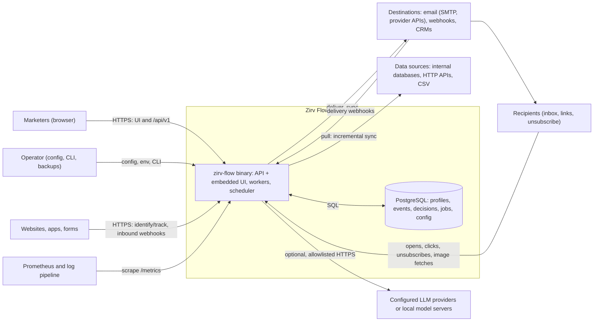
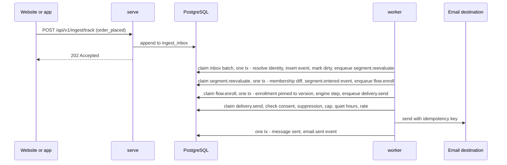
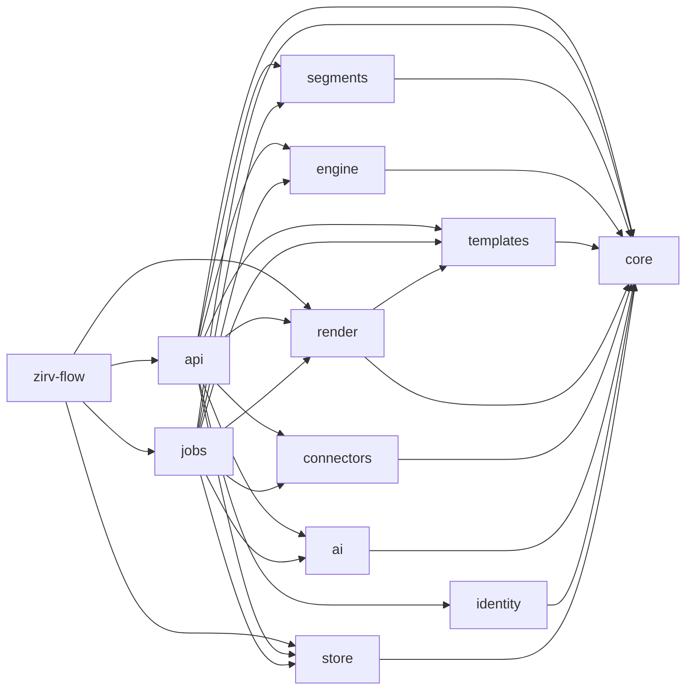
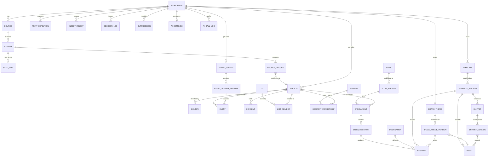
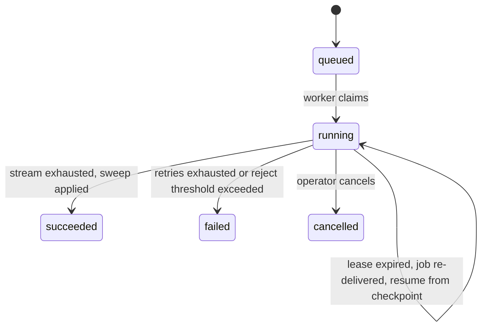
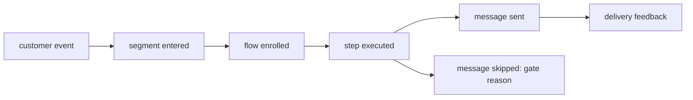

# Zirv Flow architecture

Living document: the intended system and the decisions behind it. Change it
through pull requests. Decisions (section 20) are never rewritten in place; a
changed decision gets a new superseding entry, linked both ways. Anything not
yet decided is an open question (section 21). Delivery order: [roadmap.md](roadmap.md).

## 1. Purpose and scope

Zirv Flow (`Glubiz/zirv-flow`, MIT) is a self-hosted marketing automation tool:
one Rust binary, `zirv-flow`, plus PostgreSQL. Marketers connect internal and
external data sources, segment the people in their business from that data,
and run automation flows for everyone or for a segment. It targets the problems
marketers hit before any message is sent: data about one person spread across
systems that disagree; segments nobody can explain or date; integrations that
drop, duplicate or never delete records; consent and erasure handled elsewhere.

### 1.1 Goals for v1.0

| ID | Goal |
|----|------|
| G1 | Connect data: built-in database sources, declarative HTTP sources, CSV import, identify/track API, inbound webhooks. Syncs are incremental, idempotent and deletion-aware, with per-source freshness visible. |
| G2 | One profile per person: deterministic identity resolution, typed traits with per-trait source precedence, events, lists, consent, suppression. |
| G3 | Segments marketers can trust: visual builder, live counts, per-person explanation, visible data age, entry/exit events. |
| G4 | Durable, versioned, testable flows triggered by segment changes, events, schedules, manual starts or the API. |
| G5 | Compliant delivery: email and webhooks first; consent, suppression, frequency caps, quiet hours and rate limits enforced in core; delivery and engagement fed back as events. |
| G6 | Operable by a small team: binary + Postgres, compose quickstart, metrics, health checks, documented backup/restore/upgrade. |
| G7 | Message content without code: a channel-aware template builder (email blocks rendered to responsive HTML and text, a webhook payload editor) with brand theme, snippets, merge tags from the field registry and per-block conditions; previews come from the same renderer as sends. |
| G8 | Govern and investigate events: versioned schemas, visible validation and rejects, redaction, live debugging, exploration and a unified person timeline. Every derived action is traceable to its typed cause, including skips and failures. |
| G9 | Optional, safe authoring assistance: configured LLMs draft and explain Zirv Flow's typed artifacts through the same validators and RBAC as the API; a person always reviews and accepts a draft. |

### 1.2 Non-goals for v1

- More than one organization per deployment; active-active multi-region.
- Querying sources live without copying them (federated mode is a later milestone, ADR-001).
- Running a mail transfer agent or managing IP reputation (mail goes to SMTP relays and provider APIs).
- SMS, push, in-app and ad-audience channels and their builders (their content types are reserved in the template model, section 11.1); probabilistic identity matching; predictive scoring.
- Analytics, attribution and campaign reporting beyond delivery and per-node flow counters.
- AMP email; hosted landing pages or forms.
- Autonomous assistant actions; model hosting, training or fine-tuning by Zirv Flow.
- Third-party code plugins (ADR-004); sub-second membership for time-window segment conditions (scheduled recompute, section 8.4).

## 2. Principles

1. **The binary and Postgres are the whole product.** More infrastructure needs measured evidence (ADR-003).
2. **Every number is explainable.** Counts, memberships and skipped sends link to the data and rule behind them.
3. **Freshness is a value.** Every segment result and send decision carries the age of its inputs.
4. **Compliance is data, enforced at one boundary.** Consent, suppression and erasure live in the profile store and are checked in the send pipeline, not left to flow design.
5. **Deterministic core, effects at the edge.** Segment compiler, flow interpreter and template renderer are pure functions of their input and an injected clock; I/O lives in job handlers. The segment compiler takes an explicit `now` and reads the clock at the edges (8.2); the flow engine adopts the same seam when it is built (M5).
6. **At-least-once execution with idempotency keys.** Exactly-once is never claimed for a system that cannot honour a key.
7. **The workspace is the isolation unit.** Every row carries `workspace_id`; every query and job is scoped by it.
8. **API first.** The UI uses the public `/api/v1`; every milestone ships API and UI for its feature together.
9. **Fail visibly.** Rejected records, failed steps and skipped sends are stored with a reason and shown in the UI.
10. **Causality is data.** Every derived action carries a trace and typed cause across queues and external effects; operational logs are not the system of record for product decisions.
11. **Assistance proposes, people decide.** LLM output is untrusted, workspace-scoped and draft-only; deterministic validators and explicit acceptance remain authoritative.
12. **Module boundaries are executable rules.** Crate dependencies, feature-module APIs and frontend imports follow the allowlists in section 5, and CI rejects violations.

## 3. System context



## 4. Runtime and process view

### 4.1 Roles

One binary, several roles, each a long-running loop. `all` runs every role in
one process and is the default (bare `zirv-flow` and the container image).

| Command | Instances | Responsibilities |
|---------|-----------|------------------|
| `serve` | any, stateless | `/api/v1`, ingestion, tracking/unsubscribe, inbound webhooks, template preview, image assets, embedded UI, `/healthz`, `/readyz`, `/metrics` |
| `worker` | any, stateless | Claim and execute jobs; `--kinds` dedicates a pool (e.g. `delivery`) |
| `scheduler` | any, one active leader | Due schedules to jobs, lease reaping, partition maintenance, retention, stale-source detection |
| `all` | one per host | All three roles in one process (default) |
| `migrate`, `admin ...`, `config check` | one-off | Apply migrations; create owner, rotate master key, replay erasures; validate config (secrets redacted) |

### 4.2 Cooperation through Postgres

- Roles never call each other; all coordination is rows in Postgres.
- **Transactional enqueue:** a state change and the jobs it causes commit in one transaction, so a committed change always has its follow-up job and a rolled-back one never does. No dual write, no outbox relay.
- Jobs are claimed in a short transaction and executed outside it (section 14).
- `LISTEN/NOTIFY` wakes workers as a latency hint; fixed-interval polling is the correctness path.
- The scheduler leader holds a session-level `pg_try_advisory_lock`; if its connection drops another scheduler takes over. Schedule slots carry unique keys, so a brief two-leader overlap cannot fire a slot twice.
- Due-time comparisons use the database's `now()`, so host clock skew cannot fire timers early.

### 4.3 From event to email



### 4.4 Shutdown and failure

On `SIGTERM`, `serve` drains requests, workers stop claiming and finish
in-flight jobs within a grace period, and the scheduler releases its lock. Jobs
left unfinished, by shutdown or crash, are retried when their lease expires;
idempotency keys make that safe (section 14). If Postgres is down, `/readyz`
fails, loops back off and ingestion returns `503`; v1 does not buffer locally.

## 5. Module and crate layout

M0 is a single crate. The Cargo workspace arrives in M1: `crates/<name>` for
each crate below (`zirv-flow-ai` joins in M3, `zirv-flow-identity` in M1 with OIDC sign-in, `zirv-flow-templates` and `zirv-flow-render` in M6), plus `web/` (TypeScript +
React SPA, Vite, React Flow canvas).

| Crate | Contents | Independent reason to exist |
|-------|----------|-----------------------------|
| `zirv-flow` (bin) | CLI, config, role startup, embedded web assets | The single deliverable; thin composition root |
| `zirv-flow-core` | Domain types, ids, validation, segment AST, flow graph, `Clock` trait (8.2) | Shared vocabulary; dependency set kept pure (no sqlx, HTTP client or tokio networking) |
| `zirv-flow-store` | sqlx pool, migrations, repositories, Postgres job queue primitives | Sole owner of the profile store: one migration stream, one sqlx offline cache. Queue SQL lives here because enqueue must join the caller's transaction. |
| `zirv-flow-segments` | AST to parameterized SQL compiler, dependency analysis, reference evaluator | Most correctness-critical code, own golden corpus. Pure: emits SQL + params that `store` executes. Used by `api` (preview, explain) and `jobs` (recompute). |
| `zirv-flow-engine` | Deterministic flow interpreter, simulation harness | Pure, so simulation needs no I/O. Used by `api` (test mode) and `jobs`. |
| `zirv-flow-connectors` | `Source`/`Destination` traits, connector runtime, built-ins, HTTP manifests, email transport | Heavy, fast-moving external dependencies (HTTP, SMTP, source DB drivers). Depends on `core` only: yields records and checkpoints, never writes the profile store. |
| `zirv-flow-identity` | OIDC discovery, JWKS and the authorization-code exchange with ID-token verification (`openidconnect`, rustls) | Every outbound call to the operator-configured identity provider lives here, so `api` stays inbound-only. Depends on `core` only. The issuer is operator-configured, so the M3 egress policy does not apply to it. |
| `zirv-flow-ai` | Provider trait and OpenAI-compatible and Anthropic adapters; structured tool-call orchestration, bounded repair, budgets, audit inputs and deterministic fake provider | Optional outbound protocols and HTTP dependencies change independently from the deterministic domain crates. The crate coordinates existing typed tools and validators but neither defines nor bypasses them. |
| `zirv-flow-templates` | Template document types and schema migrations, MiniJinja sandbox, rich-text sanitizer, MJML generation and rendering via `mrml`, text-part generation, webhook payload rendering, publish validation | Pure renderer used by `api` (preview) and `jobs` (send), so preview and send share one code path. Own golden corpus (per-block renders, migrations). Its dependencies (`mrml`, MiniJinja, sanitizer) are pure but too heavy for `core`, and `connectors` cannot be held pure by the `cargo tree` check. Starts in M6 with HTML and MJML code templates and the v1 block document; M7 adds themes, snippets and migrations. |
| `zirv-flow-render` | Pool client for the isolated render host (11.9): spawns and supervises `zirv-flow render-host` children, length-prefixed JSON framing, per-render deadline, kill and respawn, typed render failure, metrics; the child-side serve loop | The one place that spawns render processes, so `templates` stays pure and `api` and `jobs` share one pool implementation. Depends on `core` and `templates`. |
| `zirv-flow-api` | axum router, auth, OpenAPI, ingestion, tracking, static UI serving, assistant tools (`AiTool` implementations and their registry) | HTTP surface; neither `api` nor `jobs` depends on the other |
| `zirv-flow-jobs` | Worker and scheduler loops, job registry, job handlers | Composition point for background work: handlers combine `store`, `segments`, `engine`, `templates`, `connectors`, which no other crate needs together |



### 5.1 Allowed crate dependencies

The table is an allowlist of direct workspace-crate dependencies. A crate may
depend on fewer crates than listed; any workspace edge not listed fails CI.

| Crate | May depend directly on |
|-------|-------------------------|
| `zirv-flow` (bin) | `zirv-flow-api`, `zirv-flow-jobs`, `zirv-flow-store`, `zirv-flow-render` |
| `zirv-flow-core` | none |
| `zirv-flow-store` | `zirv-flow-core` |
| `zirv-flow-segments` | `zirv-flow-core` |
| `zirv-flow-engine` | `zirv-flow-core` |
| `zirv-flow-connectors` | `zirv-flow-core` |
| `zirv-flow-ai` | `zirv-flow-core` |
| `zirv-flow-identity` | `zirv-flow-core` |
| `zirv-flow-templates` | `zirv-flow-core` |
| `zirv-flow-render` | `zirv-flow-core`, `zirv-flow-templates` |
| `zirv-flow-loadgen` (tools/loadgen) | none |
| `zirv-flow-api` | `zirv-flow-core`, `zirv-flow-store`, `zirv-flow-segments`, `zirv-flow-engine`, `zirv-flow-connectors`, `zirv-flow-ai`, `zirv-flow-identity`, `zirv-flow-templates`, `zirv-flow-render` |
| `zirv-flow-jobs` | `zirv-flow-core`, `zirv-flow-store`, `zirv-flow-segments`, `zirv-flow-engine`, `zirv-flow-connectors`, `zirv-flow-ai`, `zirv-flow-templates`, `zirv-flow-render` |

`api` and `jobs` never depend on each other, and no crate depends on the binary.
The pure crates (`core`, `segments`, `engine`, `templates`) never depend on an
I/O crate, sqlx, an HTTP client or tokio networking. `store` owns sqlx;
`connectors`, `ai` and `identity` are the outbound-I/O crates, and `render` is the process-spawning one.

`engine` depends on `core` only, so it never sees `segments`. The flow graph types
and their structural publish validation (cycles, unreachable nodes, untyped edges)
live in `core::flow`. The engine's simulation uses a seeded test evaluator; the
reference evaluator lives in `segments` and is used by test mode in `api` (9.4).

Two cross-cutting policies add no crate and no edge. The egress policy (16.1) is
pure code in `core::egress` (address classification, allowlist matching, the
decision type); `connectors` and `ai` each enforce it at their own connect point.
Envelope crypto (16.2) is pure code in `core::secrets` next to `MasterKey`;
`store` holds the ciphertext, and `api` and `jobs` open a secret and pass the
typed plaintext credential into `connectors` or `ai`, which never decrypt.

### 5.2 Feature modules inside crates

Each crate is split into vertical feature modules for the domain areas it owns:
`sources`, `people`, `events`, `segments`, `flows`, `templates`, `delivery` and
`assistant`. A crate creates only the modules it needs. Shared code stays small
and earns a domain-neutral name; feature code does not move into a generic
`utils` module.

```text
crates/zirv-flow-api/src/
  lib.rs
  sources/mod.rs
  people/mod.rs
  events/mod.rs
  segments/mod.rs
  flows/mod.rs
  templates/mod.rs
  delivery/mod.rs
  assistant/mod.rs
```

Items are `pub(crate)` by default. A feature's supported surface is the set of
functions and types re-exported by its `mod.rs`; a crate's external surface is
re-exported by `lib.rs`. Code never reaches into another feature's internal
submodules. Cross-feature calls use the owning feature's public functions and
types. File and module names use domain terms, not transport or implementation
terms, unless the module owns that transport.

### 5.3 Extension points

These are the only implementation registries. Adding an implementation means
one module that implements the owning trait and one line in its registry; only
the registry enumerates implementations.

| Extension | Trait | Owning crate | A new implementation adds |
|-----------|-------|--------------|---------------------------|
| Connectors | `Source` | `zirv-flow-connectors` | One source module and one source-registry line |
| Destinations and channels | `Destination` | `zirv-flow-connectors` | One destination module and one destination-registry line |
| Template content types | `TemplateContent` | `zirv-flow-templates` | One content-type module and one content-registry line (`html`, `mjml`, `blocks` and `webhook` in M6) |
| Job kinds | `JobKind` | `zirv-flow-jobs` | One handler module and one job-registry line |
| AI tools | `AiTool` (defined in `zirv-flow-ai`) | `zirv-flow-api` (`assistant` feature module) | One tool module and one tool-registry line; tools live in `api` because they call validators and store reads that `ai` may not depend on (5.1) |

No other registry is introduced. Domain catalogs such as the field and event
schema registries store workspace data; they are not implementation registries.

### 5.4 Frontend modules

`web/src/features/` contains feature folders named for the same domain areas.
Each feature exposes its supported surface through `index.ts`; another feature
imports only that surface, never an internal file. Shared presentation
components live in `web/src/ui/`, and the generated OpenAPI client has its own
top-level folder. Features may use both, but never import from `web/src/app/`;
the app shell composes features, not the reverse.

### 5.5 Enforcement

- From M1, CI reads `cargo metadata` and fails on every workspace dependency
  edge absent from section 5.1, naming the disallowed edge.
- The existing `cargo tree` purity check rejects sqlx, HTTP clients and tokio
  networking in `core`, `segments`, `engine` and `templates`; sqlx remains a
  direct dependency of `store` only.
- Frontend lint rejects deep imports across features and imports by a feature
  from the app shell.
- Rust review treats `pub(crate)` as the default and rejects access to another
  feature's internal modules or an implementation listed outside its registry.
- Reviews never loosen an allowlist, purity rule or import boundary merely to
  make a change pass. A boundary change requires an architecture decision.

The engine yields branch conditions to an injected `ConditionEvaluator`
(production: compiled SQL from `segments`, run by `store` in the step transaction;
test mode: the reference evaluator over a snapshot; simulation: a seeded test
evaluator, 9.2 and 9.4). The renderer never evaluates conditions itself: it lists
a template's block conditions, the handler evaluates them in one
`ConditionEvaluator` call, and the results go into the render as plain inputs
(section 11.4). CI builds `web/` before the release build; `build.rs` embeds `web/dist`, or a
placeholder page in the api crate when it is absent, so `cargo build` works without Node. The OpenAPI document
(utoipa) is committed, drift-checked and feeds the SPA client.

## 6. Domain model

One organization per deployment (implicit). **Workspaces** (brands,
environments) are the isolation unit. **Users** are deployment-wide and join
workspaces through **memberships** with a role; **API keys** belong to one
workspace and carry scopes. Every domain table leads its key with
`workspace_id`; ids are UUIDv7 (time-ordered, index-friendly).



| Entity | Purpose and key rules |
|--------|-----------------------|
| Person | Resolved individual. `traits jsonb` is materialized from contributions; `merged_into` is set on the losing side of a merge. For traits marked "indexed for segments" (OQ-1, 21.1), `people` also carries a fixed set of generic typed slot columns per promotable scalar type: 8 string, 8 number, 6 timestamp, 4 date and 4 boolean per workspace, each with a partial btree index on `(workspace_id, slot)` where the slot is not null. `string_list` traits stay in `jsonb`. | Slots are live: columns `trait_s1..s8`, `trait_n1..n8`, `trait_t1..t6`, `trait_d1..d4` (UTC midnight) and `trait_b1..b4`; a definition holds one in state `backfilling`, `ready` or `retiring`, and every writer of `people.traits` takes `pg_advisory_xact_lock_shared(7000, hashtext(workspace))` in its own statement before reading the assignments while every assignment change takes the exclusive form.
| Identity | `(kind, normalized value)` per person: email, phone, anonymous_id, external id namespaced per source. Unique on `(workspace_id, kind, value)`. |
| Trait definition | Field registry: key, type (string, number, boolean, timestamp, date, string list), precedence policy, PII flag, channel-address flag. Values are validated on write, so compiled reads cast safely. |
| Source record | Ledger row per `(source, stream, record key)`: mapped payload, content hash, person, last seen run, deletion mark. These are the per-source contributions traits are computed from. |
| Event schema, version | Registry entry per event name with immutable versions: typed properties, required fields, enums, descriptions and a PII flag per property; validation mode `allow`, `warn` or `block`. The workspace policy creates a draft schema for an unplanned name or rejects it. |
| Event | Append-only `(name, schema_version, occurred_at, received_at, properties, source, event_id, message_id, trace_id, validation_state)`. Range-partitioned by month on `occurred_at`; ingest redaction runs before storage. A client `messageId` deduplicates retries for effectively-once storage. |
| Ingest reject | Rejected customer event or sync record with reason, masked sample, source and trace. It is visible, retained separately and replayable after its schema or mapping is fixed. |
| Decision log | Append-only, time-partitioned typed records for derived actions and their causes. It stores durable ids and reasons but no personal-data values; `trace_id` links the tree across jobs, events, messages and forwarding. |
| Consent | Recorded consent: state per `(person, channel, topic)`: `subscribed`, `unsubscribed`, `pending_confirmation`, `unknown`; plus append-only history with source and evidence. It is the input to the workspace consent policy (10.1), which decides effective consent. |
| Suppression | Identifier-level block (hard bounce, complaint, manual, erased), stored as an HMAC of the normalized identifier so it outlives erasure. |
| List; segment, version, membership | Static set of people (manual, CSV, API, flow action). Segment definition AST; membership rows with `entered_at`/`exited_at`, current members `exited_at IS NULL` (partial unique index). Erasure and person deletion remove a person's membership rows; a merge closes the merged person's rows, and the survivor's `merge` change class (7.1) re-evaluates it. |
| Workspace | Isolation unit. `workspaces.timezone` is an IANA zone name, default `UTC`, set by an Admin. It is the fallback zone for `wait.until_time` (9.1). |
| Flow, version, enrollment; message | Versions are immutable once published and enrollments are pinned to one. The enrollment context holds ids only (9.3). `flow_entries(flow_id, person_id, entries, last_entered_at)` records each person's entries for the re-entry rule, and a partial unique index allows one active enrollment per flow and person (9.4). One message row per send attempt; `messages.idempotency_key` is unique. The message records the exact template, snippet and theme versions it was rendered from. |
| Template, template version | Channel (`email`, `webhook`; `sms`, `push`, `in_app` reserved), category, mode (`blocks` or `code`) and a versioned content document (section 11). Versions are immutable once published. |
| Snippet, snippet version | Reusable block fragment (e.g. legal footer). Templates reference the snippet, and rendering uses its current published version. |
| Brand theme, theme version | One per workspace: colours, fonts, logo asset, default footer snippet. Published versions are immutable; rendering uses the current one. |
| Asset | Uploaded raster image (bytes, sniffed type, dimensions, content hash), served publicly from `server.public_url`. Retained while any published template, snippet or theme version references it. |
| AI settings | Per-workspace enablement, provider/model choice, budget, the opt-in transcript window (off by default) and PII opt-in. Deployment configuration declares the permitted providers and models. |
| AI call log | Audit record for each assistant call: workspace, user, feature, provider, model, tokens, estimated cost, latency, outcome and resulting draft id; transcript content is kept only inside the workspace's opt-in window (13.4). |

As built (lists): `lists` holds `member_count`, kept exact under a row lock on the list;
`list_members` is keyed `(list_id, person_id)` and `list_member_changes` is the history.
`store::lists` adds and removes in one transaction that locks the people (resolved through
`merged_into`, re-resolved if a merge wins the race) before the list, the same order a merge
uses, and writes one history row and one `list.membership` decision (ids only) per real
change. `merge_people` calls `lists::move_on_merge`, which gives the survivor the union of
both memberships with the earlier `added_at`, deletes the loser's rows, corrects the counts
and re-points the loser's history. Reads need `read`; writes need `write` (any member for a
session) and CSRF. Identifier values on the member page use the same masking as conflict
review. The CSV import resolves identifiers to existing people and never creates one; its
dry run runs the real transaction and rolls it back, so its counts are exact.

As built (consent, topics and suppressions):

- **Rules.** `core::consent` holds the pure rules: `Channel` (only `email`), `ConsentStatus`,
  `TopicPolicy`, `allowed(channel_wide, topic, policy)` for the M5 send gate and `merge` for
  two people's states. `core::people::identifier_hash` is the `Identifier`-purpose HMAC of
  `<kind>:<normalized value>`; the workspace is left out so organization-wide suppression
  (OQ-19, decided in 10.1) and the erasure ledger can reuse a hash.
- **Tables** (migration `0008_consent.sql`). `topics` (unique `(workspace_id, key)`),
  `consent` (one row per person, channel and topic, `topic_id` null for the whole channel,
  unique with `NULLS NOT DISTINCT`), `consent_changes` (the history: from and to status,
  source, evidence up to 4 KiB, actor, trace) and `suppressions` (a unique index per scope:
  `(workspace_id, identifier_hash)` for the workspace and `(identifier_hash)` for the
  organization, migration `0048`). A trigger refuses any update of `consent_changes` other
  than moving `person_id` to the person its owner was merged into, which a merge needs;
  deletes stay possible for erasure. `suppressions` carries an opaque `id` for paging, so a
  cursor never holds a hash.
  It has no `person_id` and survives erasure by design; the other three are
  covered by the isolation tests and the erasure scan.
- **Writes.** `store::set_consent` locks the person row, follows `merged_into`, treats a write of
  the status already held as a no-op (no history row, no decision) unless some other record of
  the person and channel overlaps its scope (equal or absent topic, and equal values for every
  dimension key both name), has a different status and lies strictly between the held row and
  the change by (`changed_at`, change id); then it advances the row like any change, because
  that is what makes the change the latest word for the messages both cover. Otherwise it appends
  the history row and a `consent.change` decision (reason is the source code, subjects are the
  person and the change) and upserts the state, but only when the change is newer by
  (`changed_at`, change id) than the row: an older change, such as a late ingest, stays in the
  history with a `superseded` decision, returns the `Superseded` outcome (callers count it as no
  state change) and leaves the state, so the state always agrees with
  the read rule's latest-change-wins. `store::consent::move_on_merge` runs inside the merge
  transaction: per channel and topic of the loser it applies `core::consent::merge` against the
  survivor, records a `merge` history row when the status changes, deletes the loser's states
  and re-points its history.
- **Suppressions.** `add_suppression` keeps the first reason, `erased` overwrites; `erased`
  rows are never deleted by `remove_suppression`. Import and export hash and stream in the API
  crate; the store sees hashes only.

## 7. Data sources and ingestion

### 7.1 Paths and the common write path

| Path | Mechanism | Idempotency | Freshness signal |
|------|-----------|-------------|------------------|
| Sync (pull) | `sync.run` job per stream, resuming from a checkpoint | Ledger content hash; checkpoint committed with the data | Last successful run, cursor high-water mark |
| Identify / track (push) | `serve` durably appends to `ingest_inbox` before returning `202`; workers drain it in batches | Client `messageId`, else server-assigned | Oldest unprocessed inbox row |
| CSV import | Upload, map, dry run, then run like a sync | Key column, else file hash + row number | Import completion |
| Inbound webhook | `/hooks/{id}`, signature check, then a durable append to `ingest_inbox` like identify; mapping runs in the drain | Configured dedupe field | Last received |
| Contacts API (push) | Create, update and delete contacts by key, singly or in bulk, through the inbox like identify (7.6) | Idempotency key, else contact key plus payload hash | Oldest unprocessed inbox row |
| Kafka stream | A long-running consumer job per stream, not a `sync.run` batch (7.6, 14); the partition offsets are the stream checkpoint, committed in the apply-batch transaction (7.6) | Topic, partition and offset | Consumer lag per partition |

Every path ends in **apply-batch**, one transaction per batch (default 500
records): normalize identifiers; resolve or create the person (merging if
needed); upsert ledger contributions and recompute affected traits; insert
events with dedupe; write coalesced dirty marks (`person_changes`); enqueue
follow-ups (segment re-evaluation, event triggers, event-wait wakeups); commit
the stream checkpoint. Customer-event schema validation, redaction, reject
handling, lateness and trace propagation are defined once in section 12 and
used by every ingestion path.

The dirty set is `person_changes`, one row per `(workspace_id, person_id)`. Each row carries a
`smallint` change-class bitmask (traits, events, lists, consent, identifiers, merge), OR-ed
on conflict, so repeated marks coalesce and keep every class that changed. A mark made after
`segment.reevaluate` claimed a row re-inserts it (8.4). `segment.*` events never mark a person
dirty: a membership change reaches dependent segments through topological evaluation, not
through the dirty set. A mark carries the trace and cause of the latest change, which the entries and exits it causes continue; the writer's transaction enqueues `segment.reevaluate` once, only to cut latency.

As built (identify / track ingestion): `POST /api/v1/ingest/{identify,track,batch}` validate
structure, charge the key's in-process token bucket (items, per `serve` process), and append
one row per item to `ingest_inbox` with the request's trace id in a single transaction that
also enqueues `ingest.drain` for the workspace (`unique_key = ingest.drain:<workspace>`). The
inbox row's `message_id` is the client's or a server-assigned UUID v7. Each row also
stores `affinity`, the first byte of the SHA-256 of its record key (the strongest identifier)
modulo 64, fixed forever; rows appended before the column existed, or by a pre-0.29 serve
during a rolling upgrade, hold NULL. A drain job first buckets the workspace's NULL rows (a
blocking `FOR UPDATE` in a short transaction of its own, so it waits out an erasure and cannot
deadlock; the bucket comes from the same function as the append's), then runs
`ingest.drain_shards` (default 8) loops concurrently, each owning the buckets with `affinity % shards =
index`, each a tokio task of its own owned by the job (so the shards use several runtime threads,
and a lost lease aborts them all). A batch is up to `ingest.drain_batch_size` of the
oldest rows of the shard's buckets, picked through `(workspace_id, affinity, id)`, so a scan
never walks another shard's backlog. A key lives in one bucket, so its
rows still apply in id order; two shards may share a person under different keys, and a
deadlock between them is the retryable `40P01`. The worker pool holds `concurrency * (1 +
shards) + 1` connections. Each loop is `drain_batch`: in one transaction it picks the
batch's ids without locking, locks those rows with `FOR UPDATE SKIP LOCKED` (a batch never
applies past a row it could not lock: the rest of that bucket's picked rows wait for the next
batch, and a batch that takes nothing ends the loop), applies them in id order through the
transaction-taking profile and event paths of apply-batch, deletes them and commits, so a crash leaves them in place and concurrent
drainers never apply a row twice. A retryable error retries the batch with jittered backoff;
any other error applies the batch's rows one at a time, each in a savepoint, and a row that
still fails becomes an `apply_failed` ingest reject. The job never re-enqueues itself, since it
holds its unique key; the scheduler leader enqueues a drain for each workspace whose oldest
row (one `(workspace_id, id)` index probe per workspace) is over 2 seconds old. Row ids come
from a sequence, so two requests that commit out of order drain in id order, not commit order.

As built (M3, webhooks): a hook is a source of kind `webhook` (capability `push`, no config, no
credential, `read` yields nothing) with one stream `payload`, plus a `webhooks` row that holds
the random v4 id of the URL, the signature scheme (`core::signature`: HMAC-SHA256 over
`"{timestamp}.{body}"`, or over the raw body when `timestamp_header` is NULL), the dedupe field
and the id of the sealed shared secret (`encrypted_secrets`, purpose `webhook_secret`). The
source, stream, secret and row are created and removed together, and only through
`/api/v1/workspaces/{ws}/webhooks`. `POST /hooks/{id}` is public and ordered cheapest first: a
declared length over `ingest.max_webhook_bytes`, the id, one query for the hook (it must be
receiving), the per-hook token bucket (charged only for ids that resolved, so the limiter holds
at most one bucket per stored hook), the body read with the same cap, the secret opened into a
zeroizing buffer, the signature and timestamp verified with a constant-time compare, then the JSON
object and its dedupe value. Only then does one transaction append an `ingest_inbox` row of kind
`webhook` (`webhook_id` set, `api_key_id` NULL, `ON DELETE CASCADE` from the hook; the row's
`item` is `{"payload", "signed_at"}`; `affinity` is the bucket of the hook id, so one hook
drains in id order in one shard), enqueue `ingest.drain` and, at most once a minute per hook per
process, report the stream through `record_stream_outcome`. Mapping runs in the drain, not at the
endpoint: it loads each batch's hooks and the trait catalog once, maps a payload with
`core::mapping::map_json` (the declared fields are `Mapping::root_fields`, so an absent field is
an empty cell), and applies the profile record (observed at the signed time, so an older replay
cannot overwrite a newer trait; the ledger keeps one row per record key, so the drain drops the
traits a later-observed payload already set), the event (message id `wh:{hook}:{dedupe value}`)
and the list memberships through the existing apply paths. A refused mapping becomes an
`ingest_rejects` row through the writer the sync batch uses (`insert_record_rejects`, with no run
id), and a row that cannot be applied is isolated as `apply_failed` like any inbox row.

As built (CSV import): `POST /imports` streams the file into `import_chunks` (1 MiB each, written
with the `imports` row in one transaction, so a refused upload leaves nothing) while the SHA-256,
the row count, the header and the first rows are taken with the pure incremental reader (over `csv-core`) in
`core::csv_file`. The mapping is the pure `core::mapping` (column rules, the bounded transform set,
save-time validation, row errors as codes), which the M3 sync runs will reuse. `import.dry_run`
and `import.run` are job kinds that read the chunks in batches of 500 rows; each batch of a run is
one transaction on a connection beside the job's, which applies the profile records through the
transaction-taking profile path, adds list members, writes the rejects and advances `rows_done`,
fenced on the import still being `running` at that checkpoint (a cancel or a second attempt makes
the batch a no-op). The record key is the key column's value, else `<file sha256>:<row number>`,
under the import's own source and stream. A run fails with `reject_threshold` once more than 1,000
rows are done and the rejected share is over the import's threshold (5%); applied batches stay.
The worker's lease heartbeat covers the long run, so there is no segmenting. The scheduler
leader's hourly upkeep deletes the chunks 7 days after an import ends and the rejects (whose
`raw` cells are admin-only personal data) 30 days after they were written.

### 7.2 Sources, streams and sync runs

A **source** is a connector instance (type, config, encrypted credentials,
schedule) exposing **streams** (table, query, API resource). Each stream maps to
`people` (identifiers, traits), `events` (name, timestamp, person identifier,
properties) or `list_membership`. Custom object types are post-1.0 (OQ-4): in v1
order- or account-like data arrives as events with typed properties or as
traits, and the store model is unchanged.

| Sync mode | Use | Deletion detection |
|-----------|-----|--------------------|
| Incremental (cursor field) | Default where an `updated_at`-like field exists | Delete signal in the mapping (soft-delete field, deleted-records endpoint), or a periodic key-only reconciliation run |
| Full refresh | Small data, no cursor | Mark and sweep: not seen in a successful complete run means tombstoned |
| Push | API, webhooks | Explicit delete calls |
| Stream | Kafka topics | A tombstone (null value) for the record key, or a mapped delete field |



A checkpoint is opaque connector state (cursor, page token, LSN) written in the
same transaction as the batch it covers, so a resumed run neither skips nor
re-applies data. Long runs heartbeat their lease. One run per stream at a time
(job unique key). The sweep runs only after a run **succeeded**: a failed or
cancelled run never deletes. A run also fails, without sweeping, when its reject
rate exceeds the stream threshold (default 5%), so a broken mapping cannot
cascade into deletions. Rejects (type mismatch, missing identifier, bad
timestamp) are kept in `ingest_rejects`, the table identify, track and import
rejects already use, with reason and raw values and a `sync_run_id` that ties
each to its run. A Kafka stream has no `sync.run`: its consumer job (7.6, 14)
applies the same reject rule per message.

As built (M3): `sync_runs` holds the state, trigger, counters, per-run checkpoint, attempt,
trace id and error code; a partial unique index allows one `queued` or `running` run per
stream. A unit of at least 500 records commits in one transaction that first locks the job's
lease (`store::lock_lease`) and then the run row, so a lost lease or a cancel writes nothing.
An expired lease does not return the run to `queued`: the row stays `running`, the job system
re-delivers the job, `attempt` counts it, and the next attempt resumes from the run's
checkpoint; only the last failed attempt marks the run `failed` (`source_error` for a read error,
else `job_failed`); the scheduler leader fails, with `job_failed`, a run whose job is dead or
gone. A lost lease also cannot end a run: the end-of-run writes lock the lease like a batch. An incremental stream also keeps `streams.checkpoint`, written in the same
transaction except for a batch that fails the run on its rejects. The reject check applies from
100 records read (`SYNC_REJECT_CHECK_MIN_RECORDS`) at 5%, stored per run. A source's cron is
mirrored to a `schedules` row (`schedules.source_id`, cascading); the leader's firing queues
one run per enabled, mapped stream without an active run, each with its own job
(`sync:run:<run_id>`) under the run's trace. The sweep is the last phase of the same `sync.run`
job for a full refresh and for a reconciliation (`sync_runs.run_kind`, `sync` or `reconcile`; the
payload, queueing, the one-active-run index, fencing and metrics are the same): after the stream
is exhausted and the last unit committed, and before `finish_run`, `store::sync_runs::sweep`
removes the live ledger rows of the stream whose `last_seen_run` is not the run, 200 per fenced
transaction (lease locked, run locked `running`), through `remove_contribution_in`, with a
`deleted` decision per removal. A record read but not applied (refused by the mapping or the
store, or only listed by a reconciliation) is marked seen, so it is never swept. Before the first
unit, one statement compares the unseen share of the live rows with `streams.sweep_limit`
(default 0.5) and a run over it ends `failed` with `sweep_limit` and removes nothing. A reconcile
run reads from the beginning, maps records only to split deleted from seen keys, and never writes
`streams.checkpoint`; its cron is a `schedules` row keyed by `stream_id`.

As built (M3, database sources): `postgres` and `mysql` are two modules and two registry lines in
`zirv-flow-connectors`, with the settings, TLS roots, keyset checkpoint, error mapping and metrics they
share in a private `sources::sql` helper (not a registry). A table or a configured `query:<name>`
is read in pages of 500 rows ordered by `(cursor, primary key)` or `(primary key)`, each page in its
own read-only transaction with a server-side statement timeout, strictly after the checkpoint
(`{"v":1,"key":[...]}`, the last row's key as the database printed it), so rows that share a cursor
value across a page boundary are neither skipped nor repeated. A stream needs a primary key and a
pageable key type, and an incremental stream does not read rows whose cursor is NULL. Every column
is read as text. Driver and server messages are dropped: failures are fixed messages, with the
SQLSTATE or error number logged and `zirv_flow_source_db_errors_total{source_type,reason}` counted.
The sources set `emits_deletes: false`; sweeping and delete signals for them come later.

**Mapping** is declarative: field path to identifier kind, trait, event field or
list, with a bounded transform set (trim, case, cast, timestamp parse,
concatenate, constant, value map, split) and nested JSON path selection for
field sources, the set already in `core::mapping`. There is no expression
language or scripting in v1 (OQ-5); a request the set cannot express becomes an
issue. The UI previews a mapping on sample records before saving.

As built (M3, HTTP manifest): the `http` source (`zirv-flow-connectors::sources::http`, one registry
line) runs any valid **manifest v1** on the connector runtime. The manifest is JSON stored as
`sources.config.manifest` (JSON because the config is `jsonb`, the editor edits text and the
assistant's typed tool schema is JSON; a YAML parser would be a second surface for an input an AI
drafts from untrusted documentation). It names the base URL, the auth type (never a secret: the
credential fields have fixed names), a rate limit, static headers and 1 to 20 streams, each with a
path, static query, records pointer, one of the runtime's pagination styles, typed fields, a primary
key, an optional incremental cursor, an optional delete signal and an optional mapping seed. There is
no expression language: unknown keys are refused, a closed list of script-like keys and any string
holding a template marker get their own code, and the only dynamic value in a request is the
incremental parameter. `zirv_flow_connectors::manifest::validate(&Value)` is the pure validator
(a hand-written walk that copies no value into an issue; `{code, path}` only, at most 50 issues,
limits of 64 KiB, 20 streams, 200 fields and 12 levels checked before the walk). The API's validate
endpoint, the editor, the source's own `read` and `check`, and the assistant tool (13.2) call it; it
depends on `core` only (5.1), and the spec-level `config_check` makes `validate_config` run it on
create and update. The checkpoint is `{"since": ...}` and moves only with the last batch of a stream
(to the highest cursor value seen), because an API may return records in any order; a lost lease
re-reads from the run's start, which the idempotent apply makes harmless (OQ-2 keeps ascending-order
resume open). A delete signal sets `Record.deleted` and nothing else: the batch path and the sweep
are unchanged. Discovery makes no request; a stream's mapping in the manifest is a seed written to
`streams.mapping` once, after the checks a saved mapping gets. `Source::rate_limit(config)` lets a
source type take its rate from its settings.

As built (M3, file sources): the `file` source (`zirv-flow-connectors::sources::file`, one registry
line) reads a CSV, NDJSON or top-level JSON array file at an https address through
`SourceContext::send` in byte-range windows of 4 MiB. A window begins at a record boundary and
is parsed by a fresh parser; the part after its last complete record is dropped and fetched
again with the next window, so a record (at most 1 MiB) always fits. The checkpoint is the byte
offset with the row count, the validator (`ETag`, else `Last-Modified`), the size and, for CSV,
the header and delimiter; a later window sends `If-Range`, and a changed validator or size
fails the read as `file_changed`. Only full refresh is offered. `core::mapping` gained the dotted
path (resolved by `JsonRecord::for_mapping`), one optional `event` rule per mapping and the
shared `map_json` the run and the preview both call. `commit_sync_batch` applies each record's
event through the event path of section 12.1 and its list memberships through `add_members`
(source `sync`) in the batch transaction, after the profile and before the checkpoint. The
event's `message_id` is `sync:` and the SHA-256 of source, stream, record key and event name, so
a re-read never repeats an event, and a mapping with an event needs a stream primary key.
`POST .../streams/{name}/preview` maps the first records of the source and writes nothing.

### 7.3 Identity resolution and precedence

Deterministic matching only, with rules per identifier kind:

| Rule | Meaning | Default |
|------|---------|---------|
| Normalization | email: trim + lowercase; phone: E.164; external ids exact, namespaced per source | as stated |
| `unique_per_person` | At most one value of this kind per person | on for external ids |
| `max_per_person` | Cap per kind, preventing chain merges through shared addresses | email 10, phone 10, anonymous id 100 |
| Merge policy | Whether a match may merge two existing people | allowed unless a uniqueness rule would break |

- **Blocked merge:** the record attaches to the person matched by the strongest identifier, and an **identity conflict** is recorded for review in the UI (shared family or role addresses are the common case). A review ends in one of two outcomes: keep the people separate, or move the identifier to one of them.
- **Merge:** the older person survives. One transaction moves identities, contributions, list memberships and consent, recomputes traits and sets `merged_into`. Consent takes the most recent explicit decision per channel/topic (`unsubscribed` wins ties). A `person.merge.rewrite` job then re-points events, enrollments and messages in batches (segment membership rows are closed instead, 6); meanwhile reads follow `merged_into` (one hop, chains compressed). Duplicate active enrollments in one flow keep the older and exit the other with reason `merged`. Each merge records its provenance (the moved ids in a merge record, plus a decision record). There is no unmerge in v1 (OQ-3).
- **Races:** concurrent creation of the same person is serialized by the unique identity index; the loser retries resolution.
- **Precedence:** each trait value is computed from all sources' contributions under the registry policy `latest` (by source observation time, default), `source_priority` (ordered sources) or `first`. Flow actions and the API write as sources (`flow:<id>`, `api`). The profile shows which source supplied each value.

As built (people, identities and the field registry):

- **Identifier kinds.** `email`, `phone`, `anonymous_id` and `external:<namespace>`
  (namespace `[a-z0-9_.-]{1,64}`). Email reuses the `Email` rules; phone is international
  format only (`+` and 8 to 15 digits after removing spaces, `-`, `.`, `(`, `)`, and a leading
  `00` read as `+`), with no national-format guessing; anonymous and external ids are exact,
  non-empty, at most 256 characters, with no control characters. Strength for an attach:
  external, then email, phone, anonymous id. An invalid identifier rejects the record with a
  typed reason; a record needs at least one valid identifier.
- **Inference.** An unregistered key is registered on first sight with `inferred = true`,
  `latest` precedence and `pii = false`: a string becomes `string`, a number `number`, a
  boolean `boolean`, an array of strings `string_list`. Timestamp and date are never
  inferred, and an object or a mixed array is dropped with a reason. Concurrent inference is
  `ON CONFLICT DO NOTHING` followed by a re-read. A type is fixed at creation.
- **Changing a rule.** Changing a trait's `precedence`, `source_order` or `archived` flag
  enqueues a `traits.recompute` job (payload `{workspace_id, key}`) in the same transaction
  as the registry change. The job recomputes that key for every person with a live
  contribution, 500 people per run and transaction (each run enqueues the next with an
  `after` person-id cursor), and appends a `trait.change` decision (ids only) and a dirty
  mark where a value changed. An archived key is not materialized: its values leave
  `people.traits` and `trait_sources` while the ledger keeps them, so unarchiving restores
  them. Retry: `StoreError::is_retryable()` is true for deadlocks, serialization failures and
  an identity race that outlasts three attempts; the caller retries the whole batch.

As built (merges and conflict review):

- **Rules.** A const table in `core::people` holds the defaults per kind, which are not
  configurable yet: `external:*` is `unique_per_person` with a maximum of 1, `email` and
  `phone` 10, `anonymous_id` 100. `merge_allowed` checks the union of the people's
  identities plus the record's new identifiers and answers `unique_kind` or `max_per_person`.
  The check is all or nothing for the people a record touches.
- **Resolution.** The people a record matches are locked `FOR UPDATE` in id order, so
  concurrent resolutions and merges cannot deadlock on each other; a person found already
  merged away re-runs the resolution (three attempts, then a retryable error). Allowed: the
  oldest person (`created_at`, then id) survives, and in the record's transaction each loser's
  identities and source records move, its traits are cleared, `merged_into` is set and chains
  are compressed, open conflicts among the merged people close as `merged`, a `person_merges`
  row, a `person.merge` decision and the `person.merge.rewrite` job are written, and the
  survivor's traits are recomputed. Blocked: the `identity_conflicts` row carries the reason
  and the shared `identity_id`, and an `identity.conflict` decision is appended.
- **Rewrite job.** `person.merge.rewrite` (payload `{workspace_id, merged_person_id}`)
  re-points `identity_conflicts.person_id` and `other_person_id` in batches of 1,000 rows per
  statement to the person the merged one now points at, then appends a
  `person.merge.rewrite` decision. A re-run moves nothing. Other person-scoped tables (events)
  join the target list in `store::people::merge` when they exist.
- **Review.** Conflicts are listed newest first by keyset (`status=open|resolved`).
  Resolving needs the admin role (or an `admin` key) and CSRF. `keep_separate` closes the
  conflict. `move_identifier` moves the conflict's identity to one of its two people unless
  the rules forbid it for that person (409), and recomputes nothing because identities carry
  no traits. Both are audited with ids only and appended as `identity.conflict.resolved`.
  Identifier values are returned to the owner, workspace admins and `admin` keys, and masked
  for members and `read` keys.

### 7.4 Deletion propagation

Deletion is in the pipeline from M2. A source-side delete tombstones the ledger
record, removes that record's identities, contributions and event rows, and
recomputes traits from what remains. If nothing remains (no contributions,
first-party events or consent), the workspace orphan policy applies (`keep`
default, or `delete`). The person is marked dirty, so memberships exit, flows
react as configured and destination syncs remove the person downstream (10.2).
Deletion removes one source's contribution; **erasure** (16.3) removes the
person and every derived row.

As built (M2): `remove_contribution` tombstones the record, recomputes the traits, deletes the
identities no other live record of the person lists (and the conflicts about them), marks the
person dirty, appends `contribution.removed` and then applies `workspaces.orphan_policy`
(`keep` or `delete`; orphan means no live record, no event and no explicit consent).
`store::privacy::delete_person` is the one function that owns the list of person-scoped tables;
it deletes the person and the people merged into them, and every milestone that adds a table
extends it. It is exposed as `DELETE /people/{id}`, as a step of erasure and as the orphan
policy's action, and it adds no suppression. As built (M3): `events.source_record_id` (nullable,
no foreign key, a partial index on the partitioned parent) names the ledger row an event came from,
and `remove_contribution_in` deletes those events, with their `event_dedupe` and `debugger_feed`
rows, in the removal's transaction, before the orphan check, so an event-only person left with
nothing follows the policy. A merge moves a record's person, not its link. No sync path writes
record-linked events until the events target of the mapping (#87); first-party events carry no
link and stay. As built (M3, file sources and deletion together): a sync batch marks its records
seen first, then hands each record's ledger id through `EventRecord.source_record_id` to the
event path, so the event a mapping yields is deleted with its record by a sweep, a delete signal, a
connector delete or a reconciliation. Lists only add: a removed record's list memberships stay.

### 7.5 Freshness and connector concerns

| Object | Freshness | Shown as |
|--------|-----------|----------|
| Pull stream | Time since last successful run; cursor high-water mark | fresh / stale (past threshold, default 2x schedule interval) / failing |
| Push source | Time since last record; inbox backlog age | same |
| Segment | `computed_at` plus the oldest input freshness of sources feeding its dependencies | "Data as of ..." on counts and membership |
| Send decision | Segment and trait freshness at decision time | recorded on the message |

Stale and failing sources are metrics and Sources-page badges. Flows do not pause
on stale inputs; they record input freshness on external effects and warn (OQ-14,
21.1). The connector runtime, not each connector,
owns (ADR-004): auth (API key, basic, bearer, OAuth2 client credentials and
authorization code with refresh), retries honouring `Retry-After`, rate limits,
pagination (cursor, offset, page, link header), checkpoints, the egress policy
(16.1) and delivery capabilities (idempotency keys, batching, erase).

As built (M3): `zirv_flow_connectors::runtime` implements auth, retries, the rate limit and the
pagination drivers once, behind `SourceContext::send` and `paginate`. `SourceContext` now carries
the source type (the metrics label), the source id (the rate-limit key) and a shared `RateLimits`
registry that `AppState` holds. The limit is one token bucket per source per worker process
(ruling 691b13cf), shared by sync runs, test connection and discovery; concurrent workers can
exceed it in aggregate, `Retry-After` handling mitigates but does not prevent that, and
this per-process bucket stays for sources; destinations use the database bucket of OQ-9 (14). Auth is attached only to the source's base
origin, and any other origin is refused before sending. A refreshed OAuth2 token is handed back
through the context's token slot (`take_refreshed_token`); `connectors` never writes to `store`
(5.1), so the caller stores it through `encrypted_secrets`; a client-credentials token is short-lived and is fetched anew
by the next call. Errors carry a variant, a status and an attempt count, never a URL, header or body.

As built (M3, HTTP manifest): the runtime now speaks the OAuth2 authorization-code grant. The
consent is `POST .../sources/{id}/oauth/start` (a signed-in admin) and `GET /api/v1/oauth/callback`:
the OIDC pattern again, with a hash-keyed single-use server-side state (`source_oauth_states`, ten
minutes) holding the PKCE verifier, the source and the user, and the existing session binding the
browser (the callback takes the state first, then requires the same signed-in admin). The code is
exchanged through the guarded client (`exchange_code`); a response without a refresh token is
refused. Both tokens are one `oauth_token` secret linked from `sources.oauth_secret_id`, apart from
the credential row so that a refreshing job and an admin replacing the credential never overwrite
each other. A refresh that rotates the refresh token is serialized across processes by the
`TokenStore` trait the runtime defines and `api` and `jobs` implement over
`store::sources::oauth::refresh_serialized`: one transaction locks the token row, reloads it, calls
the provider only if the stored refresh token is still the one the caller held, and saves the result.
A token is used only with the token URL, client id and scopes it was issued for.

As built (M3, freshness): the state is derived, never stored. `streams` gains `enabled_at`,
`last_success_at` and `last_run_failed`; the high-water mark is the existing `checkpoint`.
`core::freshness::freshness` is the pure function (a failed last run is failing; no threshold is
never stale; else stale once `now - max(last_success_at, enabled_at)` is past the threshold, and
equal is fresh), and `effective_threshold` gives the explicit value or twice the longest gap
among the next 8 slots of the source cron. `store::stream_freshness` joins `streams` with
`sources`, calls them and is the one read both the API and the leader use, so neither depends on
the other (5.1). `store::record_stream_outcome` is the only writer of the two columns and is the
shape every source type reports through: a pull run calls it in the transaction that ends the run
(finish, fail, the reject threshold, the orphan sweep; a cancel records nothing), a webhook
source calls it with the time of the last record received, and a stream consumer with success or
failure by its lag bound. Only the pull path exists as of M3. Only enabled streams of enabled
sources are reported. The high-water mark is shown to workspace admins only, since an incremental
cursor can be a record value.

### 7.6 Native contacts and streaming updates

Some companies have no external customer store. For them Zirv Flow is the
system of record for its **contacts** (customers), not only a copy of someone
else's data.

- **Contact definition.** Each workspace defines its contact shape on top of
  the field registry: typed fields, which fields are required, and which are
  identifiers (contact key, email, phone, external ids). Validation uses the
  same rules as event schemas (section 12.1). A contact is a person whose
  contributions come from the built-in `native` source, so identity resolution,
  precedence, consent, suppression, segments and erasure work unchanged.
- **Writes over HTTPS.** `/api/v1/workspaces/{ws}/contacts` offers create,
  read, list and search, full replace, partial update and delete by contact
  key, plus a bulk upsert. A single-contact write is **synchronous**: it
  validates against the definition and applies in the request, through the
  shared apply-batch store function in one transaction, and answers `201`,
  `200`, `204` or `422` with the stored contact. A bulk upsert is
  **asynchronous**: it is validated at the edge, appended to the inbox and
  answered `202`, and `ingest.drain` applies it like `identify`. Single writes
  are idempotent through an `Idempotency-Key` header, stored without field
  values; an identical repeat without the header is a no-op through the
  content hash. The UI edits contacts through the same API. A delete removes the
  `native` contributions under the orphan policy (7.4); erasure stays separate.
- **Writes over Kafka.** A Kafka source consumes one or more topics with
  `rskafka` (pure Rust, rustls TLS, SASL PLAIN and SCRAM) and without consumer
  groups. It runs as a long-running consumer job with a time budget that
  re-enqueues itself (14), not as a `sync.run` batch. The worker holding the
  stream's job lease discovers the topic's partitions and fetches each one from
  its next offset, stored in our database. Each message is mapped like any other
  stream to contact upserts, events or list membership; a tombstone deletes the
  contact. The per-partition next offsets are the stream checkpoint, written in
  the apply-batch transaction with the lease fenced inside it, so a crash
  replays from the last committed batch with no double application and a
  worker that lost its lease cannot advance an offset. A
  message that fails mapping or validation becomes an ingest reject and the
  partition moves on. Freshness is consumer lag: the partition's end offset
  minus the stored next offset. Broker credentials (SASL, TLS client
  certificates) use secrets encryption (16.2), are opened by `jobs`, and
  connections, including every broker address learned from metadata, pass the
  egress policy (16.1). Values are JSON only in v1; Avro and Protobuf with a
  schema registry come post-1.0 (OQ-31). The `rskafka` TLS and compression
  features are validated on both musl release architectures (amd64, arm64).

As built (M3, Kafka): `kafka` is one module and one registry line in `zirv-flow-connectors`; a stream
is a topic, in the new `stream` sync mode, and the record key is the message key (virtual field
`_key`, with `_timestamp`). `read` yields batches whose checkpoint is the typed `kafka::Positions`
(`next` and the high watermark per partition); the job stores them and `sync.run` never looks
inside. `stream_offsets` (migration 0027) holds `next_offset`, `high_watermark` and `observed_at`
per stream and partition; `commit_sync_batch` writes them after the lease fence and before the
counters, so a batch that is not applied moves none. A message with a null value is a tombstone
and deletes through `remove_contribution_in`; a malformed one is a reject whose reasons are the
place (`partition p offset o`) and a static code, so no payload byte is stored. The event
idempotency key hashes the log position (`Record.occurrence`) and not the record key, so a later
message with the same key is a new event while a replayed one is a duplicate; the consumer
commits a unit before a second message of a key it already holds, so no message replaces another
in a unit. One run is `running` across many `kafka.consume` slices of 60 seconds; each enqueues
its successor, under the unique key `kafka:consume:<run>:<generation>` (the running job holds its
own key), in the transaction that completes it, and a run older than a day rotates to a fresh one.
`fail_orphaned_runs` finds the job by either key form. After a slice, `report_stream_lag` stores
the watermarks and records `Succeeded` within `max_lag` and `Failed` above it; `lag` joins
`StreamFreshness` and the leader sets `zirv_flow_stream_lag_messages`. rskafka has no resolver hook,
so its only network path is a loopback SOCKS5 relay (`sources/kafka/relay.rs`) that resolves
through `SourceContext::resolve_checked`, dials the checked address and leaves TLS to verify the
name; the client is built with a retry deadline, and an empty fetch below the high watermark twice
in a row triggers a probe at `next + 1` so control batches and compacted batches do not stall a
partition. Its limits (aborted transactions are delivered, the SASL secret is copied inside the
client, the last release was in 2025) are in the README and the pull request.

As built (native contacts, issue 43): a contact is a live `source_records` row with source
`native`, stream `contacts` and `record_key` equal to the contact key, which is also the
identity `external:contact_key` (the keys `search` and `bulk` are reserved because they name
endpoints). `contact_definitions` holds one row per workspace, a list of `{key, required,
identifier}` over registry keys; `core::contacts` validates a write against it with the event
rules (`check_properties`), and the fields of an identifier field are kept as traits of the
native record as well as becoming identities, so a read returns exactly what was written.
A workspace without a saved definition needs only the key; with one, a contact holds only
its fields. `store::contacts` applies a single write through `apply_profile_record` in a
savepoint of the caller's transaction, so the API commits the data and its audit entry
together, and a registry rejection (a dropped trait) rolls the write back as a `422`. A
write takes two advisory locks, the idempotency key and then the contact, so concurrent
requests with either run in turn, and the drain takes the contact lock of every contact in its batch (sorted, after claiming the inbox rows and before the source records and people), so a bulk upsert and a single write of one contact do not overwrite each other. `contact_idempotency (workspace_id, key, request_hash,
status, created_at)` holds no field value, no person id and no contact key (which may be an
email address): a replay takes the key from its own request, whose hash covers the path and
body, and answers the stored status with the contact as it is now (`404` once it is gone, `204` for a delete),
a different request under the key is `422 idempotency_key_reused`, and the leader's
hourly upkeep deletes rows older than 24 hours. Because the table names no person,
`delete_person` and erasure do not touch it. The bulk path appends inbox kind
`contact` items (the migration extends the kind check) and the drain maps them to native
records that replace the stored fields, tallying them as `contact` in
`zirv_flow_ingest_applied_total`. The endpoints are in the README's Contacts section.

## 8. Segmentation engine

### 8.1 Definition AST

JSON with a schema version. "Nordic customers with two or more orders of at
least 50 in 90 days, not VIP, subscribed to the newsletter":

```json
{ "v": 1, "all": [
  { "trait": "country", "op": "in", "value": ["DK", "SE", "NO"] },
  { "event": "order_placed", "where": [{ "prop": "total", "op": "gte", "value": 50 }],
    "agg": { "fn": "count", "op": "gte", "value": 2 }, "window": { "last": "P90D" } },
  { "not": { "segment": "seg_0192f3c0" } },
  { "consent": { "channel": "email", "topic": "newsletter", "status": "subscribed" } } ] }
```

| Node | Semantics |
|------|-----------|
| `all`, `any`, `not` | Boolean composition |
| `trait` | Operators by registry type: equality, comparison, `in`, contains, exists, relative dates ("more than 7 days ago") |
| `event` | Property filters, then `count`/`sum`/`min`/`max`/`avg`/first or last time over a window (`last` duration, `between`, since a timestamp trait); "did not" and "never" |
| `list`, `segment` | Membership; segment references must stay acyclic |
| `consent`, `identifier` | Channel/topic state; presence of an identifier kind |
| `messages` | Policy only: sent messages on a channel, counted or reduced to the last, in a window, filtered by dimension values (10.1) |

A `consent` leaf without a `channel` is the policy form: its `status` is `granted`, `denied` or `none` for the message being sent (the status of the record that decides it, apart from the topic default). `messages` and that form read the send, which a segment has none of, so validation refuses them in a segment with the issue code `policy_only`. A policy rule is compiled with `compile_policy` and a `SendContext` (channel, dimension values, recorded status): the message consent leaf becomes a constant of the send, and `messages` reads only `sent` rows of `messages` that are not test sends, by `completed_at`. The reference evaluator takes the same facts, and a generated corpus checks it against the SQL.

**Semantics.** Every leaf is two-valued: a missing trait, or a missing or null property, makes every operator false except `not_exists`, so `neq` and `not_in` on a missing value are false. `not` is plain boolean negation of its child, so "not (country eq DK)" includes people with no country while "country neq DK" does not. Over zero matching events `count` is 0, and `sum`, `min`, `max`, `avg` and first or last time are missing, so every comparison on them is false. Date values compare at UTC midnight; the workspace time zone is out of scope in v1, a recorded limitation (21.1). The compiled SQL reproduces this with `COALESCE(…, false)`, and the property tests enforce it (ruling 887b9eef).

**Numbers (ruling e6659f67).** Numbers compare as `f64` in the evaluator and as `float8` in SQL, for traits, properties and aggregates alike; integer properties take the same path. A stored number whose magnitude is past `1e300` counts as missing, so a cast never overflows and a `sum` over up to 10^8 values cannot. v1 limits, recorded here: integers above 2^53 lose precision, and equality on an aggregate can depend on summation order.

### 8.2 Compilation

`parse -> validate -> normalize -> lower`. Validation checks types, operators,
references and window limits against the field registry and event catalog.
Normalization flattens, pushes `not` inward through `all` and `any` (never rewriting a leaf operator under `not`) and folds constants. Lowering emits
SQL with an `EXISTS` subquery per event condition without an aggregate, and for an aggregate over a `since_trait` window, whose bound reads the person's own trait. Any other event aggregate is one grouped set over `events` (`GROUP BY person_id`): a semi-join (`p.id IN (... HAVING ...)`) when the condition is a positive conjunct (the root, or reached through `all` only) that an empty aggregate does not satisfy, judged by the evaluator's own comparison, and a `LEFT JOIN` of the grouped set otherwise (under `any` or `not`, or when zero events satisfy it). A batch query also restricts every grouped set to its batch. Every value is a bind
parameter, column and JSON keys come only from the registry, and relative
windows bind `$now` from the explicit `now` the caller passes, so output is deterministic. Result:
`CompiledSegment { sql, params, deps, time_sensitive }`, where `deps` lists the
traits, events, lists, segments and consent channels read.

**Clock.** Pure code takes an explicit `now`: the compiler, the reference evaluator and
refresh planning never read time. A `Clock` at the edges (worker and scheduler context, `api`
state) supplies it. Reads are async and fallible, and `core` gains no I/O. Production reads the
database clock; tests advance a manual clock. A refresh captures one timestamp and passes it
through every compile, plan and evaluation. In M4 only segment paths adopt the clock.

Verification: golden tests (AST fixture to expected SQL, reviewed on change);
an in-memory **reference evaluator** of the same AST; property tests running
random ASTs and data through both and comparing. The AST generators and the golden SQL
corpus live in `zirv-flow-segments`: `proptest` is a dev-dependency, the generators sit behind
a `test-support` feature, and golden files are blessed with `ZIRV_FLOW_BLESS`. The PostgreSQL
comparison tests live in `zirv-flow-jobs`; CI runs them with fixed seeds, and a scheduled
nightly workflow runs random seeds without filing issues (18). v1 evaluates event aggregates
on raw events with partition pruning and `(workspace_id, name, occurred_at)`
indexes; a per-person daily rollup is the first optimization if benchmarks miss
targets (OQ-2).

### 8.3 Preview, explain, membership

- **Preview:** count and sample under a `statement_timeout` fixed at 20 s (no setting; the timeout is an execution ceiling above the section 19 targets, which measure performance), always with data age. A read replica (`database.read_url`) is deferred: in M4 preview and explain use the primary under `statement_timeout`, and the replica comes only if the M4 benchmark (#127) shows preview load harming ingestion.
- **Planning:** the compiled preview, refresh and re-evaluation statements run unnamed (`persistent(false)`), so each execution is planned with its bound values and never switches to a generic plan. A trait slot that reaches `ready` is followed by an `ANALYZE` of its column, in a job that runs after the `ready` commit; a failure only logs.
- **Explain:** evaluates each AST node for one person and returns a pass/fail tree with observed values ("2 orders in window, needs 2 or more"); it answers "why is this person in or out" on the profile. The store loads one bounded **snapshot** of the person in one read-only, consistent transaction: traits; events, limited to the referenced names and the widest window and capped; lists, consent and identifier kinds; and current memberships. The reference evaluator (8.2) runs over the snapshot at the same evaluation time the SQL would use. Leaves are two-valued, so a node is unknown only when it hit a cap: it reports "unable to explain", never a false pass or fail, and unknown propagates unless the known children decide the outcome.
- **Membership refresh:** compute the new set, diff against current members, insert entries, close exits, write `segment.entered`/`segment.exited` events (properties: segment id, version, cause `data_change`, `time`, `definition_change`, `manual` or `initial`), and enqueue batched flow triggers, all in one transaction. The full refresh derives the cause and trace from state: a segment never computed is `initial` and one computed from an older version is `definition_change` (both on the trace of the request that saved the version); otherwise the trigger decides (`schedule` and `save` give `time`, `manual` gives `manual`, a referenced segment's change gives `data_change`), on the refresh job's own trace.

### 8.4 Recompute and versioning

| Mode | When | Scope |
|------|------|-------|
| Incremental | `segment.reevaluate` drains coalesced dirty marks (7.1) | Segments whose `deps` classes intersect the batch's combined change classes, plus their transitive segment dependents, with `person_id = ANY($batch)` |
| Scheduled full | Per-segment cadence, default hourly, minimum 5 min | Whole segment; **required** for `time_sensitive` segments, which change as time passes with no new data ("no order in 30 days") |
| Manual | "Refresh now" | Whole segment |

Segment-of-segment dependencies are evaluated in topological order; one refresh
per segment at a time (job unique key); the UI states the cadence ("re-evaluated
every hour"). Editing a definition creates a new version and applies the diff
with cause `definition_change`; events and decisions are recorded, but flow
segment-entry and segment-exit triggers ignore `definition_change` changes (OQ-6, 21.1).
A flow with a segment-entry trigger chooses "enroll current members" at publish (M5) when
current members should enroll rather than only new entries.

**Claim and pass.** `segment.reevaluate` claims a batch with
`DELETE ... WHERE (workspace_id, person_id) IN (SELECT ... FOR UPDATE SKIP LOCKED LIMIT n) RETURNING`,
so concurrent jobs take disjoint people. A mark made later re-inserts a row, and a failed pass
rolls the claim back. In that one transaction it evaluates every segment whose dependency
classes intersect the batch's combined classes, plus their transitive segment dependents, in
topological order, with `person_id = ANY(batch)`. Name-level filtering (event names, trait
keys) is an optimization, made only if the M4 benchmark misses.
**Safety net and pending segments.** The scheduler leader enqueues `segment.reevaluate` for any workspace whose oldest mark is more than 2 s old, so correctness never depends on a writer's enqueue, and it publishes the dirty backlog and age. A pass skips a segment whose `computed_version` is null or differs from `current_version`: its pending full refresh covers everyone.

## 9. Flow engine

### 9.1 Model

A **flow** has drafts and immutable published **versions**: directed acyclic
graphs of typed nodes with stable node ids. Publish validation rejects cycles,
unreachable nodes and untyped edges. Lifecycle: `draft -> published -> paused ->
archived`; enrollments stay on the version they entered, new ones use the latest
(in-flight enrollments do not migrate, OQ-7, 21.1). Triggers: segment entered or exited
(optionally enrolling current members at publish); named event with property
filters; schedule (cron + time zone, audience = segment or everyone); manual
start for an audience; API (`POST .../flows/{id}/enrollments`).

**Segment triggers.** The membership diff transaction (refresh and re-evaluation)
enqueues `flow.enroll` for the published, not-paused flows triggered by that
segment's entry or exit, ignoring `definition_change`. A payload holds at most 1,000
pairs of person and segment event id, and the segment event id is the trigger
occurrence. "Enroll current members at publish" fans out over `segment_members` in
batches of 1,000, with the publish as the occurrence.

**Event triggers.** They are checked in the apply transaction, once per batch. One
query joins the batch's events with the published, not-paused event-trigger flows, the
`enrollment_waits` rows, and the event-based goals and exit criteria (9.4). It skips
events flagged `no_triggers` and forwarding re-drives (12.2). Property filters use the
segment AST's event-property filter nodes.

**Schedule, manual and API triggers.** All five triggers end in a `flow.enroll` job that calls
`enroll_entries`, idempotent on `(flow, person, occurrence)`. A job carries up to 1,000
`(person, occurrence)` pairs, or names an audience (segment members, list members or everyone)
and pages through it by person id, a thousand per job, chained. A schedule trigger is a
`schedules` row (`flow_id`, kept on a pause, removed on an archive) and its occurrence is the
slot. `POST .../flows/{id}/start` (Admin) queues a segment or list audience under the cause
`manual`; `POST .../flows/{id}/enrollments` (Write) queues one person, and an idempotency key
makes a retry one occurrence. A paused flow takes nobody: a job for people records each skip as a
decision, and a job for an audience records one skip; both are counted
(`zirv_flow_flow_enroll_skips_total`).

**Time zones.** A person's `timezone` trait overrides the workspace zone
(`workspaces.timezone`, 6) for `wait.until_time`. An invalid zone falls back to the
workspace zone, and the fallback is recorded on the step decision. Schedule triggers use
the trigger's own zone.

| Node | Behaviour |
|------|-----------|
| `wait.duration`, `wait.until_time` | Resume after a duration, or at a local time/date (person `timezone` trait, else workspace zone; invalid zone falls back, recorded) |
| `wait.until_event` | Resume on a matching event, or take the timeout edge |
| `branch` | Ordered segment-AST conditions evaluated for this person now, plus else |
| `split.random` | Percentage split by stable hash of `(enrollment_id, node_id)` (reproducible in simulation) |
| `action.send` | Message via destination + template, through the send pipeline (10.1) |
| `action.webhook`, `action.sync` | Signed HTTP call (below); upsert/remove the person in a destination |
| `action.update_trait`, `action.list` | Set/increment/unset a trait (as source `flow:<flow_id>`, below); add/remove list membership |
| `goal`, `exit` | Record conversion (optionally exit); end the enrollment |

**`action.webhook`** (ruling 9cb0bea9).

- **Payload.** A fixed JSON envelope with no templating in M5: `flow_id`, `version`, `node_id`, `enrollment_id`, `person_id`, `trace_id`, the idempotency key and `occurred_at`, plus only the trait keys an editor lists on the node. M6 adds templated payloads.
- **Signing.** The exact body bytes are signed with `core::signature::sign(secret, timestamp, body)`. The key is a per-workspace webhook signing secret, held in `encrypted_secrets` (16.2), rotatable and shown once. The request carries signature, timestamp and idempotency-key headers. Headers: `X-Zirv-Signature` (`sha256=` and the hex digest), `X-Zirv-Timestamp` (unix seconds) and `X-Zirv-Idempotency-Key`, named and formatted like an inbound hook's defaults. A rotation keeps the previous secret signing for 24 hours (`SIGNING_GRACE_SECONDS`): during the window the call carries one signature header per secret, the current one first, and a second rotation inside the window ends the first secret at once. A receiver accepts the call when any of the `X-Zirv-Signature` values verifies with a secret it holds; the repository's own inbound verifier does so. The secret is created and rotated by Admin routes under `/webhook-signing-secret`.
- **Delivery.** A `webhook.call` job sends it through the guarded client and the egress policy (16.1), with retry and backoff. A 2xx response succeeds. A 4xx other than 408 and 429 is terminal. Outcome events `webhook.succeeded` and `webhook.failed` carry the node and enrollment ids. The retried cases are 408, 429, 5xx and transport errors; a `Retry-After` longer than the backoff is honoured up to the backoff cap, and the last attempt records `webhook.failed` and ends the job as done. The egress policy is applied at the connection, so a refused destination fails at once. The response body is never read, logged or stored. Both events are written with source `flows` and a `webhook.call` decision under the enrollment's trace, and their properties are the node and enrollment ids, the status and the attempt count. A job whose person was erased makes no call and ends as done.
- **Freshness.** Every external-effect step decision (webhook in M5, send in M6) records the freshness of the flow's inputs (OQ-14, 21.1).

**`action.update_trait`.** It writes the flow's own contribution as source `flow:<flow_id>`. Set writes the value; unset removes the flow's contribution. Increment reads the person's effective value (missing counts as 0; a non-number fails the step) and writes the sum.

### 9.2 Execution model

```rust
pub fn step(
    graph: &FlowGraph,
    state: &EnrollmentState,
    input: StepInput,      // Start | TimerDue | EventArrived(..) | Resume | ConditionsEvaluated(..)
    ctx: &dyn StepContext, // injected Clock + ConditionEvaluator
) -> Result<Transition, EngineError>; // Transition { state, effects, wake, outcome }
```

`step` stays pure. At a `branch` it returns a `NeedsConditions` transition (supervisor
ruling, unparsed reply): the node and its conditions, with the effects so far. The jobs
runtime applies those internal effects, evaluates each condition for this one person with
the compiled SQL in the same transaction (exact, and it sees the effects), then calls
`step` again with `ConditionsEvaluated`. The evaluator is an engine trait. Test mode
implements it with the reference evaluator over a snapshot, with the captured internal
effects overlaid. Each yielded effect is applied exactly once.

One call advances through consecutive non-blocking nodes and stops at a wait,
an exit or the end of the graph. **Internal effects** (trait update, list,
goal) are applied in the same transaction as the state change, so later
branches see them. **External effects** (send, webhook, sync) are enqueued as
jobs in that transaction and the enrollment moves on; their outcomes return as
events (`message.sent`, `message.skipped`, ...) that later nodes can wait for.

### 9.3 Durability, idempotency, timers

- Enrollment state (node, context, `wake_at`, `state_version`) lives in Postgres. The context stores ids only: trigger kind, occurrence id (event id, segment event id or schedule slot), trace and cause. It holds no property or trait values. Each `flow.step` job carries the `state_version` it expects; stale jobs are no-ops. So when an awaited event races its timeout, the first commit wins.
- Step idempotency key: `(enrollment_id, node_id)`, sufficient because graphs are acyclic and re-entry creates a new enrollment. It is stored on `step_executions` and passed to effect jobs and destinations.
- A wait sets `wake_at` and enqueues `flow.step` with `run_at = wake_at`, unique key `wake:{enrollment_id}:{state_version}`. `wait.until_event` also writes `enrollment_waits(person_id, event_name, enrollment_id, timeout_at)`, which apply-batch checks on event insert.
- Failed steps retry with backoff; then the enrollment is `failed` with the error visible, and an operator can retry or skip.
- Merge: the merged-away person's active enrollments exit with reason `merge` on the merge trace and their `enrollment_waits` are removed; the survivor keeps its own enrollments. Erasure deletes enrollments, `step_executions`, `enrollment_waits` and `flow_entries` (16.3).
- Per-node counts are computed on read from `step_executions`, with an index and a statement timeout. There are no hot counter rows.
- Enrollment states: `active`, `waiting` (timer or event), `awaiting_conditions` (yielded at a branch; transient, since the runtime evaluates the conditions and resumes in the same transaction), `held` (a step fell due while the flow was paused; it keeps its node, timer, waits and version, and `resume_input` names the step to run on resume), `completed` (exit node or end of graph), `exited` (goal exit, exit criteria, merge, flow archived), `failed` (back to `active` on operator retry or skip).
- Lifecycle runtime. The goal and exit criteria are matched in batched store queries (events of an apply-batch; the `segment.entered` and `segment.exited` rows of a refresh or re-evaluation, which are captured for a goal segment and for the trigger segment of a `leaves_segment` criterion too) against the version each enrollment is pinned to, and applied by the `flow.settle` job through `engine::settle`. A conversion is a `settings.goal` step row and a `flow.goal` decision, written once. A `definition_change` settles nothing. `flow.step` holds a due step of a paused flow (`flow_state_for_step` reads the flow `FOR KEY SHARE` first, so a resume that locks it `FOR UPDATE` waits for the hold). Resume, archive and the bulk exit of an older version are `flow.lifecycle` jobs of 500 enrollments per transaction, person locks in id order, a decision per enrollment under the action's trace (cause `manual`). A bulk exit is point-in-time: it ends the in-flight enrollments it meets when it runs, so a delayed `flow.enroll` job pinned to an older version can still insert an enrollment for a person it has passed, and that one is not exited. Operator routes under `/flows/{id}`: `POST enrollments/{enrollment_id}/retry`, `POST enrollments/{enrollment_id}/skip` and `POST versions/{n}/exit-enrollments`, all Admin and audited.
- Built runtime choices. `flow.step` carries `{enrollment_id, state_version, input}` where `input` is `start`, `wake` or `event`; it locks the enrollment row, so the version compare-and-set cannot lose a race, and a job is stale when the version or the status differs. `failed` enrollments still hold the person (the in-flight unique index covers `active`, `waiting` and `failed`). Enrollments are keyed on the trigger occurrence too (`occurrence_id`), so a redelivered `flow.enroll` enrolls nobody twice; a person-scoped trigger (an event, a segment entry, a single-person API enrollment) continues the trace of its trigger (the event's, the segment mark's or the request's) with the trigger's cause, while an audience run (a schedule slot or a manual start) starts a fresh trace per enrollment with the trigger's cause; no new cause kind is needed.
- Event waits. Apply-batch (and a replay that emits triggers) runs one query per batch over the accepted events that are not `no_triggers`, joined to `enrollment_waits`, and enqueues `flow.step input=event` with the wait's `state_version`. The store cannot read the segment AST, so the step job applies the wait's property filters with the reference evaluator over the stored event; an event that fails them leaves the enrollment asleep.
- Failure. A failed attempt rolls back to a savepoint; the job retries with the queue's backoff, and on the last attempt the enrollment is committed as `failed` with the fixed error text on the enrollment and the step row. Engine failures (an invalid time, an empty split) fail the enrollment at once. A goal conversion is recorded as a `flow.goal` decision. A webhook effect enqueues a `webhook.call` job under the effect key, and its step decision carries `inputs_fresh`, `inputs_stale` or `inputs_failing` as the reason.

### 9.4 Enrollment rules and test mode

| Rule | Behaviour |
|------|-----------|
| Fan-out | `flow.enroll` jobs of up to 1,000 people; idempotent on `(flow_id, person_id, trigger_occurrence)` (event id or schedule slot) |
| Re-entry | `once` refuses any person with a `flow_entries` row, `once_at_a_time` refuses while an enrollment is active (partial unique index on active enrollments per flow and person), `always` checks the minimum interval. A refused enrollment is a `flow.enroll` decision with outcome `skipped` and its reason |
| Goal | Optional per flow: a named event (same property filters as an event trigger) or entry into a chosen segment. Reaching it during an active enrollment records a conversion (ruling 4d134de2); the setting "exit on goal" ends the enrollment. Graph `goal` nodes also record a conversion |
| Exit criteria | A list of: leaves the trigger segment (with a cause other than `definition_change`), a named event occurs, goal reached (ruling 4d134de2). All are checked from the existing hooks: the event-insert path, and the `segment.entered` and `segment.exited` writes of refresh and re-evaluation. There are no arbitrary AST goals in v1 |
| Pause | No new enrollments (skips are counted and recorded); due timers and arrived events are held and re-enqueued on resume |
| Archive | Exits the active enrollments with reason `flow_archived` |
| Publish | Shows how many active enrollments stay on older versions. An Admin can end every enrollment of an older version in bulk; each exits with cause `manual` and gets its own decision (ruling 469cfc51) |

The injected clock and evaluator let one engine run three ways. **Test mode**
(UI and API) walks a real or synthetic person through a version on a virtual
clock: conditions are evaluated by the reference evaluator over a snapshot,
effects are captured not executed, events can be injected to satisfy waits, and
the UI shows the path. **Simulation tests** run thousands of enrollments over
virtual months with a seeded test evaluator and injected crashes (section 18);
the engine does not depend on the reference evaluator, which lives in `segments`.
**Production** uses wall time, with due-time comparisons in SQL.

**Test mode request** (ruling 90fa390a). A stateless, deterministic
`POST .../flows/{id}/test` takes a draft graph or a version; a person (a real person
id, whose bounded snapshot is loaded read-only, or a synthetic snapshot); a start time;
and a script of steps (advance the clock to T, or inject event E at T). It returns the
path (nodes with times and branch results, plus observed values), the captured internal
and external effects, the waits and wakes, and the final state. It writes no rows. A
capped, unknown condition stops the walk with an "unable to evaluate" result that names
the condition and the cap; the partial path is still returned. The first call for a real
person returns the snapshot it used, and a replay re-posts that snapshot. The person is
read once, so the walk stays deterministic. A client-supplied snapshot is just a
synthetic person: test mode has no side effects, so it needs no signature.

## 10. Channels, destinations and delivery tracking

### 10.1 Destinations and the send pipeline

A destination implements `Destination` and declares capabilities: channels
(email, webhook, profile sync), idempotency-key support, batching, rate limits,
erase. v1: SMTP email, email-provider HTTP APIs (built in or manifest), generic
webhook, profile sync via manifests. Every `action.send` passes these gates **at
send time** (consent can change while a person waits):

| # | Gate | On failure |
|---|------|------------|
| 1 | Enrollment active, flow not paused | dropped |
| 2 | Channel address present and valid (registry channel-address trait) | `skipped: no_address` |
| 3 | Effective consent under the workspace consent policy (below); the default is the topic's policy (explicit opt-in, or allowed unless opted out) | `skipped: no_consent` |
| 4 | Suppression check on the address hash, in both scopes: the workspace and the organization (below) | `skipped: suppressed` |
| 5 | Quiet hours in the recipient's time zone | deferred to the next allowed time |
| 6 | Frequency cap per person, channel, window, for a message that sends now; check-and-record under a per-person transaction advisory lock | `skipped: frequency_cap` or deferred (configurable) |
| 7 | Template render (section 11; sandboxed, strict undefined) | `failed: render_error` |
| 8 | Destination rate limit | deferred until a token is available |
| 9 | Deliver with idempotency key | `sent`, retried, or `failed` |

A destination's credential is a workspace credential (16.2): it is chosen by `credential_id`,
shared with any other source or destination whose type needs the same fields, and rotated once
for all of them. The destination check and a delivery open the credential's current secret at use.

Each outcome updates `messages` (template version, destination, data
freshness, gate results) and appends a person event, so the profile answers
"why did this person not get the email". Zirv Flow enforces the consent policy
the operator configures; it does not decide which legal regime applies.

**Consent policies (M6).** What a person accepted is not always the whole answer.
A company may also have to weigh its own data, for example a cooldown after a
complaint, an account state such as self-excluded or closed, or a product the
person no longer holds. Consent is also more than a channel: some regimes split
it further, for example by product vertical. Zirv Flow therefore separates:

- **Consent dimensions.** Each workspace defines the dimensions consent is
  recorded on: the channel, plus its own dimensions such as topic, product
  vertical or purpose. A consent record is keyed by one value per dimension. A
  dimension can be left out, meaning "all values" (for example an unsubscribe
  from every vertical on email). Topics (M2) are the first such dimension.
- **Effective consent.** A workspace consent policy is built and versioned in
  the UI. Its rules are conditions over the recorded consent, traits, events,
  list membership and message history (cooldowns). They are expressed in the M4
  segment condition AST, with no scripting, and published like a segment. The
  send gate evaluates the policy for the message's channel and dimension values.
  The gate result records which rule decided, so "why was this not sent" names
  that rule, and a policy change appends a `definition_change` decision. The
  default policy is the topic policy above.

**Consent model (OQ-32, decided)**.

- **Dimensions.** Dimensions are a per-workspace catalog with enumerated value
  keys. The channel is built in. The existing topics become the values of a
  built-in `topic` dimension, with no data rewrite. A consent record holds one
  value per dimension; an omitted dimension means all values.
- **Reading consent.** A send's message carries one value per dimension. Among
  the records that cover it, the latest change wins, ordered by (`changed_at`,
  change id). No record means the topic policy's default. A vertical-scoped
  unsubscribe covers only sends with that vertical.
- **The policy.** An ordered list of named rules over the M4 AST, compiled to
  SQL and evaluated for one person in the send transaction. It is versioned and
  published like a segment; publishing appends a `definition_change` decision.
- **One policy per workspace.** Dimensions and topics are per workspace, and a rule decides on
  the message's own channel and dimension values, so a rule that concerns one topic or vertical
  says so in its condition. The policy has a draft (`GET`/`PUT .../consent/policy/draft`, `write`)
  and immutable versions (`POST .../publish` and `GET .../versions`, `admin`); a publish validates
  every condition and appends the decision. Rule ids are UUIDs, except the built-in
  `recorded_consent`. The tables are `consent_policies` and `consent_policy_versions`, and are
  not person-scoped.
- **Evaluation.** Gate 3 reads the recorded consent, then the store evaluates the published
  version's rules in order on the send's connection with the compiled SQL (`jobs` compiles, with
  `segments`; `store` runs it and never sees the compiler). The first rule that matches is the
  deciding one: its name goes to `messages.deciding_rule` and its id to the `send.gate` decision.
  A rule that cannot be compiled when the send runs (something it reads was archived since the
  publish) matches, so the send is stopped. A transactional message skips the gate.
  `POST .../consent/policy/evaluate` runs the same evaluation for a person without sending.
  A rule that matches for this reason is recorded as `policy_rule_unevaluable` on the gate
  record, logged as a warning with the workspace and rule ids, and flagged `unevaluable` in the
  evaluate reply. The `messages` leaf counts the sent messages of the person and of everyone
  merged into them, and a dimension filter in a rule is checked against the live dimension
  catalog on save and publish. Version history (`GET .../versions`) is `admin`, as publishing is,
  and a save or publish names the draft `revision` it is for (409 on a mismatch).
- **Accepted properties.** A publish takes effect for sends whose consent gate starts after it
  commits; a send already past its policy read finishes under the version it read. A cooldown
  rule is not serialized across concurrent sends to one person, so two sends whose gates run at
  the same moment can both pass.
- **Deny-only rules**. The send proceeds when no rule matches,
  and the deciding rule is the first rule that matches. The built-in `recorded
  consent` rule can be moved but not removed; it matches when the read above
  does not allow the send. The `consent` leaf exposes `granted`, `denied` and
  `none`, so a soft opt-in is a deny rule such as "consent is none and not a
  customer" under an "allowed unless opted out" topic policy.
- **AST leaves.** The AST gains a `consent` leaf (status for the message's
  channel and dimension values) and a `messages` leaf (count, or the last send,
  on a channel within a window, filterable by dimension values).

**As built (consent UI, #230).**

- **Pages.** `features/consent` gains Dimensions (`w/:ws/consent/dimensions`) and Policy (`w/:ws/consent/policy`),
  next to Topics and Suppressions under one **Consent** entry with a menu of its own. `features/sending-settings` is new
  and holds caps and quiet hours (`w/:ws/settings/sending`, **Sending** in the main menu).
- **Dimensions.** A catalog editor over `/consent/dimensions`: `topic` first and read-only (its values are the topics),
  declared dimensions with renameable, archivable values, all admin-only. The consent panel on a profile records a choice
  scoped to dimension values and shows the values each state is scoped to. The consent import dialog (admin, from the
  Dimensions page) previews with `dry_run` first and names the `dimension:<key>` column of each declared dimension. The
  suppression import has no dimension values, because suppressions are not scoped by them.
- **Policy builder.** Ordered rule cards, each with a name and a condition from the segments builder, which takes a
  `mode`: in `policy` mode its type list also offers the `messages` leaf and the channel-less `consent` leaf
  (`granted`, `denied`, `none`), and a segment never offers them. Rules reorder with up and down buttons that announce
  the move in a live region; the built-in `recorded consent` rule moves but has no delete. Save sends the draft
  `revision` (a 409 offers the latest draft), the issues of a refused draft land on the card that has them, and publish
  is admin-only and works on the saved revision. The check panel calls `evaluate`, which runs the **published** version,
  so it names the deciding rule of that version and marks the card in the draft with the same rule id, if there is one.
  A shared fixture (`web/src/features/consent/__fixtures__/launch-policy.json`) is the body the builder sends for an
  account-state rule, recorded consent and a cooldown; an API acceptance test publishes it and checks `evaluate`.
- **OQ-10 default.** Choosing `email.opened` in the segment builder or in a flow's wait, trigger, goal or exit event adds
  `machine = false` as an ordinary property filter, with the hint "not detected as machine-generated"; removing it counts
  every open. The AST is unchanged. The builder also knows the `machine` and `machine_reason` properties of the built-in
  event, which event schemas do not list.
- **Sending limits.** `GET` and `PUT .../sending/settings`: the form holds the whole document and the `PUT` replaces it.
  Windows are typed in hours (1 to 744) and sent as ISO 8601 (`P1D` when they divide into days, `PT12H` otherwise). The
  zone note reads: the person's `timezone` field, then the workspace zone.

**Suppression scope (OQ-19, decided)**. Suppression rows carry
the scope `workspace` or `organization`. A hard bounce suppresses
organization-wide, because the address does not exist. Complaints and
unsubscribes stay per workspace, because workspaces are distinct brands. The
Owner manages organization-wide entries. Manual and imported suppressions name
their scope, defaulting to `workspace`. Gate 4 checks both scopes for marketing
and transactional sends. It reuses the deployment-wide `identifier_hash`, which
leaves the workspace out of the hash, so nothing is rehashed.

**Provider-manifest destinations (M6)**. Email-provider
destinations are manifest only. The M3 manifest format gains a destination
section:

- the send request mapping;
- the idempotency-key header;
- the rate limit;
- error classification: retry, terminal, or permanent recipient failure;
- an optional domain-status request;
- a feedback-webhook mapping with explicit signature verification.

Fixture provider manifests and a local fake prove the whole contract in tests:
sending, zero duplicates, error classification, verified bounce and complaint
webhooks, and domain status. Bundled real-provider manifests come later, as
data only.

**As built (provider destinations, #223).**

- **One registry line.** `provider` is a destination type (`zirv-flow-connectors::destinations::provider`).
  Its configuration is the M3 manifest (`config.manifest`, the same JSON the `http` source takes) with a
  `destination` section, and a manifest used by a provider must have it. A provider manifest has no
  streams, and the `http` source refuses one. The manifest is validated by the same walk (unknown keys,
  script keys, template markers and JSON-pointer issues named by pointer, never by value). Auth may be
  `none`, `api_key`, `basic` or `bearer`: an OAuth2 grant is refused (`not_for_destinations`), because the
  delivery path makes one request and no token round trip. `auth.credential` must declare the feedback
  signing secret as a secret field.
- **The `destination` section** is data only:
  - `send`: `method` (`POST`, `PUT` or `PATCH`), `path`, `idempotency_header` (carries the message id) and a
    `body` of `fields`, a closed set (`from`, `from_name`, `reply_to`, `to`, `subject`, `html`, `text`,
    `headers`, `message_id`) each placed at a JSON pointer (`/to/0/email` makes an array), and `static`
    string, number and boolean values placed beside them. `from`, `to`, `subject` and `message_id` are
    required, and so is `html` or `text`. Two placements that collide are refused (`pointer_conflict`).
  - `rate_limit`: `requests` per `per_seconds`. It is the default rate and burst of a destination created
    without them (the #215 bucket); an explicit `rate` wins.
  - `errors`: rules in order, the first match wins: a `status` (a number, or `"500-503"`, within 400 to
    599), an optional `body` (`pointer` and a list of `values`) and an `action`: `retry`, `terminal` or
    `recipient_failure`. Without a match, 408, 429 and 5xx retry and any other status is terminal; a 429
    keeps its `Retry-After`, which slows the bucket as for any destination. A recipient failure is
    `Refusal::HardBounce`, as SMTP's is.
  - `domain_status` (optional): a GET of `path` with the domain as one query parameter (`domain_param`),
    `records_path`, pointers to each record's `name`, `type` and `status`, and a `status_map` of the
    provider's values to `verified`, `pending` and `failed`.
  - `feedback` (required): `event_type`, an `events` map to `delivered`, `bounced` and `complained`,
    `message_id` (where the provider echoes the id the send placed), `bounce_kind` (required with `bounced`;
    `hard` and `soft` value lists; an unmapped kind is soft), an optional `event_id`, and a required
    `verification`: `signature_header`, `signature_prefix`, an optional `timestamp_header`,
    `tolerance_seconds` (default 300) and `secret_field`, the credential field holding the secret. They map
    onto `zirv_flow_core::signature::Scheme` (HMAC-SHA256). A manifest without `verification` is refused.
- **Sending.** One request through the guarded client with the manifest's auth, no redirects and no hidden
  retry (the pipeline owns retries), the message id as the idempotency key. The credential is opened right
  before the call and a secret never reaches an error, a log line or a metric.
- **Feedback route.** `POST /api/v1/destinations/{id}/feedback` is public (no `Principal`, no CSRF), beside
  `/hooks/{id}`. The id only locates the destination; the signature authorises. The order is: the body cap
  (413), the destination (404 for an unknown id or a type that is not `provider`), the per-destination rate
  (429), the signature with the destination's own secret **before the body is parsed** (401
  `invalid_signature`, and nothing is written, for a missing, malformed or wrong signature or a timestamp
  outside the tolerance), then the JSON (400) and the manifest's mapping. An event type the manifest does not
  map, a malformed event, a message that does not exist, belongs to another workspace than the
  destination's or was sent through another destination is dropped with a 202 and counted in
  `zirv_flow_provider_feedback_total{outcome}` (a fixed label; never a message id).
- **Events and decisions.** A delivery writes `email.delivered`, a bounce `email.bounced` (`kind` and `bounce`
  are `hard` or `soft`) and a complaint `email.complained`, source `feedback`, with ids only and
  `enqueue_arrivals`. The decisions (`message.feedback`, and `suppression.feedback` when a suppression was
  asked for) go under the trace the message's enrollment began, so they keep the original cause.
- **Deduplication.** One event per (destination, message, event, provider event id when the manifest maps
  one). The key is `events.message_id` and the existing `event_dedupe` row, so a provider's retry writes
  nothing and bumps `duplicates`. The key is claimed first, whatever the state of the person (live, merged
  away or erased; `event_dedupe.person_id` is null then), so a retry for a person who is gone appends no
  decision again.
- **Address hash (supervisor ruling 86c6f5a4).** Migration 0052 adds `messages.address_hash`, the keyed
  identifier HMAC suppressions use (never the address), written in the statement that marks the message
  `sending`, from the address the message actually goes to (the hash the suppression gate computed). Feedback
  reads it by message id. A null hash (a message sent before the column) suppresses nobody, is recorded as a
  `suppression.feedback` decision `unable` / `address_hash_missing` and counted (`unable_to_suppress`); the
  person's current address is never used instead. The column goes with its row on erasure.
  A retry that is carried (an earlier call may have been accepted) never re-points it: if the current address
  hashes differently from the stored hash, nothing is sent and the message ends `delivery_unconfirmed` with the
  gate note `address_changed`, keeping the stored hash. A retry that is not carried, or a row with no stored
  hash, follows the current address.
- **Suppression scopes.** A hard bounce adds an `organization` suppression (reason `hard_bounce`), a
  complaint a `workspace` one (reason `complaint`), both with source `feedback`; a soft bounce and a delivery
  suppress nobody. The send job's suppression gate then skips the next send with `suppressed`.
- **Domain status.** `GET /api/v1/workspaces/{ws}/destinations/{id}/domain-status?domain_id=` (admins only, as the other destination routes)
  asks the provider with the manifest's request and answers each of our three records with our status next to
  the provider's, and the provider's other records apart. It is read-only: it never marks a domain verified
  (404 `domain_status_unsupported` when the manifest declares no request; 502 with a fixed code when the
  provider fails or redirects: redirects are never followed).
- **Tests.** Two fixture manifests (`tests/fixtures/providers/`, made-up provider, one timestamped and one
  body-only signature) and a fake provider under `test-support` (`FakeProvider`: honours idempotency keys,
  injects errors, 429 with `Retry-After`, a lost or late reply, answers domain status, posts signed feedback).
  No real provider manifest ships.

**Webhook move (M6)**. The `action.webhook` node contract stays:
`url`, `trait_keys`, the signing, headers, the guarded client with no redirects,
jobs that never go dead, the `webhook.succeeded` and `webhook.failed` events and
the decisions. `webhook.call` becomes the built-in `webhook` `Destination`
implementation and shares the delivery code, verdicts and attempt records with
the other destinations. The node gains an optional template (11.7: headers and a
JSON body, with MiniJinja only inside string values). Without one, the fixed
envelope stays. Raw-URL webhooks have no rate bucket.

**Messages and the send job (M6)**.

- An `action.send` effect enqueues `delivery.send`, with the effect key as its
  unique key.
- The job creates the `messages` row (v7 id) on its first run. The message id is
  the idempotency key across every retry.
- Gates 1 to 8 run in the job transaction. Gate 6 is check-and-record under a
  per-person transaction advisory lock, and the message's reserved slot counts.
- Delivery runs outside any database lock, following the webhook pattern: read,
  call, then lock and write the outcome.
- A deferral (quiet hours, rate limit, or a cap configured to defer) re-runs the
  job at `run_at`. A deferral appears only in the message log, not as an event.
- **Address.** A registry trait flagged `channel_address` for email takes
  precedence when it holds a valid address. Otherwise the person's most recently
  seen email identity is used. With neither, the send is `skipped: no_address`.
- **Events.** The reserved `email.` prefix covers `email.sent`, `email.skipped`,
  `email.failed`, `email.delivered`, `email.bounced` (hard or soft),
  `email.complained`, `email.opened`, `email.clicked` and `email.unsubscribed`.

**As built (send pipeline, #220).**

- **Message id.** `flow.step` mints the v7 message id when it enqueues the job, in the step's
  transaction, so the id is the idempotency key at the destination on every attempt, deferral and
  retry. The job writes the `messages` row, `pending`, on its first run once gate 1 passed, in a
  statement of its own so a retry that rolls the job's transaction back leaves it. The message
  ends as `sent`, `skipped` or `failed`: the row is updated, and the event and the decisions are
  written with it, under a short `FOR KEY SHARE` lock on the person (skipped when the person was
  erased or merged away meanwhile). A job that finds its message ended does nothing. Migration
  `0048_messages.sql`.
- **Delivery and recovery.** Before the destination call the row is marked `sending` in a
  statement of its own, and no lock is held during the call. A retry that finds `sending` skips
  the person gates and delivers again under the same idempotency key. When it cannot (the sender,
  address or enrollment is gone, the template, the destination or its type is unavailable, the
  render fails, or the six-hour rate wait ran out) the message ends
  `failed: delivery_unconfirmed`, because the first call may have been accepted; what really went
  wrong is a code in the gate record's `note`, never an address. The scheduler
  leader ends, at most once a minute, a `pending` or `sending` message whose `delivery.send` job
  is no longer `ready` or `running` (it went dead), whoever holds the person or the enrollment now.
  The ending follows the row's marks: `delivery_unconfirmed` when the in-flight or unconfirmed mark
  says a call may have been accepted, `internal_error` for a `pending` message or a `sending` one
  with neither mark (every attempt was refused for good or never left; a timeout or reset after an HTTP request was written latches the unconfirmed mark, so it is not this). The sweep appends its `job` gate, noted
  `job_dead`, to the gates the row holds.
- **Order of the gates**, as recorded in `messages.gate_results`: `enrollment` (dropped when the
  enrollment ended or the flow is paused or archived: a decision, no row), `template`
  (`failed: template_unavailable`), `sender` (`skipped: sender_unverified`, through the shared
  `require_verified_sender`, run in a transaction of its own so no lock outlives it), `address`,
  `consent` (skipped for a transactional template), `suppression`, `quiet_hours`,
  `frequency_cap` (both #221), `render` (the pool; every failure is `failed: render_error`),
  `rate_limit` and `delivery`. The sender check comes before the gates that read the person
  because it needs nothing about them.
- **Rate limit.** The destination is loaded again for every message, and an archived one is
  refused whatever a held block of tokens says (`failed: destination_unavailable`). With no token
  the job ends and a copy runs at the instant the bucket will hold one, under the key
  `<effect key>:defer:<n>`, with its attempt budget carried over; six hours after its first wait
  the message fails as `rate_limited` (`delivery_unconfirmed` for a message marked `sending`). A
  429 halves the bucket's rate until its `Retry-After`
  (`throttle_bucket`). The leader's queue-depth and oldest-item-lag gauges read the destination's
  ready `delivery.send` jobs.
- **SMTP destination (#218).** The `smtp` destination is a small MIME builder and SMTP client over
  `tokio-rustls`. A small client keeps the connection on an address from `resolve_checked`, the one
  the egress policy checked, with the host name as the TLS server name, and bounds every read and
  every step. TLS is implicit or `STARTTLS` (a server that does not offer it is not used in the
  clear). The connection and the login live in the destination's `smtp` workspace credential:
  `host`, `port`, `tls` (`starttls`, `tls` for implicit TLS, or `none`), `username` and the sealed
  `password`; all five are the destination's credential fields. `none` (plaintext) is refused
  outside a test build, in the check and in a delivery, as a configuration error that never
  connects. The destination's own configuration holds only the optional `ca_certificate`. The
  message is `multipart/alternative` with `List-Unsubscribe`,
  `List-Unsubscribe-Post`, a `Message-ID` and `X-Zirv-Idempotency-Key` that are the message id, so a
  retry repeats them. A destination whose spec says `signs_dkim` is handed the sender domain's key
  by the pipeline, which opens the sealed `dkim_key` secret right before the call and passes a
  parsed signer in `Outbound::dkim`; a key that cannot be opened is the same retried
  `credential_unavailable` as a credential. Every read is bounded and every step has a timeout.
  Header names from the template are compared case-insensitively and a name given twice keeps the
  last one given (the payload object's key order); a header the builder sets itself cannot be set
  again: every `Content-` and `Resent-` header and `From`, `To`, `Cc`, `Bcc`, `Sender`, `Reply-To`,
  `Subject`, `Date`, `Message-ID`, `MIME-Version`, `Return-Path`, `Received`,
  `Authentication-Results`, `DKIM-Signature` and `X-Zirv-Idempotency-Key` are dropped.
  `List-Unsubscribe` never uses encoded words: a non-ASCII byte inside a `<...>` URI span is `%XX`,
  non-ASCII outside a span is refused. `List-Unsubscribe-Post` must be ASCII (RFC 8058 fixes it as
  `List-Unsubscribe=One-Click`), and a line break is refused in both. `Subject` and the `From` display name fold at white
  space within 78 characters where it allows. **A reply lost after the final dot** (the connection
  drops, the answer times out or cannot be read once the whole message and its end marker were
  sent) is `DestinationError::Unconfirmed`: the server may have accepted the message. It retries
  under the same `Message-ID` and `X-Zirv-Idempotency-Key`; a later `250` ends the message `sent`,
  and when the attempts run out it ends `failed: delivery_unconfirmed` (the reason the orphan sweep
  uses) with `email.failed`. The unconfirmed state is a `delivery` entry in the `sending` row's
  `gate_results`, written in a statement of its own before the attempt is settled, so it survives a
  job retry, a failed settle and a lost lease. Once it is there, one rule holds: every ending other
  than `sent` and `hard_bounce` is `failed: delivery_unconfirmed` with `email.failed`. That covers
  every terminal reason (`destination_auth`, `destination_config`, `egress_denied`,
  `destination_unsupported`, `smtp_rejected` at any stage, `credential_unavailable`) and retries
  that run out of any kind, a `4xx` included (never a `soft_bounce`), because a later failure that
  is not a verdict about the address cannot show that the earlier copy was refused. The real reason
  is the gate record's `note` and the log line. A `5.1.x` hard bounce keeps its ending and its
  suppression: it is a verdict about the address. The flag that the end marker was sent is set as
  soon as it is written, so a flush that fails or stalls is also unconfirmed.
  The same state is written ahead of the call for every destination type: the write that marks
  the row `sending` also notes a call in flight, committed before the destination is called. It is
  cleared, before the attempt is settled, only when the outcome proves the call was not accepted (a
  `4xx` or `5xx` reply, an auth or config error, or a failure before anything was sent: a refused
  destination, a refused or timed-out connect, a name that did not resolve, a TLS failure before the
  request was written, or a transport failure before the end marker). A reply lost after the end
  marker latches the unconfirmed mark instead, and so does an HTTP call that timed out or was reset
  after the request was written, or whose answer went over the size cap (`HttpError::may_have_arrived`,
  set where the guarded client maps its errors; the reason codes stay `timeout` and `transport`),
  so such a message is carried and a retry to a changed address is refused. A success
  ends the message. A worker that crashes, or whose lease is lost, between the call and the clear
  leaves the note, and the next attempt counts it like the unconfirmed mark (the earlier call's
  outcome is unknown); a crash after a definitive reply but before the clear is counted the same
  way, which is deliberately conservative. A resumed message that fails at the enrollment or flow
  step ends `delivery_unconfirmed` with the reason as its note, like the other resumed failures.
- **Links.** Until the tracking endpoints exist, the unsubscribe and preference links of a
  message are placeholders on a reserved `.invalid` host that carry the message id; a signed link
  replaces them.
- **Suppression scope** (OQ-19). `suppressions.scope` is `workspace` or `organization`; an
  organization row has no workspace and is keyed by the hash alone, and `is_suppressed` reads both
  scopes in one statement over the two unique indexes.
- **Erasure and merge.** `messages` is deleted with the person; a queued `delivery.send` is purged
  by `person_id`. On a merge messages stay on the old id, and the log reads through
  `person_merges`.

**As built (caps and quiet hours, #221).**

- **Settings.** Migration `0050_send_limits.sql`: `frequency_caps` (channel, window in whole hours up
  to 31 days, limit, `skip` or `defer`; several per workspace, all must pass) and `quiet_hours` (at
  most one row per workspace: local start and end, the weekdays a period starts on). The API is
  `GET` (Read) and `PUT` (Admin, audited as `send_settings.updated`) on
  `/api/v1/workspaces/{ws}/sending/settings`; the `PUT` replaces both in one transaction and refuses
  with JSON pointers. Windows are ISO 8601 durations, parsed by the segments crate's parser.
- **Gate 5, quiet hours.** The zone is the person's `timezone` trait, else `workspaces.timezone`; a
  trait that is not a zone falls back and puts the note `timezone_fallback` on the gate record and
  a `message.send` / `noted` decision. A message inside a quiet period (a period belongs to the day
  it starts on) is deferred to its end, resolved with `resolve_local`. A transactional message
  skips both gates. The gate results record `quiet_hours` then `frequency_cap`.
- **Gate 6, the slot.** `messages.cap_slot_at` is the instant a message reserved its slot, with a
  partial index for the count. The check runs in a short transaction of its own on the pool, not
  the job's: it takes `pg_advisory_xact_lock(7001, hashtext(workspace:person))`, counts the person's
  non-test, non-skipped messages on the channel whose slot is inside each cap's window (excluding
  the message itself, which counts as itself), and either sets the slot or blocks without
  reserving. A job transaction would hold the lock across the destination call and roll the
  reservation back on a retry. The first cap in `skip` mode that is full skips the message
  (`frequency_cap`); otherwise caps in `defer` mode hold it until the latest of the instants enough
  slots leave their windows. A re-run after a rate-limit wait moves its one slot to the time it
  sends, so every window sees it from then. Quiet hours are judged first, so only a message that
  sends now reserves a slot. Test sends and transactional messages hold none and are not counted;
  merged people are not walked (the cap counts the person's own id).
- **Deferral.** A gate's deferral re-enqueues a copy at `run_at` under `<effect key>:defer:<n>` with
  the remaining attempt budget, so it never consumes `max_attempts`. It writes a `deferred` entry
  (gate, `run_at`, note) to the message's gate results in a statement of its own, which the ending
  write keeps ahead of the run's own gates, and a `message.send` / `deferred` decision with the
  gate as reason; no event, and the row stays `pending`. A quiet-hours deferral releases the slot in
  the same write, so the deferred run takes one when it really sends. Only a wait for a rate-limit
  token starts the six-hour clock (`first_wait`); a gate's deferral stores it as null, restarting
  it after the hold, so a message held overnight is not failed as `rate_limited`. Each run of
  token waits is bounded, but a send whose token waits alternate with gate holds has no bound on
  its total wait. A defer-mode release time is read from other messages' slots, which a re-run
  can move later; the woken message checks again and may defer once more. A resumed (`sending`) message skips gates 3 to 6
  as before.

### 10.2 Email, tracking and feedback

- **Templates:** content model, builder, rendering, validation and preview are in section 11. Marketing email must contain an unsubscribe link (publish fails otherwise); messages carry `List-Unsubscribe` and `List-Unsubscribe-Post` (RFC 8058 one-click).
- **Categories:** `marketing` or `transactional`. Transactional skips the marketing-consent gate and always honours suppression. There is no dedicated transactional API in v1 (OQ-11, decided): transactional email is a flow started by the M5 API trigger, with an `action.send` of a `transactional` template, through the same send pipeline. The job-queue hops (trigger, `flow.enroll`, `flow.step`, `delivery.send`) add latency, which the docs state. A dedicated API is a post-1.0 (M9) theme.
- **Sender authentication**: the roadmap wins over the earlier "relay's job" position. A workspace registers sending domains. Zirv Flow generates the DKIM key pair, shows the DNS record text to publish, verifies the published records, and signs SMTP mail with the key. Sending from an unverified domain is refused. Key generation uses the `rsa` crate already in the workspace (it passes the dependency advisory check with no ignores); signing is `rsa-sha256` with relaxed/relaxed canonicalization through `ring` (#218), whose private-key operations are constant-time; `rsa` is only for generation. The signed headers are From, To, Subject, Date, Message-ID, MIME-Version, Content-Type and the `List-Unsubscribe` pair. Provider destinations use the provider's own domain-status request (10.1).
- **Tracking:** open pixel `/t/o/{token}`, click redirect `/t/c/{token}`, unsubscribe page and one-click endpoint `/u/{token}` on `server.public_url`. Tokens are HMAC-signed (message id, link index, no personal data); redirects only go to links recorded for that message. `email.opened` carries `machine` (bool) and `machine_reason`, computed at request time from a known prefetch-proxy user agent or a short delay after delivery; neither the IP nor the user agent is stored (OQ-10, decided). The segment builder and the wait and goal editors add a visible, removable `machine = false` filter when `email.opened` is chosen; the AST and compiler do not change. `machine = false` means "not detected as machine-generated", not "verified human".
- **Feedback:** provider webhooks map to `email.delivered`, `email.bounced` (`hard`/`soft`), `email.complained`; hard bounce and complaint add a suppression (hard bounces organization-wide, complaints per workspace). SMTP bounce handling is synchronous only (OQ-12, decided): a permanent recipient failure at RCPT or DATA, a 5xx whose enhanced status is 5.1.x or one the destination classifies as a recipient failure, records `email.bounced` hard and suppresses. A 5xx caused by authentication, relay policy or content fails the message without suppressing the recipient. Exhausted 4xx retries record a soft bounce with no suppression. As built (#218): the destination returns `Refusal::HardBounce`, `Rejected` or `Deferred`; the message ends `failed` with reason `hard_bounce` (event `email.bounced`, `bounce: "hard"`, and an organization-wide suppression written in the same transaction), `smtp_rejected` (`email.failed`, no suppression) or, when the attempts run out, `soft_bounce` (`email.bounced`, `bounce: "soft"`, no suppression). Only an enhanced status `5.1.x` other than `5.1.7` and `5.1.8`, at `RCPT` or `DATA`, is a recipient failure; the enhanced code is read from the final line of a multi-line reply, else from the first line that carries one. A permanent 5xx with no enhanced code (a bare `550 relay not permitted`) is `smtp_rejected`, without suppression. VERP, DSN mailbox polling and raw-DSN HTTP intake are post-1.0; the docs point SMTP-only setups at relays that reject synchronously, or at providers with webhooks. Feedback and tracking decisions are appended under the message's originating trace (12.4). Engagement events (`email.opened`, `email.clicked`, `email.unsubscribed`) are ordinary person events usable in segments and waits; opens are low-confidence because some clients prefetch images (see Tracking).
- **Webhooks and sync:** outbound webhooks are HMAC-signed with a timestamp and send `X-Zirv-Idempotency-Key` (the shipped header; provider manifests name their own), with timeout and retries. Keeping a segment in an external system is a flow (entry: `action.sync` upsert; exit: remove), not a second mechanism. Deletion and erasure call the destination's remove/erase capability where declared.

**As built (tracking, #222).**

- **Token.** `zirv_flow_core::tracking`: base64url without padding of 35 bytes, a kind byte (`o` open, `c` click, `u` unsubscribe and preferences), the 16-byte message id, a big-endian `u16` link index (0 for `o` and `u`) and the first 16 bytes of the HMAC-SHA256 of those 19 bytes under `HmacPurpose::Tracking` (`zirv-flow/hmac/tracking/v1`). It holds no personal data. A token of the wrong kind, a bad MAC (compared in constant time) or a bad length is a 404 page. A marketing message needs `server.public_url` and the HMAC root: without them the send fails `render_error` and logs a warning naming the setting; a transactional one sends untracked. The `List-Unsubscribe` URL must be `https`.
- **Render.** The send job rewrites each `http` or `https` link to `{public_url}/t/c/{token}` and records `(message, index, url)` in `message_links` (migration 0051, insert-only in a statement of its own before delivery (`ON CONFLICT DO NOTHING`). A link's index is bound to its URL: a render first reads the message's recorded links, a URL keeps its recorded index, a URL repeated in the render reuses one, and any other URL takes the next free index (one past the highest recorded or assigned; more than 65536 distinct URLs fail `render_error`), so every token in every attempt leads to the URL that attempt displayed, even when a retry renders reordered links, deleted with the message on erasure). The unsubscribe and preference URLs (`/u/{token}`, `/u/{token}/preferences`) are not rewritten, and the open pixel (`/t/o/{token}`) is added before the last `</body>`. A transactional message is not tracked and gets no pixel.
- **Routes.** Public, with no `Principal` and no CSRF check (the token authorises the one message), rate limited per message after the token verified (429), and answering a small server-rendered page with no script for anything that is not found. `GET /t/o/{token}` returns a 43-byte GIF (`Cache-Control: no-store`) and records `email.opened` only for a `sent` message. `GET /t/c/{token}` redirects (302) only to the URL recorded for that message and index and records `email.clicked` with the index. `GET /u/{token}` asks for confirmation and changes nothing; `POST /u/{token}` (the form button or the RFC 8058 `List-Unsubscribe=One-Click` post) denies consent for the message's channel, topic and dimension values with source `unsubscribe_link`, appends the `consent.change` decision under the enrollment's trace, and writes `email.unsubscribed`; a repeat writes nothing. An unsubscribe always works: when the topic or a dimension value of the message no longer exists, the message channel with no topic or dimension values is denied instead (the change evidence says `fallback: channel`), with the same page and one-click 200; only an erased person token is a 404. A preference save writes one `email.unsubscribed` event (topic id and dimension keys) for each choice that changed to denied, and none for an opt-in. `GET` and `POST /u/{token}/preferences` list the email topics and the dimension values with the person's current choice and save the differences through the same consent write. `HEAD` requests record nothing. The routes are not in `openapi.json`, like the other pages that are not JSON. A message whose person was merged away still redirects and unsubscribes (the event goes to the survivor for an unsubscribe and is not written for an open or a click); an erased person's message is gone, so its tokens are 404.
- **Machine rule.** `email.opened` carries `machine` and `machine_reason`. It is a machine open (`user_agent`) when a token of the lower-cased user agent (split on non-alphanumeric characters) ends with `proxy`, `prefetch`, `preview`, `scanner`, `crawler` or `bot`, so a fused fetcher name is caught and `bot` in the middle of a longer word is a person, or when the user agent contains a fragment from `tracking.prefetch_user_agents` (a case-insensitive substring match; default empty; operators add the exact fragments of the fetchers they see), and otherwise (`delivery_delay`) when it arrives less than 10 seconds after the message's `completed_at`.
- **Never stored.** Neither the IP address nor the user agent is stored or logged, and no event, decision or log line holds a URL, an address or a token. `message_links.url` is the rendered link and goes with its message.

**As built (UTM parameters, #240).**

- **Setting.** `workspaces.utm` (jsonb, migration 0058, default disabled) holds `enabled`, one pattern each for `utm_source` (`{workspace}`), `utm_medium` (`email`), `utm_campaign` (`{flow}`) and `utm_content` (`{template}`), and the link `domains` (empty). It is read and replaced through `GET` and `PATCH /workspaces/{ws}` (`utm` beside `timezone`), by an Admin only, through `admin::update_workspace_utm`, which audits `workspace.utm_updated` with the switch and the number of domains, never a pattern or a domain. `templates.utm` (`inherit` or `off`, default `inherit`) is the per-template override, set by the template update and returned on the template body.
- **Patterns.** `zirv_flow_templates::utm` is pure. A pattern may use only `{workspace}`, `{flow}`, `{flow_version}`, `{step}`, `{template}`, `{template_version}` and `{category}`; any other placeholder (a person or event field included), unbalanced braces, a control character or more than 200 bytes is refused with `utm_pattern_invalid` naming the placeholder. Domains are normalised (lower case, no leading `*.`), invalid ones are `utm_domain_invalid`, and enabling with none is `utm_domains_required`. Expansion slugs each value (lower case, hyphens) and URL-encodes the result; a pattern that expands to nothing leaves its parameter out.
- **Step.** `Hooks` gains `utm: Option<UtmTags>` (already expanded values and the domain list). `apply_tracking` runs the step on the HTML and the text part before the click rewrite, so `message_links.url` and the redirect target carry the parameters; the isolated render host finishes in the caller's process as it does for tracking. With the part absent the output is byte-identical. The parameters are appended after the existing query in the fixed order source, medium, campaign, content, the fragment stays last, and a `utm_*` key already on the link is kept. Only `http` and `https` links whose host is a listed domain or a subdomain of one on label boundaries are tagged; the message's unsubscribe and preference URLs, `mailto:`, `tel:` and anchors never are. `data-zf-utm="off"` skips a link and is removed from every `<a>` of the output whether or not the step runs (an `<a>` without `href` included); a text-part URL exactly equal to an opted-out HTML link is skipped too, and a text URL is tagged only at a boundary (start, whitespace or one of `( < [ " '`). A `utm_*` key counts when percent-encoded, and an authority with a backslash is never tagged. The block-level opt-out stays with #238 and #239.
- **Callers.** The send, the test send and the preview resolve the values (workspace slug, flow name, version and node id, template name and version, the template category as `{category}`) and pass them in. A preview and a test send have no flow, so `{flow}`, `{flow_version}` and `{step}` are empty there and those parameters are left out. The Sending screen has a "UTM parameters" section with a live example link, and the template editor a per-template control.

**As built (profile sync, #226).** The guide is `docs/profile-sync.md`.

- **Manifest.** The `destination` section gains `upsert_profile` and `remove_profile`
  (`manifest/profile.rs`). `send` and `feedback` become optional as a pair, and a provider manifest
  declares the pair, a profile operation, or both; each issue is named by pointer. An operation has a
  `method`, a `path` with at most one `{key}` placeholder, an `idempotency_header`, `key_from`
  (`{"identity": kind}` or `{"trait": key}`), a `body` placing the key, the listed traits (`traits`
  as one object, or `fields` one by one; a remove has neither) and `static` values at JSON pointers,
  an optional `rate_limit` and `errors` (checked before the destination's own; a `recipient_failure`
  action is refused). The feedback secret and a declared credential schema are required only with
  `feedback`. The destination's default rate is its own `rate_limit`, else the strictest an operation
  declares.
- **Runtime.** `Destination` gains `sync(ctx, config, credential, ProfileCall)`, `Unsupported` by
  default; only `provider` implements it. The external key is percent-encoded as one path segment
  (every byte but `A-Za-z0-9-._~`), and is at most 512 bytes. A key of `.` or `..` would still be a
  path dot segment, so it is refused as a configuration error, with no call. A trait the
  person has no value for is sent as `null`. Capabilities stay static per kind (`provider` lists the
  `profile_sync` channel); which operations a destination supports is read from its manifest
  (`provider_profile_support`), by publish and by the job. A provider manifest with no `send` is not
  a destination `action.send` may name.
- **Node.** `action.sync { destination, operation, trait_keys }`, port `next`, effect key
  `{step_key}:sync`. Structural validation: at most 50 distinct trait keys, none for a remove
  (`trait_keys_not_allowed`). Publish: the destination exists, is not archived and has the profile
  channel (`sync_destination_unusable`), its manifest declares the operation (`operation_unsupported`),
  and the traits are known (`unknown_trait`). Test mode captures the effect (destination, operation,
  traits at the walk's values) and calls and writes nothing.
- **Job.** `delivery.sync`, enqueued by `flow.step` under the effect key, with a `sync_id` minted in
  the step's transaction as the subject of its `delivery_attempts` rows. It reads the destination, the
  person, the key and the traits without a lock, takes a token from the destination's bucket, opens the
  credential, calls through `delivery::sync` (the shared verdicts) and records the attempt, then locks
  the person `FOR KEY SHARE` for the outcome write. A person gone, exited or merged away is a no-op. A
  person without the key ends `sync.failed` with `missing_key`, with no call and no attempt row. An
  empty bucket re-enqueues the job (unique key `{effect key}:wait:{n}`, six hours at the most, then
  `rate_limited`) without spending an attempt; the copy is inserted under the person's `FOR KEY
  SHARE` lock, so an erasure either finds and purges it or leaves nothing to insert. A 429 slows the bucket; the last attempt of a retried
  failure is recorded as a failure.
- **Outcome.** `sync.succeeded` and `sync.failed` are reserved names. They are written by the store
  writer `webhook.call` uses (`record_webhook_outcome`, with a `SyncDetail`), so no second event
  writer exists: properties `node_id`, `enrollment_id`, `status`, `attempts`, `destination_id` and
  `operation`; the decision is `sync.upsert` or `sync.remove` under the enrollment's trace, with the
  enrollment, person, event, flow and destination ids and a fixed reason. Never the key or a trait
  value, in an event, a decision, a log line or a metric.
- **Erasure.** No table. `delivery.sync` is in `names_erased_person!`. The destination's erase call
  on person erasure is made by `destination.erase` (#227, 16.3); the manifest declares it as
  `erase_profile`.

## 11. Templates and the builder

A template is Zirv Flow's own channel-aware content document, stored as
versioned JSON, edited in the React builder and rendered server-side in Rust per
channel (ADR-006). Preview and send call the same renderer
(`zirv-flow-templates`). v1.0 builds email and webhook content. SMS, push and
in-app content types are defined in the schema from day one, and their builders
ship with those channels after 1.0. M6 ships HTML and MJML code templates, the
builder core (block document v1, its renderer and the WYSIWYG block editor) and the
webhook payload editor; M7 adds block document schema 2, themes, snippets, assets,
visibility conditions and assistant drafting on the same renderer. Rendering runs in an isolated child
process (11.9).

### 11.1 Content model

```json
{ "schema": 2, "channel": "email", "mode": "blocks",
  "blocks": { "theme": "default", "footer": "theme",
              "subject": "{{ person.first_name | default('Hi') }}, your order shipped",
              "preheader": "Tracking inside", "sender": "snd_0192f4a1", "lang": "en",
              "category": "marketing",
              "sections": [ { "id": "intro",
                              "columns": [[ { "type": "heading", "id": "title", "level": 1, "text": "On its way" },
                            { "type": "image", "id": "logo", "alt": "Shop", "src": { "theme": "logo" } },
                            { "type": "snippet", "id": "sig", "snippet_id": "snp_0192f4b7" } ]] } ] } }
```

Schema 2 adds these fields to the blocks content:

- `theme`: `"default"` (follow the workspace default theme; what a new document starts with), `{"id": <theme id>}` (a named theme) or `"none"` (the document's own `settings` apply, exactly as schema 1 renders them). The `settings` object styles the document only when no theme is in effect: with `"none"`, or when it follows the default and the workspace has no default theme.
- `footer`: `"theme"` (default) or `"none"`; see the footer append in 11.3.
- `visible_if` on a section or block: a bounded segment-AST condition (11.4).
- The `snippet` block (`snippet_id`; 11.2).
- The image `src`, one of `{"asset": <id>}`, `{"url": "https://..."}` (kept so migrated documents render unchanged) or `{"theme": "logo"}` (the theme's logo).
- Typed contents for the reserved channels `sms`, `push` and `in_app`, with their length rules: they validate and can never be published.

Reads accept schemas 1 and 2 and migrate in memory (11.8); a newer schema is refused.

The block content sits in its own `blocks` object beside the code content (`email`), so a code document reads and writes exactly as before. Every section and block has a stable `id` (letters, digits, `_`, `-`; unique in the document) that validation issues and the editor address it by. Every object refuses a field it does not define and the block list refuses a `type` it does not know (typed errors `unknown_field` and `unknown_block`), so a document a newer editor wrote is an error and never silently loses content. A document holds at most 50 sections, 500 blocks and 400 000 bytes of text, with per-field bounds (a heading, label or alt text 1 000 bytes, a URL 2 048, rich text 50 000, raw HTML 100 000). Over a limit is a blocking issue.

| Channel | Content type | v1.0 editor |
|---------|--------------|-------------|
| `email` | Subject, preheader, sender identity, reply-to, `lang`, body as blocks or as code (HTML + text) | Block builder, code mode |
| `webhook` | Headers and a JSON body template; the destination supplies URL and signing | Payload editor (11.7) |
| `sms` | Text and sender id, with encoding and segment-length rules | Reserved: validated, never publishable |
| `push` | Title, body, image, deep link, data | Reserved: validated, never publishable |
| `in_app` | Title, body, image, call to action | Reserved: validated, never publishable |

- Every document carries an integer `schema` (currently 2). The server reads older schemas through migrations (11.8) and refuses newer ones.
- `mode` is `blocks` or `code`. Code mode is the escape hatch and is HTML (raw HTML + text with MiniJinja) or MJML (MJML source with MiniJinja, plus a text part). The registered content types are `html`, `mjml` and `blocks` for email, and `webhook`. Conversion is one-way: blocks to MJML code keeps merge tags; code to blocks is never offered.
- Reserved channel types define typed fields and length rules now (schema 2, #302), so content and validation keep their shape when those builders ship.

### 11.2 Email block set v1

| Block | Content | Notes |
|-------|---------|-------|
| `section` | Row of 1 to 3 columns, each a list of blocks; background, padding | Columns stack on narrow screens; sections do not nest |
| `heading` | Level 1 to 3, text | Theme tokens, or the document `settings` when the theme is `none` |
| `text` | Rich text: paragraphs, bold, italic, underline, links, lists, line breaks | Sanitized against an allowlist (`ammonia`: `p b strong i em u a ul ol li br`; `href` only, `https`, `http`, `mailto` or a leading merge tag) at validation, and again on the MiniJinja output at render |
| `image` | `src` (an asset, an `https` URL or the theme logo), alt text, optional link, width | Assets come from the asset library (11.3, #306); an `https` URL stays valid so migrated documents render unchanged |
| `button` | Label, URL, alignment | Theme colours |
| `divider`, `spacer` | Style; height | |
| `raw_html` | The marketer's own HTML | Passed through as `mj-raw`; never rendered unsandboxed in the app (16.1) |
| `snippet` | Reference to a snippet, a block list (#305) | Resolved at render time to the snippet's current published version; the block may carry `visible_if` |

Themes (11.3, #304) apply to block documents only; code-mode HTML and MJML get no theme. When a document's `theme` is `none`, its per-document `settings` style it: background, text, link and button colours (`#rgb` or `#rrggbb`), a content width of 480 to 800 pixels (default 600) and a font stack from a fixed web-safe list (`arial`, `helvetica`, `verdana`, `tahoma`, `trebuchet`, `georgia`, `times`, `courier`).

Any block may carry a visibility condition (11.4). Styling is limited to theme
tokens and a small set of spacing and alignment values. The set grows only
under the block-set growth policy (OQ-23, decided in 21.1): M7 adds only
the snippet block, and blocks are never removed.

### 11.3 Brand theme, snippets, assets

- **Brand themes (#304):** several per workspace, versioned, one of them the default. A template picks a theme or follows the default (the `theme` field, 11.1). A theme holds colours (primary, text, background, link), font stacks (web-safe, optional web font URL), a logo asset, link and button styles, and a default footer snippet (postal address, unsubscribe link). Blocks reference theme tokens, so a theme change restyles templates at their next render without republishing; changing the workspace default changes only templates that follow it. The theme editor previews the theme and warns when a colour pair is below WCAG AA (OQ-22).
- **Theme footer:** a blocks email that uses a theme (it follows the default or names one) gets the theme's footer snippet appended as its last section at render, unless the document says `footer: "none"`. The editor shows it as a locked last section with a remove action. A change to the theme's footer changes every such email at its next render. Publish validation inspects the effective rendered content, so a document that opts out must supply its own unsubscribe link.
- **Snippets (#305):** versioned block lists (legal footer, signature) with no sections, no snippet blocks (so there are no cycles) and no `visible_if` inside. Templates render a snippet's current published version; the `snippet` block in a template may carry `visible_if`. Publishing a snippet lists the templates and active flows that use it.
- **Assets (#306):** raster images only (PNG, JPEG, GIF, WebP). Limits and the storage decision are OQ-21 (21.1).
  - Rows are per workspace in PostgreSQL (ADR-003) and served at `/a/{sha256}.{ext}` from `server.public_url`, where the hash is the SHA-256 of the bytes and any live row with that hash serves it.
  - The upload is a raw streamed body, as the CSV import does (no multipart). The type is sniffed from the magic bytes and must match the declared type; SVG is refused. The pixel size is read from the header before any decode.
  - The response carries immutable cache headers, `X-Content-Type-Options: nosniff` and `Content-Security-Policy: default-src 'none'; sandbox`.
  - `asset_references` are written at publish (template, theme and snippet versions). An asset with a published reference cannot be deleted, because sent emails keep pointing at it.

### 11.4 Personalization and conditions

- **Merge tags:** a picker fed by the field registry (traits by type), the event catalog (trigger event properties), the brand theme (a Theme group: colours, logo URL, name; the `theme.*` merge values exist wherever a theme is in effect) and system values (unsubscribe and preference URLs) inserts MiniJinja expressions such as `{{ person.first_name | default("there") }}`. The sandbox is unchanged: no filesystem or network, fuel, recursion and output limits, strict undefined, HTML autoescape in HTML fields.
- **Visibility conditions:** a section or block may carry a segment-AST condition in `visible_if` ("in segment VIP", "country is DK"). The condition is opaque, bounded JSON to `zirv-flow-templates`: the crate lists a document's conditions and takes their results as an input, so it needs no new crate edge (5.1). The API and jobs parse and validate conditions with `zirv-flow-segments`, with issue paths `/blocks/block/<id>/visible_if`.
- **`ConditionEvaluator`:** built in the store's segments module (#307): N conditions for one person in one call, compiled and run through `run_person_batch`. The flow branch (`flow_step.rs` `branch`) moves onto it, so a flow and a template evaluate conditions the same way. The send or preview handler calls it and passes the results to the renderer.
- **Preview reasons:** for a real person, the reasons a block is hidden come from the reference evaluator (explain, 8.3). For a sample person, the reference evaluator runs the conditions over the sample snapshot, where the sample is in no segment.

### 11.5 Rendering pipeline

1. Load the template version, the theme in effect (named, or the workspace default) and the current published versions of the theme and of the snippets the document references, and evaluate the document's `visible_if` conditions for the person (11.4).
2. Migrate the document to the current schema in memory (11.8).
3. Resolve snippets, bind the `theme.*` values and theme tokens (none for `theme: "none"`, code mode or webhooks), append the theme footer snippet as the last section unless `footer` is `"none"`, and drop sections and blocks whose condition is false.
4. Render every text field (subject, preheader, text, labels, URLs, alt text) through MiniJinja with the person and trigger context.
5. Emit MJML and render it to responsive HTML with the `mrml` crate.
6. Generate the text part from the block tree (headings, paragraphs, links as `label: url`), not by scraping the HTML.
7. Post-render: rewrite links for click tracking, bind the required `marketing` unsubscribe footer to the message's signed URLs, add the `List-Unsubscribe` headers. Preview runs this step with inert tokens.

HTML code mode runs steps 4 (on the whole HTML and text) and 7. MJML code mode runs
step 4 over the whole MJML source and the text part, then step 5 (`mrml` with its
include loaders disabled; a parse error is a blocking validation issue), then 7.
Block mode runs step 4 per text field (the literal text of a plain field is escaped for MJML first, rich text is sanitized before and after the render, a rendered link URL must still be `https`, `http` or `mailto`), then step 5 over the MJML emitted from the tree and step 6 from the tree, then 7; `blocks_to_mjml` is the same emission with the merge tags kept, so its MJML rendered through the MJML code path gives the block render's HTML bytes. Webhook content renders as in 11.7. The theme, the snippets and the condition results are inputs of the render, not lookups inside it (#303). Every step runs inside the render host (11.9). Output is deterministic: no clock reads, random ids or
map-order dependence, so equal inputs give equal bytes. Golden tests and the
preview-equals-send test rely on this.

### 11.6 Validation

- **Blocks publish:** a merge field unknown to the registry or event catalog; MiniJinja syntax errors; a `marketing` email without an unsubscribe link (own or from the theme footer); a missing sender identity; a broken reference (snippet, asset, theme, segment in a condition), checked on the effective content after the theme footer is appended; a document failing its schema or the sanitizer; raw HTML that `mrml` cannot parse; a webhook body that is not valid JSON after a sample render.
- **Block paths:** an issue on a block document names the block, `/blocks/block/<id>` plus the field when one applies (`/blocks/block/cta/url`), and a field of the document itself as `/blocks/<field>` (`/blocks/subject`, `/blocks/settings/link_color`). A problem of the whole message, such as a missing unsubscribe link, is `/blocks`. Document shape, limit and URL problems are the blocking codes `blocks_limit`, `duplicate_block_id`, `invalid_block_id`, `invalid_columns`, `invalid_setting`, `invalid_url` and `sanitizer_rejected` (rich text the allowlist would change).
- **Warns:** a theme colour pair below WCAG AA contrast (4.5:1 for text, links and normal-size button text; 3:1 only for large text); images without alt text (`image_without_alt`), a subject over 78 or a preheader over 110 characters (`subject_too_long`, `preheader_too_long`); HTML size near the clipping threshold of common mail clients (about 100 KB); missing `lang`; subject or preheader beyond typical display length; links not using `https`.

**As built (block editor, #239).**

- **Where.** `web/src/features/templates/blocks/`, behind the templates feature's `index.ts`; the Blocks mode of the #229 split view. The editor builds exactly the #238 document and adds no field; a new block gets only the fields the model requires, with ids `heading-1`, `section-1` and so on (letters, digits, `-`).
- **Layout.** A palette (sections of 1 to 3 columns, the seven blocks), a canvas that shows each block as a line of words (the editor never renders template HTML; the preview is the server render in the #229 iframe, `sandbox=""`, desktop and mobile widths), and a docked panel with Block settings, Document style and Message (subject, preheader, sender, language) tabs. Issues with a block path show on their block; a blocking issue disables publish through the same preview gate as code mode, a warning does not.
- **Drag and keyboard.** Native HTML5 drag events, no dependency. A section is a root item and a block lives in a column, so a section cannot be dropped inside a section (`canDrop`). Every drag has a keyboard equivalent: palette buttons insert after the selected block, move up and move down buttons (and Alt with the arrow keys on the focused block) move a block, crossing into the next or previous column at a column edge.
- **Rich text.** A small `contenteditable` editor whose output goes through a client clean pass (`richText.ts`) that mirrors the `sanitize.rs` allowlist (`p b strong i em u a ul ol li br`, `href` only, `https`, `http`, `mailto` or a merge tag). Merge tags are left as written. Source is parsed in an inert `DOMParser` document. The server stays the authority.
- **Newer schema.** A document with a `schema` above 1 opens read-only with a notice and is saved back unchanged.
- **Convert.** `POST /templates/{id}/draft/convert-to-mjml` (write; audited as `template.draft_converted`) locks the template, requires a blocks-mode draft (`template_malformed` otherwise), runs `blocks_to_mjml` (blocking issues come back as `template_invalid` with the issues), and saves an MJML code-mode draft built from the same envelope. It is the emitter the block render uses, so nothing is emitted twice, and the existing tests pin that the converted MJML renders to the block render's bytes. Published versions are untouched. The editor asks for a one-way confirmation first.

### 11.7 Versions, preview, test sends, webhook payloads

- **Versions:** drafts are editable; publishing creates an immutable version. `action.send` references the template, not a version, and sends its current published version at send time, so a typo fix needs no flow republish. Publishing a template, snippet or theme returns the active flows that use it. Version history and where-used are available for templates, snippets and themes. A message row records `theme_id`, `theme_version` and `snippet_versions` (snippet id to version) beside `template_version`, and a test send records them too.
- **Preview:** rendered server-side through the same pipeline, as a real person (requires `view_pii`; until M8 introduces that grant, owners and admins only) or a sample person built from registry types, at desktop and mobile widths (#307). The SPA shows it in a sandboxed iframe (no `allow-scripts`, no same-origin) with the text part, subject, preheader, hidden blocks with their reasons and validation results.
- **Saved preview people (#308):** a per-template list of people to preview as, managed by an Admin. The rows are erased with the person and move to the survivor when people merge.
- **Assistant template drafts (#309):** a template tool (the ninth in the registry) drafts email copy, subject variants, block layouts and translations. The draft is an `ai_drafts` row of kind `template`, validated by template validation with bounded repair before it is stored. The response carries the field diff and a render diff at desktop and mobile widths. Accepting writes the template's ordinary draft after validation passes again and never publishes. An accepted translation updates only the current draft, including its `lang`; saving it as a new template is a separate marketer action.
- **Test sends:** a `template.test_send` job sends through the real destination, but only to workspace members' verified addresses or a workspace allowlist. Test sends are rate-limited, marked `test`, excluded from frequency caps and engagement stats, and kept in a test-send log under message retention.
- **Webhook payloads:** headers and a JSON body template. MiniJinja is allowed only inside string values, so the structure always stays valid JSON; a value that is exactly one merge tag may take the field's registry type (number, boolean). Sample-payload preview with a real or sample person; body size limit.

**As built (test sends, #224).**

- **No message row (ruling 1d3048b4).** A test send writes only its `test_sends` row, whose id is the
  idempotency key at the destination. There is no `messages` row (`messages.test` stays false, and the
  applied migrations are never edited, because sqlx checks their checksums; migration
  `0053_test_sends.sql` adds tables and a secret purpose), no `email.*` event, no rewritten link and no open pixel.
  Caps, policy cooldowns, engagement events and stats read `messages` and events, so they exclude test
  sends structurally: a spent cap does not stop a test and a test spends none.
- **Request.** `POST /templates/{id}/test-send` (write; admin when `person_id` renders a real person's
  values, as a preview does until `view_pii`) names an optional `version` (absent: the draft), a
  `destination_id` and `sender_identity_id` as a send node does, `to` and an optional `person_id`. It
  answers 202 with the log row; `GET /test-sends` lists the log (read, newest first, paged, filterable
  by `template_id`). The audit entry `template.test_sent` holds ids only.
- **Recipients.** `to` is `{"member": <user id>}`, a member of the workspace, whose `users.email` is the
  verified address (an admin or a verified sign-in sets it, and no member can change it), or
  `{"address"}`, which must hash (the keyed identifier hash the suppressions use) to an entry of the
  workspace allowlist. Anything else is 422 `recipient_not_allowed`, whichever way it is reached. The
  allowlist (`GET`, `POST`, `DELETE /test-send-allowlist`, admin, add and delete audited with no
  address or hash) stores the hash and a masked hint (`q***@example.com`). A writer reads the
  entries as `GET /test-send-allowlist/options` (`{id, name}`, `name` the masked hint) to pick a test
  recipient; `GET /destinations/options` and `GET /sender-identities/options` do the same for the
  other two pickers, with `capabilities` `{send, sync, erase}` on a destination. The capabilities come
  from `DestinationSpec::abilities` in the connectors crate, the one derivation the erase job reads too.
- **Rate limit.** At most 10 tests per member and 100 per workspace in any rolling hour. The API counts
  the log rows in the window and inserts the `queued` row, which is the reservation, in one transaction
  under an advisory lock keyed by the workspace, so two requests for the last slot cannot both win. A
  refusal is 429 `test_send_rate_limited` with `Retry-After`, the seconds until the oldest counted row
  leaves the window. The job does not count again (this refines the issue's "again in the job": the
  row already holds the slot).
- **The job** (`template.test_send`) checks the template and version, the sender (`sender_unverified`),
  and the recipient again, now: a member must still be a member and the current `users.email` is used,
  an allowlisted address must still have its entry, and its sealed address is opened with the keyring
  and delivered in its normalised form (a request spelled `a\u{212A}@x.test` reaches `ak@x.test`);
  otherwise no call is made and the row ends `failed: recipient_unavailable`. A missing or wrong
  keyring fails like a credential that cannot be opened (a retry, then `failed:
  credential_unavailable`). Then the suppression (workspace or organization scope, never skipped:
  `suppressed`, no call), the render through the render host (`render_failed`), the `[TEST] ` subject
  prefix, the destination (exists, not archived, does email), a rate token (waiting re-runs the job
  later, as the send job does) and the call. Consent, policy, quiet hours and the frequency cap are
  skipped. A lost reply (`delivery_unconfirmed`) ends the row `unconfirmed` with no retry; other
  retryable answers retry under the same key and the last attempt ends the row `failed` with the
  verdict's fixed reason. A job that finds its row no longer `queued`, or gone, sends nothing and ends
  quietly. No `delivery_attempts` row is written. The leader's upkeep that ends open messages whose job
  is gone also ends a `queued` test-send row whose `template.test_send` job is dead or missing as
  `failed: abandoned`; a ready or running job is left alone.
- **Inert unsubscribe.** `system.unsubscribe_url`, `system.preferences_url` and the `List-Unsubscribe`
  header are `/u/{token}` URLs minted with the existing codec (kind `u`) for the test send's id. A
  token with no message but a `test_sends` row is answered by every `/u` route (GET, the form POST, the
  one-click POST, the preference center) with the page "This was a test send. Nothing was changed.",
  and nothing is changed or written.
- **Retention and erasure.** `events.retention` also deletes `test_sends` rows older than 13 months
  (the proposed message retention, 16.3) and reports the count. The log names no person (the rendered
  person's id is not stored), so erasing a person deletes the rows whose `recipient_hash` is one of the
  person's erased identifier hashes, folded from the ledger, and the allowlist entries with such an
  `address_hash` together with their sealed addresses, because an entry now holds the address. The
  `template.test_send` jobs whose payload names the person as the render person are purged like any
  other job that names them (`names_erased_person!`). The replay after a restore does the same by the
  ledger hashes. The erasure tests assert each rule.

### 11.8 Document schema migrations

A migration is a pure function from schema `N` to `N + 1`, and reads chain them.
Reads accept schemas 1 and 2 and migrate in memory; a newer schema is refused.
Drafts are saved as the current schema; published versions are stored as saved,
never rewritten, and migrated when read. Each migration ships with golden tests: a schema-`N` fixture
migrates to the expected document and renders byte-identically. The builder
refuses a document whose schema is newer than the server's.

The v1 to v2 migration (#302) sets `theme: "none"` and `footer: "none"`, keeps
`settings`, and turns each image `url` into `src: {"url"}`, so a migrated document renders
byte-identically. A new document starts with `theme: "default"` and `footer: "theme"`.

### 11.9 Render isolation

Fuel, the recursion limit and the output caps (11.5) bound a render's work and its
result, not the memory a template allocates on the way there: a loop that doubles a
string exhausts memory long before either trips. So a render never runs in the API
or a worker process. `zirv-flow-render` keeps a small fixed pool of child processes,
each a copy of the binary running the hidden `render-host` command, and a render is
one request to a free child.

- **Wire.** A request (the render call and its inputs) and a response (the result or
  the renderer's typed error) are serde types in `templates`. The framing is a 4-byte
  big-endian length followed by JSON, bounded in both directions (16 MiB); the parent
  refuses an oversized response. Click tracking is applied by the caller on the
  child's result (`apply_tracking`), because the token function cannot cross the
  process boundary; the bytes equal an in-process render's.
- **Memory.** On Linux the child sets `RLIMIT_AS` on itself, through the `rlimit`
  crate, before it reads its first request (`render.memory_limit_mib`, default 512).
  A failed allocation then aborts the child with the standard
  `memory allocation of N bytes failed` line on standard error; the pool reads the
  tail of the child's standard error to tell that from any other death. Other
  operating systems run the child without the limit and log one warning at its
  start (development only).
- **Time.** The pool enforces `render.deadline_ms` per render; on overrun it kills the
  child.
- **Failure.** `memory_limit`, `deadline`, `child_exited` and `protocol` are distinct
  from the renderer's own errors. The pool kills and replaces any child that fails,
  and the failure costs that one render: a send maps it to `failed: render_error`,
  preview returns problem+json, and the worker and the API carry on. A child killed by
  something other than the limit (for example the kernel's OOM killer) is
  `child_exited`.
- **Metrics.** `zirv_flow_render_duration_seconds{channel}`,
  `zirv_flow_render_wait_seconds` (waiting for a free child),
  `zirv_flow_render_restarts_total` and `zirv_flow_render_failures_total{reason}`.

## 12. Event logging and traceability

Customer events describe what people did; the decision log describes what
Zirv Flow derived and why. Neither replaces security audit records or
operational logs. The four layers stay separate because they have different
writers, readers, retention and privacy constraints:

| Layer | Records | Authority and links |
|-------|---------|---------------------|
| Customer events | Typed business facts used by segments and flows | Event store; `event_id`, `message_id`, `trace_id`, source id |
| Audit records | Who changed configuration or accessed sensitive operations | Audit log; actor id, object id, `request_id`, `trace_id` where applicable |
| Decision log | What the system derived, attempted, skipped or rejected, and why | Append-only decision store; `trace_id`, typed cause and domain ids, never personal-data values |
| Operational logs and spans | Runtime diagnosis for requests, jobs, dependencies and failures | Structured `tracing` output; `request_id`, `trace_id`, job and domain ids; exportable through OTLP |

Durable ids, not copied payloads, link the layers. A request receives a
`request_id`; ingestion or a domain operation receives a `trace_id`; a customer
event receives an `event_id`; a client retry may supply `message_id`; a send
receives a message id. These ids cross every job payload and span.

### 12.1 Event schemas, validation and redaction

The event catalog is a versioned schema registry keyed by event name. Each
immutable version defines properties, types, required fields, enums,
descriptions and a PII flag per property. A registry entry selects one mode:

| Mode | Behaviour |
|------|-----------|
| `allow` | Accept and record validation results without flagging the event |
| `warn` | Accept, set `validation_state = flagged`, and expose every reason |
| `block` | Do not create the customer event; write an ingest reject with reason and a masked sample |

A workspace policy handles unplanned event names by creating a draft schema
from the observed shape or rejecting them. Schema inference never publishes a
schema. Before accepted properties are stored, ingest redaction drops or
keyed-hashes configured properties and truncates IP addresses; validation uses
the pre-redaction types but rejects and debugger samples apply the same masking
rules. Property values flagged as PII are masked without `view_pii`; until M8
adds that grant, only owners and admins can view them. Per-event-name retention
may shorten or extend the deployment default within operator-set bounds.

**As built.** The store ships the registry, validation and storage of this section, and 7.1
describes the ingestion API; the debugger, explorer and replay are described under 12.2 and 12.3. Versions are immutable
(a trigger refuses an update), an unplanned name drafts a schema only when it has no entry yet,
and a reject sample keeps a value only when the published schema marks the property as
non-PII and not an `object`. Only an accepted event claims its `message_id`, so a rejected
message can be resent; a second reject for the same open `message_id` is not written.
Events are partitioned by month on `occurred_at` like the decision log, with the leader
creating this and next month and the `events.retention` job dropping old ones. Merging people
does not yet rewrite events.

`segment.entered` and `segment.exited` are reserved system event names: a client cannot send
any `segment.` name, on any ingestion path. The store writes them with source `segments`.
Their properties are the segment id, version and cause, and their trace and cause are those of
the change that caused them.

As built (M3, sync events): an event a sync run yields goes through the same validation,
redaction and reject handling as one sent over HTTP. A refused event is an `ingest_rejects` row
of kind `event` that names the run, and the record counts once, as rejected, while its profile
change stands. Duplicates are counted by `zirv_flow_sync_events_total{outcome}`.

### 12.2 Delivery, time and replay semantics

- The ingestion API returns `202` only after the inbox append is durable. A
  client `messageId` has a unique dedupe record, so retries give
  effectively-once customer-event storage; duplicates are counted and linked
  to the original event rather than applied again.
- `occurred_at` and `received_at` are distinct. Timestamps beyond the configured
  future-skew limit are clamped to `received_at` and flagged. Events older than
  the workspace lateness window are accepted and marked late; affected
  time-window segments are recomputed for that person before downstream
  triggers are evaluated.
- An operator may replay rejects after publishing a schema or fixing a mapping,
  or re-drive a failed forwarding destination. A replay records its original
  id and a typed `manual` or `definition_change` cause. It never re-triggers
  flows unless the operator explicitly selects that separately previewed
  action; forwarding re-drives cannot trigger flows.

As built (reject replay): `POST /ingest-rejects/replay` (admin, CSRF) takes `ids` or a
`filter` (at most 10,000 rejects), a typed `cause` (`manual` or `definition_change`),
`emit_triggers` (default false) and `dry_run`. A dry run judges each reject's stored,
redacted payload against the current schema and policy and predicts `accept`, `flag`,
`still_rejected` (with reasons), `duplicate` or `already_replayed`, and names properties that
the policy hashes although the schema types them as something other than text
(`redacted_type_changed`); it writes nothing. A real run audits `ingest_rejects.replayed`
with counts and enqueues one `ingest.replay` job on a trace whose cause is the typed one.
The job replays each reject in its own transaction: it stores the event once under the
reject's original `message_id` and person (the payload keeps no identifiers, so a reject that
named no person is `still_rejected` as `no_person`), applies the redaction rules the payload
has not had yet (a reject records the rules it was stored under in `ingest_rejects.redaction`;
`drop` and `truncate_ip` are applied in full, `hash` only for paths not recorded, a legacy
reject gets the full current rules; the dry run reports `redaction_changed`), writes the
debugger feed row when the workspace is watched, sets `replayed_at` and `replay_event_id`, flags the event `replayed` and
appends an `event.replayed` decision (subjects `reject`, `event`, `person`). A second replay
finds `replayed_at` and does nothing; a `message_id` that is already stored resolves the
reject as a duplicate. With `emit_triggers` false the event is also flagged `no_triggers`.
**The M5 event-trigger path must skip an event flagged `no_triggers`**; no flow reads events
before M5, so nothing consumes the flag yet (`EventFlag::NoTriggers` documents the rule).

### 12.3 Debugger, explorer and person timeline

- **Live debugger:** an authenticated SSE stream scoped to one workspace and
  optionally one source. It shows accepted, flagged, rejected and duplicate
  events with validation results; filters by event name, source and result;
  samples apply PII masking and ingest redaction. Disconnecting a viewer never
  affects ingestion.
- **Event explorer:** filters by event name, typed properties, time and person;
  displays counts over time and property breakdowns; exports the filtered set
  as CSV. Interactive and export queries have separate statement timeouts and
  row limits, always use workspace and partition predicates, and report a
  timeout rather than running without a bound.
- **Person timeline:** interleaves customer events with relevant decision
  records, including merges, consent and trait changes, segment changes,
  enrollments, steps, sends and skips. Each system record links to its trace
  tree; values remain subject to the caller's PII access.

As built (people search, profile and person timeline):

- **The person key.** Every decision about a person carries `subject_ids.person`, the person
  whose timeline it belongs on. The merge decision (`person.merge`), the merge rewrite and the
  list-membership move add it next to `survivor` and `merged`; the trait, consent, identity,
  list and event decisions already had it. Migration `0012_people_timeline.sql` indexes
  `decision_records (workspace_id, (subject_ids ->> 'person'), recorded_at DESC)` for rows that
  have the key, on the partitioned parent so every partition gets it, and adds a GIN
  `jsonb_path_ops` index on `people.traits` for equality search until trait promotion (OQ-1, 21.1)
  replaces it. Decisions written before the migration are not backfilled.
- **Search** (`store::people::search_people`). An identifier search is an exact match on the
  normalized value that follows `merged_into` to the survivor. A trait search compares one
  registered field, with the operator checked against the field's type (`eq`, `exists`;
  `prefix` for `string`; `gt`, `gte`, `lt`, `lte` for `number`, `timestamp`, `date`), keyset
  paged by person id, and skips merged people. Values are bound, never formatted into SQL, and
  errors name the field and the rule, never the value.
- **Profile** (`store::people::load_profile`). Identities are grouped by the `source` of the
  live source records that list them; the rest are `observed`. Each field comes from
  `people.traits` and `trait_sources`, with the observation time of the latest record of the
  winning source that carries the value.
- **Timeline** (`store::people::load_timeline`). Two keyset streams, events by `occurred_at`
  (across partitions) and decisions by `recorded_at`, for the person and everyone merged into
  it, are merged newest first under the cursor `(at, kind, id)`; at equal times a decision
  sorts before an event, then ids descend. `event.accepted` is left out unless asked for.
  Each event carries the published schema version it was validated against, so the API can
  mask PII properties; an event with no schema is masked entirely for callers without value
  access.
- **Bounds.** Search, profile and timeline reads run in a transaction with
  `SET LOCAL statement_timeout = 5000`. PostgreSQL's cancellation (SQLSTATE 57014) becomes
  `StoreError::is_timeout`, which the API answers as `503` with the problem code
  `search_timeout` (the problem document gained an optional `code`).
- **API and UI.** `POST /people/search`, `GET /people/{id}` and `GET /people/{id}/timeline`
  need `read`; masking uses the same rule as identity conflicts and lists. The web UI's
  People page is the search, `people/:id` the profile with the consent panel (owned by the
  consent feature) and the lists panel (owned by the lists feature).

As built (debugger, explorer):

- **Feed.** Migration `0016_investigation.sql` adds `debugger_watch` and an UNLOGGED
  `debugger_feed`. A `serve` process with a viewer for a workspace upserts
  `debugger_watch.until = now() + 30 s` every 10 s and on connect. While `until` is in the
  future, `apply_event_record` writes one feed row per outcome (`accepted`, `flagged`,
  `unplanned`, `rejected`, `duplicate`) in the deciding transaction and the batch ends with
  one `pg_notify('zf_debugger', workspace_id)`; otherwise it writes nothing extra. Rows hold
  the redacted properties only, the reject code, the reasons and the published schema version
  for later masking. The leader deletes rows older than 15 minutes every minute. The feed
  does not survive a crash, which also starts `seq` over. `seq` is taken when a row is
  inserted, not when its transaction commits, so a row can become visible behind a newer one.
- **Stream.** `GET /debugger/stream` (`read`) uses one shared `PgListener` per `serve`
  process; a separate timer renews the watch, so a failing listener cannot let it expire, and
  while the listener is down the viewers poll every 5 s and send `event: status` with
  `degraded`. A notification wakes the viewers of that workspace. Each viewer keeps a low
  watermark (every `seq` up to it is settled) and the rows it sent above it, reads what it has
  not sent, and waits 10 s for a missing `seq` before giving up on it (its writer rolled
  back), so a late commit is never lost. A frame's `id` is the watermark after it, so
  `Last-Event-ID` resumes without skipping and may repeat rows (the `seq` in the data tells);
  a position beyond the feed is clamped to its end with a `gap` frame whose `reset` is true.
  At most 20 streams per workspace per process (`429` with `Retry-After`), and every stream
  ends when the server shuts down. Rows are masked per viewer with `mask_event` (the person timeline's rule, now in core; rejected events use the stricter
  sample rule), and sends `item` frames through a bounded channel. A full channel makes the
  viewer skip to the head and send `event: gap` with the number skipped. `Last-Event-ID`
  resumes as described; without it the stream starts at the newest row older than 10 s, so a batch still committing at that moment is not missed (live, plus those seconds). `reveal=true`
  shows stored values only to owners, admins and `admin` keys. Comments keep idle
  connections open every 15 s.
- **Explorer.** `POST /events/explore/{count,breakdown,list,export}` (`read`). Every query
  carries `workspace_id` and `[from, to)` (at most 400 days), so partitions are pruned, and
  runs in one `REPEATABLE READ READ ONLY` snapshot under `SET LOCAL statement_timeout`
  through the shared bounded-read helper, so a breakdown and its totals agree; a timeout
  is `503` with the code `query_timeout`. Filter operators follow the published schema type of
  the chosen name (undeclared properties compare as text); callers without value access may
  use only `eq` and `exists` on PII or undeclared properties and cannot break them down
  (`403 pii_property_not_explorable`). Count, breakdown, list and export share one `WHERE`.
  The export counts first (so a timeout is an error response and the audit entry exists),
  audits `events.exported` with operators and counts only, then streams keyset pages and
  ends with a `#` comment when the row limit cut it short. The `[explorer]` settings hold the
  timeouts and row limits.

### 12.4 End-to-end causality

Every derived action appends a typed decision record in the same transaction
as its domain state change. Covered actions are sync records applied, rejected
or deleted; identity merges; consent and trait changes; segment entry and exit;
enrollment and flow step outcomes; sends or skips with the gate reason;
delivery feedback; and forwarding attempts. Each record has `trace_id`, time,
action type, outcome, durable domain ids and one typed cause: `event`,
`trait_change`, `schedule`, `manual`, `api`, `definition_change` or `sync_run`, with the
cause id. It never stores identifier, trait or event-property values.
For enrollments a segment trigger keeps the cause of the membership change; an event
trigger is cause `event` with the event id; a schedule trigger is cause `schedule`, the
API trigger cause `api`, and operator actions (retry, skip, bulk exit, manual audience
enrollment) cause `manual`. Every enrollment, step, branch, wait, failure, retry and
skip decision stays under the originating trace. Email feedback and tracking
decisions (delivered, bounced, complained, opened, clicked, unsubscribed) are
appended under the message's originating trace with the original cause; M6 adds
no cause kind. Every external-effect step decision
records the freshness of the flow's inputs (9.1, OQ-14).
A sync writes one decision per record, appended with one multi-row insert per
batch in the apply-batch transaction.

As built (M3): the `sync_run` cause carries the run id, and the run's trace is
the trace of its jobs and of every decision it writes. An applied record is
`sync.record`/`applied` with the `person` and `source_record` ids; a rejected record is
`sync.record`/`rejected` with the reason code and the `ingest_reject` id, and also the `source_record` ledger row when it has one (#114; a record refused on first sight is named by its reject row alone); a deleted record has
the `contribution.removed` decision that retracting it writes. Unchanged records write none.
Both `cause_kind` CHECKs (`jobs`, and the partitioned `decision_records`) list the seventh kind.

The `trace_id` and cause cross transactional job enqueue, retries and external
effects. Retries add attempts under the same logical record rather than hiding
failures. `GET /api/v1/workspaces/{ws}/traces/{trace_id}` and the trace UI return
the resulting tree, including skipped work and exhausted retries:



Decision records are append-only and time-partitioned by record time. Their
retention and volume policy is OQ-28; erasure removes records scoped to the
person while preserving aggregate operational metrics.

As built (M1 skeleton):

- **Trace id and cause.** `TraceId` is a v4 UUID shown as 32 lowercase hex
  characters (the W3C trace-id shape, so OTLP can carry it later). `Cause` is one
  of the six kinds above plus an id, built only through typed constructors. The
  HTTP layer mints a fresh trace per request with cause `api(<request id>)` and
  ignores any incoming trace header, so a client cannot graft its requests onto
  another trace. The scheduler mints one per fired slot with cause
  `schedule(<schedule id>)`.
- **Jobs.** `jobs.trace_id`, `cause_kind` and `cause_id` are required; handlers read
  the trace from `JobContext::trace()` and pass it to follow-up jobs they enqueue.
- **`decision_records`.** Columns: `id`, `workspace_id`, `trace_id`, `recorded_at`,
  `action`, `outcome`, `reason`, `cause_kind`, `cause_id`, `subject_ids` (name to
  uuid, durable ids only), `job_id` and `attempt`. The table is partitioned by
  month on `recorded_at` with primary key `(recorded_at, id)`, an index on
  `(workspace_id, trace_id, recorded_at)` and a DEFAULT partition, so an insert
  never fails for a missing month. The scheduler leader creates this month's and
  next month's partitions on taking leadership and at most hourly; if the DEFAULT
  partition already holds rows for a month, that month's partition cannot be
  created, a warning is logged, and the rows stay readable. The store API takes
  static strings and ids only, and offers no update or delete.
- **`job.attempt` records.** For workspace jobs, a failed attempt appends
  `job.attempt` with outcome `failed` (a retry follows) or `exhausted` (dead) and
  the fixed failure reason, in the same statement as the fenced update. The lease
  reaper appends `lease_expired`, or `exhausted` when the expiry kills the job.
  Successful completion appends nothing; domain handlers record their own
  decisions through `JobContext::record_decision`, in their own transaction.
- **`GET /api/v1/workspaces/{ws}/traces/{trace_id}`** needs a workspace member or an
  API key with `read` scope. It returns `{trace_id, records, truncated}`, oldest
  first and at most 1000 records, each with `id`, `recorded_at`, `action`,
  `outcome`, `reason`, `cause {kind, id}`, `subject_ids`, `job_id` and `attempt`.
  A malformed id is 400 and a trace with no records in the workspace is 404,
  never saying whether it exists elsewhere.

As built (message log, #231): `GET /api/v1/workspaces/{ws}/people/{id}/messages` (`read`) pages
a person's `messages` newest first by `(created_at, id)` (`limit`, `before`, and the filters
`result` = `sent`, `skipped`, `deferred` (pending with a rate-limit wait or a gate hold in force), `in_progress` (sending, or pending and not waiting) or `failed`, and `template_id`). It
reads through `people.merged_into` and `person_merges`, so a merged-away id reads as its
survivor; an unknown or erased person is 404. Each message carries the template (name, version,
category), the flow and step (the step name only when the published graph gives its node one),
the destination name, `status`, `reason`, `deciding_rule`, `gate_results` in stored order, and
the trace id found through the `send` decisions' `enrollment` and `message` subjects (none when
no decision was written). No address and no identifier hash is selected. A pending message says
when it runs again and why: the waiting `delivery.send` job's `run_at` (a wait for a rate-limit
token when its payload has a `first_wait`, else the latest `deferred` gate entry's gate), or,
with no job left, that gate entry while it is still in the future. The consent rule is named by
its id when the gate result has one; the stored gate results carry no policy version, so the
API gives the workspace's policy id and no version. The web person page has a Profile and a
Messages tab (`?tab=messages`); a row expands to the checks in the send job's run order
(enrollment, template, sender, address, consent, suppression, quiet hours, frequency cap,
render, rate limit, deliver), each passed, stopped here, held or not reached, from one label
map in `web/src/ui/sendLabels.ts`. The trace tree words the `send.gate`, `message.send`,
`message.feedback` and `job.attempt` decisions and links a message to its person's log; the
destination has no page yet and stays text.

### 12.5 Event forwarding

M6 adds event-forwarding destinations after core tracking and causality are in
place. A destination selects accepted events with typed filters and maps them
to its payload. Delivery is at-least-once with a stable idempotency key derived
from event and destination; retries with backoff, attempts and dead letters
are visible, re-drivable and represented in the decision log. Metrics expose
per-destination queue depth, oldest-item lag, attempts and outcomes. Erasure
removes pending and dead forwarding payloads and calls destination erase where
the destination declares that capability.

**Transactional outbox (M6)**. Forwarding is a transactional outbox on
every event-writing path: ingest, sync, system writers, and segment and email
events. Matching delivery rows are inserted atomically with the accepted events,
unique on (`destination_id`, `event_id`), with a stable event-and-destination
idempotency key, and delivered through the existing job retry machinery. Replay
never triggers flows. Reason: a v7 cursor with a settle lag can permanently skip
an event whose transaction commits late.

**Ingest constraint**. Ingest p99 is already over target (#209), so the
outbox step is set-based per batch. With no active forwarding destination in the
workspace, it costs at most one cached or indexed lookup. Ingest is measured
before and after on the same input.

**As built (forwarding, #225).**

- **Tables (migration 0054).** `forwarding_rules` holds the workspace, the destination, a name (unique
  ignoring case), the exact `event_name`, the `filter` (the segment `where` list) and the `mapping`
  (output key to source), an `active` flag and the times. A workspace has at most 20 active rules
  (422 `too_many_rules`, counted under an advisory lock). `forwarding_outbox` holds the workspace,
  destination, rule and event ids, `person_id`, the idempotency key (`sha256` of `event id:destination
  id`), the mapped `payload`, `state` (`pending`, `delivered`, `dead`), `attempts` of the current
  cycle, `attempt_offset` (the attempts of earlier cycles, so the numbers in `delivery_attempts`, which
  names the row as a `forwarding` subject, never repeat), a fixed `last_error` code, `next_attempt_at`
  and the times, with `UNIQUE (destination_id, event_id)`. Partial indexes serve the due-row claim and
  the depth and lag reads, the dead-letter list, the purge of delivered rows, and the job lookup.
- **The mapping and the filter** are typed in `zirv-flow-core::forwarding` and evaluated in SQL by the
  outbox insert: sources are `event.id`, `event.name`, `event.time`, `event.received_at`, `person.id`,
  `event.properties` at a JSON pointer (at most eight tokens; a missing value is `null`) and static
  strings, numbers and booleans. Keys, pointers and values are bound, never spliced. A filter uses the
  segment AST `where` form with the operators `eq`, `neq`, `in`, `not_in`, `contains`, `starts_with`,
  `exists`, `not_exists`, `gt`, `gte`, `lt`, `lte` and `between`; the API validates it with the segment
  validator against the published schema of the event name. Comparisons need the property present and
  of the value's type. The rule's destination must declare the `event` channel
  (`webhook` does, the email destinations do not: 422 `destination_unsupported`).
- **The enqueue.** `enqueue_forwarding(connection, workspace, refs)` runs in the writer's transaction
  after its inserts. It is called by `EventBatch::finish` (ingest, sync, inbound webhooks and the
  apply-batch path), the `webhook.*` writer, the `email.*` send, feedback and engagement writers, and
  after a segment pass for its `segment.entered` and `segment.exited` events (which are written by SQL
  and read back by name, time and segment). With no active rule in the workspace it costs one indexed
  `EXISTS`; otherwise it runs one `INSERT ... SELECT ... ON CONFLICT (destination_id, event_id) DO
  NOTHING` per active rule over the whole batch, joined to `events` by its primary key. Replay writes
  no outbox row. A source scan test fails when a file that inserts events is not on the list of
  writers that call the enqueue.
- **The job.** `event.forward` (one registry line) delivers one destination. At most one is ready per
  destination: the enqueue and a re-drive pull a ready job forward or insert one, and two alternating
  unique keys let a running job leave its successor. The job claims up to 25 due rows
  (`FOR UPDATE SKIP LOCKED`), counting the attempt, setting a fresh `claim_token` and moving
  `next_attempt_at` a five-minute lease ahead so no lock is held across the call. Each row's lease is
  renewed, fenced on its token, right before its call, and a row whose claim was taken over or
  re-driven is skipped. It delivers through the shared delivery code (`webhook` signing, the guarded
  client with no redirects, the destination's rate bucket, the attempt row and metrics). Outcomes
  are written fenced on the claim token, so an older claim's outcome never lands: a delivered row
  loses its payload; a retryable verdict sets `next_attempt_at` with the worker backoff (5 s doubling
  to an hour, or a longer `Retry-After`); a terminal verdict, or the eighth attempt, makes the row
  `dead`. Each retry and dead letter appends an `event.forward` decision in the same transaction
  (destination, rule, event and outbox ids and the reason code). A rate-limit wait gives the row
  back without spending an attempt. When rows remain, the job leaves its successor, due at the
  earliest `next_attempt_at`. It never calls `enqueue_arrivals` and never writes an event. The
  leader gives a destination with waiting rows and no job a new one. Delivered rows are purged
  after seven days.
- **Re-drive.** `POST .../forwarding/re-drive` sets one row (dead or pending), a destination's dead
  rows or every dead row of the workspace to `pending`, due now, with the cycle's attempts moved
  into `attempt_offset`, and ensures a job. It starts no flow.
- **API and metrics.** Rule CRUD, the dead-letter list (ids, code, attempts and times; no payload),
  the status (per destination `depth`, `oldest_lag_seconds`, `dead`) and re-drive are Admin,
  workspace-level and audited (`forwarding.rule_created`, `rule_updated`, `rule_deleted`,
  `redriven`). The leader publishes `zirv_flow_destination_forwarding_depth` and
  `zirv_flow_destination_forwarding_lag_seconds`, and the attempts and outcomes are the
  `zirv_flow_destination_attempts_total` and `zirv_flow_destination_outcomes_total` of the shared
  delivery code; labels are ids only.
- **Erasure and merge.** `delete_person` deletes the person's outbox rows and the erasure scan test
  covers the table; the job payload names only the destination, so `names_erased_person!` has
  nothing to purge. A merge re-points `forwarding_outbox.person_id` through `REWRITE_TARGETS`. The
  destination's own erase call is `destination.erase` (#227, 16.3); the erasure flow asserts that
  pending and dead outbox rows are gone and the suppression hash stays.
- **Ingest cost (#209).** `apply_event_batch` over 200 batches of 500 events after 20 warm-up
  batches, local PostgreSQL, release build without LTO, each case alone on a fresh database
  (`ZIRV_MEASURE_CASE`, an ignored test in `forwarding/outbox.rs`): enqueue switched off
  (the cost before the outbox) p50 1991 ms, p99 2179 ms; no active rule p50 1971 ms, p99 2351 ms; one
  active rule matching 10% of the events p50 1915 ms, p99 2215 ms. The no-rule case is within the
  run-to-run noise of about 5% (its p50 is 1% lower and its p99 8% higher than switched off, and the
  rule case is lower than both, so the order is noise): the one `EXISTS` is below what the
  500 events of the batch cost.

## 13. LLM assistance

Assistance is optional and operator-configured. It turns natural language into
reviewable drafts of Zirv Flow's own typed artifacts; it is not a second
authoring model and has no privileged path around validation (ADR-008).

### 13.1 Providers and configuration

`zirv-flow-ai` defines a Rust provider trait with OpenAI-compatible and
Anthropic API adapters. The compatible adapter accepts a base URL, so local
model servers use the same path. Deployment configuration allowlists providers,
models and base URLs. Per-workspace settings choose enablement, provider,
model, monthly budget and whether personal data may be sent. Provider keys use
envelope encryption (16.2); `api` or `jobs` opens the key right before a call and
passes it to `ai`, which never decrypts. Every call uses the egress policy
(16.1); a local server on a private network still needs an explicit allowlist
entry.

Minimum model capabilities (OQ-27, decided): structured tool calls with a JSON
Schema subset (object, string, number, integer, boolean, array, enum,
required), token usage reporting, and a context window of at least 32k tokens.
Streaming is optional. A capability probe on save checks tool calls and usage;
the window comes from provider metadata or operator configuration. Enabling a
model is refused while a requirement is missing. Provider-specific responses
are reduced to one internal stream of text, usage and structured tool calls, so
product code does not branch on provider.

As built (M3, AI provider layer): `zirv-flow-ai` depends on `core` only. Its `Provider` trait is
`complete(http, endpoint, key, request) -> ChatResponse`, and a response is reduced to `Text` and
`ToolCall` parts plus `Usage`. An answer from an OpenAI-compatible server without a `usage` object,
or a tool call whose arguments are not JSON, is a `Capability` error; the probe turns these into
missing capabilities. `AiHttp` is the crate's one HTTP client: a resolver hook calls
`EgressPolicy::decide_all` and hands reqwest only the checked addresses, IP literals are decided
before sending, redirects are never followed, environment proxies are ignored, the total timeout is
60 s and a response body is capped at 4 MiB; a source-scan test allows exactly one client builder.
It duplicates the small guard of `zirv-flow-connectors` because 5.1 forbids the edge; both delegate
every decision to `core::egress`. Tool parameter schemas are a validated subset (`JsonSchema`), so no
provider sees a keyword it may reject. Generating tool schemas from the API types is #93's.

The deployment allowlist is `[ai]` in the configuration (`ai.providers` with models, context
windows and prices in micro-units per million tokens, `ai.rate_limit_per_user_per_minute`,
`ai.max_repair_attempts`), validated at startup and by `config check`. Workspace settings are
`ai_settings`; the provider key is an `encrypted_secrets` row of purpose `ai_provider_key`, written
in the same transaction as the settings. `PUT ai/settings` runs the probe before it stores anything,
checks the configured window against 32,768 tokens without calling the model, and stores only a
passing probe. Streaming is not built; #93 adds it if its UI needs it.

### 13.2 Typed tools and the draft loop

Tool JSON schemas are generated from the same Rust types that produce the API
schema. The registry contains workspace-scoped reads and draft creation only:

| Artifact | Assistant work | Deterministic authority and review |
|----------|----------------|------------------------------------|
| Segment AST | Draft or explain a segment | Segment parser/compiler; diff plus preview count and sample |
| Flow graph | Draft or explain a flow | Flow publish validation (`core::flow`); graph diff plus simulation summary (test-mode walks of synthetic persons, 9.4) |
| Template document | Draft copy, subject variants, layout or translation (template tool, #309) | Template validation; rendered diff at desktop/mobile widths |
| Source field mapping | Draft mappings from schema and samples | Mapping schema and sample dry run; field-by-field diff |
| HTTP connector manifest | Draft a manifest from pasted API documentation | Manifest schema and mock/test-connection preview |
| Trace | Explain a trace tree in plain language | Read-only trace API; cited decision-record ids |

Model output is parsed as a tool call and passed to the existing validator.
Validation errors may be returned to the model for a configured bounded number
of repair attempts; exhaustion returns the errors to the user. The UI shows
the validated diff and applicable counts, renders or dry-run results. Accepting
copies it into an ordinary product draft; publishing remains a separate human
action under its existing permission.

As built (M3, #93): `zirv-flow-ai` defines the `AiTool` trait (`ToolEffect` has two variants,
`Read` and `Draft`, so a publishing, sending, deleting or consent tool cannot be added without
touching every exhaustive match) and the async three-way `repair` (`Verdict`: valid, invalid
with typed issues, or abort). `api::assistant::tools` holds the registry, one module and one line
per tool: `read_source`, `draft_mapping` and `draft_manifest`. Their parameter schemas are lowered
from the API types (`MappingBody`, the manifest validate request) into the provider subset by
`assistant::schema`. `POST .../ai/drafts` runs one synchronous draft: the server reads the context
through `read_source`, offers the model only the kind's draft tool, checks each attempt with the
validator a save runs, repairs at most `ai.max_repair_attempts` times, and answers with the draft,
its field-by-field diff against the saved artifact and a dry run (the mapping preview, or the
manifest sample). Only a validated draft keeps content, in `ai_drafts` (seven days; an invalid
run stores a row with no content). `POST .../ai/drafts/{id}/accept` re-checks the stored draft,
audits `ai.draft.accepted` and returns it; the editor holds it as its unsaved draft, and saving
stays `PUT .../streams/{name}` or `PATCH .../sources/{id}`.

As built (M4, #126): the registry gains `draft_segment` (draft) and `explain_segment` (read), five
tools in all. `draft_segment` takes a whole definition and runs `parse_and_validate`, the
self-reference check and `compile` (which normalizes) against the catalog read for the call, and
returns the definition or `code at pointer` lines. `explain_segment` is checked against the saved
version's definition: every pointer a node, every condition cited once, plain text with a length
cap; its output goes to the caller and is not stored (a read tool that returns the checked
explanation as `ToolOutput::Draft`, since it is not request content). `ai_drafts` gained the
`segment` kind and a nullable `segment_id`, and the source and stream rules were split per kind. The
context is built from `segment_catalog_details` (definitions only, no value of any person). In
the saved definition each string literal compared with a trait or property not declared
non-personal becomes a placeholder before it is sent and is restored in the draft, only in the
node it was sent in. Accept takes the segments lock of a save, compares the digest of the current
version and re-checks the definition, and writes no version. The golden corpus has `segment` and
`explain` kinds.

### 13.3 Authorization and untrusted input

The server authenticates every tool call as the requesting user, rechecks its
RBAC permission and workspace, and rejects ids from another workspace. No tool
can publish, send, delete, mutate consent or invoke an arbitrary endpoint; the
absence of those tools is enforced by a registry test. Structurally valid model
output remains untrusted and receives semantic validation and normal limits.

System instructions identify event properties, template text, source samples
and pasted API documentation as data, never instructions. Tool arguments may
only select registered fields and typed ids; retrieved content cannot add tools
or loosen policy. Prompt-injection tests cover indirect instructions in each
context source.

As built (M3, #93): both routes need an admin and a signed-in user (an API key is 403
`ai_user_required`), and every tool call authorizes that user again, so a user demoted mid-run is
refused at the next call. The draft tools take only the artifact: the target comes from the
authorized request, and a list id or source of another workspace is refused. A field name a source
reports, the keys of a pasted webhook sample and pasted documentation are `Untrusted`; record
values are `Personal`, now fenced like `Untrusted` and bringing the same notice. The keys of a
webhook sample that parse as an email or phone are left out of the context.

### 13.4 Context, audit and limits

Schema-only context is the default: field and event names, types, descriptions
and aggregate counts, without identifier or property values. Sending personal
data requires per-workspace opt-in and may be restricted to configured local
providers. Without opt-in, request construction rejects identifier values even
if a caller attempts to supply them.

Every call records workspace, user, feature, provider, model, input/output
tokens, estimated cost, latency, outcome and resulting draft id. Assistant
transcripts are not stored by default (OQ-26). A workspace admin can opt in to
a debugging window of 1 to 30 days (default 7), a retention job purges it, and
changing the setting is audited. The content-free call audit log is always
kept. Per-workspace budgets stop
new calls before dispatch with a clear error, and per-user rate limits bound
abuse and accidental loops. Audit records never contain prompt or response
content.

As built (M3, AI provider layer): `api::assistant::dispatch` is the only way product code calls a
model. In order it loads the settings (refusing with `Disabled` when the workspace is off, has no
key or its model left the allowlist), refuses over the per-user per-minute limit (429), refuses when
the month's spend has reached the budget (402; a budget of 0 allows no calls), builds the request
under the workspace's `Privacy`, opens the key, reserves the call, calls the provider, then finishes
the `ai_calls` row and, if the workspace opted in, adds an `ai_transcripts` row. A refusal at a gate
sends and records nothing. Spend and rate are read from `ai_calls` (the sum of
`estimated_cost_micros` since the first of the month in UTC; the calls of the last minute by the
database clock), so they hold across instances. The reservation is one transaction under an advisory
lock on the workspace: it counts every row, `pending` ones included, and inserts a `pending` row
whose cost is the worst case (one input token per byte of the request text plus framing, the full
output cap), and admits the call only when the month's spend plus that cost stays within the budget,
so concurrent calls cannot all pass the gates and real spend never exceeds the budget. The call then
runs in a task of its own, so a dropped handler cannot leave the row pending, and the row is
finished with the real tokens and cost. A panic marks it `abandoned`; a process that dies mid-call
leaves it `pending`, and the next reservation of the workspace marks `pending` rows older than the
client timeout plus a margin `abandoned`. Both keep the worst-case cost, which is conservative and
intended. Personal data is a
distinct request content type (`Personal`), and a request builder at `SchemaOnly` privacy returns
`PersonalDataNotAllowed` for it, so the check does not depend on the caller. Untrusted content is
fenced in `<untrusted_data>` delimiters, with a system notice added whenever it appears. Bounded
repair sends each attempt through the same gates. `ai_calls` has no column that can hold content
(a test lists its columns); `ai_transcripts` carries `expires_at`, and the
`maintenance.ai_transcripts` job, scheduled hourly by the migration, deletes expired rows in batches.
Erasing a person deletes the workspace's transcripts whose text contains their ids or identifier
values, ignoring case, in the erase transaction.

As built (M3, #93): the two dispatch residuals are closed. The reservation now runs in the same
spawned task as the provider call, so a dropped handler cannot leave a reserved row without a
flight, and a provider panic is caught inside that task and finishes the row `abandoned` at its
worst-case cost. `Dispatcher::for_draft` sets `ai_calls.draft_id`; the features are `mapping`,
`manifest` and `evaluation`.

### 13.5 Evaluation and later MCP exposure

A provider-independent evaluation harness holds golden natural-language prompts
and expected artifact properties. Operators run it manually or nightly against
configured providers; scores and model metadata are recorded but do not gate a
release. CI uses a deterministic fake provider that replays recorded tool calls
to test validation, repair, privacy, budget and authorization paths. CI never
calls an LLM.

After 1.0, an MCP server may expose the same read-and-draft tool registry. It
uses the same workspace scoping, RBAC, audit and draft-only constraints; its
authentication model is OQ-30.

As built (M3, #93): the corpus is `api/src/assistant/golden.json`, compiled in. Each case holds a
prompt, optional documentation, fixture fields and traits, expected properties (JSON pointer
checks `equals`, `contains` and `absent`, with `*` for any element) and a replay of the tool-call
arguments a good model gave. CI runs every case on the fake provider through the same prompt
builder, repair loop and pure validators, with no database. `zirv-flow admin evaluate-assistant
--workspace <slug> [--case <name>]` runs it against the workspace's model through the gated
dispatcher (feature `evaluation`; budget and rate limit apply) and prints one JSON line per case.
It exits 0 whatever the score. `ai/evaluations` (stored scores, an API) is not built.

## 14. Queue and scheduler

`jobs(id, workspace_id, kind, payload, priority, run_at, state, attempts,
max_attempts, lease_token, lease_expires_at, locked_by, unique_key, last_error)`
has a partial index `(priority, run_at) WHERE state = 'ready'` and a partial
unique index on `unique_key WHERE state IN ('ready','running')`. `schedules(kind,
cron, timezone, next_run_at, payload)` holds recurring work. Kinds: `sync.run`,
`kafka.consume`, `ingest.drain`, `ingest.replay`, `event.forward`, `person.merge.rewrite`, `segment.reevaluate`, `segment.refresh`,
`flow.enroll`, `flow.step`, `delivery.send`, `delivery.sync`, `destination.erase`, `webhook.call`,
`template.test_send`, `privacy.export`, `privacy.erase`, `maintenance.*`.
Handlers implement `JobKind` (a `KIND` name and `run(ctx, payload)`), with one
line in the job registry. The M6 kinds are `delivery.send` (10.1),
`event.forward` (12.5), `delivery.sync` and `template.test_send`; `webhook.call`
keeps its kind name while the handler moves onto the built-in `webhook`
destination (10.1).

`kafka.consume` is a long-running consumer job per Kafka stream with a time
budget: it heartbeats its lease, applies batches that each commit the partition
offsets with the lease fenced inside the transaction, and re-enqueues itself
when the budget ends. A Kafka stream is therefore not a `sync.run` batch, and a
lost lease moves the stream to another worker without a skipped or repeated
offset (7.6).

As built (M3, Kafka): a slice's successor has the unique key `kafka:consume:<run>:<generation + 1>`,
since the running job still holds its own key and the unique index covers running rows; it is
enqueued through the handler's transaction, so the completion fence makes it exactly once.
```sql
-- Claim: short transaction, committed before the handler runs.
UPDATE jobs SET state = 'running', attempts = attempts + 1, locked_by = $worker,
       lease_token = gen_random_uuid(), lease_expires_at = now() + $lease
WHERE id IN (SELECT id FROM jobs
             WHERE state = 'ready' AND run_at <= now() AND kind = ANY($kinds)
             ORDER BY priority, run_at LIMIT $batch
             FOR UPDATE SKIP LOCKED)
RETURNING id, kind, payload, attempts, lease_token;
-- Complete: fenced by the lease token; a worker whose lease expired cannot complete.
DELETE FROM jobs WHERE id = $id AND lease_token = $token;
```

**Completion.** The runtime opens the handler's transaction and first takes a
key-share lock on the job row, `SELECT 1 FROM jobs WHERE id = $1 AND
lease_token = $2 FOR KEY SHARE`; no row means the lease was lost and the
transaction is abandoned. A key-share lock, not `FOR UPDATE`, because the
heartbeat's `UPDATE` runs on another connection while the handler works and must
not wait for the handler to finish. The handler writes and enqueues through that
transaction. When it returns, the runtime runs the fenced `DELETE FROM jobs
WHERE id = $1 AND lease_token = $2` in the same transaction and commits only if
a row was deleted; otherwise the lease was lost meanwhile and the whole
transaction, handler writes included, rolls back. Of two workers that ran the
same job, exactly one deletes it, so a job never completes twice. Failure, retry,
heartbeat and dead are fenced on the token the same way. `last_error` is cut to
2 KB and never holds payload values; handlers return a typed error with a fixed
message.

**Scheduler slots.** A slot is enqueued only by `UPDATE schedules SET
next_run_at = $next WHERE id = $id AND next_run_at = $slot`, a compare-and-set
in the same transaction as the enqueue, with unique key `schedule:<id>:<slot>`.
Advancing `next_run_at` is the durable record that a slot fired, so a failover
or a two-leader overlap fires no slot twice, even after the first slot's job
completed and was deleted. A schedule far behind enqueues only its latest due
slot and logs how many it skipped. A DST gap runs a fixed wall-clock time at the
first instant after the gap, and an overlap runs it once.

**Fairness (OQ-8, decided).** One shared queue with a per-workspace running cap:
the claim query skips a workspace that already has `worker.max_running_per_workspace`
jobs running (default unlimited; instance-level jobs are never capped). While a
cap is set, claims take a transaction-level advisory lock so concurrent workers
cannot overshoot it. Weighted claiming is rejected for v1: it is more complex
and nothing yet shows the cap is not enough. M8 validates the cap under load.

| Concern | Design |
|---------|--------|
| Execution | Outside any claim transaction. The handler's writes and the jobs it enqueues commit in its own transaction, which also checks the lease token (see Completion below). Long handlers heartbeat every third of the lease (default 30 s, `worker.lease_seconds`); a heartbeat that finds the lease gone cancels the handler and discards its transaction. |
| Retries | `run_at = now() + min(base * 2^attempts, cap) * jitter`; after `max_attempts` the job is `dead`, visible and retryable on the Jobs admin page. |
| Idempotency | Database effects are idempotent by construction (upserts, unique keys, `state_version`). External effects carry stable keys: effectively-once where the destination honours them; where it cannot (SMTP), a crash between provider acceptance and recording can duplicate a send. Documented, not hidden. |
| Scheduler | Leader enqueues due schedules with unique key `(schedule_id, slot)`, reaps expired leases, pre-creates event partitions and watches the default partition, enforces retention, refreshes the stream freshness gauges every 30 s (stale-source detection: the state is derived on each pass, nothing is marked), triggers scheduled segment refreshes. |
| Hygiene | Completed jobs are deleted at once (history only for failures/dead); aggressive autovacuum on `jobs`; applied inbox rows deleted; dead-tuple counts exported as metrics. |
| Rate limits | Per-destination token bucket in a row; workers take tokens in blocks with one `UPDATE ... RETURNING`; `429` halves the rate and honours `Retry-After` (OQ-9, below). Cross-workspace fairness is a per-workspace running cap (OQ-8, below). |

**Rate-limit blocks (OQ-9, decided)**. The bucket row holds rate, burst,
tokens and `refilled_at`. A worker takes k = clamp(ceil(rate x 0.1 s), 1, 50)
tokens in one statement, granted only up to what the bucket holds. A block is
valid for a 1 s lease from its grant. Unused tokens are discarded, never
returned, and a worker discards expired tokens before sending. The bound is:
sends in any window T are at most rate x (T + lease) + burst. The M6
exit-criterion test states its tolerance from this bound. A `429` halves the
rate (floor 1/s) until `Retry-After` has passed, then the rate recovers
additively. There is no adaptive sizing and no returning of tokens. Raw-URL
webhooks have no bucket (10.1).

## 15. API and UI

REST under `/api/v1`, JSON, OpenAPI 3.1 (utoipa, committed). Workspace resources
live under `/api/v1/workspaces/{ws}/...`. Cursor pagination,
`application/problem+json` errors (RFC 9457), `Idempotency-Key` on creating
POSTs. After 1.0, `/api/v1` changes only additively.

**Authentication:** local accounts (argon2id), server-side sessions in
HttpOnly SameSite cookies with CSRF tokens on mutations; API keys random, stored
as SHA-256 hashes, workspace-scoped, with scopes `ingest` (write-only), `read`,
`write`, `admin`. OIDC SSO works with any compliant provider, with Keycloak as
the reference: the authorization-code flow with PKCE, a state cookie bound to a
single-use server-side login, and ID-token verification in `zirv-flow-identity`.
An identity links to a user by issuer and subject, or by a verified e-mail
address; provider roles are not mapped, so an admin grants workspace access.
Local sign-in can be turned off. **First-run setup:** while no owner exists,
`serve` mints a one-time setup token (kept as a SHA-256 in memory, logged once)
and `GET /api/v1/setup` reports `{required}`; `POST /api/v1/setup` with
`{token, email, password}` creates the owner through the shared audited admin
operation and signs them in like `POST /api/v1/session` (403 on a wrong token,
409 when an owner exists). Each `serve` process has its own token. **Jobs
administration (instance owner session only; API keys get 403):**
`GET /api/v1/admin/jobs` (ready, running and dead counts per kind and the age of
the oldest runnable job), `GET /api/v1/admin/jobs/dead` (dead letters newest
first, keyset-paginated, with trace ids and no payload) and
`POST /api/v1/admin/jobs/{id}/retry` (requeues a dead job under its original
trace; audited as `job.retried`, plus a `job.retry` decision for workspace
jobs). **Public endpoints:**
`/api/v1/ingest/{identify,track,batch}` (ingestion key implies workspace; size
and per-key rate limits; schema validation; `202` after durable append),
`/hooks/{id}` (HMAC signature), `/t/*` and `/u/*` (signed tokens), `/a/*`
(content-addressed image assets, read-only).

The SPA (TypeScript, React, Vite, React Flow) is served from `/` (history
fallback, hashed assets, strict CSP). Every destructive or bulk action previews
its impact first, such as how many people would enter a flow now.

| Area | API resources | UI |
|------|---------------|----|
| Sources | sources, streams, sync-runs, rejects, imports | Freshness badges, setup wizard (test connection, discover, mapping preview), run history, rejects |
| Events and traces | event-schemas, ingest-rejects, reject-replays, debugger stream, event-explorer, event-exports, traces, forwarding-destinations and attempts | Schema registry and validation modes; live debugger; explorer with charts, breakdowns and CSV; reject replay; trace tree; forwarding lag and dead letters |
| People | people, timeline, identity-conflicts, traits (registry), lists, consent, topics, suppressions | Search; profile with identities by source, traits with provenance, unified event and decision timeline, consent, lists, segments with explain, messages with gate outcomes; conflict review |
| Segments | segments, versions, preview, members, people/{id}/explain | Builder over registry and event catalog, live count with data age, sample, membership history |
| Flows | flows, versions, publish, enrollments, simulate, stats | Canvas editor with inline validation, publish with impact preview, test mode, enrollment inspector, per-node stats |
| Delivery | destinations, messages, sender identities | Destinations, topic consent policy, frequency caps, quiet hours |
| Templates | templates, versions, publish, where-used, snippets, brand theme, assets, preview, test-sends | Email block builder with code mode, merge-tag picker, visibility conditions, desktop/mobile preview, test sends; webhook payload editor; snippets, theme, asset library; version history and where-used |
| Assistant | ai/settings, ai/models, ai/drafts, ai/evaluations, ai/usage | Provider/model and privacy settings; authoring panel with validated diff and previews; usage, budget and call audit |
| Settings | workspaces, members, users, api-keys, audit, privacy/exports, privacy/erasures, jobs, health | Workspaces, members and roles, API keys, audit log, retention, privacy requests, jobs admin |

As built (M3, #93): `ai/drafts` is `POST /api/v1/workspaces/{ws}/ai/drafts` (run) and
`POST .../ai/drafts/{id}/accept`; there is no list or read route for drafts. The assistant panel is
shown in the Map dialog and the manifest editor.

## 16. Security, privacy and compliance

### 16.1 Trust boundaries

| Boundary | Threat | Control |
|----------|--------|---------|
| Browser to `serve` | Session theft, CSRF, XSS | HttpOnly SameSite cookies, CSRF tokens, CSP without inline scripts |
| Ingestion, webhooks | Floods, forged data | Write-only keys or signatures, size and rate limits, schema validation |
| Tracking, unsubscribe | Enumeration, forged unsubscribes, open redirect | HMAC tokens, no personal data in URLs, recorded-link allowlist |
| Outbound HTTP | SSRF into internal networks or cloud metadata | Egress policy checked after DNS resolution and bound to the connection: deny loopback, private, link-local, metadata ranges unless allowlisted |
| Templates | Injection, resource exhaustion | MiniJinja sandbox, fuel and output limits |
| Rich text in blocks | Script or markup injection into emails and the builder | Allowlist sanitizer (tags, attributes, URL schemes) on save and on render |
| Preview of marketer HTML | Raw HTML block or code mode running script in the app | Shown only in a sandboxed iframe without `allow-scripts` or same-origin, with its own CSP; never rendered unsandboxed in the app. It is the marketer's own content, so it is not sanitized for the email itself. |
| Asset uploads | Disguised files, SVG script, storage exhaustion | Type sniffed from the bytes, raster allowlist (no SVG), size and quota limits, `nosniff`, served from `/a/` only |
| Test sends | Use as an open relay | Recipients limited to members' verified addresses or a workspace allowlist; rate-limited |
| Segment builder | SQL injection | AST only, bind parameters, registry-only identifiers, no raw SQL in v1 |
| LLM provider egress | Personal data disclosure, SSRF, unapproved model | Provider/model/base-URL allowlist, common egress policy after DNS resolution, schema-only context by default, workspace PII opt-in |
| Assistant context and output | Prompt injection in stored or pasted data; structurally valid unsafe output | Treat context as data, fixed read/draft tool registry, per-call RBAC and workspace checks, deterministic semantic validators, bounded repair |
| Stored credentials | Database dump exposes secrets | Envelope encryption (16.2) |
| Database sources | Over-privileged credentials | Documented read-only roles; connectors open read-only transactions |
| Kafka brokers | SSRF through broker metadata | Bootstrap and every broker address from metadata pass the egress policy; connect by the checked IP |
| Logs | Personal data leakage | Log person ids, not identifier values; secrets redacted |

**Egress policy.** The pure policy lives in `core::egress`: address
classification, allowlist matching and the decision type. Each outbound crate
enforces it at its own connect point. `connectors` and `ai` install a reqwest
DNS-resolver hook that classifies every resolved address. For database and
Kafka drivers, which resolve names themselves, the caller resolves, checks, then
connects by IP. The checked address is bound to the actual connection, so a
second lookup cannot swap it. Redirects, retries and endpoints a driver
discovers (Kafka broker metadata) are checked again. No new crate or edge is
needed (5.1).

As built (M3): `zirv_flow_core::egress` holds the pure policy and `zirv-flow-connectors` enforces it
for HTTP through `GuardedClient`. The PostgreSQL and MySQL sources call the same policy at their own
connect points (`SourceContext::resolve_checked`, below); the Kafka consumer and the `ai` crate will
call it at theirs when they land. The Kafka source reaches the network only through its
SOCKS5 relay, which resolves with `resolve_checked` for every connection the client opens: the
bootstrap hosts, every broker the metadata names and every reconnect.

- **Classes.** An address is public, loopback, private, unique-local, link-local, shared CGNAT,
  metadata, unspecified, multicast, broadcast, documentation, benchmarking or reserved. IPv4-mapped,
  IPv4-compatible, NAT64 and 6to4 IPv6 addresses are classified by the IPv4 address they embed;
  Teredo is reserved. Only public addresses are reachable by default.
- **Allowlist.** `egress.allow` takes CIDR ranges only (no host names, no ports); a bare address or
  an entry with host bits set fails startup and `config check`. A range unlocks the non-public
  addresses it contains. A metadata address (`169.254.169.254`, `169.254.170.2`, `fd00:ec2::254`,
  `100.100.100.200`, `168.63.129.16`) is unlocked only by an entry naming exactly it (`/32` or `/128`), never by a
  broader range.
- **Mixed resolutions.** A host name that resolves to several addresses is refused whole if any one
  is denied; the denied address is never filtered out silently.
- **Connect point.** The reqwest DNS hook checks every resolved address and returns only those, so
  the connector dials the checked addresses and DNS cannot change between check and connect. An
  IP-literal URL never reaches DNS and is decided before sending; each redirect hop is checked
  again; environment proxies are ignored. Denials count in `zirv_flow_egress_denied_total{class}`
  and log the host and class, never the path or query.
- **Database connect point.** `SourceContext::resolve_checked(host)` resolves the host (an IP literal
  skips DNS), checks every address with the same policy (one denied address refuses the host; more
  than 8 distinct addresses are refused only after all were checked), and returns the checked list.
  Each source calls it at every connect, so a changed DNS answer is checked again, and hands the
  list, and nothing else, to the driver: PostgreSQL gets one `host`/`hostaddr` pair per address
  (`hostaddr` is the TCP target, `host` the TLS name) and MySQL `resolved_ips`. Neither driver follows
  a redirect or a server-supplied endpoint, and the options that could dial something the caller did
  not name (a Unix socket host, `prefer_socket`, a connection string, local infile) are never set;
  tests on the built options pin that. TLS is verified by default against the configured CA alone
  or the compiled-in public roots (never the system store), and `tls = off` is refused when any
  checked address is public.
- **Exempt.** The OIDC provider calls in `zirv-flow-identity` stay outside the policy, as above.

### 16.2 Secrets, RBAC, audit

Connector credentials, OAuth tokens and AI provider keys use **envelope encryption**: a random
data key per secret (XChaCha20-Poly1305), wrapped by an operator-held master
key (`secrets.master_key_file` or env, identified by key id).
`zirv-flow admin rotate-master-key` re-wraps data keys in one transaction
without decrypting payloads. The API never returns plaintext. A lost master key means
credentials must be re-entered (documented).

**Workspace credentials (M6, ruling 20303fa3).** A source or destination does not seal a
credential of its own: it references a named workspace credential by `credential_id`. A
credential has a `kind` (the schema id: a fixed built-in `CredentialKind` of `api_key`, `basic`,
`smtp`, `oauth2_client`, `signing_secret`, `bearer_token` or `tls_client`, data in `core` and not a
registry, or `custom` with a
schema carried in the row, which is how a manifest `auth.credential` schema is stored), its non-secret
`fields` as JSON, and one `secret_id` that holds every secret field as a single sealed JSON object
(purpose `workspace_credential`, same associated data rule as every secret). It also keeps a hint per
secret field (the last four characters of a value of at least 16, else nothing), a fingerprint (the
redaction HMAC of the sealed object, used only to warn that a secret was entered twice), `rotated_at`,
`last_tested_at` and the last test outcome. Rotation seals the new object, swaps `secret_id` and
deletes the old `encrypted_secrets` row in one transaction; because `api` and `jobs` open the
credential's current secret right before every use (the credential row and its secret are read in one
statement, so a swap in between cannot leave a deleted id), nothing else changes and no cached copy
exists. `admin rotate-master-key` re-wraps these rows like any other. Credentials a source or
destination had sealed itself before migration 0047 became `imported` credentials that point at the
same `encrypted_secrets` row with its old purpose (`connector_credential` or
`destination_credential`): nothing is re-sealed in SQL because the associated data binds the
purpose, the secret stays readable, and the next rotation re-seals it as `workspace_credential`. The
old `credential_secret_id` and `credential_fields` columns of `sources` and `destinations` were
dropped after the backfill; the secret id and the field names are derived from the credential. OAuth
access and refresh tokens stay per source (`oauth_token`), because they are runtime state. Archiving
is refused while a live source or destination references the credential, and an archived credential
cannot be referenced. As built (issue 261): `bearer_token` (secret `token`) and `tls_client`
(`tls_client_cert`, secret `tls_client_key`) are built-in kinds so the file, HTTP and Kafka sources
can share them, `signing_secret` gains an optional secret `previous_signing_secret` for the webhook
destination's rollover, and `oauth2_client.token_url` is optional because the manifest's token URL is
the only one the runtime uses (it wins over the credential's, which is unused).

As built (M2): the master key arrives in M2 as `secrets.master_key_file` or `secrets.master_key`, with per-purpose HMAC keys derived by HKDF-SHA256 (identifier and redaction hashes); M3 reuses it for the envelope encryption above.

Where it lives (M3): envelope crypto (seal and open, wrap and unwrap, key id)
is pure code in `core::secrets` next to `MasterKey`, adding `chacha20poly1305`.
One `encrypted_secrets` table and repository in `store` holds the ciphertext,
the wrapped data key and the key id. Decryption happens only in `api` and
`jobs`: they open a secret right before use and pass a typed plaintext
credential, zeroized after use, into `connectors` or `ai`, which never decrypt.

As built (M3): `core::secrets` seals a secret with a random 32-byte data key and a random 24-byte nonce (XChaCha20-Poly1305). The associated data is `zirv-flow/secret/v1|<workspace_id>|<secret_id>|<purpose>`, so a ciphertext moved to another row or workspace does not open. The data key is wrapped by a key encryption key (HKDF-SHA256 over the master key bytes, info `zirv-flow/kek/v1`) and stored with the wrapping key id, in `encrypted_secrets` (workspace scope) or `deployment_keys` (deployment scope). `store::secrets` handles sealed values only; `api` and `jobs` open them right before use, into zeroizing values that have no `Display`, `Serialize` or `Clone`. The HMAC keys no longer derive from the master key but from the **HMAC root** in `deployment_keys`: it is created once, atomically, from the master key that produced the existing hashes (`insert ... on conflict do nothing`, then every start reads back the winner), keeps the same HKDF labels, and is re-wrapped, never changed, by `admin rotate-master-key`. A previous key is configured with `secrets.previous_master_key_file` or `secrets.previous_master_key` for the rotation window, and a start with a previous key and no root is refused so a root is never bootstrapped from a rotation's new key. Rotation re-wraps both tables in one transaction and audits key ids and the count. Rotation locks the HMAC root row `FOR UPDATE` first and is refused when it is absent; every secret insert and replace locks it `FOR SHARE` and proceeds only when its wrapping key is one the writer's keyring holds, so a process left on the old key cannot store a row after a rotation, and a write racing a rotation is either re-wrapped by it or refused. A write with no root is refused.

| Role (proposed, confirmed in M8) | Scope | Can |
|------|-------|-----|
| Owner | Organization | Everything: workspaces, users, instance settings, key rotation |
| Admin | Workspace | Sources, destinations, credentials, API keys, members, retention, assistant provider and privacy settings |
| Publisher | Workspace | Editor rights plus publish/pause flows, publish templates, snippets and the brand theme, run imports |
| Editor | Workspace | Draft segments, flows, templates, snippets, lists; assistant drafts when enabled; previews, test mode and test sends |
| Viewer | Workspace | Read only; personal data masked unless granted `view_pii` |

Editors create segments, save current segment versions (ruling e4aa60bb) and refresh a segment now; viewers read its members and history.

Flow permissions until the M8 Publisher role exists (ruling 43163028). Read: flows, versions, enrollments and counts. Write (a member, or a write-scoped key): drafts, validation and test mode, and the API trigger `POST .../flows/{id}/enrollments`. Admin: publish, pause, resume and archive; operator retry and skip; the bulk exit of old-version enrollments; a manual audience enrollment.

The per-workspace webhook signing secret for `action.webhook` (9.1) is stored in `encrypted_secrets`, rotatable and shown once.

M1 ships owner, admin and member; the full matrix lands in M8. The **audit
log** is append-only (actor, action, object, time, request id, change summary
without personal data values) and covers sign-ins, membership and key changes,
credential access, publishes, imports, exports, erasures and configuration.
Assistant calls also write the dedicated call log in section 13.4 whether they succeed, fail validation or are stopped by policy or budget.

**Sending-domain DNS lookups.** The check of a sending domain's DKIM, SPF and DMARC
records (`sending_domain.verify`) reads TXT records through the operator-configured
system resolver, not through the guarded HTTP client, so the HTTP egress policy does not
apply to it: that policy governs outbound connections to addresses a tenant supplies,
and a name lookup opens none to a tenant-chosen host (the resolver is the operator's, and
the name goes to its configured name servers). What a tenant could learn through the check
is bounded instead by two rules. A domain name must be a public one: single labels, IP
literals and the special-use or never-delegated suffixes (`localhost`, `local`,
`internal`, `arpa`, `test`, `example`, `invalid`, `onion`, `alt`, `corp`, `home`, `mail`)
are refused, so the check cannot be pointed at a private zone by name. A CNAME in an answer's
chain whose target fails the same rule is not followed and nothing of it is read, so a public
name cannot be aliased into a private zone either; the record is reported as a `mismatch` with
a fixed note (`(an alias to a non-public name, not followed)`) that carries none of the target's
text, and the domain drops to `unverified`, because public receivers cannot resolve it either. And only a TXT record that parses completely as
the expected type is shown (`v=spf1` at the domain, `v=DMARC1` at `_dmarc`, a DKIM record at
the selector name), rebuilt from its parsed fields (SPF mechanisms and modifiers, the DMARC
tags, the DKIM key tags, each in its RFC grammar) and never copied; any other string, or a
record with an unknown term, is reported as present with none of its text. A private zone
reachable under a public-looking name stays the operator's to split-horizon.

### 16.3 Export, erasure and retention

**Export** (`privacy.export`) produces JSON of everything held on a person
(profile, identities, traits with sources, events, consent history, membership
history, enrollments, messages) behind an expiring link. **Erasure**
(`privacy.erase`): (1) record the request in the erasure ledger (person id,
identifier HMACs); (2) add suppression hashes; (3) delete identities, ledger
contributions, events in all partitions, ingest rejects, list members, consent,
segment memberships, enrollments, step executions, enrollment waits, flow entries, messages, test-send log entries,
person-scoped decision records, stored assistant transcripts, pending
and dead forwarding payloads and pending exports, and clear saved preview-person
references; (4) call `erase` on forwarding and delivery destinations that
declare it and record results; (5) delete the person; (6) write an audit entry
without personal data. Templates,
snippets, themes and assets hold no personal data by design. Each milestone
that adds a table extends erasure, and a test asserts no row for an erased
person survives anywhere. Backups keep erased data until they age out;
after a restore, `zirv-flow admin replay-erasures` re-applies the ledger
(keeping a ledger copy outside the database is OQ-13). **Retention** (proposed
defaults, enforced by scheduler jobs): events 25 months deployment-wide, with
per-name workspace overrides (drop monthly partitions; batched deletes where
an override is shorter; each purge of rows that show a destination handled a person leaves a
handled marker, see "Handled markers" below), messages 13 months, ingest rejects (including those from syncs and imports) 30 days, import files 7 days after the import ends,
job failure history 14 days, audit log 2 years. Decision-log retention is OQ-28.
Assistant transcripts are not stored unless a workspace opts in to a 1 to 30
day window (default 7), which a retention job purges (13.4, OQ-26).

As built (M2): the ledger is `erasure_requests` (person id, identifier HMACs with their kinds,
status, requester, trace); it is the one table the erasure scan skips on purpose.
`POST /privacy/erasures` records the request and enqueues `privacy.erase` in one transaction;
the job then runs in one transaction: it deletes the pending `ingest_inbox` rows whose
identifiers, parsed and hashed, match any hash of the group (locked `FOR UPDATE`, so a drain either
applied them before or never sees them), after folding the group's identities and ids into the ledger row,
upserts `erased` suppressions from the ledger hashes, calls `delete_person` for each ledger id, completes the ledger row and audits `privacy.erased` with the request id.
`admin replay-erasures` re-applies completed entries after a restore (suppressions, restored
people, and pending inbox rows by hash with the master key). Exports are `privacy_exports`:
`privacy.export` builds the gzip JSON `zirv-flow.person-export/v1`, the download is
admin-only, audited and answers 410 after 24 hours, and the leader's hourly upkeep drops expired
content. A request whose job went dead reads as `failed`. Backup-copy handling of the ledger
(OQ-13) is not built yet; enrollments joined the erasure in M5 (9.3).
M6 adds the rest: it erases the `messages` rows and their message links, the test-send log
entries and the pending and dead forwarding payloads of the person, and calls
`erase` on each forwarding or delivery destination that declares it, recording
the result per destination.

**As built (erase calls, #227).**

- **Who decides.** `zirv-flow-store` reads no manifest. `privacy.erase` (jobs) lists the
  workspace's live destinations and decides, with the destination registry, which declare erase: a
  built-in type through `Capabilities.erase` (keyed on the person id), a provider destination when
  its manifest has `erase_profile` (keyed on the identity or trait its `key_from` names). `webhook`
  and SMTP declare none. It passes these to `erase_person` as `EraseTarget { destination, key:
  ExternalKey }`, with `ExternalKey` one of `PersonId`, `Identity(kind)` or `Trait(key)`.
- **Plan, in the erasure transaction, before the delete.** `erase_person` keeps the targets that
  handled the person's group (a `messages` or `forwarding_outbox` row at the destination, or a
  `sync.succeeded`/`sync.failed` event naming it; `delivery_attempts` names those items and no
  person), resolves each key from the group's rows, writes an `erasure_destination_calls` row
  `pending` and enqueues one `destination.erase` job, unique key `destination.erase:{ledger}:{destination}`.
  A key that cannot be resolved records `failed` with `missing_key` and no job.
- **Table.** `erasure_destination_calls` (migration 0057): ledger id, destination id, `outcome`
  (`pending`, `done`, `failed`), `attempts`, a fixed `error_code` (set exactly when failed) and the
  times. It is keyed to the ledger and has no person column, so the erasure scan finds nothing.
- **Job.** `destination.erase` payload: `workspace_id`, `ledger_id`, `destination_id`,
  `external_key`; no trait value. The call runs after the erasure commits, through the shared
  delivery path (rate bucket, the common verdict), with the idempotency key `erase:{ledger}:{destination}`,
  stable across retries. Retryable failures back off as the other delivery kinds do (8 attempts; a
  wait for a rate token spends one). A terminal failure or the last attempt records `failed` with
  the verdict's code and the job ends as done; a destination deleted or archived first records
  `destination_unavailable`; the erasure is never blocked or rolled back.
- **Payload lifetime.** A job that ends is deleted by `complete_job`, payload included. A job that
  dies is scrubbed of `external_key` by `fail_job` and `reap_expired`; a retried dead job records
  `failed` with `key_unavailable` and makes no call.
- **Per-person call lock (sync and erasure).** A sync calls its destination and writes the
  `sync.succeeded`/`sync.failed` outcome afterwards, so an erasure could commit in between and see
  no handling evidence. Both sides therefore take a PostgreSQL transaction-level advisory lock
  (class `0x7a636c6b`, key a bucket of `hashtext(workspace/person)` modulo 1024). `delivery.sync`
  takes it shared (`lock_sync_person`) before it reads the person and keeps it, on its own job
  connection, through the call and the outcome write. `erase_person` takes it exclusively for the
  group's buckets, in ascending bucket order, before any row lock (so a sync waiting for the person
  row cannot deadlock with it), and holds it through commit. A sync that gets the lock after an
  erasure reads no subject (the person is gone) and makes no call and writes no outcome. Buckets
  bound the lock-table cost to one lock per sync and at most 1024 per erasure however large a merged
  group is; a collision only makes a sync and an unrelated erasure wait for each other. A sync
  holds its shared lock for the length of its call (the client timeout bounds it), so an erasure of
  that person waits at most that long. Deliveries and forwarding write their evidence before the
  call, so they need no such lock.
- **What counts as sync evidence.** A destination handled a person for the erasure when any of
  these exists for the group: a `messages` or `forwarding_outbox` row at it; a `sync.succeeded` or
  `sync.failed` event naming it; or a `delivery.sync` job, in any state (queued, running,
  retrying, dead), whose enrollment belongs to the group and which names it. The last covers an
  attempt whose answer was lost: its transaction rolled back, so it left no event, only the queued
  retry. The jobs are read before `delete_person` purges them; a job that never ran adds a harmless
  extra erase call. A sync whose person was merged away during its call records its outcome under
  the survivor: the full outcome (event, decision, steps) if the enrollment is the survivor's,
  else the `sync.*` event alone (`record_sync_evidence`), so the survivor's erasure reaches the
  destination. A bucket the erasure finds only after it holds row locks (a merge that committed
  meanwhile) is tried with `pg_try_advisory_xact_lock` and, if held, is a retryable error that
  makes the job retry the whole transaction, so it never waits for a lock while holding rows.
  The `job_dead` settlement matches the call's workspace to the dead job's.
- **Settling.** A call row never stays `pending` after its job dies: `fail_job` and `reap_expired`
  mark it `failed` with `job_dead`, in the statement that buries the job, so an error on the last
  attempt (a database error, an unopenable credential, a missing pool) is recorded too. Archived
  destinations that handled the person are planned and settle as `destination_unavailable`.
- **Forwarding.** `delete_person` deletes pending and dead outbox rows; the suppression hash stays.
- **API.** `GET .../privacy/erasures` (admin) adds `destination_calls` (destination id, outcome,
  attempts, error code, times) to each request; never a key.
- **Manifest.** `erase_profile` has the shape and validation of `remove_profile` (`key` and
  `static` body placements only, never traits). Existing manifests validate as before.
- **Handled markers (#283).** Events and delivered forwarding rows age out by retention, so a
  destination that handled a person only before that would not be called. `erasure_handled_markers`
  (migration 0059) keeps the fact: one row per workspace, person and destination, with
  `first_handled_at`. Each retention purge that removes handling evidence writes the markers of the
  rows it removes, in its own statement, with `ON CONFLICT DO NOTHING`: the event deletes (default
  and per-name override) for `sync.succeeded` and `sync.failed` events that name a destination, the
  safety net before a partition drop, and `purge_delivered` for delivered outbox rows. A row that
  names no destination writes none, and neither does a destination that no longer exists. Messages
  are not purged by retention (the 13-month message retention is not built), so they write none;
  when it is built it writes markers too. Nothing on a hot path (message insert, outbox insert, sync
  outcome) writes a marker. The marker insert joins `people`, so a purge writes nothing for a person
  already gone, and the table's `person_id` key (`ON DELETE CASCADE`) means a
  marker never outlives its person: a purge that raced an erasure fails as a whole statement and
  runs again on its next pass, and an erasure waits for the person row a purge's marker key holds.
  Planning reads the markers with the other evidence in one statement, for every member of the merged
  group, so each destination is planned once whether the evidence is a marker, a live row or both.
  `delete_person` deletes the markers after planning, and the erasure scan finds the table through its
  `person_id` column.
  A purge and an erasure of the same person can deadlock, because the purge's marker key takes the
  person row after it deleted the evidence and `delete_person` locks the person row first; Postgres
  aborts one of them. The aborted erasure job retries and plans from the committed markers, the
  aborted purge rolls back and runs again on its next pass, and no data is lost either way.

Segment membership rows (6) join the erasure scan and `delete_person` in M4: both remove a
person's rows, current and closed. A merge does not delete them: it closes the merged person's
rows, and the survivor is re-evaluated through its `merge` change class (7.1).

## 17. Observability and operations

| Area | Design |
|------|--------|
| Logs and traces | Structured JSON through `tracing` on standard error for the long-running commands (`serve`, `worker`, `scheduler`, `all`); one-shot commands print plain text. An `http.request` span carries `request_id`, `trace_id`, `method` and the matched `route`; a `job` span carries `job_id`, `kind`, `workspace_id`, `attempt`, `trace_id`, `cause_kind` and `cause_id`. JSON lines include the current span's fields. The response header `x-trace-id` and the `trace_id` of problem bodies name the trace; with `log.otlp.endpoint` set, spans are exported over OTLP/HTTP (protobuf, batched, dropped on a full queue or a collector error, flushed at shutdown) with the zirv trace id as the OTel trace id and no invented parent span, so `x-trace-id`, the logged `trace_id`, the decision log and the exported trace agree; a valid `traceparent` request header becomes a span link on `http.request` and never a parent or the trace id, `log.filter` applies to exported spans too, and export is off (no provider, layer or task) without the setting. Operational spans link to, but never replace, the customer-event, audit or decision stores in section 12. |
| Metrics | Prometheus, `zirv_flow_` prefix: HTTP latency/status (`zirv_flow_http_requests_total`, `zirv_flow_http_request_duration_seconds`); queue depth `zirv_flow_jobs{kind,state}` for `ready`, `running` and `dead`, claim lag `zirv_flow_job_claim_lag_seconds{kind}` (`now - run_at`), handler duration `zirv_flow_job_duration_seconds{kind}`, attempts `zirv_flow_jobs_total{kind,outcome}`; ingestion rate, inbox age, validation outcomes, duplicates and late events; debugger delivery latency and clients; explorer duration/timeouts/exports; decision-log append duration; sync duration, records, stream freshness; segment refresh duration/size, dirty backlog; active/waiting enrollments, timer lateness; sends by outcome and skip reason, rate-limit waits; forwarding lag/retries/dead letters; template render duration and failures; assistant calls/tokens/estimated cost/latency/outcomes/budget denials; DB pool `zirv_flow_db_pool_connections{pool,state}` and `zirv_flow_db_pool_max_connections{pool}`, jobs-table dead tuples. `/metrics` is served only by processes that run `serve` (so not by a worker-only or scheduler-only process, #21); the leader exports the queue gauges, so they appear where `serve` and the leader run together |
| Health | `/healthz` liveness; `/readyz` readiness (DB reachable, schema version matches, role loops running) |
| Config | TOML file + env overrides `ZIRV_FLOW_<SECTION>__<KEY>` (e.g. `ZIRV_FLOW_DATABASE__URL`). Sections: `server` (bind, `public_url` for tracking links), `database` (url, `read_url`, pool, `migrate_on_start`), `worker` (concurrency, kinds), `ops` (`bind`, off by default: metrics and health listener for worker-only and scheduler-only processes), `log` (`filter`, an EnvFilter directive, default `info`; `format`, `json` or `text`, default `json`), `secrets` (`master_key_file`, `master_key`), `ai` (allowed providers/models/base URLs). `config check` prints the result with secrets redacted. |
| Migrations | sqlx, embedded, forward-only. `zirv-flow migrate` explicitly, or guarded `database.migrate_on_start` / `--migrate` under an advisory lock (one migrator). Startup refuses an unknown (newer) schema, and pending migrations when migrating is not enabled. |
| Packaging | GHCR image (multi-stage, non-root, linux amd64/arm64); a static Linux release binary from CD; `docker-compose.yml` quickstart (`zirv-flow all` + Postgres, health checks, volume). Larger setups: `serve` behind a load balancer, N workers, two schedulers, and a CDN or caching proxy in front of `/a/` image assets. Worker-only and scheduler-only processes serve `/metrics`, `/healthz` and `/readyz` on `ops.bind` (off by default); with `serve` the endpoints stay on `server.bind`. PostgreSQL 16 or newer is required. |
| Backup and restore | Postgres is the only stateful component: `pg_dump` when small, WAL archiving + point-in-time recovery in production. Back up the master key and config separately. Restore = database, matching binary, erasure replay; rehearsed in M8. |
| Upgrades (v1) | Back up, stop all roles, `zirv-flow migrate` with the new binary, start. Mixed-version rolling upgrades are OQ-17. |

## 18. Testing strategy

| Layer | Tests |
|-------|-------|
| `core`, `segments` | Inline unit and property tests; golden SQL snapshots for the compiler; the AST generators (`proptest`, behind a `test-support` feature) and the golden corpus live in `segments`, golden files blessed with `ZIRV_FLOW_BLESS` |
| Segments on PostgreSQL | Tests in `zirv-flow-jobs` comparing compiled SQL on Postgres with the reference evaluator; CI runs fixed seeds, and a scheduled nightly workflow runs random seeds without filing issues |
| `engine` | Inline unit tests; deterministic simulation (ruling 05ce90ec) in two layers. (1) The engine harness: `zirv-flow-engine` ships a deterministic harness with an in-memory transactional runtime model that implements the same commit protocol (`state_version` checks, idempotency keys and wake keys; a crash discards the uncommitted transaction). It runs thousands of enrollments over 90 virtual days with seeded random events and a crash after every effect, using a seeded test evaluator (the engine does not depend on `segments`, 5.1). (2) The PostgreSQL test: a test in `zirv-flow-jobs` drives the real runtime with `ManualClock` over hundreds of enrollments for 90 days and injects two failures: a rollback before commit, and a crash after commit and before the job is acknowledged, followed by a re-claim (lease expiry, and a concurrent duplicate execution). Both layers check all four invariants: no internal effect applied twice, every external effect enqueued with a stable key, no timer fires early, every enrollment ends or waits on a due wake. CI uses fixed seeds and nightly runs random ones; the seeds and population sizes are recorded. |
| Store and queue | Postgres-backed integration tests in CI: claim concurrency, lease expiry, fencing, unique keys, scheduler failover |
| Ingestion and events | Idempotent replay, identity scenario suite, schema-mode and unplanned-event matrix, redaction, duplicate/late/future handling, reject replay, debugger masking and SSE latency, explorer filters/timeouts/CSV, deletion propagation, erasure table scan |
| Connectors | Database sources against service containers; HTTP manifests against recorded fixtures and a mock server (pagination, OAuth refresh, `429`) |
| `templates` | Golden render corpus per block and per channel; representative email layouts validated through `mrml`; preview-equals-send byte test (tracking tokens excluded); golden tests per document schema migration; sanitizer allowlist tests |
| Causality | Trace-completeness integration fixtures for every derived action and cause; job retry and failure trees; assertions that decision records contain ids and reasons but no personal-data values |
| Assistant | Deterministic fake provider and recorded tool calls in CI; tool-registry allowlist, RBAC/workspace isolation, no-PII context, budget/rate-limit, bounded repair, prompt-injection and draft-only tests. Golden-prompt evaluations against real configured providers run manually or nightly, never as a CI gate. |
| API and web | Handler tests on real Postgres, RBAC matrix, OpenAPI drift check; SPA type check and unit tests, browser end-to-end tests from M7 (next row) |
| Browser end-to-end | Playwright (`@playwright/test`, Chromium only) in `web/e2e` (#315, #316). A test-only server binary behind a cargo feature (like the bench-feature gate) boots the Rust e2e harness (`crates/zirv-flow/src/e2e/`) on a port with the fixture DNS resolver and the in-process SMTP sink, and seeds a workspace, an owner, a verified domain, a sender, an SMTP destination and the allowlist. A test-only route exposes the sink's captured messages. A CI job runs it. One test builds the reference newsletter through the UI with a theme, a snippet and an uploaded asset, test-sends it, and compares the captured HTML with the preview render, normalising only the tracking tokens; another puts a script in a raw HTML block and checks in the real browser that it never runs in the app preview |
| Performance | Load generator and benchmarks per milestone slice; full validation in M8 |
| Gates | The M0 CI gates (fmt, clippy, nextest, test-presence, advisory security scan) apply to every PR; from M1, the crate-dependency allowlist, purity check and frontend import-boundary lint in section 5.5 are also required |

**As built (#315): browser end-to-end tests.** The `zirv-flow` crate has a cargo feature `browser-test`, never a default feature, which adds the binary `zirv-flow-browser-test` (`src/browser_test/`, `required-features`) and turns on `test-support` of the connectors and store crates as optional dependencies. The binary includes `e2e/harness.rs` and `e2e/mail.rs` by path and builds the harness `World` on the real (database) clock with the real worker pool, the render host (the binary answers its own `render-host` argument), the fixture DNS resolver and the in-process `SmtpSink`; the parts only the send test needs stay under `cfg(test)`. The feature refuses to compile unless `ZIRV_FLOW_BROWSER_TEST_BUILD` is set at build time (`browser_guard.rs`, an `option_env!` assertion, included by the server binary and the main binary), and `scripts/check-bench-features.sh` fails when the feature name, the variable or the binary name appears in a shipped build input (any workflow but `ci.yaml`, a Dockerfile, a compose file, cargo config, a script those invoke), when a `Cargo.toml` lists `browser-test` among its default features, when the guard does not stop a build without the variable, or when the default `zirv-flow` binary contains the `/__test/` string; a unit test of the main binary proves the router has no such route. At boot the server binds `127.0.0.1` (port 47700, `ZIRV_FLOW_BROWSER_TEST_PORT` overrides), creates a scratch database `zf_browser_<pid>_<random>` on the server `DATABASE_URL` names, migrates it and drops it (with `FORCE`) on exit; no other database is touched. It seeds the workspace `acme`, the instance owner `owner@browser-test.example` (a workspace admin) whose password is the run's `ZIRV_FLOW_BROWSER_TEST_PASSWORD` (Playwright generates it with `crypto.randomBytes` per run; it is never written down), a verified sending domain with a sender identity, an SMTP destination on the sink and one test-send allowlist address, prints one line `READY http://127.0.0.1:<port>`, and serves the embedded `web/dist` and the API. `GET /__test/sink` returns the captured messages as JSON (`recipients`, `headers` as name and value pairs, `html`, `text`), `DELETE /__test/sink` clears them and `POST /__test/shutdown` finishes the worker, closes the pool and drops the scratch database while still serving, answers 200 only once that succeeded (500 with the reason otherwise) and then stops the server (the Playwright global teardown calls it and fails the run on any other answer, so the database is dropped even on Windows, which has no signal); all are mounted on the same loopback listener, by the test binary only. SIGINT, SIGTERM and Ctrl-C stop it cleanly. Playwright (`@playwright/test`, Chromium only, `web/e2e/`) starts the binary through `webServer`, signs in through the real sign-in page, and the `browser` job of `ci.yaml` runs it on pull requests against PostgreSQL 16 and uploads the report on failure.

## 19. Scalability envelope

Every figure is a **TARGET to validate, not a measurement**; measurements are
recorded in the "As measured" notes below the table. Each milestone measures its slice and M8 validates all of them on
reference hardware (assumed: PostgreSQL 8 vCPU / 32 GB RAM / NVMe; two
`zirv-flow` hosts of 4 vCPU). A missed target is fixed or revised in a recorded
decision, never dropped silently. Beyond the envelope: more workers, a read
replica for preview and explain (deferred, 8.3), event rollups (OQ-2), then the ADR-003 add-ons
(external broker, analytical event store), only on measured need.

| Dimension | v1 TARGET |
|-----------|-----------|
| People per workspace / per deployment | 10 million / 25 million |
| Retained events per deployment | 500 million rows |
| Sustained / burst ingestion | 2,000 events/s / 10,000 events/s for 10 min, backlog drained within 15 min |
| Ingestion API latency | p99 < 100 ms at sustained rate |
| Inbox to applied profile | p95 < 5 s at sustained rate |
| Live debugger delivery from durable inbox append | p95 < 2 s at sustained ingestion rate |
| Event explorer interactive query | p95 < 5 s for a 90-day filtered count or property breakdown; hard timeout 15 s |
| Decision-log append overhead | p95 < 5 ms added transaction time and < 10% ingestion-throughput loss against the same workload with decision writes disabled |
| Segment preview, 10 M people | p95 < 3 s trait-only; < 15 s with a 90-day event aggregate |
| Full segment refresh, 10 M people | < 2 min trait-only; < 10 min with event aggregates |
| Event to segment entry to enrollment | p95 < 60 s |
| Waiting enrollments; timer lateness | 10 million; p99 < 60 s at that volume (M5 measures at 1 million, M8 at 10 million) |
| Job throughput | 1,000 jobs/s claimed and completed |
| Send throughput | 300 messages/s per deployment, provider limits permitting |
| Template render, typical block email (about 20 blocks, conditions pre-evaluated) | p95 < 50 ms per message (render benchmark, #317) |

**As measured (M2).** The ingestion rows were measured on a development machine, not the reference
hardware, at three sizes of the zirv-flow stack (2, 4 and 8 vCPU) in
[docs/benchmarks/m2-ingestion.md](benchmarks/m2-ingestion.md). Sustained 2,000 items/s on one workspace
holds (API p99 11 to 80 ms, inbox to applied p95 35 to 46 ms). Missed there: the decision-log append
(52.9 ms of added p95 per 500-event drain transaction, 34% throughput loss; #75) and the API p99 of
500-item batches (125 ms; #76). The 10-minute burst drain first missed (projected at about 19 minutes
from a 2-minute run; #74): one workspace's drain applied about 3,400 mixed items per second because its
shards shared one task. With each shard on its own task (#74) the drain applies about 4,000 to 4,400
items per second, and a measured 10-minute burst at 10,000/s drained in 890 s (14.8 minutes), 10 s inside
the 15-minute target, a thin margin. The figures
are not a v1 sign-off; the targets are re-checked on reference hardware before 1.0.

**As measured (M4).** The segment rows were measured at 10 million people and 50 million events on a
development machine (PostgreSQL on cpuset `8-31`, the app at 4 vCPU) in
[docs/benchmarks/m4-segments.md](benchmarks/m4-segments.md), on images 0.56.0, 0.57.0 and 0.57.1 (after
#142 to #144 and #149). Every segment target measured is met (previews and refreshes on 0.57.0, the
incremental phase on 0.57.1): trait-only preview p95 1.06 s on slots (3 s),
aggregate preview p95 4.68 s and property-filtered aggregate preview p95 1.20 s (15 s, no 503s), full refresh
median 45.7 s trait-only (2 min) and 14.5 s with an aggregate (10 min), and event to `segment.entered` p95
4.05 s (60 s). OQ-2 is decided (21.1): no rollup for v1. The 0.57.0 image had missed the last one (p95
278.5 s) because #143's per-execution custom plan of the re-evaluation batch statement estimated one row for
a segment missing from the `segment_members` statistics; #149 fixed it by forcing the generic plan. The
ingestion API row missed during the same incremental phase: p99 638.8 ms against 100 ms (60 ms on 0.56.0),
with no ingest code changed and the cause not established (#151). On 0.56.0
the previews had missed because the persistent prepared statement fell back to a generic plan after five
executions, a slot backfill left no statistics, and an aggregate was a correlated subquery per person (38.7 s
and 97.5 s uncapped; 503 at the 10 s limit, which also contradicted the 15 s target). An aggregate preview on
a cold cache can take about 15 s. D4.1 on `jsonb` was not re-run. The figures are not a v1 sign-off.

M5 measures timer lateness at 1 million waiting enrollments (exit criterion 8). The 10 million row stays the target for the M8 reference-hardware run.

**As measured (M5, provisional until the M8 hardware run).** Timer lateness at 1,000,000 waiting enrollments (900,000 spread over 40 minutes plus 100,000 waking in one minute, seeded by SQL from rows a product-path sample wrote, so no evidence of enrollment throughput) on a development machine, image 0.76.0, in [docs/benchmarks/m5-flows.md](benchmarks/m5-flows.md). With no ingest load the target is met, with a thin margin: p99 52.4 s and 51.8 s in two runs (max 55.8 s), the tail being the burst backlog, since one worker at concurrency 4 drains about 1,100 wake jobs/s (the job throughput row). With 2,000 events/s running at the same time it is missed: p99 136.4 s, max 141.7 s, the drain falling to 832 jobs/s with PostgreSQL at 480% CPU (#207). The ingest API p99 in that run was 1,016 ms server-side, beside #151.

## 20. Key decisions

ADR-001 to ADR-005 are **Accepted (M0)**. ADR-006 to ADR-009 are **Accepted**;
they were ruled as their capabilities were added to the plan.

### ADR-001: Sync-first data model

- **Context.** Segments must combine many sources, resolve identity across them, show freshness, and run fast and repeatably. Many sources are SaaS APIs that cannot answer analytical queries; live cross-source joins are neither consistent nor fast.
- **Options.** (1) Federated live queries only: no copies, but impossible for most APIs, no cross-source identity, availability tied to every source. (2) Sync-first into an own profile store. (3) Warehouse-native: requires every operator to run a warehouse, breaking the binary + Postgres baseline.
- **Decision.** (2). Connectors incrementally import records and events into the Postgres profile store (identity-resolved people, typed traits, events); segments are evaluated there. Per-source freshness is visible, ingestion is idempotent and incremental, deletions propagate from the start. A federated live-query source mode follows in a later milestone for data that cannot or must not be copied.
- **Consequences.** Fast, explainable, source-independent segments with event history. Personal data is copied, so erasure and retention must reach the copies. Data is as fresh as the last sync, which the UI must show. Storage grows with sources. The AST must not assume all data is local (OQ-18).
- **Reverse if.** Many deployments cannot copy their people data (policy or volume); measured sync lag cannot meet freshness needs live queries would; or copied volume exceeds the Postgres envelope and the analytical add-on does not fix it.

### ADR-002: Embedded TypeScript + React SPA

- **Context.** The core UI is highly interactive (flow canvas with drag, zoom, edge routing; nested segment builder with live counts), and the product must stay a single binary.
- **Options.** (1) Server-rendered HTML with progressive enhancement: one toolchain, but a graph editor is impractical. (2) A Rust-to-WASM UI framework: one language, but a less mature graph-editor ecosystem and a narrower contributor pool. (3) TypeScript + React SPA with React Flow, embedded.
- **Decision.** (3). Built in CI, embedded with rust-embed, served by axum.
- **Consequences.** Mature canvas library; typed client generated from OpenAPI. Two toolchains (Node in CI and for UI work); frontend dependencies become a supply-chain concern; binary grows by the asset size.
- **Reverse if.** A Rust-native UI stack reaches comparable graph-editing maturity and the dual toolchain measurably slows contributions; or embedding blocks a needed deployment pattern (e.g. separately hosted UI).

### ADR-003: Baseline deployment = binary + PostgreSQL

- **Context.** Small teams self-host. Each extra stateful service adds backup, upgrade, monitoring and HA work. Domain writes and job enqueues must be atomic or work is lost or duplicated.
- **Options.** (1) Postgres + external message broker: more queue throughput, but a second system and dual writes or an outbox relay. (2) Postgres + in-memory store for queues and rate limits: durability gaps, one more service. (3) Postgres only.
- **Decision.** (3). Postgres is system of record, profile/event store, durable job queue (`FOR UPDATE SKIP LOCKED`, short claim transactions, leases, retries, idempotent handlers, indexed due times) and scheduler; jobs execute outside the claim transaction. External broker only when measured throughput or fan-out justifies it; an analytical event store (e.g. ClickHouse) is an optional later add-on.
- **Consequences.** One component to operate; transactional enqueue. Queue throughput shares Postgres write capacity; vacuum and bloat need active management; Postgres is the single point of failure (HA = operator's replication).
- **Reverse if.** At the section 19 targets, queue tables become the dominant write load or claim lag p99 exceeds the timer-lateness target on an otherwise healthy database; campaign fan-out cannot reach the send target because of claim contention; event queries miss preview targets (analytical add-on).

### ADR-004: Extension model

- **Context.** The long tail of sources and destinations is mostly paginated HTTP with standard auth. Auth refresh, retries, rate limits, checkpoints and delivery semantics are where integrations fail, so they must be implemented once, in core. No third party ships connectors yet.
- **Options.** (1) Built-in Rust connectors only: every API needs a release. (2) Built-ins + bounded declarative HTTP manifest + generic webhooks. (3) Sandboxed WASM component plugins now: ABI, host interface and sandbox to maintain before anyone needs them. (4) External connector processes over stdio: any language, but process management, weaker contracts, runtime concerns leave core. (5) Embedded scripting: unbounded, hard to secure and test.
- **Decision.** (2). Built-in Rust connectors behind `Source`/`Destination` traits; a bounded manifest for auth, pagination and field mapping; generic inbound/outbound webhooks. Auth, retries, rate limits, checkpoints and delivery semantics are core connector concerns. WASM plugins deferred until third-party isolation or independent plugin distribution is a demonstrated need.
- **Consequences.** Uniform reliability; manifests are reviewable data testable with fixtures. Non-HTTP or logic-heavy integrations need a Rust PR and release. The manifest language must resist becoming a programming language.
- **Reverse if.** Requests manifests cannot express regularly outpace what maintainers merge; third parties want to distribute connectors independently; operators need to run untrusted connector code.

### ADR-005: Release cadence

- **Context.** Before M1 nothing is functional; per-merge releases would publish binaries that do nothing. After M1, frequent releases keep `main` releasable and feedback short.
- **Options.** (1) Release on every merge from the start: noise, non-functional releases. (2) Tag-driven only: batches changes, depends on someone tagging. (3) Manual dispatch until M1, then every merge to `main`.
- **Decision.** (3). CD publishes only by manual dispatch until M1 (first functional milestone), then on every merge to `main`.
- **Consequences.** From M1 every merge is a release: migrations, config and API changes must be release-safe in every PR, and versioning must be automated. Before M1 a maintainer must remember to dispatch.
- **Reverse if.** Per-merge releases cause measurable user harm (a broken release reaches users, or operators report upgrade churn); then batched or tagged releases.

### ADR-006: Template builder

- **Context.** Marketers must build content for every channel without writing HTML. Email HTML has to render across clients with very uneven CSS support. Merge fields, unsubscribe links and sender identities must be checked against Zirv Flow's own registry and consent model at publish, and preview must show exactly what will be sent. Rendering runs in Rust on the server for both preview and send, and must be deterministic for golden tests.
- **Options.** (1) Zirv Flow's own channel-aware block document (versioned JSON) with a server-side Rust renderer. (2) Embed an open-source JavaScript email editor and store the HTML it produces, with form editors for other channels: fast to start, but the stored HTML is opaque to merge-field and compliance checks, every channel gets a different model, and the embedded editor's format and output changes become dependencies Zirv Flow does not control. (3) Code-only templates (status quo): nothing to maintain, but marketers write responsive email HTML by hand, which is the problem being solved.
- **Decision.** (1). The React builder edits the block document. Rust renders it per channel: email blocks become MJML and then responsive HTML via the `mrml` crate, plus a generated text part; webhook content (later SMS, push and in-app) renders from typed content schemas. Code mode (raw HTML + text with MiniJinja) stays as an escape hatch, one-way only: blocks to code is allowed, code to blocks never. Preview uses the same renderer as send. The first release is narrow: a small email block set, typed forms for other channels, explicit document schema versions. Representative email layouts are validated through `mrml` before the initial block set is committed (an M6 exit criterion, see the amendment). v1.0 covers email and webhook payloads; SMS, push and in-app content types are reserved in the schema, and their builders ship with those channels after 1.0.
- **Consequences.** Zirv Flow owns the editor and the document schema migrations; this cost is accepted. Structured content makes validation, personalization checks and preview-equals-send possible. `mrml` becomes a key dependency, so its MJML gaps become Zirv Flow's. Each block added is a permanent migration commitment (OQ-23). The raw HTML block and code mode escape most structural checks other than parsing, size and the required unsubscribe link.
- **Reverse if.** Block-set requests consistently outpace delivery, so marketers fall back to code mode for common layouts; `mrml` output fails client compatibility for representative layouts and cannot be fixed or worked around; or maintaining the editor and its migrations measurably crowds out the segmentation, data source and integration work.

- **Amendment (M6, rulings 963d119f and f5213fbb).** The builder core ships in M6, not M7: block document v1, its renderer and the WYSIWYG block editor; MJML joins HTML as a code mode; the `mrml` layout check on the representative set is an M6 exit criterion (OQ-25). Rendering runs in an isolated child process with an OS memory limit (11.9). Themes, snippets, assets, visibility conditions, the assistant, the webhook payload editor and document migrations stay in M7.

### ADR-007: Governed customer events and a distinct causality log

- **Context.** Customer events drive segments and flows, but an unversioned catalog cannot prevent schema drift, and customer events alone cannot explain retries, skips or system decisions. Audit and operational logs have different privacy and retention purposes and cannot safely become product history.
- **Options.** (1) Keep an informal catalog and diagnose from operational logs. (2) Put validation and every derived decision into the customer-event stream. (3) Use a versioned event schema registry and keep customer events, audit records, append-only decision records and operational logs distinct, linked by durable ids.
- **Decision.** (3). Event schemas carry typed properties, required fields, enums, descriptions and PII flags, with per-event `allow`/`warn`/`block` validation and a workspace policy for unplanned names. Redaction precedes storage; rejects, debugger, explorer and replay make ingestion visible. Every derived action carries a propagated `trace_id` and typed cause into a personal-data-free, time-partitioned decision log and trace API. Client `messageId` dedupe gives effectively-once event storage; forwarding is at-least-once with stable keys and visible retries. Section 12 is authoritative.
- **Consequences.** More writes and partitions buy deterministic investigation and safe replay. Every handler must append its decision record transactionally and extend erasure. The explorer stays on Postgres until measured targets justify an analytical add-on. Replays are explicit and do not silently re-trigger flows.
- **Reverse if.** On reference hardware, partitioning and indexing cannot meet the section 19 debugger, explorer or decision-write targets without harming core ingestion, after the measured Postgres optimizations are exhausted. Then move the relevant query or append workload behind the same API to the analytical add-on; do not collapse the four record types or weaken trace semantics.

### ADR-008: Draft-only LLM assistance over typed tools

- **Context.** Natural-language assistance can shorten authoring and explanation, but direct model output is nondeterministic, may contain injected instructions, may disclose personal data and must not bypass existing validators or publishing permissions. Operators need a provider choice that includes private local servers.
- **Options.** (1) No LLM support. (2) Feature-specific prompt endpoints that accept provider text and write product objects directly. (3) An optional provider abstraction whose models can call only shared, typed read-and-draft tools; validate the result, show a diff and require user acceptance into a draft.
- **Decision.** (3). `zirv-flow-ai` supports OpenAI-compatible and Anthropic APIs, including explicitly allowlisted local base URLs. Deployment and workspace settings constrain providers, models, budgets and PII use; credentials use envelope encryption and calls use the egress policy. Tool schemas come from API Rust types, every call is re-authorized as the user, repair attempts are bounded, and no publish, send, delete or consent-mutating tool exists. Model output and supplied context are untrusted. Real-model evaluations are manual or nightly; CI uses a deterministic fake. The same read-and-draft layer may be exposed through MCP after 1.0.
- **Consequences.** Provider behaviour can change without changing artifact semantics, and generated drafts remain testable through deterministic validators. The product gains provider HTTP dependencies, cost accounting, prompt-injection surface and transcript policy. Schema-only context is less personalized but is the safe default; PII requires explicit workspace opt-in.
- **Reverse if.** Golden-prompt and usability evidence shows no sustained authoring benefit over the manual builders at acceptable cost and latency; required model capabilities are unavailable to self-hosters; or security testing shows the fixed tool and context boundary cannot contain prompt injection or personal-data disclosure. Then disable or remove providers while retaining the ordinary typed drafts and validators.

### ADR-009: Modular monolith with enforced boundaries

- **Context.** Zirv Flow ships as one binary, but sources, people, events, segments, flows, templates, delivery and assistance change for different reasons. Informal layering would let I/O leak into deterministic code, feature internals become shared by accident and every new implementation add another dispatch path.
- **Options.** (1) Layered crates, vertical feature modules inside each crate and exactly five trait-backed implementation registries, with dependency and import boundaries enforced in CI. (2) Vertical bounded-context crates over a shared kernel: stronger domain ownership, but premature while one team owns the system and the domain boundaries are still being validated. (3) One crate with modules only: fewer manifests, but no machine-checked dependency direction between layers.
- **Decision.** (1). Keep the layered crates and the direct-dependency allowlist in section 5.1. Inside them, use feature modules with `pub(crate)` by default and explicit `mod.rs`/`lib.rs` re-exports. The only implementation registries are connectors (`Source`), destinations and channels (`Destination`), template content types, job kinds and AI tools. The SPA mirrors the domain features behind `index.ts` boundaries. CI enforces crate edges, pure-crate dependencies and frontend imports from M1.
- **Consequences.** The deployable remains one binary and features can share transactions through the composition crates, while illegal dependency directions and deep imports fail before review. Adding an implementation is one module plus one registry line. Some cross-feature work needs an explicit public type or function instead of a shortcut, and changes that genuinely alter layering require an architecture decision and allowlist update.
- **Reverse if.** A domain area demonstrates independent ownership and a stable dependency boundary that justifies a bounded-context crate, or repeated legitimate changes must cross feature surfaces and keep forcing changes to the dependency table. Extract that bounded context over the smallest shared kernel and replace this ADR with a superseding decision; do not dissolve the enforced boundaries.

## 21. Open questions

| ID | Question | Decide by |
|----|----------|-----------|
| OQ-13 | Where the erasure ledger is kept outside the database so it survives a restore | M8 |
| OQ-16 | Is OIDC SSO required for v1.0, or post-1.0? Decided in M1: OIDC SSO through any compliant provider, with Keycloak as the reference. | Closed (M1) |
| OQ-17 | Rolling, mixed-version upgrades with expand/contract migrations | Post-1.0 |
| OQ-18 | Federated mode shape: which AST nodes run against a live source; freshness and identity there | M9 |
| OQ-28 | What is the default decision-log retention, and what per-workspace volume limits preserve useful traces without unbounded storage? | M8, by retention and load validation |
| OQ-29 | Which measured explorer workload triggers the optional analytical store: retained rows, query p95, write interference or all three? | M8 benchmark; M9 promotion decision |
| OQ-30 | How does the post-1.0 MCP server authenticate users and API clients while preserving workspace RBAC and per-call audit? | M9, before an MCP milestone is promoted |

### 21.1 Decided questions

- **OQ-21:** Asset limits. Per file 5 MiB and per workspace 1 GiB, both config keys; at most 8192
  px per side and 40 megapixels, read from the image header before any decode. PostgreSQL is the only
  asset store in v1.0; S3-compatible object storage stays an optional post-1.0 add-on and is never
  required. Large senders put a CDN or caching proxy in front of `/a/`.
- **OQ-22:** No dark variants in v1.0; the email relies on client inversion. The theme editor and publish
  validation warn when a theme colour pair is below WCAG AA: 4.5:1 for text, links and normal-size button
  text, and 3:1 only for large text. Output stays deterministic, so the warnings cannot guarantee
  readability after a client inverts colours, and the documentation says so.
- **OQ-23:** A block is added only with an ADR naming the need that existing blocks, snippets and raw
  HTML cannot meet; a document schema bump with a pure migration and golden tests; MJML emission
  through `mrml` with golden tests; and a client-matrix pass under the #253 process. Blocks are never
  removed: a retired block leaves the palette and still renders. M7 adds only the `snippet` block.
- **OQ-24:** Localization is post-1.0. A template has one language (its `lang`), and a flow picks
  per-language templates with a branch on a language trait. Accepting an assistant translation updates
  only the current template draft, including its `lang`; saving it as a new template is a separate
  marketer action. Variant storage, send-time language selection and fallback rules are deferred to
  post-1.0.

- **OQ-2:** No per-person daily rollup for v1. Event aggregates compile to a grouped
  set over `events` (workspace, name, window, property filters, `GROUP BY person_id
  HAVING agg op N`) semi-joined to `people` (#144), and the incremental path
  restricts that set to the batch's people. Decided by the D5 rule of the M4
  benchmark (#127) on 0.57.0 and 0.57.1 at 10 million people and 50 million events: the
  90-day aggregate preview is p95 4.68 s and the property-filtered sum p95
  1.20 s, both under 15 s with no 503s, and a full aggregate refresh takes a
  median 14.5 s against 10 min (38.7 s, 97.5 s and 57.6 s before). The grouped
  set reads every event of the window, so a preview of a large aggregate is
  I/O-bound: measured 8.7 s to 15 s on a cold cache, which is the thin margin to
  watch at M8. The incremental path meets its target on 0.57.1 (event to
  `segment.entered` p95 4.05 s against 60 s) after #149; the miss on 0.57.0 (278 s) was
  a custom plan of the re-evaluation batch statement, not the aggregate compile
  (`docs/benchmarks/m4-segments.md`, section 4.3, follow-up D). Revisit rollups only if
  M8 on reference hardware misses the preview target with a warm cache. See
  [docs/benchmarks/m4-segments.md](benchmarks/m4-segments.md).

- **OQ-4:** Custom object types are post-1.0. v1 sources map to people, events
  and list membership (7.2); order- or account-like data arrives as events with
  typed properties or as traits. The store model is unchanged.
- **OQ-5:** The bounded transform set already in `core::mapping` is the v1
  mapping language, plus nested JSON path selection for field sources. There is
  no expression language; a request outside the set becomes an issue (7.2).
- **OQ-31:** Kafka uses `rskafka` (pure Rust, rustls TLS, SASL PLAIN and SCRAM)
  without consumer groups. The worker holding the stream's job lease discovers
  the partitions and fetches each from per-partition next offsets stored in our
  database, written in the apply-batch transaction with the lease fenced inside
  it. JSON values only in v1; Avro and Protobuf with a schema registry come
  post-1.0. The TLS and compression features are validated on both musl
  architectures (amd64, arm64). Sections 7.6 and 14.
- **OQ-26:** Assistant transcripts are not stored by default. A workspace admin
  can opt in to a debugging window of 1 to 30 days (default 7), purged by a
  retention job; changing the setting is audited. The content-free call audit
  log is always kept (13.4, 16.3).
- **OQ-27:** A model needs structured tool calls with a JSON Schema subset
  (object, string, number, integer, boolean, array, enum, required), token usage
  reporting and a context window of at least 32k tokens. Streaming is optional.
  A capability probe on save checks tool calls and usage; the window comes from
  provider metadata or operator configuration; enablement is refused when a
  requirement is missing (13.1).
- **OQ-6:** A definition edit writes a new version and applies the membership diff with cause
  `definition_change`; events and decisions are recorded. Flow segment-entry and segment-exit
  triggers ignore `definition_change` changes. A flow that wants the current members chooses
  "enroll current members" at publish (M5). Section 8.4.

- **OQ-7:** Decided for v1 (ruling 469cfc51). In-flight enrollments do not migrate: they stay
  pinned to their version until they end. Publishing shows how many active enrollments stay
  on older versions. An Admin can end every enrollment of an older version in bulk; each one
  exits with cause `manual` and gets its own decision. Migration stays a post-1.0 theme
  (9.1, 9.4).
- **OQ-14:** There is no automatic pause in v1 (ruling 5c679ecb). Every external-effect step
  decision (webhook in M5, send in M6) records the freshness of the flow's inputs: the trigger
  segment, and the segments and sources behind the branch conditions. The flow page and the
  publish dialog warn when an input is stale or failing, and operators pause by hand (9.1, 12.4).

- **Segment semantics (M4):** leaves are two-valued, `not` is boolean negation that normalization
  never pushes into a leaf operator, and aggregates over zero events are missing except `count`
  (8.1). Dates compare at UTC midnight: per-workspace time zones for date conditions are out of
  scope in v1, a recorded limitation to revisit with flow schedules (M5).

- **OQ-1:** Hot traits are promoted to typed columns with btree indexes; every other trait stays in the
  `people.traits` `jsonb`. At 1 million people and 20 mixed-type traits (M2 benchmark, tier M's
  PostgreSQL, medians of 5), against `jsonb` with expression indexes on the same three traits: segment-style
  counts are 17 to 21 times faster (1.0 and 1.3 ms against 18.1 and 27.4 ms, because typed columns allow
  index-only scans), the three-trait AND count and id scan 1.8 times faster (26 ms against 47 ms), an upsert of
  10,000 trait changes 1.23 times faster (133 ms against 164 ms) and the table 12% smaller; the plain id scans
  are within 6 to 12% (31 against 28 ms, 19 against 18 ms), the one place `jsonb` is ahead. The difference is
  outside noise, so the simpler design is not kept. Cost: a promoted trait has one fixed type and
  two copies to keep in step. Promotion needs no per-workspace DDL: `people` gains a fixed set of generic typed slot
  columns per promotable scalar type, 8 string, 8 number, 6 timestamp, 4 date and 4 boolean per workspace, each with a
  partial btree index on `(workspace_id, slot)` where the slot is not null. An admin marks a trait "indexed for
  segments"; the registry assigns a free slot of its type, and a backfill job copies the values race-safely alongside
  writes. The write path keeps `jsonb` and the slot in step, and the compiler reads the slot only after the backfill
  completes. Unmarking retires the slot safely before it is cleared or reassigned. Marking is refused when no slot of the type is free; the trait then
  stays in `jsonb`. `string_list` traits stay in `jsonb`. The promotion is built in the
  segment milestone (M4); until the slots exist the `jsonb_path_ops` index stays, and it is reconsidered once promoted
  traits cover the equality searches. The slots are live (#125): states `backfilling`, `ready` and `retiring`; writers take the shared slot lock before they read the assignments and assignment changes take the exclusive one, so a backfill never leaves a stale value (`people/slots.rs`); the routes are `POST` and `DELETE /traits/{key}/index`.
  Known limitation: migration 0033 builds its 30 partial indexes in one transaction, which blocks writes to `people` for the build on a populated install; index creation must be revisited before upgrades of populated installations are supported.
  Details in [docs/benchmarks/m2-ingestion.md](benchmarks/m2-ingestion.md).

- **OQ-8:** A per-workspace running cap in the claim query
  (`worker.max_running_per_workspace`, default unlimited); weighted claiming is
  rejected for v1. M8 validates it under load (section 14).
- **OQ-3:** No unmerge in v1. Per-kind identifier rules (7.3) prevent bad
  merges. A blocked merge is reviewed as an identity conflict, and the review
  either keeps the people separate or moves the identifier to one person. Every
  merge records its provenance (moved ids in a merge record, plus a decision
  record). Moving an identifier is not a person split: an unmerge would also
  have to decide who owns contributions, events and memberships added after the
  merge, so provenance alone does not make it deterministic. Unmerge is an M9
  theme, promoted on evidence.
- **OQ-20:** HTTP API only in v1. `identify`, `track` and `batch` are documented
  with curl and `fetch` examples (write-only keys, limits, `messageId` reuse on
  retries). Browser and mobile SDKs are an M9 theme, promoted when adoption
  shows repeated integration friction.
- **OQ-15:** PostgreSQL 16 is the minimum supported version. CI covers
  PostgreSQL 16 and 18. Reassess the minimum before v1.0 against the versions
  supported at that release date.
- **OQ-9:** Rate-limit blocks are small and leased. A worker takes k = clamp(ceil(rate x 0.1 s), 1, 50)
  tokens, valid for a 1 s lease, with unused tokens discarded. Sends in any window T are bounded by
  rate x (T + lease) + burst, and the exit-criterion test states its tolerance from that. A `429` halves
  the rate until `Retry-After` passes. Reason: a lease bounds the overshoot that worker churn can cause
  without returning tokens, which would need a second write path. (14; supervisor ruling, unparsed reply).
- **OQ-10:** `email.opened` carries `machine` and `machine_reason`, computed at request time from a known
  prefetch-proxy user agent or a short delay after delivery. The segment builder and the wait and goal
  editors add a visible, removable `machine = false` filter, with no AST change. Reason: the detection
  is a guess, so the operator sees and controls it. (10.2; supervisor ruling, unparsed reply).
- **OQ-11:** No dedicated transactional API in v1. Transactional email is a flow started by the M5 API
  trigger with an `action.send` of a `transactional` template. Reason: it reuses the one send pipeline and
  its gates, at the cost of job-queue hops, which the docs state. A dedicated API is a post-1.0 (M9) theme.
  (10.2; supervisor ruling, unparsed reply).
- **OQ-12:** SMTP bounce handling is synchronous only: a permanent recipient failure at RCPT or DATA,
  stated by an enhanced status of class 5.1.x, records a hard bounce and suppresses; other 5xx
  failures, a bare 5xx with no enhanced status included, fail the message without suppressing, and
  exhausted 4xx retries record a soft bounce. VERP, DSN mailbox polling and raw-DSN HTTP intake are
  post-1.0. Reason: asynchronous bounce intake is a separate subsystem with its own deployment burden.
  (10.2; supervisor ruling, unparsed reply).
- **OQ-19:** Suppression is per workspace plus organization-wide. Hard bounces suppress organization-wide;
  complaints and unsubscribes stay per workspace; the Owner manages organization-wide entries. Reason:
  a nonexistent address is nonexistent for every brand, but a complaint is about one brand. The gate
  checks both scopes and reuses `identifier_hash`. (10.1; supervisor ruling, unparsed reply).
- **OQ-25:** Decided in M6 (ruling 6ae62d8f, #237). The representative layout set is six golden
  documents under `crates/zirv-flow-templates/tests/fixtures/mjml/`: one, two and three columns, a hero
  image, a button, and a footer with the unsubscribe link. Each is rendered through the sandbox and
  `mrml` and compared byte for byte, twice, and the output is asserted to be table-based with inline
  styles, conditional comments for the Word engine, a mobile media query and the content width. The
  client matrix is named by rendering-engine class, not by product: a Word-engine desktop client (a
  table-only layout engine with no modern CSS), WebKit desktop and mobile clients, and webmail with a
  CSS sanitizer (which strips or rewrites style blocks and unknown attributes). A manual review of the
  rendered set in real clients of those three classes, with the clients, their versions and the
  results recorded, happens before the v1 block set (#238) is frozen; until then the automated checks
  show that the output is stable and well-formed, not that every client draws it well. Reason: the
  classes are what decide how a layout breaks, product lists age, and a gap found before the block set
  is frozen costs a block change, not a migration. (11.5, 11.6.) **Deferred by the operator
  (2026-10-22):** the manual real-client review runs once the product is feature-complete and the
  operator starts testing (#253); #238 merges on the automated golden tests alone.
- **OQ-32:** Consent dimensions are a per-workspace catalog with enumerated value keys, and topics become
  the built-in `topic` dimension. The policy is an ordered, versioned list of deny-only rules over the M4
  AST, with a built-in `recorded consent` rule and new `consent` and `messages` leaves. Reason: a catalog
  keeps values typed and addressable by the read rule, and reusing the AST adds no second language.
  (10.1; supervisor ruling, unparsed reply, with the deny-only refinement an orchestrator decision).

- **Builder core in M6:** Decided for v1 (ruling 963d119f). Block document v1 (with a `schema` number), the v1 email block set, per-document style settings, MJML rendering through `mrml` with a generated text part, an MJML code mode beside HTML code mode and the WYSIWYG block editor ship in M6; the `mrml` check on the representative layout set (OQ-25) is an M6 exit criterion. Themes, snippets, the asset store, visibility conditions, the assistant, the webhook payload editor and document migrations stay in M7. Reason: the operator chose a WYSIWYG block editor and MJML beside HTML code for M6's template editor (2026-10-22), and an `mrml` gap is cheaper to find before sends depend on it (11, ADR-006).
- **Render memory:** Decided for v1 (ruling f5213fbb). Templates render in a child process under an OS memory limit, with a per-render deadline and output caps; a child termination is a render failure, never a worker crash. Reason: fuel and the end-of-render output cap do not bound intermediate allocation, which a template can use to exhaust the worker's memory (11.9, 5.1).
