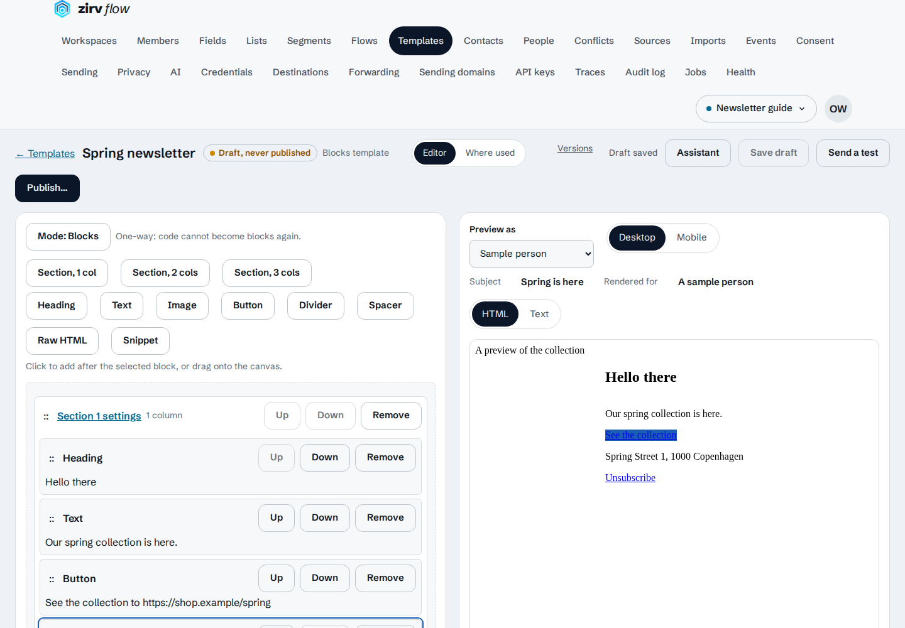
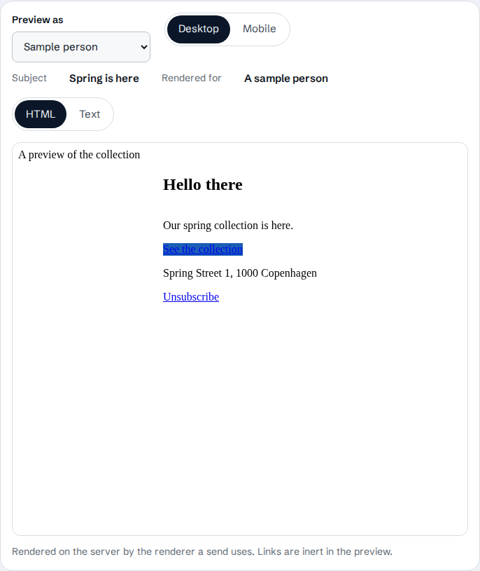

# Getting started

This guide takes a new workspace from an event to a newsletter sent by a flow.
Use one synthetic person and an SMTP server that captures mail for the first run.
The [flows guide](flows.md) explains the settings and the steps in more detail.

The example uses the Spring newsletter from the browser tests and the
event-to-segment-to-send path from the send-path tests. Those tests supply their
own DNS and SMTP fixtures. The Compose quickstart does not supply them.

## 1. Start and claim the instance

From a checkout, start the services in `docker-compose.yml`:

```sh
docker compose up -d --build --wait
curl -fsS localhost:8080/readyz
```

Open <http://localhost:8080/setup>. Find the one-time setup token in the
`zirv-flow` service's startup logs. Enter **Setup token**, **Owner email** and
**Password**, then choose **Create owner and sign in**. The password must have
12 to 1024 characters. If an owner already exists, use **Sign in** instead.
A restart replaces an unused setup token; use the token from the current process.

Use localhost for this local HTTP setup. Before sending marketing email, have
the operator put the app behind HTTPS and set the configuration key
`server.public_url` to that public address. In the `zirv-flow` service's
`environment` section in `docker-compose.yml`, add:

```yaml
ZIRV_FLOW_SERVER__PUBLIC_URL: "https://flow.example.com"
```

Replace the example address with the HTTPS address that reaches your instance,
then run the same Compose command again to apply the change. Sign in there for
the rest of the guide. Marketing mail needs this address for unsubscribe and
tracking links. The default Compose file has no public URL or TLS proxy.

**Common mistake:** using the bind address as the public email-link address.
**Fix:** use the HTTPS address recipients can reach, and check it before sending.

## 2. Create a workspace

Open **Workspaces**, choose **New workspace**, enter a **Name**, and choose
**Create workspace**. **Slug** is optional. Select the workspace in the workspace
switcher. Workspace pages have addresses starting with `/w/:ws`; `:ws` is the
workspace id, not its slug.

The instance owner can do every step below. For a team:

- A **viewer** reads.
- An **editor** creates and changes drafts, previews and tests them.
- A **publisher** also publishes templates and flows, and operates running flows.
- An **admin** also manages sources, destinations, credentials, keys, sending
  domains and members.

The instance owner is an account flag, not a workspace role. An admin can grant
`view_pii` to a publisher, editor or viewer. Editors and publishers need it for
real-person previews and flow tests; owners and admins already have that access.

**Common mistake:** expecting an editor to publish a finished draft.
**Fix:** have a publisher, admin or the owner review and publish it.

## 3. Bring in an event

This path uses the ingestion API. A [file source](sources.md#the-file-source)
or [HTTP manifest source](sources.md#the-http-manifest-source) is another
way to bring data in; use one path for this first run.

In **Events**, choose **Add schema**, name the event `order_placed`, and choose
**Add schema** in the dialog. Open its draft and choose **Publish**, then
**Publish version**. Leave the property list empty for the event below.

In **API keys**, choose **Create key**, enter a **Name** such as *Guide ingestion*,
and select only the **Ingest** scope in the **New API key** dialog (clear the
default **Read** selection). Choose **Create key** there and copy the
key when it appears; it is shown only once. In a terminal, set `INGEST_KEY` to
that key and `FLOW_URL` to your instance's public address. These are shell
variables for this example, not server configuration keys.

Open **Events → Debugger** (`/w/:ws/events/debugger`) before sending. In a clean
workspace, this event creates the person identified by the synthetic address:

```sh
curl -i -X POST "$FLOW_URL/api/v1/ingest/track" \
  -H "Authorization: Bearer $INGEST_KEY" \
  -H "Content-Type: application/json" \
  -d '{"identifiers":{"email":"reader@example.com"},"event":"order_placed","properties":{},"messageId":"guide-order-1"}'
```

Use an address accepted by your capture server. The `messageId` makes retrying
this request safe: reuse it for a retry, and use a new one for a new event.
A 202 response means queued. Wait for **Accepted** in the debugger.
**Reveal PII** shows values only to someone allowed to see them. Open **People**
(`/w/:ws/people`), find the person, and check their profile and timeline.

If the event is rejected, inspect **Events → Rejects**, correct the schema or
input, and replay or send a new event. A 202 alone does not prove the event was
accepted into the event store.

**Common mistake:** sending with the browser session or a key with only `write`.
**Fix:** use a bearer key with the `ingest` scope for the ingestion endpoints.

## 4. Preview a segment and record consent

Open **Segments**, choose **New segment**, and name it *Newsletter readers*.
In **Who belongs**, change the top-level **Type** from **All of** to **Event**, choose
`order_placed`, and leave **Time window** at **Any time**. Leave the property
filters empty and add no summary: one matching event is enough.

The **Who matches** panel previews the count and a sample as you build. Check
that the synthetic person appears, then choose **Create segment**. Wait for its
membership to be computed before using it in a flow: reload the page and check
the **Members** tab for the person. This segment includes
everyone with that event, so keep the workspace limited to your test person.

Open **Consent** on the person's **Profile** tab. Under **Applies to**, select
**All email**; under **Choice**, select **Subscribed**, then choose **Record choice**. This is
the test person's recorded choice, not permission to subscribe a real audience.
See the [compliance guide](compliance.md) before using real data.

**Common mistake:** treating membership in a segment as consent to send.
**Fix:** record consent separately and let the send gate check it at send time.

## 5. Set up email delivery

An admin does this part. Have a domain whose DNS you can change and an SMTP
capture server reachable from the application container. The capture server
must support STARTTLS or implicit TLS and accept the configured username and
password. The quickstart has no SMTP capture service; the browser harness's
sink is a test fixture only.

1. Open **Sending domains** (`/w/:ws/sending-domains`), choose **Add a domain**,
   enter your domain, and choose **Add the domain**. Publish the displayed SPF,
   DKIM and DMARC records in DNS. Choose **Check DNS now** and wait for verification.
2. On the domain page, choose **Add sender identity**. Enter **From name** and a
   **From address** on that domain. **Reply-to (optional)** can be left empty.
   Choose **Add the identity** and check that it says **Can send**.
3. Open **Destinations**, choose **New destination**, and select **SMTP** as the
   **Type**. Name it *Newsletter capture*. Choose an existing credential, or choose
   **New credential** and enter **Host**, **Port**, **Username** and **Password**
   from the capture server. In **TLS mode**, type `tls` for implicit TLS or
   `starttls` for STARTTLS, then choose **Create credential**.
   For a private certificate authority, paste its PEM into
   **CA certificate (optional)** on the destination form. Choose
   **Create destination**. Use the server address reachable from
   the container; its localhost is the container itself.
4. Open **Sending** (`/w/:ws/settings/sending`), headed **Sending limits**. Under
   **Test inboxes**, enter the synthetic recipient's **Address** and choose
   **Add address**. This allowlist is used by template test sends. It does not
   restrict a published flow's audience.

A private-network capture server also needs an operator exception in the
configuration key `egress.allow`. The default policy refuses private and
loopback destinations, including SMTP. For a sink at 10.0.5.7, add this to the
service's environment and apply the Compose change:

```yaml
ZIRV_FLOW_EGRESS__ALLOW: '["10.0.5.7/32"]'
```

Replace that address with the sink's actual address. Keep the exception limited
to that destination.

**Common mistake:** using the harness's example domain without publishing DNS.
**Fix:** use your own verified domain; the harness's DNS resolver is not in the
normal application.

## 6. Write and test the newsletter

Open **Templates**, choose **New template**, name it *Spring newsletter*, select
**Blocks**, and choose **Create template**. Build a short version of the browser
test's newsletter:

1. Add a section with one column. Add a **Heading** block with *Hello there*,
   then a **Text** block with *Our spring collection is here.*
2. Add a **Button** block. Set **Label** to *See the collection* and **URL** to
   the HTTPS page you want to link to.
3. Add a **Text** block for the footer. Write the sender's postal address and
   *Unsubscribe*. Select the word *Unsubscribe*, choose **Add a link**, put
   `{{ system.unsubscribe_url }}` in **Link address**, then **Apply link**.
4. In **Message**, set **Subject** to *Spring is here*, **Preheader** to
   *A preview of the collection*, and choose the verified **Sender identity**.
   Keep this newsletter's category as marketing.

Wait for **Draft saved**. Check the HTML and text previews. A publisher chooses
**Publish…**, reviews the checks on **Review and publish version 1**, then
chooses **Publish version 1**. Fix any failing checks before publishing.

Choose **Send a test**. Select the masked allowlisted address under **Test inboxes**
(`r***@example.com` for this example), choose **Version 1 · live**, and select
the sender under **From**. Select the
SMTP destination under **Send through**. Choose **Send 1 test** and wait for
the captured message in the SMTP server. Check its subject (*[TEST] Spring is here*),
HTML, text and unsubscribe link. **Queued** is not proof of receipt.

This sends a real test message to the chosen inbox. Flow test mode, below, sends
nothing. A template test send does not prove the person's consent, frequency
cap or quiet-hours checks will allow a live flow send.

**Common mistake:** leaving out the unsubscribe link in a marketing template.
**Fix:** use the system variable above and publish again after the checks pass.





## 7. Build and test the flow

Open **Flows** (`/w/:ws/flows`) and choose **New flow**. Name it *Spring newsletter*.
For **Starts when**, choose **A person enters or leaves a segment**, then
**Create flow**.

In **Flow settings**, choose *Newsletter readers* as the **Segment** and
**Enters the segment** under **When a person**. Select **Also enroll the people
already in the segment when the flow is published**. In **Re-entry**, keep
**Never enters again**. No goal or exit criteria are needed for this first flow.

In **Canvas**, use **Add a step** to add **Send an email** and **Exit**. Open the
send step, choose the published newsletter **Template** and *Newsletter capture*
as **Destination**, and leave **Topic** at **No topic** to use the channel-wide
consent recorded earlier. Under **Where it goes next**, set **Next step** to the
Exit step. The trigger leads to the send step, the one with no incoming connection.
Wait for **Saved** and resolve the validation problems shown on the canvas.

Choose **Test** before publishing. Choose the synthetic person, or
**A made-up person, from an editable snapshot** and leave **Snapshot** at `{}`.
Choose **Start the test**. Check that the path reaches the send step and Exit.
The captured send effect names what would be queued; it neither renders nor
sends an email, and it does not run the send gates. Choose **Exit test** when done.

**Common mistake:** publishing first to make test mode available.
**Fix:** test the draft first. Publishing with current segment members selected
can begin sending immediately.

## 8. Publish, send and read the trace

A publisher chooses **Publish…**. Check the entry estimate and input warnings.
For this first send, the segment should contain only the synthetic recipient.
Choose **Publish version 1**. Publishing enrolls the current segment members
because you selected that option; there is no separate Send button for this flow.

Open **Enrollments**, choose **Show enrollments** if needed, and open the
person's enrollment. Read its step history and **Trace**. The tree labels the
decisions, including **A person was considered for a flow**, **A flow step ran**
and **Message sent**. A send check is recorded as `send.gate`; a final send
decision as `message.send`. A held or skipped message is not a successful send.

Choose **Open in Traces** to see the records at `/w/:ws/traces/:traceId`, with
their action, outcome, reason, cause and subject ids. Decision records contain
ids and fixed codes, not the person's email or event values. Check the SMTP
capture server for the live flow message as well as the earlier test message.
If it did not arrive, use the [send gates](flows.md#send-gates) to find what
stopped it; use **Pause** while you investigate a live flow.

**Common mistake:** reading **Message sent** as proof that a recipient opened it.
**Fix:** confirm capture separately. Delivery feedback and opens are later events;
an SMTP acceptance alone does not prove delivery or reading.

The **Upgrade Drill** CI job's **Getting-started walkthrough** step follows this
page on a clean Compose stack, checks both SMTP captures and the enrollment trace,
and records synthetic evidence in the run summary. It runs when this guide or
the walkthrough's Compose, browser, fixture or CI files change.
