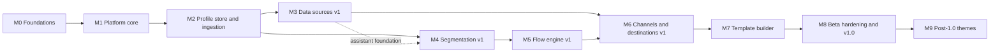

# Zirv Flow roadmap

This plan takes Zirv Flow from an empty repository to v1.0 and lists the themes
after it. The design is in [architecture.md](architecture.md); the binding
decisions are in [architecture.md section 20](architecture.md#20-key-decisions). Every milestone ships the API and the UI
for its own feature, so there is no separate UI milestone.

No dates or effort estimates: there is no throughput data yet.

## How milestones are tracked

- Each milestone is a GitHub milestone titled exactly like its heading below, e.g. `M1 — Platform core` (em dash, single spaces).
- Every issue carries its milestone; an issue without one is untriaged.
- The milestone description repeats the exit criteria as a checklist. A milestone closes when every criterion links to evidence (CI run, merged PR, benchmark report).
- Scope changes go through a PR to this file; moving an item updates both milestones in the same PR.
- Releases follow ADR-005: manual dispatch only until M1 exits, then every merge to `main` is a release.

## Overview

| Milestone | Goal | Depends on |
|-----------|------|------------|
| M0 — Foundations | Repository runs like zirv-cli; architecture and plan recorded | none |
| M1 — Platform core | Deployable, observable, authenticated binary on Postgres with a durable queue, correlation and embedded UI shell | M0 |
| M2 — Profile store and ingestion | Pushed data becomes governed, explorable events and identity-resolved people; deletion and erasure work from the start | M1 |
| M3 — Data sources v1 | Incremental pulls with visible freshness; provider foundation for optional authoring assistance | M2 |
| M4 — Segmentation v1 | Segments marketers can build, draft, explain and trust; membership changes become traced events | M2, M3 |
| M5 — Flow engine v1 | Durable, versioned, traced and assistant-draftable flows | M4 |
| M6 — Channels and destinations v1 | Compliant delivery, profile sync, delivery feedback and event forwarding | M3, M5 |
| M7 — Template builder | Email and webhook content built or assistant-drafted; preview rendered by the same code that sends | M6 |
| M8 — Beta hardening and v1.0 | Trace, assistant security and production targets validated; v1.0 | M3, M4, M5, M6, M7 |
| M9 — Post-1.0 themes | Hold post-1.0 themes until each is promoted to its own milestone | M8 |

M3 and M4 core work can run in parallel after M2: segmentation can be built and
tested on data from the identify/track API and CSV import. M4 cannot exit until
M3's assistant foundation is available for segment drafting and explanation.

## Rules for every milestone

- **API and UI together:** the feature is in `/api/v1` (OpenAPI updated, drift check green) and in the UI.
- **Isolation:** every new table carries `workspace_id` and is covered by the workspace isolation test.
- **Deletion and erasure** reach every table the milestone adds; the erasure table-scan test is extended, never bypassed.
- **Telemetry and audit:** new job kinds and endpoints get metrics and spans; new mutating admin actions write audit entries.
- **Modularity:** new code lands in the owning feature module and allowed crate; new connector, destination, template content type, job kind or AI tool goes through its section 5.3 registry. The crate-dependency check, purity check and frontend boundary lint stay green and are never loosened to make a change pass.
- **Measurement:** the milestone measures its slice of the targets (architecture section 19) and attaches the numbers. A miss becomes an issue; it blocks only where an exit criterion says so.
- **Docs:** user-facing behaviour is documented in the PR that ships it.

## M0 — Foundations

**Goal.** Make the repository run like zirv-cli and record the architecture and
plan before any product code exists.

**Scope.**
- `.github/`: FUNDING, issue forms (bug, feature, config), PR template.
- `ci.yaml` merge gate on PRs to `main` and `release/**`: build, fmt, clippy `-D warnings` (host and Windows target), nextest, test-presence gate, context-sync drift gate, dependency audit, version-bump check, advisory security scan.
- `cd.yaml` (build and GitHub release), triggered only by `workflow_dispatch` (ADR-005).
- Hygiene: `.gitignore`, `.gitattributes`, `.config/nextest.toml`, `.claude/settings.json`.
- Agent context: `.zirv/` settings, shortcuts, commands (test, commit), context files, `ctx.toml`; `CLAUDE.md` and `AGENTS.md` generated by `zirv context sync --generate`.
- Governance: README, CONTRIBUTING, CODE_OF_CONDUCT, SECURITY, DISCLAIMER, CHANGELOG.
- `scripts/`: test-presence gate, advisory security scan, changelog generator, each with `--self-test`.
- A minimal Rust 2024 crate `zirv-flow` (one binary) so every gate runs real code.
- GitHub settings: description, topics, discussions, "Protected Main" and "Protected Tags" rulesets, labels `security` and `severity:{blocker,major,minor}`, read-only default Actions token.
- `docs/architecture.md`, `docs/roadmap.md`, and GitHub milestones M0 to M9.

**Out of scope.** Product functionality, the Cargo workspace split, the frontend
toolchain, the container image.

**Exit criteria.**
- [ ] The M0 PR is green on the CI merge gate, and the "Protected Main" ruleset requires a reviewed PR for everyone except repository admins (the zirv-cli setting).
- [ ] `zirv context sync --check` passes; `CLAUDE.md` and `AGENTS.md` are generated, not hand-written.
- [ ] The four cargo gates and every script `--self-test` pass locally and in CI.
- [ ] `cd.yaml` has no push trigger, so the skeleton is never published.
- [ ] `gh api` shows the rulesets, labels, description, topics, discussions and token permissions as specified.
- [ ] GitHub milestones `M0 — Foundations` to `M9 — Post-1.0 themes` exist with titles identical to this file's headings.
- [ ] A case-insensitive search of tree, commits and PR body for other marketing or workflow automation product names finds nothing.

**Dependencies.** None.

## M1 — Platform core

**Goal.** Deliver a deployable, observable, authenticated `zirv-flow` binary on
Postgres with a durable job queue and an embedded UI shell. This is the first
functional milestone; at its end, releases switch to every merge.

**Scope.**
- **Layout.** The Cargo workspace from architecture section 5, with the direct-dependency allowlist in section 5.1, plus the `web/` feature-folder skeleton (TypeScript, React, Vite) from section 5.4. CI builds the SPA and rust-embed embeds it; a placeholder `web/dist` lets `cargo build` run without Node.
- **CLI.** `serve`, `worker`, `scheduler`, `all` (default), `migrate`, `admin` (create owner, reset password), `config check`.
- **Config.** TOML plus `ZIRV_FLOW_` env overrides, readable validation errors, secrets redacted.
- **Postgres.** sqlx pool, embedded forward-only migrations, `migrate` and guarded `migrate_on_start` under an advisory lock. Startup refuses a newer schema, and pending migrations when migrating is disabled.
- **axum server.** `/healthz`, `/readyz`, `/metrics`; `/api/v1` skeleton with OpenAPI 3.1 (utoipa), committed spec, drift check, generated TypeScript client, problem+json errors, request ids.
- **Auth and tenancy.** Workspaces; local accounts (argon2id); sessions with HttpOnly cookies and CSRF tokens; workspace-scoped hashed API keys with scopes; base roles owner, admin and member. The audit log records sign-in, workspace, membership and key events.
- **Queue and scheduler.** `jobs` and `schedules` tables, transactional enqueue, `SKIP LOCKED` claim, leases with a fencing token, heartbeats, retries with backoff and jitter, dead letters, unique keys, `LISTEN/NOTIFY`, scheduler leader by advisory lock, lease reaper. The OQ-8 fairness design is recorded.
- **Correlation and decision-log skeleton.** Generate request and trace ids at ingress; propagate both through HTTP spans and every job payload. Add the time-partitioned decision-log table, typed cause envelope and `GET .../traces/{trace_id}` skeleton before domain action types arrive.
- **Observability.** Structured JSON logs via `tracing`, with request id, trace id, job id, workspace and attempt; optional OTLP export; Prometheus metrics for HTTP, queue and DB pool.
- **UI.** First-run owner setup, sign-in, workspace switcher, members, API keys, Jobs admin (depth by kind, dead letters, retry), trace-inspector shell, health view.
- **Packaging.** Multi-stage non-root Dockerfile, GHCR image (amd64, arm64), `docker-compose.yml` quickstart (binary + Postgres, health checks), release binaries.
- **CI.** Postgres service container for integration tests, SPA type check and tests, image build, a `cargo metadata` dependency-direction check against section 5.1, the `cargo tree` purity check, and frontend lint for feature import boundaries.
- **CD switch.** The last change of M1 switches `cd.yaml` to publish on every merge to `main` (ADR-005). OQ-15 (minimum Postgres version) is decided.

**Out of scope.** Profile data, connectors, segments, flows, provider role and group mapping
for OIDC sign-in, the full RBAC matrix, secrets encryption (no credentials are stored yet).

**Exit criteria.**
- [ ] From a clean checkout, `docker compose up` serves the UI and `/readyz` returns 200. A new owner signs in, creates a workspace and an API key, through both UI and `/api/v1`.
- [ ] Queue test: 10,000 jobs across 4 workers; none lost, none recorded complete twice. A job whose worker gets `SIGKILL` re-runs after lease expiry.
- [ ] Scheduler failover: killing the leader lets a second scheduler take over; no schedule slot fires twice.
- [ ] A binary older than the schema exits with a clear error; pending migrations with migrating disabled stop startup.
- [ ] `/metrics` exposes queue depth, claim lag, handler duration and HTTP latency; logs are JSON with request and job ids.
- [ ] An HTTP request that enqueues and retries a fixture job has the same trace id in its response, structured spans and job payload; its trace endpoint and inspector shell return the same fixture decision and failed attempt without personal-data values.
- [ ] CI fails on an un-regenerated OpenAPI spec and on a `cargo tree` purity violation.
- [ ] A test PR adding a disallowed workspace edge (`zirv-flow-api` -> `zirv-flow-jobs`) fails CI with a message naming that edge.
- [ ] A deep import from one `web/` feature into another, or a feature import from `app/`, fails frontend lint.
- [ ] The first merge to `main` after the switch publishes a GitHub release and a GHCR image that `docker pull` retrieves.

**Dependencies.** M0.

## M2 — Profile store and ingestion

**Goal.** Turn pushed data (API, CSV) into identity-resolved people with typed
traits, events, lists, consent and suppression: idempotently, with deletion
and erasure working from the start.

**Scope.**
- **Schema.** People, identities, source-record ledger, field registry (types, precedence); events in monthly partitions with a default partition and maintenance; versioned event schema registry; ingest rejects; lists; consent with history; topics; suppressions (HMAC); the `person_changes` dirty set.
- **Apply-batch.** Normalization, identity resolution with per-kind rules and recorded conflicts, merges (survivor rules and re-point job), trait precedence, client-`messageId` event dedupe, late-event and future-timestamp handling, ingest redaction, dirty marks.
- **Ingestion API.** `identify`, `track`, `batch` with ingestion keys, size and per-key rate limits, `ingest_inbox` and drain workers. HTTP only in v1 (OQ-20): the README and OpenAPI document each endpoint with curl and `fetch` examples.
- **Event governance.** Immutable schema versions with typed properties, required fields, enums, descriptions and per-property PII flags; per-event `allow`/`warn`/`block`; workspace policy for draft-schema or reject on unplanned names; visible flagged events and rejects with masked samples; replay after a schema fix; per-name retention overrides. PII properties are masked without `view_pii`; until M8, only owners and admins can view them.
- **Event investigation.** Workspace/source SSE debugger with filters, validation results and PII masking; explorer filters by name, typed properties, time and person, with counts, breakdowns, CSV and statement timeouts; unified person timeline.
- **Causality.** Decision records for event acceptance/rejection, merge, consent and trait change, with propagated trace ids and typed causes; API and timeline links to trace trees.
- **CSV import.** Upload, column mapping, dry run, import as a run with downloadable rejects.
- **Native contacts.** For companies without an external customer store (architecture 7.6): a workspace contact definition on the field registry (typed, required and identifier fields); contacts API (create, read, list, search, replace, partial update, delete by contact key, bulk upsert) through the inbox with idempotency keys; contacts list, detail and edit UI. Contacts are people contributed by the built-in `native` source.
- **Deletion and privacy.** Person delete and contribution removal with the orphan policy; erasure v1 across all M2 tables with the erasure ledger; export v1.
- **Consent and suppression.** API and UI for consent and topics; suppression list import and export.
- **UI.** People search; profile (identities by source, traits with provenance, unified event/decision timeline, consent, lists); event schema registry, rejects/replay, live debugger and explorer; field registry editor; identity conflict review (keep separate, or move the identifier to one person); lists; CSV import wizard; ingestion keys.
- **Decisions.** OQ-1 (trait storage), by benchmark. OQ-3 (no unmerge in v1) and OQ-20 (HTTP API only in v1) are decided in architecture section 21.1.

**Out of scope.** Pull connectors (M3), segments (M4), custom objects (OQ-4),
unmerge (OQ-3), client SDKs (OQ-20).

**Exit criteria.**
- [ ] Replaying the same `batch` payload twice leaves the database in an identical state (row-level comparison test).
- [ ] A block-mode event with a wrong property type lands in rejects with a masked sample and reason; after a schema fix, replay stores it once and emits no downstream trigger unless that separately previewed option is selected.
- [ ] A duplicated `messageId` stores one event; a late event recomputes the affected person's time-window segments; an excessive future timestamp is clamped and flagged.
- [ ] Identity suite passes: anonymous-to-identified merge; shared email blocked by a unique external id with the conflict visible in the UI; a concurrent identify race producing one person; consent merge where `unsubscribed` wins ties.
- [ ] Two sources writing one trait resolve per registry policy; removing one source's contribution restores the other's value.
- [ ] After erasure, an automated scan finds no row with the person's id in any table; the identifier stays suppressed via its hash; export returns every M2 data class.
- [ ] A 1-million-row CSV imports with visible progress and downloadable rejects.
- [ ] A contact created, partially updated and deleted through the contacts API (and edited in the UI) round-trips its typed fields, rejects a missing required field, and a repeated request with the same idempotency key changes nothing.
- [ ] The live debugger shows accepted, flagged and rejected fixture events; an editor sees PII masked while an owner can reveal it, ingest-redacted values remain unavailable, and the explorer's filters, count, breakdown and CSV agree on the fixture set. A forced slow query ends at its statement timeout.
- [ ] One person's timeline interleaves an event, trait change, consent change and merge decision; each system entry resolves to a trace tree whose decision records contain ids and reasons but no personal-data values.
- [ ] Ingestion benchmark attached against the targets: 2,000 events/s sustained, API p99 < 100 ms, inbox to profile p95 < 5 s.

**Dependencies.** M1.

## M3 — Data sources v1

**Goal.** Pull data incrementally from internal databases and HTTP APIs, with
checkpoints, deletion detection and freshness marketers can see.

**Scope.**
- **Connector runtime.** `Source` trait (discover, read from checkpoint, capabilities). Auth: API key, basic, bearer, OAuth2 client credentials and authorization code (redirect to `public_url`) with refresh. Retries honouring `Retry-After`, rate limits, pagination drivers, checkpoints committed with each batch.
- **Secrets encryption at rest** (envelope, operator master key). It lands here because M3 stores the first credential.
- **Egress policy** (SSRF protection) for all outbound connections: HTTP, databases, Kafka and AI providers.
- **Built-in sources.** PostgreSQL and MySQL (tables, or queries with a cursor column); CSV/JSON files over HTTPS.
- **HTTP manifest v1.** Schema and validation; auth, pagination, incremental cursor, field mapping, delete signal; UI editor and validator; reference manifests tested against a mock server.
- **Inbound webhooks.** Generic, with signature verification and mapping.
- **Kafka source.** Topic streams mapped to contacts, events or lists; offsets stored as the checkpoint in the apply-batch transaction; tombstones delete; failed messages become rejects; consumer lag as freshness; SASL/TLS credentials encrypted (architecture 7.6).
- **Sync runs.** Schedules, manual run, cancel; state machine with lease heartbeat and checkpoint resume; full-refresh mark and sweep; reconciliation runs for incremental streams without a delete signal; reject threshold.
- **Mapping UI.** Stream to people, events or lists; identifier and trait mapping; bounded transforms; preview on sample records.
- **Freshness.** Per stream: last success, high-water mark, staleness threshold; stale/failing badges and metrics. Done for pull streams; webhooks (#90) and Kafka (#91) report through `record_stream_outcome`.
- **Causality.** Each sync record applied, rejected or deleted appends a decision with its trace id, sync-run cause and source-record id.
- **AI foundation.** `zirv-flow-ai` provider trait with OpenAI-compatible (including configured local base URLs) and Anthropic adapters; deployment provider/model allowlist; encrypted provider keys; per-workspace provider/model, enablement, budget and PII opt-in; per-user rate limits; call audit and configurable transcript retention; bounded repair; golden-prompt evaluation harness and deterministic fake provider for CI. Calls use the egress policy.
- **Mapping and manifest assistance.** Read-and-draft typed tools create source field mappings and HTTP manifests, validate them with the existing schemas, and show sample dry runs and field diffs before the user accepts an ordinary draft.
- **UI.** Sources list with freshness, setup wizard (test connection, discover, mapping preview and optional assistant), run history with logs, rejects and trace links; manifest assistant; provider, privacy, budget and usage settings.
- **Decisions.** OQ-4 (custom objects), OQ-5 (mapping expressions), OQ-26 (assistant transcript default), OQ-27 (minimum model capabilities), OQ-31 (Kafka client and value formats).

**Out of scope.** Warehouse-specific connectors, CDC/logical replication,
federated live sources, WASM plugins, destinations (M6).

**Exit criteria.**
- [ ] Killing a worker mid-sync against a seeded Postgres source and restarting resumes from the last checkpoint, with no duplicate events and no missing records.
- [x] A record deleted in a full-refresh source is gone from its person's contributions after the next successful run; a failed or cancelled run deletes nothing.
- [ ] A manifest for a mock API with cursor pagination, OAuth2 refresh and `429` responses syncs incrementally (fixture test).
- [ ] Credentials appear only as ciphertext in a database dump; no API response returns plaintext.
- [ ] The egress policy blocks loopback, private, link-local and metadata addresses unless allowlisted, including after DNS resolution.
- [ ] A configured local model server on a private address is blocked until its resolved address is explicitly allowlisted; provider keys appear only as ciphertext.
- [x] A source past its staleness threshold shows as stale in the UI and in the freshness metric.
- [ ] Killing a worker while it consumes a Kafka fixture topic and restarting it applies every contact upsert and tombstone exactly once from the stored offsets; a malformed message lands in rejects without stopping its partition.
- [ ] A sync fixture's applied, rejected and deleted records appear under one trace with typed causes and source-record ids.
- [ ] The fake provider drafts an invalid then repaired mapping and manifest; only validator-approved output can be accepted, and the UI shows the dry-run result and diff.
- [ ] The fake-provider suite proves the tool registry has no publish, send, delete or consent tools and that no identifier values enter a provider request when PII opt-in is off; crossing the workspace budget stops the call before dispatch with a clear error.

**Dependencies.** M2.

## M4 — Segmentation v1

**Goal.** Marketers build segments over the profile store with live counts,
per-person explanations and visible data age; membership changes become events.

**Scope.**
- **AST v1.** Trait conditions, event aggregates with windows, list, segment, consent, identifier presence, `all`/`any`/`not`; JSON schema published through OpenAPI.
- **Compiler.** Validation against registry and event catalog, normalization, parameterized SQL, dependency and time-sensitivity analysis.
- **Verification.** Golden SQL tests, the in-memory reference evaluator, and property tests comparing the two on Postgres.
- **Preview and explain.** Count and sample with a timeout; per-person explain endpoint.
- **Membership.** Membership table, full refresh with diff, `segment.entered`/`segment.exited` events with cause, scheduled refresh for time-sensitive segments, incremental re-evaluation from the dirty set, segment-of-segment ordering, cycle rejection.
- **Causality.** Segment entry and exit decisions carry the originating trace and a typed event, trait-change, schedule, manual or definition-change cause.
- **Assistant.** Natural language drafts segment ASTs and explains saved segments through typed read-and-draft tools; compiler errors receive bounded repair, and review shows the AST diff, preview count and sample before acceptance.
- **Versions and freshness.** Segment versions, `computed_at`, input freshness. Erasure and deletion reach memberships.
- **UI.** Builder over registry and event catalog, live count with data age, sample people, explain on the profile, membership history, refresh now.
- **Decisions.** OQ-2 (event rollups), OQ-6 (definition-edit triggers).

**Out of scope.** Segments over custom objects, raw SQL segments, predictive
segments, federated sources.

**Exit criteria.**
- [ ] The golden suite covers every node type and operator. Property tests (fixed seeds in CI, random nightly) find no mismatch between compiled SQL and the reference evaluator.
- [ ] An event that qualifies a person produces `segment.entered` within 60 s (p95) in an integration test with default configuration.
- [ ] A time-window segment ("no order in 30 days") gains members as the injected clock advances, with no new data.
- [ ] A segment reference cycle is rejected at save, with an error that names the cycle.
- [ ] Explain shows, for one person, which conditions matched and the observed values.
- [ ] An event- and a definition-driven membership change each retain their original trace id and the correct typed cause through `segment.entered`/`segment.exited`.
- [ ] The fake provider's segment draft passes the same compiler as the builder, shows its diff and preview count, and enters only the selected segment's draft; segment explanation cites the AST nodes it describes.
- [ ] Preview and full-refresh benchmarks at 10 million people are attached, measured against the section 19 targets.

**Dependencies.** M2 for segmentation; M3 for the assistant foundation.

## M5 — Flow engine v1

**Goal.** Durable, versioned automation flows that enroll people from triggers
and run waits, branches and actions as designed, testable before publishing.

**Scope.**
- **Flows and versions.** Immutable on publish; validation for acyclicity, reachability, typed edges.
- **Triggers.** Segment entered/exited, event, schedule, manual, API.
- **Nodes.** Waits (duration, until local time, until event with timeout), branch on a segment-AST condition, random split; webhook, update trait, list, goal and exit actions.
- **Engine.** Pure `step` function with injected clock and condition evaluator; deterministic simulation harness.
- **Runtime.** Version-pinned enrollments; step and enqueue in one transaction with `state_version` checks; timers as jobs; event-wait index; step idempotency keys; batched fan-out; re-entry rules; exit criteria; pause, resume, archive; operator retry or skip; merge and erasure handling for enrollments.
- **Causality and trace UI.** Enrollment, step, branch, wait, failure, retry and operator-skip decisions propagate the trigger trace and typed cause. The enrollment inspector gains the trace tree, including failed and skipped work.
- **Assistant.** Natural language drafts and explains flow graphs; publish validation drives bounded repair; the user reviews a graph diff and simulation summary. Trace explanation is the first read-only trace consumer and cites decision-record ids.
- **Test mode.** A real or synthetic person on a virtual clock, effects captured, events injectable.
- **UI.** React Flow canvas editor, node panels, validation on the canvas, publish with impact preview, version history, enrollment inspector (one person's path), per-node counts.
- **Decisions.** OQ-7 (version migration), OQ-14 (pause on stale inputs).

**Out of scope.** Send-message and sync nodes (M6), loops, migrating in-flight
enrollments, A/B test statistics.

**Exit criteria.**
- [ ] Simulation: thousands of enrollments over 90 virtual days with a crash after every effect. No internal effect applied twice; every external effect enqueued with a stable key; no timer fires early.
- [ ] Publishing v2 leaves existing v1 enrollments on v1 (test).
- [ ] When an awaited event races its timeout, exactly one path is taken (test).
- [ ] A segment-entry trigger for 100,000 people enrolls each exactly once under re-entry rule `once`.
- [ ] Test mode in the UI walks a person through a flow and shows the path and captured effects, with no side effects.
- [ ] A segment-triggered enrollment and every step, retry and skip remain under the originating trace; the UI tree and API include the same nodes and gate or failure reasons.
- [ ] The fake provider cannot publish a repaired flow; accepting it changes only a draft after the normal validator passes, and its explanation and trace explanation cite the graph nodes and decision records they describe.
- [ ] Timer lateness at 1 million waiting enrollments is measured and attached against the section 19 target.

**Dependencies.** M4 (and through it M2 and M1).

## M6 — Channels and destinations v1

**Goal.** Send compliant email and webhooks from flows, sync people to external
systems, and feed delivery and engagement back as events.

**Scope.**
- **Destinations.** `Destination` trait on the M3 connector runtime, with capability flags (idempotency, batching, rate limits, erase).
- **Email.** SMTP destination; email-provider HTTP API destinations (built in or manifest); sender identities (from name, from and reply-to addresses) bound to verified sending domains.
- **Sender authentication.** Sending domains with verification: Zirv Flow generates the DKIM key and the SPF, DKIM and DMARC records to publish, checks them in DNS and shows their status; SMTP mail from a verified domain is DKIM-signed (key stored under the M3 secrets encryption); provider destinations show the provider's domain status where its API exposes it. Sends from an unverified domain are blocked. A guide covers DNS setup at common hosts.
- **Templates (code mode).** The pure `zirv-flow-templates` renderer with MiniJinja HTML and text parts: sandbox, versions, preview with a real or sample person through the send renderer, test sends, required unsubscribe link for the marketing category. M7 builds the block builder on it.
- **Consent policies.** Workspace consent dimensions beyond the channel (topic, product vertical, purpose; one value per dimension or "all"), and versioned effective-consent rules built in the UI on the M4 condition AST over recorded consent, traits, events, lists and message history (for example cooldowns and account state). They are evaluated at the send gate, with the deciding rule recorded (architecture 10.1, OQ-32).
- **Send pipeline.** Effective consent under the workspace consent policy, suppression, frequency caps, quiet hours, render, rate limit, deliver; a `messages` log with skip reasons.
- **Tracking.** Open pixel, click redirect with recorded-link allowlist, unsubscribe page, RFC 8058 one-click, topic preference center.
- **Feedback.** Provider webhooks become `email.delivered`/`bounced`/`complained` events; hard bounces and complaints suppress automatically.
- **Causality.** Send, every gate skip, destination attempt and delivery feedback append decision records under the originating trace, with message and destination ids but no address values.
- **Event forwarding.** Destination filters and typed mappings; at-least-once delivery with stable idempotency keys, visible retries and dead letters, manual re-drive, per-destination lag metrics, and erase calls where declared. Forwarding replay never triggers flows.
- **Flow nodes.** `action.send`, `action.sync`; the webhook action moves onto the destination runtime.
- **Deletion and erasure.** Messages, test-send log entries, forwarding payloads and person-scoped decision records erased; delivery and forwarding destination `erase` called where declared; suppression hashes retained.
- **UI.** Destination and forwarding setup, code template editor with preview, consent dimensions and the consent policy builder, frequency caps and quiet hours, per-person message log ("why was this not sent"), trace links, forwarding lag/dead letters and per-node delivery stats.
- **Decisions.** OQ-9 (token blocks), OQ-10 (machine opens), OQ-11 (transactional API), OQ-12 (SMTP bounces), OQ-19 (suppression scope), OQ-32 (consent dimensions and policies).

**Out of scope.** SMS, push, ad audiences, running an MTA, deliverability tools
(seed tests, warm-up), a transactional API unless OQ-11 decides otherwise, the
block builder (M7).

**Exit criteria.**
- [ ] End to end: track call, then segment entry, then flow, then an email captured by a local SMTP sink with `List-Unsubscribe` headers. The tracked click records `email.clicked`; one-click unsubscribe updates consent, and the next send is skipped with `no_consent`.
- [ ] A sending domain stays unverified until its SPF, DKIM and DMARC records resolve (fixture resolver); SMTP mail from a verified domain carries a DKIM signature that verifies against the published key, and a send from an unverified domain is refused.
- [ ] A hard-bounce webhook adds a suppression; later sends are skipped with `suppressed`.
- [ ] A consent policy built in the UI decides sends. It combines recorded consent with a cooldown since the last message and an account-state trait, and an unsubscribe scoped to one product vertical blocks only that vertical. Each skipped send names the deciding rule.
- [ ] Concurrent sends from two flows to one person never exceed the frequency cap (concurrency test).
- [ ] Quiet hours defer a send to the next allowed local time, including across a DST change (injected clock test).
- [ ] N workers together stay within the configured destination rate, within a stated tolerance.
- [ ] A retried delivery job reuses its idempotency key; providers that honour keys show zero duplicates in fixture tests.
- [ ] A trace from a track call shows event, segment entry, enrollment, steps, a message and delivery feedback, plus a later skipped send with its exact gate reason; the API tree and UI agree.
- [ ] A forwarding fixture filters and maps the expected event, reuses its idempotency key across retries, exposes lag and a dead letter, re-drives successfully without triggering a flow, and receives its declared erase call.
- [ ] Send throughput benchmark attached against the section 19 target.

**Dependencies.** M5 (flow actions) and M3 (connector runtime, manifests, secrets).

## M7 — Template builder

**Goal.** Marketers build email and webhook content without code in a
channel-aware block builder whose preview is rendered by the same Rust code
that sends (architecture section 11, ADR-006).

**Scope.**
- **Validate `mrml` first.** Render the representative layout set through `mrml` and check it against the client matrix (OQ-25) before the v1 block set is frozen.
- **Content model.** Versioned JSON document with explicit `schema` numbers; email and webhook content types; SMS, push and in-app types reserved in the schema; document migrations as pure functions with golden tests.
- **Renderer.** Block documents in `zirv-flow-templates`: theme tokens, snippet resolution, MiniJinja per text field, MJML via `mrml`, generated text part, post-render tracking and unsubscribe binding, deterministic output. Code mode stays; blocks-to-code conversion is one-way.
- **Block editor UI.** Email block set v1 (sections with 1 to 3 columns, heading, sanitized rich text, image, button, divider, spacer, raw HTML, snippet), reordering, per-block settings, inline validation.
- **Themes and snippets.** Several themes per workspace (colours, fonts, logo, link and button styles, default footer), one of them the default; each template picks a theme or follows the default. Theme editor with preview; versioned snippets with where-used.
- **Assets.** Image upload into Postgres with sniffed type, raster allowlist (no SVG), size and quota limits (OQ-21); content-addressed public serving from `/a/`; asset library.
- **Personalization.** Merge-tag picker fed by the field registry and event catalog; per-block visibility conditions on the segment AST, evaluated through the `ConditionEvaluator`.
- **Assistant.** Draft email copy, subject-line variants, block layouts and translations through the typed template tool; template validation and bounded repair precede a rendered diff at desktop and mobile widths and explicit acceptance into a draft.
- **Preview and test sends.** M6's preview and test sends extended to block documents: desktop and mobile widths, shown in a sandboxed iframe; test sends only to verified member addresses or a workspace allowlist.
- **Webhook payload editor.** JSON body template and headers with a sample-payload preview.
- **Versions.** Publish validation (blocking errors and warnings), immutable versions, version history, where-used for templates and snippets, active flows shown on publish; message rows record template, snippet and theme versions.
- **Erasure.** Saved preview-person references are covered.
- **Decisions.** OQ-21 (asset limits), OQ-22 (dark mode), OQ-23 (block-set growth), OQ-24 (localization), OQ-25 (layout set and client matrix).

**Out of scope.** SMS, push and in-app builders and channels; AMP email; landing
pages and forms; blocks beyond the v1 set.

**Exit criteria.**
- [ ] The representative layout set renders through `mrml` and passes the client-matrix check before the block set is frozen; results attached.
- [ ] A browser end-to-end test builds the reference newsletter layout without code and test-sends it to an SMTP sink; the captured HTML equals the preview render apart from tracking tokens.
- [ ] Publishing an email with an unknown merge field, or a `marketing` email without an unsubscribe link, is rejected.
- [ ] After a snippet update is published, later sends use it, and the message log records the template, snippet and theme versions each message used.
- [ ] One template rendered under two themes differs only in theme tokens; changing the workspace default theme changes only templates that follow the default.
- [ ] A document saved under schema v1 opens and renders byte-identically after migration to the current schema (golden test).
- [ ] A raw HTML block containing a script runs no script in the app preview, and an SVG or type-mismatched upload is rejected (tests).
- [ ] The fake provider drafts copy, subject variants, a layout and a translation; invalid merge fields are repaired or returned as errors, the render diff is reviewable, and acceptance changes only the template draft.
- [ ] Render benchmark attached against the section 19 target (p95 < 50 ms for a typical block email).

**Dependencies.** M6 (renderer, send pipeline, destinations), and through it M5.

## M8 — Beta hardening and v1.0

**Goal.** Make Zirv Flow safe for a small team to run in production, validate it
against the scalability targets, and release v1.0.

**Scope.**
- **RBAC.** Full role matrix (owner, admin, publisher, editor, viewer) and the `view_pii` grant, enforced on every endpoint.
- **Audit.** Complete coverage, a UI with filters, export.
- **Secrets.** Master key rotation (re-wrap); documentation of what losing the key means.
- **Privacy.** End-to-end export and erasure across all tables including derived data; erasure ledger replay after restore (OQ-13 decided); retention policies with enforcement jobs and a UI.
- **Trace completeness.** Audit every v1 action and cause against the decision-record matrix; verify request and trace propagation through HTTP, jobs, sync, segmentation, flows, delivery, feedback and forwarding.
- **Performance.** Full benchmark suite against every section 19 target on the reference hardware, including debugger latency, explorer queries and decision-log overhead, with fixes. An unmeetable target is revised through a recorded decision.
- **Operations.** Backup/restore guide with a rehearsed restore drill; upgrade guide with a tested upgrade of a populated database from the previous release; sizing and Postgres tuning; runbooks for the main alerts.
- **Security.** Threat model review, dependency audit, fuzzing of the AST, manifest and template document parsers, SSRF, template sandbox, sanitizer and preview-isolation tests; assistant prompt-injection, cross-workspace, PII-context and server-side draft-only review.
- **User docs.** Getting started, sources, segments, flows, templates, channels, and a compliance guide stating what Zirv Flow enforces and what stays the operator's responsibility.
- **API stability.** `/api/v1` frozen: additive changes only after 1.0. A beta period with release candidates.
- **Decisions.** OQ-8 validated under load; OIDC sign-in itself shipped in M1 (OQ-16 closed).

**Out of scope.** New features; M9 themes.

**Exit criteria.**
- [ ] The RBAC matrix test covers every endpoint and role; a viewer without `view_pii` sees personal data masked.
- [ ] After erasure, a scan of every table finds only the suppression hash and the ledger entry; default-level logs hold no identifier values; destinations that declare erase received requests.
- [ ] The trace-completeness matrix covers every v1 derived action and typed cause, including failure and skip paths, and no decision record contains a personal-data value.
- [ ] Assistant security tests place instructions in event properties, template text, source samples and pasted API documentation; none can add a tool, cross a workspace, disclose PII without opt-in, or publish, send, delete or change consent.
- [ ] Restore drill: restore a backup, replay the erasure ledger, confirm erased people stay erased.
- [ ] Upgrade drill: a populated database from the previous release upgrades to v1.0 and passes data-integrity checks.
- [ ] A benchmark report covering every section 19 target is published in the docs, with no unexplained miss; it includes debugger p95, explorer p95/timeouts and decision-log write overhead.
- [ ] Zero open `severity:blocker` or `severity:major` issues in this milestone.
- [ ] v1.0.0 is published as a GitHub release and a GHCR image, with complete user and operator docs.

**Dependencies.** M3, M4, M5, M6, M7.

## M9 — Post-1.0 themes

**Goal.** Hold the prioritized post-1.0 themes until each is promoted to its own
milestone (M10, M11, ...) with full scope and exit criteria, before work starts.

**Scope (themes).**

| Theme | Content | Evidence that promotes it |
|-------|---------|---------------------------|
| Warehouse sources | Incremental sync from analytical warehouses and lakehouse tables | Operators whose people data lives in a warehouse |
| Federated live sources | ADR-001's later mode for data that cannot or must not be copied (OQ-18) | Deployments blocked by copy restrictions |
| More channels | SMS, mobile push and in-app messages, each arriving with its builder on the content types already reserved in the template model | Demand once email is stable |
| Template builder growth | More email blocks under the growth policy (OQ-23), localized variants (OQ-24) if not in v1.0, object storage for assets | Block requests, code-mode fallback for common layouts |
| Ad-audience sync | Hashed identifiers to advertising platforms, with deletion propagation | Demand, plus a consent model for that purpose |
| WASM component plugins | Sandboxed third-party connectors (ADR-004) | ADR-004's reversal evidence |
| Event analytics store | Optional add-on for the explorer, high-volume traces, event-heavy segments and reporting (ADR-003, OQ-29) | M8 event/explorer benchmarks miss targets after measured Postgres tuning |
| Reporting and attribution | Flow and campaign performance, conversion attribution | v1.0 users needing more than per-node counters |
| Identity and access | OIDC role and group mapping (sign-in itself shipped in M1), SCIM provisioning | Team deployments asking for it |
| Client SDKs | Browser and mobile SDKs for identify and track (anonymous id, batching, `messageId`, retries) over the v1 HTTP API (OQ-20) | Adoption shows repeated integration friction with the HTTP API |
| Unmerge | Splitting a merged person back apart, using the merge provenance recorded since M2 (OQ-3) | Conflict reviews or support cases that keep-separate and move-identifier cannot resolve |
| Assistant interoperability | MCP server exposing the same workspace-scoped, RBAC-checked read-and-draft tool layer (OQ-30) | External clients need supported draft tooling and the authentication model is decided |
| Further assistant capabilities | Additional read, draft or explanation tools; never autonomous product actions | Golden-prompt and usage evidence for a specific user task |
| Platform | Custom objects (OQ-4), rolling upgrades (OQ-17), flow version migration (OQ-7), transactional API (OQ-11) | Each open question's decision |

- A promotion brief for the event analytics store, MCP server or further
  assistant work must cite the relevant M8 benchmark, security review or
  evaluation evidence and preserve the v1 API and draft-only constraints.

**Out of scope.** Starting work on a theme before it has its own milestone.

**Exit criteria.**
- [ ] Every theme is either promoted to its own milestone (goal, scope, out of scope, exit criteria, dependencies) or dropped with a recorded reason.
- [ ] Any promoted MCP or assistant milestone has an authentication decision, an unchanged no-mutating-tools registry test and provider-independent exit criteria; any analytical-store milestone names the measured Postgres threshold it addresses.

**Dependencies.** M8.
