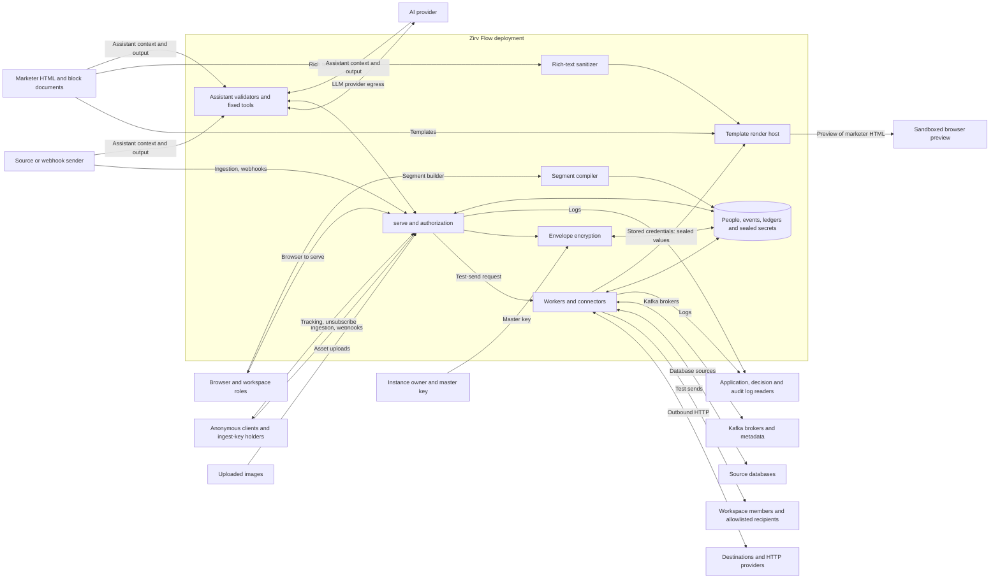

# Threat model

This page is for the operator reviewing a release candidate and for contributors changing a
trust boundary. It follows [architecture 16.1](architecture.md#161-trust-boundaries).
The evidence covers the authorization, erasure, trace and assistant parts of
[M8 criteria 1 to 4](roadmap.md#m8--beta-hardening-and-v10). A named test describes what the
suite checks; its presence here does not mean it passed on a particular deployment.

Source locations are `path:line` at the time of writing. Test links carry the exact declared
name. The documentation gate checks that the names still exist, including browser tests, and
that every architecture boundary has a section. Line numbers are historical; review the
control when its implementation changes. The operator reviews this model before the release
candidate. CI cannot accept a risk on the operator's behalf.

## Assets

| Asset | What must be protected |
| --- | --- |
| People data and the event store | Identifier values, traits, source records, event properties and derived membership must stay within the workspace and the caller's personal-data grant. Erasure must reach their copies. |
| Credentials and the master key | Connector, destination and AI credentials, OAuth tokens, webhook secrets and DKIM private keys must not appear in responses or logs. A database copy alone must not open sealed secrets. |
| HMAC root and erasure ledger | The root preserves suppression, identifier and tracking hashes through master-key rotation. The ledger must survive a database restore and prevent erased identities from returning. |
| Sessions and API keys | Bearer tokens must not confer another workspace's access. A browser session must not authorize a forged mutation. |
| Decision log and audit log | Decision records explain derived actions without personal values. Audit records preserve accountability, including opaque references retained after erasure. |
| Sending reputation | Domains, sender identities and DKIM keys authorize outbound mail. Test sends must not become an open relay. The operator remains responsible for the content and recipients of campaigns. |
| Assistant context | Catalogs, samples, saved artifacts, templates, prompts and optional transcripts can carry hostile instructions or personal data. They must not expand the model's authority. |

## Actors

| Actor | Authority and threat |
| --- | --- |
| Anonymous internet | Reaches sign-in, ingestion, webhook, tracking and public asset surfaces. Can send malformed inputs and floods; cannot assume a workspace role. |
| Holder of an ingest key | Can submit data in the key's workspace. The ingest scope alone grants no read or administrative access. Accepted payloads are still untrusted. |
| Admin | Manages members, credentials, integrations and governance, and holds the lower workspace capabilities. Can read personal data and workspace audit rows. |
| Publisher | Can edit and publish, and operate running work. Personal values need the separate grant. |
| Editor | Can read and edit working data, including eligible assistant drafts; cannot publish. Personal values need the separate grant. |
| Viewer | Can read; personal values need the separate grant. Cannot edit or publish. |
| Instance owner | Manages the instance and bypasses workspace membership checks. This is a trusted administrator, not a tenant-isolated account. |
| Malicious or compromised source | Controls incoming records, samples, schema text and remote replies. Can inject false data, hostile context or network targets. Authentication proves the sender, not the truth of its data. |
| Compromised destination or provider | Receives intended payloads and credentials. Can retain them, lie about delivery or erasure, and return hostile redirects or errors. |
| AI provider | Receives the permitted request context and returns arbitrary output. Provider selection and personal-data opt-in are administrative choices. |
| Model output | Has no independent authority. It is input to a fixed tool and deterministic validators, even when it is structurally valid. |

The role hierarchy is [`crates/zirv-flow-core/src/role.rs:43`](../crates/zirv-flow-core/src/role.rs#L43), `allows`. Workspace and key
checks are [`crates/zirv-flow-api/src/auth.rs:259`](../crates/zirv-flow-api/src/auth.rs#L259), `authorize`; personal-data grants are
[`crates/zirv-flow-api/src/auth.rs:306`](../crates/zirv-flow-api/src/auth.rs#L306), `reveals_pii`.

## Data flow

The labels name all 16 boundaries. Arrows describe data movement, not a grant of trust.
The database is inside the deployment but a stolen copy is a separate threat. The operator
keeps the master key outside that copy. Preview content crosses into an isolated browser frame.

## Boundaries

Threats use STRIDE terms: spoofing, tampering, repudiation, information disclosure, denial of
service and elevation of privilege. Priority combines reach and impact: **high** means a public
or ordinary authenticated input can reach sensitive data, authority or availability; **medium**
requires privileged configuration, a stolen database or a compromised integration. Controls
mitigate the stated attack; their limits and accepted risks remain below.

### Browser to `serve`

| Threat and priority | Control in code | Proving test |
| --- | --- | --- |
| High: session theft, forged mutations (spoofing, tampering) | [`crates/zirv-flow-api/src/session.rs:127`](../crates/zirv-flow-api/src/session.rs#L127), `started` sets the session cookie; [`crates/zirv-flow-api/src/auth.rs:220`](../crates/zirv-flow-api/src/auth.rs#L220), `check_csrf` checks the token on session mutations. Cookies are HttpOnly and SameSite=Lax; Secure follows deployment configuration. | [test: `sign_in_sets_a_hardened_cookie_and_the_session_shows_the_same_csrf_token`](../crates/zirv-flow-api/src/acceptance.rs#L285) (`crates/zirv-flow-api/src/acceptance.rs:285`); [test: `csrf_applies_to_every_mutating_method_but_not_to_reads_or_sign_in`](../crates/zirv-flow-api/src/acceptance.rs#L393) (`crates/zirv-flow-api/src/acceptance.rs:393`) |
| High: script injection into the app (tampering, disclosure) | [`crates/zirv-flow-api/src/web.rs:45`](../crates/zirv-flow-api/src/web.rs#L45), `respond` attaches the app CSP and content-type protection. The app script policy does not permit inline scripts. | [test: `the_root_serves_index_html_with_the_security_headers`](../crates/zirv-flow-api/src/web.rs#L144) (`crates/zirv-flow-api/src/web.rs:144`) |
| High: role escalation, cross-workspace reads or personal-data disclosure | [`crates/zirv-flow-api/src/auth.rs:259`](../crates/zirv-flow-api/src/auth.rs#L259), `authorize` checks workspace, role and key scope; [`crates/zirv-flow-api/src/auth.rs:316`](../crates/zirv-flow-api/src/auth.rs#L316), `may_view_pii` checks the personal-data grant. | [test: `the_rbac_matrix_holds_for_every_row_and_principal`](../crates/zirv-flow-api/src/rbac/acceptance.rs#L1039) (`crates/zirv-flow-api/src/rbac/acceptance.rs:1039`); [test: `no_seeded_personal_value_reaches_a_reader_without_the_grant`](../crates/zirv-flow-api/src/rbac/acceptance.rs#L2547) (`crates/zirv-flow-api/src/rbac/acceptance.rs:2547`) |

### Ingestion, webhooks

| Threat and priority | Control in code | Proving test |
| --- | --- | --- |
| High: forged data or use of a session as an ingest key (spoofing, tampering) | [`crates/zirv-flow-api/src/ingest/mod.rs:422`](../crates/zirv-flow-api/src/ingest/mod.rs#L422), `accept` requires an ingest key. [`crates/zirv-flow-api/src/webhooks/receive.rs:141`](../crates/zirv-flow-api/src/webhooks/receive.rs#L141), `accept` verifies the configured webhook signature before appending. | [test: `a_key_without_the_ingest_scope_is_a_403_and_stores_nothing`](../crates/zirv-flow-api/src/ingest/mod.rs#L918) (`crates/zirv-flow-api/src/ingest/mod.rs:918`); [test: `a_signed_in_session_is_a_403_even_with_a_csrf_token`](../crates/zirv-flow-api/src/ingest/mod.rs#L937) (`crates/zirv-flow-api/src/ingest/mod.rs:937`); [test: `every_signature_fault_is_a_401_problem_that_writes_nothing_and_leaks_nothing`](../crates/zirv-flow-api/src/webhooks/acceptance.rs#L496) (`crates/zirv-flow-api/src/webhooks/acceptance.rs:496`) |
| High: large bodies and floods (denial of service) | [`crates/zirv-flow-api/src/ingest/mod.rs:495`](../crates/zirv-flow-api/src/ingest/mod.rs#L495), `read_body` caps the body. [`crates/zirv-flow-api/src/ingest/mod.rs:105`](../crates/zirv-flow-api/src/ingest/mod.rs#L105), `charge` and [`crates/zirv-flow-api/src/ingest/mod.rs:121`](../crates/zirv-flow-api/src/ingest/mod.rs#L121), `charge_hook` charge per-key and per-hook buckets. These buckets are per serve process. | [test: `a_body_over_the_limit_is_a_413_whether_or_not_it_declares_its_length`](../crates/zirv-flow-api/src/ingest/mod.rs#L994) (`crates/zirv-flow-api/src/ingest/mod.rs:994`); [test: `a_key_over_its_rate_limit_gets_a_429_with_retry_after_and_stores_nothing_more`](../crates/zirv-flow-api/src/ingest/mod.rs#L1099) (`crates/zirv-flow-api/src/ingest/mod.rs:1099`); [test: `a_hook_over_its_rate_answers_429_with_retry_after_and_another_hook_is_unaffected`](../crates/zirv-flow-api/src/webhooks/acceptance.rs#L745) (`crates/zirv-flow-api/src/webhooks/acceptance.rs:745`) |
| High: malformed or schema-breaking records (tampering) | [`crates/zirv-flow-api/src/ingest/mod.rs:422`](../crates/zirv-flow-api/src/ingest/mod.rs#L422), `accept` parses the envelope before appending. [`crates/zirv-flow-store/src/events/apply.rs:199`](../crates/zirv-flow-store/src/events/apply.rs#L199), `apply_event_record` applies the event schema and workspace policy when draining. Acceptance into the inbox does not promise schema acceptance; policy may reject, flag or accept unplanned events. | [test: `an_invalid_item_is_a_400_listing_index_field_and_reason_and_nothing_is_appended`](../crates/zirv-flow-api/src/ingest/mod.rs#L1030) (`crates/zirv-flow-api/src/ingest/mod.rs:1030`); [test: `a_block_mode_wrong_type_is_rejected_with_a_masked_sample_and_no_event`](../crates/zirv-flow-store/src/events/apply.rs#L949) (`crates/zirv-flow-store/src/events/apply.rs:949`) |

### Tracking, unsubscribe

| Threat and priority | Control in code | Proving test |
| --- | --- | --- |
| High: forged unsubscribe, message enumeration or identifier disclosure in a token | [`crates/zirv-flow-core/src/tracking.rs:69`](../crates/zirv-flow-core/src/tracking.rs#L69), `verify` authenticates the kind, message id and link index with HMAC; [`crates/zirv-flow-api/src/tracking/mod.rs:67`](../crates/zirv-flow-api/src/tracking/mod.rs#L67), `admit` checks token use and rate. Tokens contain no recipient values; possession still authorizes their use. | [test: `a_tampered_byte_is_refused_wherever_it_is`](../crates/zirv-flow-core/src/tracking.rs#L124) (`crates/zirv-flow-core/src/tracking.rs:124`); [test: `the_wrong_kind_key_or_length_is_refused`](../crates/zirv-flow-core/src/tracking.rs#L140) (`crates/zirv-flow-core/src/tracking.rs:140`); [test: `the_decoded_bytes_hold_only_the_kind_the_message_and_the_index`](../crates/zirv-flow-core/src/tracking.rs#L170) (`crates/zirv-flow-core/src/tracking.rs:170`); [test: `a_message_is_rate_limited_after_a_burst`](../crates/zirv-flow-api/src/tracking/mod.rs#L961) (`crates/zirv-flow-api/src/tracking/mod.rs:961`) |
| High: attacker-selected redirect (tampering) | [`crates/zirv-flow-api/src/tracking/mod.rs:182`](../crates/zirv-flow-api/src/tracking/mod.rs#L182), `click` looks up the recorded URL for the authenticated message and index. It does not accept a redirect URL from the request. | [test: `a_click_redirects_to_the_recorded_link_only_and_records_its_index`](../crates/zirv-flow-api/src/tracking/mod.rs#L783) (`crates/zirv-flow-api/src/tracking/mod.rs:783`) |

### Outbound HTTP

| Threat and priority | Control in code | Proving test |
| --- | --- | --- |
| High: SSRF to private or metadata addresses, including alternate IP encodings | [`crates/zirv-flow-core/src/egress.rs:233`](../crates/zirv-flow-core/src/egress.rs#L233), `decide` classifies addresses and applies the CIDR allowlist. Metadata addresses require an exact entry. [`crates/zirv-flow-connectors/src/http/client.rs:98`](../crates/zirv-flow-connectors/src/http/client.rs#L98), `execute` checks literal targets and redirect locations. | [test: `a_broad_range_never_unlocks_metadata_but_the_exact_address_does`](../crates/zirv-flow-core/src/egress.rs#L480) (`crates/zirv-flow-core/src/egress.rs:480`); [test: `exotic_urls_and_redirect_locations_are_refused_and_counted`](../crates/zirv-flow-connectors/src/http/client.rs#L356) (`crates/zirv-flow-connectors/src/http/client.rs:356`) |
| High: DNS rebinding, mixed answers or credential forwarding across origins | [`crates/zirv-flow-connectors/src/http/resolver.rs:97`](../crates/zirv-flow-connectors/src/http/resolver.rs#L97), `resolve` returns checked addresses to the connection; [`crates/zirv-flow-connectors/src/http/client.rs:224`](../crates/zirv-flow-connectors/src/http/client.rs#L224), `redirect_policy` refuses cross-origin forwarding. A mixed resolution is denied as a whole. | [test: `rebinding_cannot_replace_the_checked_address_during_connect`](../crates/zirv-flow-connectors/src/http/client.rs#L316) (`crates/zirv-flow-connectors/src/http/client.rs:316`); [test: `a_mixed_set_is_denied_as_a_whole`](../crates/zirv-flow-core/src/egress.rs#L516) (`crates/zirv-flow-core/src/egress.rs:516`); [test: `a_redirect_to_another_origin_is_not_followed_and_the_other_origin_sees_nothing`](../crates/zirv-flow-connectors/src/http/client.rs#L681) (`crates/zirv-flow-connectors/src/http/client.rs:681`) |

OIDC is a separate, accepted exception below. A permitted destination can retain its payload.

### Templates

| Threat and priority | Control in code | Proving test |
| --- | --- | --- |
| High: sandbox escape or runaway evaluation (disclosure, denial of service) | [`crates/zirv-flow-templates/src/sandbox.rs:49`](../crates/zirv-flow-templates/src/sandbox.rs#L49), `environment` installs fuel, recursion and strict-undefined limits, without a filesystem loader. [`crates/zirv-flow-templates/src/sandbox.rs:150`](../crates/zirv-flow-templates/src/sandbox.rs#L150), `render_string` caps source and rendered output. | [test: `sandbox_escape_table_is_typed_or_bounded_and_checked_by_the_editor`](../crates/zirv-flow-templates/src/sandbox.rs#L306) (`crates/zirv-flow-templates/src/sandbox.rs:306`); [test: `a_loop_past_the_cap_stops_at_the_cap`](../crates/zirv-flow-templates/src/sandbox.rs#L255) (`crates/zirv-flow-templates/src/sandbox.rs:255`); [test: `fuzz_template_document`](../crates/zirv-flow-templates/src/fuzz.rs#L130) (`crates/zirv-flow-templates/src/fuzz.rs:130`) |
| High: large intermediate allocations or a stuck render (denial of service) | [`crates/zirv-flow-render/src/pool.rs:543`](../crates/zirv-flow-render/src/pool.rs#L543), `render_email_with` runs in the render pool with a deadline. [`crates/zirv-flow-render/src/host.rs:77`](../crates/zirv-flow-render/src/host.rs#L77), `run` applies the configured memory limit on Linux. Fuel and output limits alone do not bound intermediate allocation. | [test: `a_deadline_overrun_fails_that_render_and_a_respawned_child_serves_the_next`](../crates/zirv-flow-render/src/pool.rs#L979) (`crates/zirv-flow-render/src/pool.rs:979`); [test: `a_template_that_doubles_a_string_hits_the_os_limit_and_the_next_render_succeeds`](../crates/zirv-flow-render/src/pool.rs#L1092) (`crates/zirv-flow-render/src/pool.rs:1092`) |

### Rich text in blocks

| Threat and priority | Control in code | Proving test |
| --- | --- | --- |
| High: scripts, unsafe URLs and markup injected by merge values (tampering) | [`crates/zirv-flow-templates/src/content/blocks/sanitize.rs:71`](../crates/zirv-flow-templates/src/content/blocks/sanitize.rs#L71), `sanitize_source` allows only the rich-text tags, attributes and URL schemes. [`crates/zirv-flow-templates/src/content/blocks/check.rs:311`](../crates/zirv-flow-templates/src/content/blocks/check.rs#L311), `check_rich` reports unsafe source; [`crates/zirv-flow-templates/src/content/blocks/render.rs:145`](../crates/zirv-flow-templates/src/content/blocks/render.rs#L145), `rich` cleans source and rendered output. | [test: `the_sanitizer_table_removes_what_is_not_allowed_and_keeps_what_is`](../crates/zirv-flow-templates/src/content/blocks/sanitize.rs#L439) (`crates/zirv-flow-templates/src/content/blocks/sanitize.rs:439`); [test: `sanitized_output_reparses_without_disallowed_tags_attributes_or_schemes`](../crates/zirv-flow-templates/src/content/blocks/sanitize.rs#L641) (`crates/zirv-flow-templates/src/content/blocks/sanitize.rs:641`); [test: `a_merge_value_that_names_a_bad_scheme_in_a_rich_text_link_is_cleaned_after_the_render`](../crates/zirv-flow-templates/src/content/blocks/render.rs#L528) (`crates/zirv-flow-templates/src/content/blocks/render.rs:528`); [test: `fuzz_sanitize_source`](../crates/zirv-flow-templates/src/content/blocks/sanitize.rs#L673) (`crates/zirv-flow-templates/src/content/blocks/sanitize.rs:673`) |

A draft can retain invalid source for editing. Validation reports a blocking issue; it is not a
promise that every saved draft is clean. [test: `rich_text_that_the_sanitizer_would_change_is_blocking`](../crates/zirv-flow-templates/src/content/blocks/check.rs#L864) (`crates/zirv-flow-templates/src/content/blocks/check.rs:864`)
pins the validation refusal. Raw HTML and code-mode email content use the separate
preview boundary below.

### Preview of marketer HTML

| Threat and priority | Control in code | Proving test |
| --- | --- | --- |
| High: script execution, top navigation, form submission or base-URL injection in the app | [`web/src/features/templates/PreviewPane.tsx:165`](../web/src/features/templates/PreviewPane.tsx#L165), `Rendered` uses an iframe with an empty sandbox. [`web/src/ui/previewDocument.ts:5`](../web/src/ui/previewDocument.ts#L5), `previewDocument` puts the preview CSP first in the head. The frame grants neither scripts nor same-origin. | [test: `the preview has its own CSP and blocks scripts, top navigation, forms and base URLs`](../web/e2e/preview-sandbox.spec.ts#L32) (`web/e2e/preview-sandbox.spec.ts:32`) |

The email HTML itself remains the marketer's content. Browser isolation protects the app;
it does not certify content delivered to a recipient's mail client.

### Asset uploads

| Threat and priority | Control in code | Proving test |
| --- | --- | --- |
| High: disguised files, SVG script or active content served as an image | [`crates/zirv-flow-api/src/assets/upload.rs:100`](../crates/zirv-flow-api/src/assets/upload.rs#L100), `check` compares the declared raster type with [`crates/zirv-flow-api/src/assets/sniff.rs:95`](../crates/zirv-flow-api/src/assets/sniff.rs#L95), `sniff`. [`crates/zirv-flow-api/src/assets/serve.rs:25`](../crates/zirv-flow-api/src/assets/serve.rs#L25), `serve` serves the image with content-type protection and a restrictive CSP. | [test: `text_svg_and_empty_bodies_are_not_images`](../crates/zirv-flow-api/src/assets/sniff.rs#L318) (`crates/zirv-flow-api/src/assets/sniff.rs:318`); [test: `the_file_must_be_the_declared_type_and_within_the_pixel_limits`](../crates/zirv-flow-api/src/assets/upload.rs#L308) (`crates/zirv-flow-api/src/assets/upload.rs:308`); [test: `the_public_route_serves_the_bytes_with_the_ruled_headers`](../crates/zirv-flow-api/src/assets/acceptance.rs#L387) (`crates/zirv-flow-api/src/assets/acceptance.rs:387`) |
| High: oversized files or concurrent quota exhaustion (denial of service) | [`crates/zirv-flow-api/src/assets/upload.rs:72`](../crates/zirv-flow-api/src/assets/upload.rs#L72), `receive` caps bytes while streaming; [`crates/zirv-flow-store/src/assets/upload.rs:52`](../crates/zirv-flow-store/src/assets/upload.rs#L52), `store_asset` serializes quota admission. | [test: `an_image_over_the_file_limit_is_refused_by_length_and_while_streaming`](../crates/zirv-flow-api/src/assets/acceptance.rs#L264) (`crates/zirv-flow-api/src/assets/acceptance.rs:264`); [test: `two_parallel_uploads_at_the_workspace_quota_edge_admit_only_one`](../crates/zirv-flow-api/src/assets/acceptance.rs#L337) (`crates/zirv-flow-api/src/assets/acceptance.rs:337`) |

Asset URLs are public by design. Do not treat an unguessable image hash as workspace authorization.

### Test sends

| Threat and priority | Control in code | Proving test |
| --- | --- | --- |
| High: open relay or sending-reputation abuse (elevation of privilege, denial of service) | [`crates/zirv-flow-api/src/test_sends/send.rs:103`](../crates/zirv-flow-api/src/test_sends/send.rs#L103), `test_send` admits a workspace member's account email or an allowlisted address. [`crates/zirv-flow-store/src/test_sends/log.rs:185`](../crates/zirv-flow-store/src/test_sends/log.rs#L185), `reserve_test_send` enforces member and workspace quotas under a lock. | [test: `only_members_and_allowlisted_addresses_are_recipients`](../crates/zirv-flow-api/src/test_sends/acceptance.rs#L481) (`crates/zirv-flow-api/src/test_sends/acceptance.rs:481`); [test: `the_workspace_limit_holds_across_members`](../crates/zirv-flow-store/src/test_sends/log.rs#L806) (`crates/zirv-flow-store/src/test_sends/log.rs:806`); [test: `two_requests_for_the_last_slot_have_one_winner`](../crates/zirv-flow-store/src/test_sends/log.rs#L826) (`crates/zirv-flow-store/src/test_sends/log.rs:826`) |

The recipient check does not separately verify a member's email address. Membership and the
allowlist are the implemented restriction; administrators control those inputs.

### Segment builder

| Threat and priority | Control in code | Proving test |
| --- | --- | --- |
| High: SQL injection or malformed AST exhaustion (tampering, denial of service) | [`crates/zirv-flow-segments/src/compile.rs:30`](../crates/zirv-flow-segments/src/compile.rs#L30), `compile` validates the typed definition against the catalog, then lowers it with bind parameters. It accepts no raw SQL. | [test: `a_hostile_key_or_value_is_only_ever_a_parameter`](../crates/zirv-flow-segments/src/compile.rs#L443) (`crates/zirv-flow-segments/src/compile.rs:443`); [test: `fuzz_segment_ast`](../crates/zirv-flow-segments/src/fuzz.rs#L152) (`crates/zirv-flow-segments/src/fuzz.rs:152`); [test: `fuzz_segment_limits`](../crates/zirv-flow-segments/src/fuzz.rs#L157) (`crates/zirv-flow-segments/src/fuzz.rs:157`) |

### LLM provider egress

| Threat and priority | Control in code | Proving test |
| --- | --- | --- |
| High: disclosure to an unapproved model or without personal-data opt-in | [`crates/zirv-flow-api/src/assistant/dispatch.rs:137`](../crates/zirv-flow-api/src/assistant/dispatch.rs#L137), `open` selects only an enabled, configured provider/model. [`crates/zirv-flow-ai/src/request.rs:95`](../crates/zirv-flow-ai/src/request.rs#L95), `admits` checks content under the workspace privacy mode; [`crates/zirv-flow-api/src/assistant/settings.rs:224`](../crates/zirv-flow-api/src/assistant/settings.rs#L224), `put_settings` requires Admin. | [test: `a_workspace_that_is_off_or_whose_model_left_the_allowlist_is_disabled`](../crates/zirv-flow-api/src/acceptance.rs#L11433) (`crates/zirv-flow-api/src/acceptance.rs:11433`); [test: `personal_content_is_refused_without_the_opt_in_and_sent_with_it`](../crates/zirv-flow-api/src/acceptance.rs#L11394) (`crates/zirv-flow-api/src/acceptance.rs:11394`); [test: `a_schema_only_run_never_reads_the_source`](../crates/zirv-flow-api/src/assistant/acceptance.rs#L2380) (`crates/zirv-flow-api/src/assistant/acceptance.rs:2380`) |
| Medium: a configured base URL, DNS answer or redirect reaches an internal service | [`crates/zirv-flow-ai/src/http.rs:153`](../crates/zirv-flow-ai/src/http.rs#L153), `with_lookup` installs the guarded resolver, ignores environment proxies and disables redirects; [`crates/zirv-flow-ai/src/http.rs:184`](../crates/zirv-flow-ai/src/http.rs#L184), `post_json` checks literal addresses. | [test: `a_private_or_mixed_resolution_stays_blocked_when_only_loopback_is_allowlisted`](../crates/zirv-flow-ai/src/http.rs#L433) (`crates/zirv-flow-ai/src/http.rs:433`); [test: `a_redirect_is_never_followed`](../crates/zirv-flow-ai/src/http.rs#L456) (`crates/zirv-flow-ai/src/http.rs:456`); [test: `environment_proxies_are_ignored`](../crates/zirv-flow-ai/src/http.rs#L522) (`crates/zirv-flow-ai/src/http.rs:522`) |

Schema-only context is the default. A workspace opt-in permits personal content; it does not
make a provider trusted to keep or erase it. Transcripts are a separate opt-in.

### Assistant context and output

| Threat and priority | Control in code | Proving test |
| --- | --- | --- |
| High: context instructions add tools, disclose values or cause a protected write | [`crates/zirv-flow-api/src/assistant/catalog.rs:18`](../crates/zirv-flow-api/src/assistant/catalog.rs#L18), `names` bounds and fences catalog data. [`crates/zirv-flow-api/src/assistant/drafts.rs:534`](../crates/zirv-flow-api/src/assistant/drafts.rs#L534), `validate_turn` checks the one expected call before registry lookup and semantic validation. | [test: `criterion_4_security_matrix`](../crates/zirv-flow-api/src/assistant/acceptance.rs#L177) (`crates/zirv-flow-api/src/assistant/acceptance.rs:177`); [test: `criterion_4_registered_tools_of_the_wrong_kind_are_not_executed`](../crates/zirv-flow-api/src/assistant/acceptance.rs#L485) (`crates/zirv-flow-api/src/assistant/acceptance.rs:485`) |
| High: a valid-shaped artifact crosses workspaces, or a demoted user retains authority | [`crates/zirv-flow-api/src/assistant/tools/mod.rs:106`](../crates/zirv-flow-api/src/assistant/tools/mod.rs#L106), `authorize_again` checks each tool call. [`crates/zirv-flow-api/src/assistant/drafts.rs:1786`](../crates/zirv-flow-api/src/assistant/drafts.rs#L1786), `accept` rechecks the current workspace, caller, artifact and referenced objects before accepting. | [test: `criterion_4_accept_rechecks_foreign_ids_for_every_draft_kind`](../crates/zirv-flow-api/src/assistant/acceptance.rs#L530) (`crates/zirv-flow-api/src/assistant/acceptance.rs:530`); [test: `a_user_demoted_during_a_run_is_refused_at_the_next_tool_call`](../crates/zirv-flow-api/src/assistant/acceptance.rs#L2222) (`crates/zirv-flow-api/src/assistant/acceptance.rs:2222`) |

#### Server-side draft-only review

Catalog names and descriptions, saved artifacts, and template documents are untrusted input.
The prompt renderers separate product headings from fenced data in both privacy modes.
Names are limited to 200 characters after filtering control characters and fence delimiters;
each catalog list has a count limit and an omission count. Filtering never changes the registry.
Schema-only mode excludes source record values and masks personal condition literals.

The server offers exactly one tool for each draft or explain turn and checks the returned name
and call count before looking it up. Draft and explain tools validate arguments and do not write.
Accept revalidates against the current workspace. A template accept also checks sender ownership.
Invalid runs retain metadata with null content; they never store the rejected model artifact.
Transcripts are a separate, explicit opt-in and can contain rejected answers.

The complete registry is [`crates/zirv-flow-api/src/assistant/tools/mod.rs:85`](../crates/zirv-flow-api/src/assistant/tools/mod.rs#L85), `registry`.
[test: `the_registry_holds_only_read_and_draft_tools`](../crates/zirv-flow-api/src/assistant/tools/mod.rs#L144) (`crates/zirv-flow-api/src/assistant/tools/mod.rs:144`)
pins its names and effects, and [test: `tool_modules_write_nothing`](../crates/zirv-flow-api/src/assistant/tools/mod.rs#L222) (`crates/zirv-flow-api/src/assistant/tools/mod.rs:222`)
checks the tool modules for forbidden write calls. The behavioral matrix remains necessary;
a source scan alone is not proof of no side effects.

| Tool | Effect | Allowed result |
| --- | --- | --- |
| `read_source` | Read | The authorized source's structure, and bounded samples only with personal-data opt-in. |
| `draft_mapping` | Draft | A validated stream mapping. |
| `draft_manifest` | Draft | A validated HTTP source manifest. |
| `draft_segment` | Draft | A validated segment definition. |
| `explain_segment` | Read | An explanation citing the saved definition. |
| `draft_flow` | Draft | A validated flow graph and settings. |
| `explain_flow` | Read | An explanation citing the flow's nodes. |
| `explain_trace` | Read | An explanation citing decision records. |
| `draft_template` | Draft | A validated template fragment for the requested task; no sender, category or mode change. |

Tools do not publish, send, delete or change consent. The surrounding request can retain draft
and call metadata and audit rows, plus opted-in transcripts. Accepting a flow or template can
update its working draft. Accepting a mapping, manifest or segment returns the checked artifact
and marks the assistant draft accepted; it does not publish it.

The criterion-4 tests above use the same seven attack instructions across eight context sources,
all five draft tools and all three explain tools, in both privacy modes. They use production
context renderers, request builders, the gated dispatcher and turn validators. The fake model
attempts forbidden calls and foreign references, then returns a valid answer. This tests server
enforcement; it does not measure a live model's resistance. The HTTP wrong-kind test refuses
registered flow-draft and trace-explanation calls in segment runs, retains no model content and
cannot accept them. The accept test refuses foreign list, template, destination and sender
references. A manifest has no workspace references: an injected reference is an unknown field.

[test: `criterion_4_all_tables_guard_detects_protected_writes`](../crates/zirv-flow-api/src/assistant/acceptance.rs#L724) (`crates/zirv-flow-api/src/assistant/acceptance.rs:724`)
checks the guard itself with inserts into consent, suppression, message and flow-version rows
and an update to consent. The catalog-enumerated guard permits only draft, call, audit and
opted-in transcript changes. Counts and row fingerprints detect inserts, deletes and updates.

Unit evidence also includes [test: `names_filter_controls_and_fences_and_bound_unicode_length`](../crates/zirv-flow-api/src/assistant/catalog.rs#L50) (`crates/zirv-flow-api/src/assistant/catalog.rs:50`),
[test: `hostile_catalog_names_stay_in_the_fence_in_every_privacy_mode`](../crates/zirv-flow-api/src/assistant/segment_context.rs#L1098) (`crates/zirv-flow-api/src/assistant/segment_context.rs:1098`),
[test: `catalog_names_and_document_are_untrusted_in_both_privacy_modes`](../crates/zirv-flow-api/src/assistant/template_context.rs#L287) (`crates/zirv-flow-api/src/assistant/template_context.rs:287`),
and [test: `the_sender_the_category_and_the_mode_cannot_be_set`](../crates/zirv-flow-api/src/assistant/tools/draft_template.rs#L463) (`crates/zirv-flow-api/src/assistant/tools/draft_template.rs:463`).
The last test pins the fragment merge's sender/category/mode refusal in code and block modes.

The security cases in [the assistant corpus](../crates/zirv-flow-api/src/assistant/golden.json)
use the existing corpus format. Expected refusal means a safe validated artifact without the
requested side effect, or an explicit profile-disclosure refusal in an explanation. Replays use
the fake provider. Neither a replay nor row counts alone proves what a live provider will answer.

### Stored credentials

| Threat and priority | Control in code | Proving test |
| --- | --- | --- |
| Medium: a database dump exposes secrets or moved ciphertext opens under another workspace (disclosure, tampering) | [`crates/zirv-flow-core/src/secrets.rs:484`](../crates/zirv-flow-core/src/secrets.rs#L484), `seal` uses a random data key and authenticated encryption; [`crates/zirv-flow-core/src/secrets.rs:413`](../crates/zirv-flow-core/src/secrets.rs#L413), `secret_aad` binds workspace, row and purpose. [`crates/zirv-flow-core/src/secrets.rs:506`](../crates/zirv-flow-core/src/secrets.rs#L506), `open` requires the wrapping key. | [test: `a_wrong_aad_a_flipped_ciphertext_bit_and_a_flipped_wrapped_key_bit_each_fail`](../crates/zirv-flow-core/src/secrets.rs#L701) (`crates/zirv-flow-core/src/secrets.rs:701`); [test: `a_ciphertext_moved_to_another_row_or_workspace_does_not_open`](../crates/zirv-flow-store/src/secrets.rs#L631) (`crates/zirv-flow-store/src/secrets.rs:631`) |
| Medium: master-key replacement silently changes suppression or tracking identity | [`crates/zirv-flow/src/secrets.rs:68`](../crates/zirv-flow/src/secrets.rs#L68), `load_hmac_root` opens the stored root and refuses a key that cannot open it. [`crates/zirv-flow-core/src/secrets.rs:521`](../crates/zirv-flow-core/src/secrets.rs#L521), `rewrap` changes the wrapping key without changing the payload. | [test: `a_second_start_with_another_key_cannot_open_and_names_it`](../crates/zirv-flow/src/secrets.rs#L214) (`crates/zirv-flow/src/secrets.rs:214`); [test: `the_root_survives_sealing_and_a_rotation`](../crates/zirv-flow-core/src/secrets.rs#L873) (`crates/zirv-flow-core/src/secrets.rs:873`) |

Envelope encryption protects sealed secrets, not all people or event data in the database.
Master-key custody and recovery remain the operator's duty.

### Database sources

| Threat and priority | Control in code | Proving test |
| --- | --- | --- |
| Medium: an over-privileged source account modifies the source database (tampering) | [`crates/zirv-flow-connectors/src/sources/postgres.rs:223`](../crates/zirv-flow-connectors/src/sources/postgres.rs#L223), `begin_batch` opens a read-only transaction. [`crates/zirv-flow-connectors/src/sources/mysql.rs:153`](../crates/zirv-flow-connectors/src/sources/mysql.rs#L153), `options` sets read-only sessions and [`crates/zirv-flow-connectors/src/sources/mysql.rs:195`](../crates/zirv-flow-connectors/src/sources/mysql.rs#L195), `begin_batch` starts a read-only transaction. Operators should still provision read-only accounts. | [test: `a_write_inside_the_batch_transaction_is_refused_even_for_a_role_that_can_write`](../crates/zirv-flow-connectors/src/sources/postgres.rs#L1618) (`crates/zirv-flow-connectors/src/sources/postgres.rs:1618`); [test: `a_write_inside_the_batch_transaction_is_refused_even_for_a_user_that_can_write`](../crates/zirv-flow-connectors/src/sources/mysql.rs#L1799) (`crates/zirv-flow-connectors/src/sources/mysql.rs:1799`) |
| Medium: source configuration or DNS rebinding reaches an internal service | [`crates/zirv-flow-connectors/src/sources/context.rs:142`](../crates/zirv-flow-connectors/src/sources/context.rs#L142), `resolve_checked` checks every address. The PostgreSQL and MySQL `options` functions pass checked addresses to the driver while retaining the TLS hostname. | [test: `rebinding_dials_only_the_checked_address_and_rechecks_on_reconnect`](../crates/zirv-flow-connectors/src/sources/postgres.rs#L914) (`crates/zirv-flow-connectors/src/sources/postgres.rs:914`); [test: `rebinding_dials_only_the_checked_address_and_rechecks_on_reconnect`](../crates/zirv-flow-connectors/src/sources/mysql.rs#L1005) (`crates/zirv-flow-connectors/src/sources/mysql.rs:1005`) |

### Kafka brokers

| Threat and priority | Control in code | Proving test |
| --- | --- | --- |
| Medium: bootstrap, broker metadata or reconnects cause SSRF | [`crates/zirv-flow-connectors/src/sources/kafka/relay.rs:193`](../crates/zirv-flow-connectors/src/sources/kafka/relay.rs#L193), `serve` resolves and checks each connection target and connects by the checked IP. The client uses the relay for bootstrap and discovered brokers. | [test: `private_loopback_metadata_and_mixed_resolutions_are_refused_and_never_dialled`](../crates/zirv-flow-connectors/src/sources/kafka/relay.rs#L414) (`crates/zirv-flow-connectors/src/sources/kafka/relay.rs:414`); [test: `rebinding_dials_the_checked_broker_and_refuses_the_next_answer`](../crates/zirv-flow-connectors/src/sources/kafka/relay.rs#L321) (`crates/zirv-flow-connectors/src/sources/kafka/relay.rs:321`); [test: `a_broker_advertising_a_blocked_address_is_refused_and_never_dialled`](../crates/zirv-flow-connectors/src/sources/kafka/broker.rs#L517) (`crates/zirv-flow-connectors/src/sources/kafka/broker.rs:517`) |

### Logs

| Threat and priority | Control in code | Proving test |
| --- | --- | --- |
| High: personal values or credentials leak through application logs (disclosure) | [`crates/zirv-flow-api/src/assistant/dispatch.rs:448`](../crates/zirv-flow-api/src/assistant/dispatch.rs#L448), `record_usage` logs call accounting without content; [`crates/zirv-flow-core/src/secrets.rs:353`](../crates/zirv-flow-core/src/secrets.rs#L353), `SecretBytes::fmt` redacts secret formatting. Default-level privacy evidence exercises ingestion through erasure, including failures. It is not a guarantee for arbitrary debug logs or external collectors. | [test: `default_level_logs_hold_no_identifier_value_through_the_whole_privacy_scenario`](../crates/zirv-flow/src/e2e/privacy.rs#L255) (`crates/zirv-flow/src/e2e/privacy.rs:255`); [test: `the_secret_types_print_as_redacted`](../crates/zirv-flow-core/src/secrets.rs#L892) (`crates/zirv-flow-core/src/secrets.rs:892`) |
| High: decision records retain personal values or lose attribution (disclosure, repudiation) | [`crates/zirv-flow-store/src/decisions.rs:192`](../crates/zirv-flow-store/src/decisions.rs#L192), `append_decision` writes registry action/outcome/reason and typed subjects; [`crates/zirv-flow-api/src/trace.rs:87`](../crates/zirv-flow-api/src/trace.rs#L87), `assign` assigns server trace identity. The decision suite wraps database scenarios with the personal-data invariant. | [test: `decision_acceptance_suites_keep_the_invariant_on_new_database_tests`](../crates/zirv-flow/src/e2e/decisions.rs#L230) (`crates/zirv-flow/src/e2e/decisions.rs:230`); [test: `decisions_name_ids_and_codes_only`](../crates/zirv-flow-store/src/events/apply.rs#L1694) (`crates/zirv-flow-store/src/events/apply.rs:1694`); [test: `a_valid_traceparent_becomes_one_link_on_the_request_span_and_never_its_parent`](../crates/zirv-flow-api/src/trace.rs#L335) (`crates/zirv-flow-api/src/trace.rs:335`) |
| High: audit tampering, missing accountability or personal values in summaries | [`crates/zirv-flow-store/src/audit.rs:101`](../crates/zirv-flow-store/src/audit.rs#L101), `append_audit` validates summaries. The audit trigger in [`crates/zirv-flow-store/migrations/0077_audit_read_api.sql`](../crates/zirv-flow-store/migrations/0077_audit_read_api.sql) refuses updates, deletes and truncation outside controlled retention. | [test: `every_audited_route_leaves_one_row_and_every_not_audited_route_none`](../crates/zirv-flow-api/src/rbac/audit_acceptance.rs#L397) (`crates/zirv-flow-api/src/rbac/audit_acceptance.rs:397`); [test: `a_summary_with_personal_data_is_refused_and_nothing_is_written`](../crates/zirv-flow-store/src/audit.rs#L408) (`crates/zirv-flow-store/src/audit.rs:408`); [test: `update_delete_and_truncate_are_refused`](../crates/zirv-flow-store/src/audit.rs#L701) (`crates/zirv-flow-store/src/audit.rs:701`) |

The decision log has no free-form explanation field. Registry membership and the invariant
constrain writers; they do not make an opaque id anonymous or validate every arbitrary string
as nonpersonal. Keep personal values out of user-chosen graph ids and metadata too.

The trace inventory is guarded by
[test: `every_registry_row_has_a_producing_test_or_a_listed_gap`](../crates/zirv-flow/src/e2e/decisions.rs#L960) (`crates/zirv-flow/src/e2e/decisions.rs:960`)
and [test: `every_registry_row_has_a_producing_test`](../crates/zirv-flow/src/e2e/decisions.rs#L1007) (`crates/zirv-flow/src/e2e/decisions.rs:1007`).
Propagation evidence includes
[test: `an_event_crosses_the_outbox_to_a_forwarding_decision_on_its_own_trace`](../crates/zirv-flow/src/e2e/propagation.rs#L651) (`crates/zirv-flow/src/e2e/propagation.rs:651`)
and [test: `manual_retry_and_skip_keep_the_operator_decisions_but_resume_the_enrollment_cause`](../crates/zirv-flow/src/e2e/propagation.rs#L428) (`crates/zirv-flow/src/e2e/propagation.rs:428`).

## Erasure and merge

This model adds no storage table. Erasure is a control across the people, event, log and assistant
assets. [`crates/zirv-flow-store/src/privacy/erasure.rs:253`](../crates/zirv-flow-store/src/privacy/erasure.rs#L253), `erase_person` and
[`crates/zirv-flow-store/src/privacy/delete.rs:41`](../crates/zirv-flow-store/src/privacy/delete.rs#L41), `delete_person` remove the person and the merge
group's related data. [test: `no_table_holds_a_value_of_an_erased_person_outside_the_allowlist`](../crates/zirv-flow-store/src/privacy/content_scan.rs#L655) (`crates/zirv-flow-store/src/privacy/content_scan.rs:655`)
scans catalog-discovered tables, including free text and binary data, with a bystander control.
The permitted remnants are suppression hashes, ledger entries and id-only audit references.
[test: `deleting_a_merged_person_deletes_the_survivor_and_the_group`](../crates/zirv-flow-store/src/privacy/delete.rs#L568) (`crates/zirv-flow-store/src/privacy/delete.rs:568`)
pins the group behavior. Transcript matching has limits: it finds the identifier values and
forms the implementation recognizes, not every possible paraphrase of a person.

[`crates/zirv-flow-jobs/src/kinds/privacy_erase.rs:123`](../crates/zirv-flow-jobs/src/kinds/privacy_erase.rs#L123), `declares_erase` selects destinations with
erase support. [test: `only_the_destinations_that_declare_erase_receive_one_call_with_a_stable_key`](../crates/zirv-flow/src/e2e/privacy.rs#L503) (`crates/zirv-flow/src/e2e/privacy.rs:503`)
checks the calls and stable idempotency keys. A provider's response is not proof that it erased
its own copies. Backups retain old data until the operator ages them out. Ledger replay prevents
restored matched identities from returning; see [backup and restore](operations/backup-restore.md).
[test: `an_erased_person_stays_erased_after_the_restore_and_the_replay_applies_a_later_erasure`](../crates/zirv-flow/src/e2e/restore.rs#L343) (`crates/zirv-flow/src/e2e/restore.rs:343`)
covers the restore and replay path. The ledger holds hashes, so replay cannot rediscover every
value-only copy that an erasure removed from the live database.

## Dependency and parser evidence

Compromised dependencies can run with the application's or build's authority. The dependency job
in [CI](../.github/workflows/ci.yaml) runs the policy in [deny.toml](../deny.toml) and the production
web dependency audit. [The dependency policy check](../scripts/check-dependency-policy.sh)
requires pinned Docker image digests and a documented review for each advisory ignore; its
`--self-test` mode exercises passing and failing fixtures. The two accepted advisory exceptions
are below. A dependency audit finds known advisories; it does not establish that code is safe.

The AST, template and sanitizer properties are named at their boundaries. The manifest parser
also has [test: `fuzz_manifest`](../crates/zirv-flow-connectors/src/manifest/fuzz.rs#L63) (`crates/zirv-flow-connectors/src/manifest/fuzz.rs:63`) and
[test: `fuzz_manifest_limits`](../crates/zirv-flow-connectors/src/manifest/fuzz.rs#L68) (`crates/zirv-flow-connectors/src/manifest/fuzz.rs:68`).
The bounded nightly [fuzz workflow](../.github/workflows/fuzz-nightly.yml) complements those
properties. Finite fuzz runs do not exhaust the input space.

## Accepted risks

| Risk | Reason and owner | Revisit when |
| --- | --- | --- |
| OIDC provider calls sit outside the common egress policy. | The operator configures the issuer; discovery supplies trusted token and JWKS endpoints. [`crates/zirv-flow-identity/src/oidc.rs:40`](../crates/zirv-flow-identity/src/oidc.rs#L40), `new` disables redirects. [test: `request_values_cannot_replace_the_configured_identity_provider`](../crates/zirv-flow-identity/src/oidc.rs#L303) (`crates/zirv-flow-identity/src/oidc.rs:303`) pins request-value isolation. | Issuer selection becomes request-controlled, discovery trust changes, or redirects are enabled. |
| The RustSec ignore retains vulnerable transitive code. | Maintainers reviewed restricted production usage: OIDC verifies public-key signatures; DKIM signing uses ring. The exact exposure, review dates and exit condition for RUSTSEC-2023-0071 are in [the security policy](../SECURITY.md#known-advisories). | Before the release candidate, on dependency or cryptographic-use changes, or when an affected path can be upgraded or removed. Remove the ignore once its affected path is gone or fixed. |
| The instance owner can see every workspace's metadata and has broader workspace access. Workspace audit is Admin-only, including the owner; instance audit is owner-only. | The operator is the deployment trust root. Workspace audit may reveal sensitive activity, so ordinary readers do not receive it. This follows the audit access decision and ruling e3c37d2b; the owner bypass is in `authorize` above. [test: `the_workspace_audit_routes_are_for_admins_and_the_owner`](../crates/zirv-flow-api/src/audit/acceptance.rs#L217) (`crates/zirv-flow-api/src/audit/acceptance.rs:217`) and [test: `the_instance_audit_routes_are_for_the_owner_only`](../crates/zirv-flow-api/src/audit/acceptance.rs#L259) (`crates/zirv-flow-api/src/audit/acceptance.rs:259`) pin access. | The deployment needs isolation from its owner or a separate audit-reader role. |
| Audit rows retain opaque person ids after erasure. | Ruling e3c37d2b preserves accountability. These are references, not anonymous data; the operator must restrict access and retention. | Audit content changes, ids become resolvable through another retained dataset, or the retention decision changes. |
| Master-key custody belongs to the operator. | A database plus the key defeats protection of sealed values; losing the key loses the stored HMAC root and credentials. The [secrets guide](operations/secrets.md) records the consequences and recovery. | Key storage, backup, operator access or the recovery procedure changes. |
| A compromised destination sees and may retain what is sent. | Sending requires disclosing the selected payload. The operator chooses the destination and its credentials; egress checks constrain reach, not the recipient's conduct. Erase calls are requests, not evidence of downstream deletion. | A provider changes, payload scope expands, or the operator needs a stronger deletion guarantee. |
| Backups age out erased data rather than being rewritten by erasure. | The operator owns backup storage and retention (#404). Restore requires the current ledger and replay before service resumes. Value-only copies outside hash matching remain limited by their retention windows. | Backup retention exceeds the operator's obligations, a restore can bypass replay, or ledger coverage changes. |

## Keeping the evidence current

Run `bash scripts/check-threat-model.sh` and `bash scripts/check-threat-model.sh --self-test`.
CI runs both. The first checks exact test declarations in the cited source files and coverage of
all architecture 16.1 rows; the second proves that missing or renamed tests and boundary sections
fail. Neither runs the cited tests. The ordinary Rust, database and browser CI jobs own execution.

Every boundary above has named test evidence. No test-less boundary is currently listed.
When adding a threat whose control lacks a test, record the gap next to that row as
`tracked in #<issue number>` and assign the issue to M8. Pending issue numbers use `#TBD-n`
until assigned. Revisit accepted risks and the diagram whenever a boundary or data flow changes.
